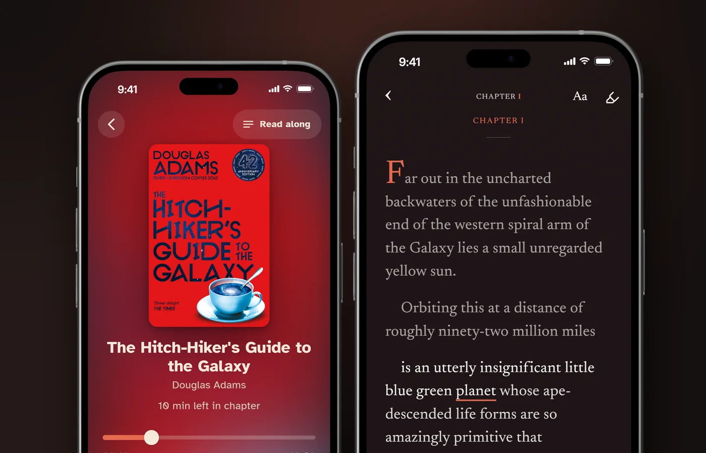
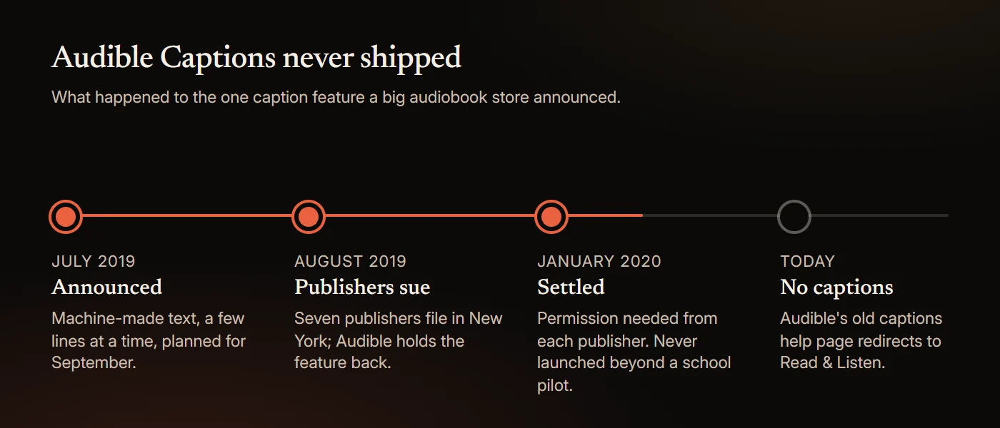
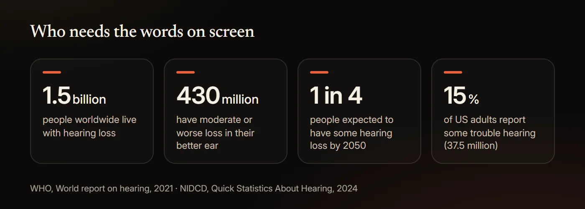

# Audiobooks With Captions: How to Get Subtitles on Any Audiobook

Most audiobooks do not come with captions. Audible, Spotify, Libby, Apple Books and hoopla show no text for the narration, and Audible's own captions feature, announced in July 2019, was challenged by seven publishers and never launched. You can still get captions three ways. If you own both the Audible audiobook and the Kindle ebook, Audible Read & Listen highlights the ebook text as the narrator reads. Any iPhone 11 or later and most recent Android phones can caption the audio of any app with Live Captions, a few lines at a time. And for audiobook files you own, a read-along app such as HushBook transcribes the recording on your phone and shows every word as it is spoken, which is a caption track for the whole book.

This guide covers what each service offers, how to turn on the phone-level captions, which apps caption your own files, and what the research says about who captions help. Every service detail below was read from the company's own help pages or store listing on November 3, 2026.

## Do audiobooks come with captions or subtitles?

No, not from the big services. An audiobook is sold as audio only. The words belong to the ebook, which is a separate product with a separate licence, so the player apps have nothing to show.

| Service | Text or captions for audiobooks | What it offers instead |
|---|---|---|
| Audible | No captions. Read & Listen shows the Kindle ebook, if you own both editions | Immersion reading on 800,000+ titles with a Read & Listen badge |
| Spotify | None. Transcripts are a podcast feature | Page Match syncs your place with a print book or ebook, using the camera |
| Libby | None. The only audiobook setting is speed | Read-alongs: narrated children's ebooks, with highlighting on some |
| Apple Books | None | Skip, chapters, speed, sleep timer |
| hoopla | None. Closed captions apply to its videos only | Speed and bookmarks |
| Storytel | Synced Listening on part of the catalogue, in some markets | Not sold in the US under the Storytel name |

Spotify's audiobook help page lists what the Now Playing view gives you: speed, 15-second skips, a sleep timer, downloads and "extra material". No text. A Spotify community thread titled "Transcripts for audiobooks" has been open since December 2024, with the last reply in June 2026. Libby's accessibility page offers one audiobook setting, speed from 0.6x to 3x, and none of its help articles mention captions. Apple's guide to audiobooks in the Books app covers skipping, chapters, speed, the sleep timer and AirPlay. hoopla's FAQ explains how to turn on subtitles while playing a video, and says nothing of the kind for audiobooks. If you want the text of a book you only own as audio, see [do audiobooks come with text](/audiobook-with-text) for the short version, or keep reading for the long one.

## Does Audible have closed captions?

No. Audible has no captions or subtitles setting in its app, and the help page it once published for the feature now redirects to the Read & Listen article.

The history explains why. On July 31, 2019, Audible demonstrated Audible Captions, "a soon-to-launch technology that will provide, at user request, machine-generated transcriptions" of the audio. The text was "displayed progressively, and only a few lines at a time, while audio is playing", it was "designed with students in mind", and it was due in September 2019 for the start of the school year. The Authors Guild called it "outright, willful copyright infringement". On August 23, 2019, Chronicle Books, Hachette, HarperCollins, Macmillan, Penguin Random House, Scholastic and Simon & Schuster sued Audible in the Southern District of New York, and Audible agreed to hold the feature back from their titles while the court considered an injunction. The parties told the court on January 13, 2020 that they had "resolved their disputes". Under the settlement Audible "agreed that it will obtain permission from any AAP members" before captioning their books. By March 2020, Publishers Weekly reported that the program "never launched" beyond a pilot of public domain works for a group of high school students, and that there were "no plans to expand" it.

Today the old help address, "is the Audible Captions feature available", answers with a redirect to "Learn about Read & Listen", which does not mention captions. Audible's accessibility page lists "Listen while you read" with a Kindle and says nothing about captions, transcripts or deaf listeners. Some sites say Audible has a subtitles toggle. A Speechify post from 2023 tells readers to tap a gear icon and "select 'Subtitles and Captions' and toggle the switch on or off". Audible's own help pages describe no such setting, and the Speechify article itself now redirects to the Speechify homepage.

What Audible does offer is Read & Listen. Its help page is direct: "To use Read & Listen, you'll need both the audiobook and Kindle eBook in your Audible and Kindle libraries." With both, the Kindle text appears while the audio plays and "the text highlights as the narrator reads", which Audible calls immersion reading. Audible expanded it on October 26, 2026 to "more than 800,000 English and German-language titles", live in the US, UK, Germany and Australia and rolling out to Canada, India, France, Italy, Spain, Japan and Brazil. It is a good answer for books you buy twice from Amazon. It is not captions on the audiobook you already own. We cover the setup in [can you read along with Audible](/blog/can-you-read-along-with-audible).

## Can you get subtitles on Spotify, Libby or Apple Books audiobooks?

No on all three, as of November 2026.

- **Spotify.** Audiobooks have no transcript. The transcripts you may have seen in the app belong to podcasts: Spotify's creator help says "Some shows have auto-generated episode transcripts." Spotify's Page Match, launched in February 2026, uses the phone camera to find your place in a print book or ebook and jump the audiobook there. It moves your position; it shows no words. More in [can you read along with Spotify audiobooks](/blog/can-you-read-along-with-spotify-audiobooks).
- **Libby.** No captions on audiobooks. OverDrive's read-alongs are "narrated ebooks" made so "developing readers can independently enjoy ebooks", with "text highlighted as the narrator reads (offered by some publishers)". They are children's titles, not a caption switch for the adult catalogue. See [can Libby read to you](/blog/can-libby-read-to-you).
- **Apple Books.** No transcript or captions in the Books app. The one thing an iPhone can do is caption the audio at the system level, which is the next section.

## Can Live Captions on iPhone or Android caption an audiobook?

Yes, roughly. Both phones can transcribe the audio of any app in real time and show it in a floating caption box. It is a useful stopgap. It is not a reading experience.

**iPhone.** Apple's Live Captions "follow the audio in any app, such as FaceTime or Podcasts". Open Settings, tap Accessibility, tap Live Captions and turn it on, then tap the Live Captions button and choose iPhone Audio while the book plays. It needs an iPhone 11 or later. When it arrived in iOS 16 it was marked beta and limited to US and Canadian English; Apple's current feature list names 18 languages and regions, including six kinds of English, French, German, Japanese, Korean, Spanish and Chinese. Apple adds a caution: "The accuracy of Live Captions may vary and shouldn't be relied upon in high-risk or emergency situations."

**Android.** Google's Live Caption works "on media like videos, podcasts, phone calls, video calls, and audio messages". Press a volume button, then tap More under the volume slider, then Live Caption. It runs in English on Pixel 2 and 3, in seven languages on Pixel 4 and 5 and selected phones, and in 15 languages on Pixel 6 and later. Everything is processed on the phone and "never stored or sent to Google". Two limits from Google's own page: "Captions might be unavailable for some media and calling apps" and "Live Caption doesn't work on music."

**Windows.** If you listen on a PC, Windows 11 version 22H2 and later has live captions under Settings, Accessibility, Captions. It works offline and supports 21 languages.

What the system captions cannot do is the part that matters for a book. They show a few lines and then they are gone. You cannot scroll back to the sentence you missed, the text is not saved, nothing is tied to the audio position, and names come out wrong with no way to correct them. For a ten-hour novel you want the whole text on a page that stays in sync, which is why a read-along app is the better route for files you own. HushBook keeps the full transcript on the page, and a long press on any line plays from there.

## Which audiobook apps show captions for any file?

A short list, because few apps do this. Everything below was read from the official site or store listing on November 3, 2026. Prices are in US dollars.

| App | Platforms | Where the words come from | Works with your own files | Price |
|---|---|---|---|---|
| **HushBook** | iPhone, iPad, Android | Transcribed from the audio on your phone; every word highlighted as it is spoken | Yes: MP3, M4A, M4B, AAC, FLAC, OGG, WAV and more, plus free LibriVox and Internet Archive classics | Free; Pro adds extras |
| Bloox | iPhone, iPad, Apple Watch | Transcribed on the device, English only | Yes: M4B and MP3 | Free |
| SubRead | Android (F-Droid) | Your ebook, aligned sentence by sentence to the audio; exports .srt | Yes, if you also have the ebook | Free, open source |
| Storyteller | Your own server, plus iOS and Android apps | Your ebook, aligned to the audio on your server | Yes, if you also have the ebook | Free, open source |
| WorkAudioBook | Windows, Android | A subtitle file you supply, split into phrases | Yes, with an .srt file | Android $4.95; Windows paid since 2022, free for 10 minutes a day |
| Clearly Audiobooks | iPhone, iPad | Its own 20-hour catalogue of books that sync voice, text and a speaker's lips, for hearing training | No | Full Access $5.99 or $59.99, subscription |
| Audible Read & Listen | Audible app | The Kindle ebook, bought separately | No | Both editions |

Three different mechanisms are hiding in that table. HushBook and Bloox transcribe the recording itself, so they work on any file with nothing else needed. SubRead and Storyteller line the audio up with an ebook you already own, so the words are exact but you need both editions. WorkAudioBook and the Audible route need a second product too, a subtitle file or the Kindle book. If you only have the audiobook, transcription is the only option, and it is the one that works for the public domain classics in HushBook's free library, where no ebook purchase is needed either. For a wider comparison that includes the Kindle and Storytel routes, see the [best apps to read and listen at the same time](/blog/best-apps-to-read-and-listen-at-the-same-time).

## How do you add captions to an audiobook you already own?

Three routes, from easiest to most technical.

**1. On your phone, with a read-along app.** Import the file into HushBook, choose Transcribe book, and listen while the chapters unlock one by one. The whole book is transcribed on the phone, so nothing is uploaded, and from then on the words scroll with the narration. Downloads from the built-in LibriVox and Internet Archive catalogue queue transcription automatically. On iOS, Bloox does the same for English M4B and MP3 files.

**2. On a computer, with Whisper.** OpenAI's Whisper and the whisper.cpp port are free under the MIT licence, and both write SRT and VTT subtitle files straight from an audio file. A ten-hour book takes a while on a laptop, and you then need a player that shows subtitles with audio. WorkAudioBook does that on Windows and Android, and SubRead Overlay on Android "shows the lines of a subtitle file (.srt) over the app that plays your audiobook". This route gives you a file you can keep and edit.

**3. Live captions while you listen.** The iPhone, Android and Windows captions above. Nothing to set up and nothing saved.

What you cannot do is caption a copy-protected book. Audible's conditions of use, updated November 2, 2026, say you may not "attempt to disable, bypass, modify, defeat, or otherwise circumvent any digital rights management". Libby and hoopla loans and Apple Books and Spotify purchases are protected the same way, so none of the apps above can open them. Recordings from LibriVox are the opposite case. LibriVox says "anyone can use all our recordings however they wish (even to sell them)", so transcribing, sharing or editing their text is fine. Our guide to the [best LibriVox apps](/blog/best-librivox-app) covers that catalogue.

## Do captions help if you are hard of hearing?

Yes, and the group is far larger than most people think.

The World Health Organization's 2021 World Report on Hearing puts it this way: "Hearing loss currently affects more than 1.5 billion people worldwide, of whom 430 million have moderate or higher levels of hearing loss in the better hearing ear." WHO expects "nearly 2.5 billion people worldwide, or 1 in 4 people" to be living with some degree of hearing loss by 2050. In the US, the National Institute on Deafness and Other Communication Disorders reports that "approximately 15% of American adults (37.5 million) ages 18 and over report some trouble hearing", a figure from the 2012 National Health Interview Survey.

Web accessibility standards treat text as the alternative to audio. The Web Content Accessibility Guidelines require, at their lowest level, an alternative "that presents equivalent information for prerecorded audio-only content", and the guidance explains who it is for: "People who are deaf, are hard of hearing, or who are having trouble understanding audio information for any reason can read the text presentation." Those rules cover web content, not audiobook stores, and they carve out audio that is itself an alternative to a text, which an audiobook of a print book can be. So no rule forces a store to caption its audiobooks. The principle still stands: the words are the accessible version.

The lab evidence is about short sentences in noise rather than novels, and it is encouraging. In a 2009 study in Ear & Hearing, Zekveld and colleagues tested 22 young adults, 22 middle-aged adults with normal hearing and 30 middle-aged adults with hearing loss, listening to sentences in noise with text from a speech recogniser on screen. The text, at roughly 74% accuracy, gave about a 2 dB signal-to-noise benefit, and the benefit held "regardless of age and hearing loss". In an earlier 2008 study by the same group, with 14 to 24 young listeners per experiment, imperfect machine text improved the speech reception threshold by about 3 dB, which the authors equate to "an increase in speech comprehension of about 35% in critical conditions". Delaying the text cut the gain. There is a counterweight from the same lab: in a 2008 evaluation of a captioned telephone system, 20 hearing-impaired users given delayed captions at 60% to 70% accuracy found "the erroneous text" difficult, and benefit was only felt at 80% to 90% accuracy with no delay. Accuracy and timing matter.

HushBook's Low Vision profile is built for the people who need the text big. The app describes it as "larger captions, stronger contrast, bold text, and accessible font choices", with the Atkinson Hyperlegible typeface among them. None of this is a medical tool. If your hearing is changing, an audiologist is the person to see; captions just let you keep the books.

## Do captions help with focus, accents or noisy places?

The best evidence comes from video, and it says yes.

Gernsbacher's 2015 review in Policy Insights from the Behavioral and Brain Sciences summarises it: "More than 100 empirical studies document that captioning a video improves comprehension of, attention to, and memory for the video." She finds captions "particularly beneficial for persons watching videos in their non-native language, for children and adults learning to read, and for persons who are D/deaf or hard of hearing." A 2022 meta-analysis by Reynolds and colleagues pooled 20 studies of language learners watching captioned video and found a large effect on vocabulary (an effect size of 0.88), largest of all for same-language captions (1.73, from five studies). If you listen in a second language, [learning English with audiobooks](/blog/learn-english-with-audiobooks) covers the reading-while-listening research.

Accents are a special case with a neat study behind them. In 2009, Mitterer and McQueen had 121 Dutch students watch clips of Scottish or Australian English. Afterwards the students repeated new clips in the same accent better when they had watched with English subtitles, and worse when the subtitles had been in Dutch. Same-language captions taught them the accent. If a narrator's accent is the thing between you and a book, captions are the fix.

For attention, the audiobook problem is well documented. In a 2013 study of 211 students, Varao Sousa, Carriere and Smilek found minds off task at about half of the check-ins while listening (0.51), against about a third (0.36) during silent reading. Seeing the words gives your eyes a job and shows you where you drifted; [how to focus on audiobooks](/blog/how-to-focus-on-audiobooks) goes through the rest. Adesope and Nesbit's 2012 meta-analysis of 57 studies found that spoken plus written text beat spoken text alone, most of all for "system-paced" and "picture-free" material, which describes an audiobook exactly. It did no better than written text alone, so captions are not magic; they bring listening up to reading.

Hearing people already use captions in large numbers. In a YouGov poll of 1,000 US adults in July 2023, 63% of adults under 30 preferred subtitles on, against 38% overall, and the reasons people gave were comprehension (40%), accents (40%), noisy environments (33%) and hearing difficulties (30%). A 2022 survey by the tutoring company Preply, of 1,265 Americans, found half used subtitles most of the time and 70% of Gen Z did. These are opt-in polls and a vendor survey, so treat them as a sign of demand, not proof of benefit.

## What the evidence does not show

- The caption studies use video, and mostly language learners and students. Nobody has measured captions on a ten-hour audiobook.
- No study has tested word-level audiobook captions with hard-of-hearing adults. The closest evidence is lab work with short sentences in noise.
- Accuracy and timing change the result. Benefit rose with transcript accuracy and fell with delay, and hearing-impaired users found error-filled text effortful. A machine transcript of a novel will have errors, especially on names.
- Following the words does not help everyone. In Adesope and Nesbit's analysis, spoken plus written text did no better than written alone. In a 2025 study of 76 undergraduates (38 with ADHD and 38 without), Moussaoui and colleagues found that showing one word at a time in the centre of the screen improved comprehension for students with ADHD by almost 13% relative to controls, while showing one word at a time in its usual place, with the rest of the page hidden, did not. That study used no audio. More in [are audiobooks good for ADHD](/blog/are-audiobooks-good-for-adhd).
- The usage numbers are self-reported, from an opt-in panel and a vendor survey. They show that people want captions, not what captions do for them.
- Service features change. The Audible, Spotify, Libby, Apple, hoopla, Google and Microsoft details above were read on November 3, 2026.

## Captions for any audiobook in HushBook

[HushBook](/) is an audiobook player for iPhone and Android that shows the words as the narrator reads them. It transcribes the recording on your phone and highlights each word as it is spoken, so the whole book is on screen, in sync, and a long press on any line plays from there. The text size, font, spacing and theme are adjustable while the audio plays, and the Low Vision profile turns on larger captions with stronger contrast. Free public domain classics from LibriVox and the Internet Archive are built in, so you can try it without owning a single audiobook. Nothing is uploaded, and there is no account and no ads.

Honest limits. The words come from speech recognition, so unusual names and invented words can come out wrong, and a heavy accent or a noisy recording lowers accuracy. HushBook plays files you can import, such as MP3, M4A and M4B, and its free library. It cannot import copy-protected books from Audible, Libby, hoopla, Apple Books or Spotify. Transcribing a long book on the phone takes time; you can listen while it works, and chapters unlock as they finish.

## Sources

- [Audible (2019), "Audible Captions: A Demonstration", Audible Newsroom](https://audible.co.uk/about/newsroom/audible-captions-a-demonstration)
- [Authors Guild (2019), "Statement from the Authors Guild on Audible's New Caption Feature"](https://authorsguild.org/news/statement-from-the-authors-guild-on-audibles-new-caption-feature/)
- [Publishers Weekly (2019), "AAP Suit Seeks to Block Implementation of Audible Captions"](https://www.publishersweekly.com/pw/by-topic/industrynews/publisher-news/article/81000-aap-suit-seeks-to-block-implementation-of-audible-captions.html)
- [Anderson (2019), "US Publishers' Lawsuit of Amazon's Audible: 'Captions' Delayed", Publishing Perspectives](https://publishingperspectives.com/2019/08/american-publishers-lawsuit-amazon-audible-captions-rollout-delayed/)
- [Albanese (2020), "Audible, Publishers Say They've Settled 'Captions' Lawsuit", Publishers Weekly](https://publishersweekly.com/pw/by-topic/digital/copyright/article/82166-audible-publishers-say-they-ve-settled-captions-lawsuit.html)
- [AAP (2020), "Statement of AAP President & CEO Maria Pallante on Chronicle Books, et al., vs Audible Inc."](https://publishers.org/news/statement-of-aap-president-ceo-maria-pallante-on-chronicle-books-et-al-vs-audible-inc/)
- [Albanese (2020), "Settlement Terms Revealed (Mostly) in Audible Captions Litigation; Judge Signs Off", Publishers Weekly](https://publishersweekly.com/pw/by-topic/digital/copyright/article/82598-settlement-terms-revealed-mostly-in-audible-captions-litigation.html)
- [Audible (2026), "Audible's Read & Listen Experience Comes to More Listeners Around the Globe", Audible Newsroom](https://www.audible.com/about/newsroom/audibles-read-and-listen-experience-comes-to-more-listeners-around-the-globe)
- [Audible Help, "Learn about Read & Listen"](https://help.audible.com/s/article/listen-with-whispersync-for-voice)
- [Audible Help, "What is immersion reading?"](https://help.audible.com/s/article/what-is-immersion-reading)
- [Audible, "Accessibility at Audible"](https://www.audible.com/ep/accessibility)
- [Audible, "Conditions of Use"](https://www.audible.com/legal/conditions-of-use)
- [Weitzman (2023), "Does Audible have subtitles?", Speechify (Wayback Machine copy)](http://web.archive.org/web/20260421040703/https://speechify.com/blog/does-audible-have-subtitles/)
- [Spotify Support, "Unlock Audiobooks"](https://support.spotify.com/us/article/audiobooks/)
- [Spotify for Creators, "Managing episode transcripts on Spotify"](https://support.spotify.com/us/creators/article/managing-episode-transcripts-on-spotify/)
- [Spotify Community, "Transcripts for audiobooks"](https://community.spotify.com/t5/Other-Podcasts-Partners-etc/Transcripts-for-audiobooks/td-p/6586356)
- [Spotify Newsroom (2026), "How to Use Page Match to Seamlessly Switch Between a Book and Its Audiobook on Spotify"](https://newsroom.spotify.com/2026-02-05/page-match-how-to/)
- [Libby Help, "Customizing Libby to meet your needs"](https://help.libbyapp.com/en-us/6243.htm)
- [OverDrive Resource Center, "OverDrive Read-Alongs"](https://resources.overdrive.com/library/libby-features/overdrive-read-alongs/)
- [Apple Support, "Listen to audiobooks in the Books app on iPhone"](https://support.apple.com/guide/iphone/listen-to-audiobooks-iphac1971248/ios)
- [Apple Support, "Get live captions of spoken audio on iPhone"](https://support.apple.com/guide/iphone/get-live-captions-of-spoken-audio-iphe0990f7bb/ios)
- [Apple Support, "Get live captions in real time on iPhone" (iOS 16 guide)](https://support.apple.com/guide/iphone/iphe0990f7bb/16.0/ios/16.0)
- [Apple, "iOS and iPadOS 27 Feature Availability"](https://www.apple.com/ios/feature-availability/)
- [Android Accessibility Help, "Live Caption: Caption media & calls on your device"](https://support.google.com/accessibility/android/answer/9350862?hl=en)
- [Microsoft Support, "Use live captions to better understand audio"](https://support.microsoft.com/en-us/accessibility/windows/use-live-captions-to-better-understand-audio)
- [hoopla, "Find hoopla support, help, and FAQs"](https://www.hoopladigital.com/faq)
- [App Store, "Bloox - M4B Audiobook Player"](https://apps.apple.com/us/app/bloox-m4b-audiobook-player/id6759511972)
- [F-Droid, "SubRead"](https://f-droid.org/en/packages/space.subread.app/)
- [F-Droid, "SubRead Overlay"](https://f-droid.org/en/packages/space.subread.overlay/)
- [Storyteller, "Storyteller Docs"](https://storyteller-platform.dev/)
- [WorkAudioBook, "Audio Player for Language Learners"](http://www.workaudiobook.com/)
- [WorkAudioBook, "WorkAudioBook for Windows - License and Activation"](http://www.workaudiobook.com/WorkAudioBook/How-to-activate(Windows).aspx)
- [Google Play, "Repeat player WorkAudioBook"](https://play.google.com/store/apps/details?id=com.povalyaev.WorkAudioBook)
- [App Store, "Clearly Audiobooks App"](https://apps.apple.com/us/app/clearly-audiobooks/id1608953900)
- [Storytel (2025), "Storytel launches innovative product features to elevate the user experience"](https://storage.mfn.se/43472b75-0186-4bdc-9ec6-825a5966a81d/storytel-launches-innovative-product-features-to-elevate-the-user-experience.pdf)
- [Storytel Group (2026), "Interim report January–March 2026"](https://www.storytelgroup.com/en/wp-content/uploads/sites/2/2021/10/interim-report-january-march-2026-260428.pdf)
- [GitHub, "openai/whisper"](https://github.com/openai/whisper)
- [GitHub, "ggml-org/whisper.cpp"](https://github.com/ggml-org/whisper.cpp)
- [LibriVox, "Public Domain"](https://librivox.org/pages/public-domain/)
- [WHO (2021), "World report on hearing: executive summary"](https://cdn.who.int/media/docs/default-source/documents/health-topics/deafness-and-hearing-loss/world-report-on-hearing/wrh-executive-summary2-en.pdf)
- [WHO (2021), "WHO: 1 in 4 people projected to have hearing problems by 2050"](https://www.who.int/news/item/02-03-2021-who-1-in-4-people-projected-to-have-hearing-problems-by-2050)
- [NIDCD (2024), "Quick Statistics About Hearing, Balance, & Dizziness"](https://www.nidcd.nih.gov/health/statistics/quick-statistics-hearing)
- [W3C (2024), "Web Content Accessibility Guidelines (WCAG) 2.2", Success Criterion 1.2.1](https://www.w3.org/TR/WCAG22/#audio-only-and-video-only-prerecorded)
- [W3C WAI, "Understanding Success Criterion 1.2.1: Audio-only and Video-only (Prerecorded)"](https://www.w3.org/WAI/WCAG22/Understanding/audio-only-and-video-only-prerecorded.html)
- [Zekveld, Kramer, Kessens, Vlaming and Houtgast (2009), "The Influence of Age, Hearing, and Working Memory on the Speech Comprehension Benefit Derived from an Automatic Speech Recognition System", Ear & Hearing](https://doi.org/10.1097/aud.0b013e3181987063)
- [Zekveld, Kramer, Kessens, Vlaming and Houtgast (2008), "The Benefit Obtained from Visually Displayed Text from an Automatic Speech Recognizer During Listening to Speech Presented in Noise", Ear & Hearing](https://doi.org/10.1097/AUD.0b013e31818005bd)
- [Zekveld and colleagues (2008), "User Evaluation of a Communication System That Automatically Generates Captions to Improve Telephone Communication", Trends in Amplification](https://doi.org/10.1177/1084713808330207)
- [Gernsbacher (2015), "Video Captions Benefit Everyone", Policy Insights from the Behavioral and Brain Sciences](https://doi.org/10.1177/2372732215602130)
- [Reynolds and colleagues (2022), "Vocabulary Acquisition through Viewing Captioned and Subtitled Video: A Scoping Review and Meta-Analysis", Systems](https://doi.org/10.3390/systems10050133)
- [Mitterer and McQueen (2009), "Foreign Subtitles Help but Native-Language Subtitles Harm Foreign Speech Perception", PLoS ONE](https://doi.org/10.1371/journal.pone.0007785)
- [Varao Sousa, Carriere and Smilek (2013), "The way we encounter reading material influences how frequently we mind wander", Frontiers in Psychology](https://doi.org/10.3389/fpsyg.2013.00892)
- [Adesope and Nesbit (2012), "Verbal redundancy in multimedia learning environments: A meta-analysis", Journal of Educational Psychology](https://doi.org/10.1037/a0026147)
- [Moussaoui, Siddiqi, Cheung and Niemeier (2025), "Reading without eye movements: Improving reading comprehension in young adults with attention-deficit/hyperactivity disorder (ADHD)", Journal of the International Neuropsychological Society](https://doi.org/10.1017/s1355617725101628)
- [YouGov (2023), "Most American adults under 30 prefer watching TV with subtitles — even when they know the language"](https://yougov.com/en-us/articles/45987-american-adults-under-30-watching-tv-subtitles)
- [Preply (2022), "Survey: Why America Is Obsessed with Subtitles"](https://preply.com/en/blog/americas-subtitles-use)
