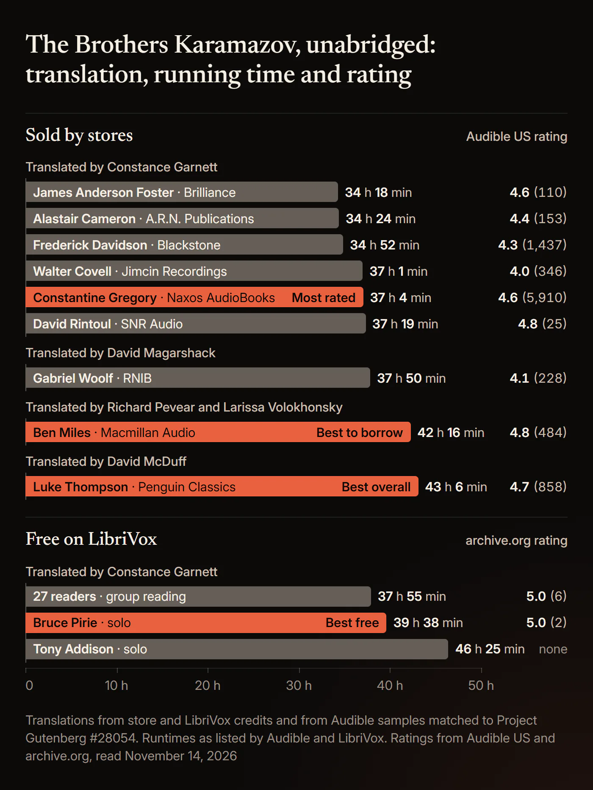
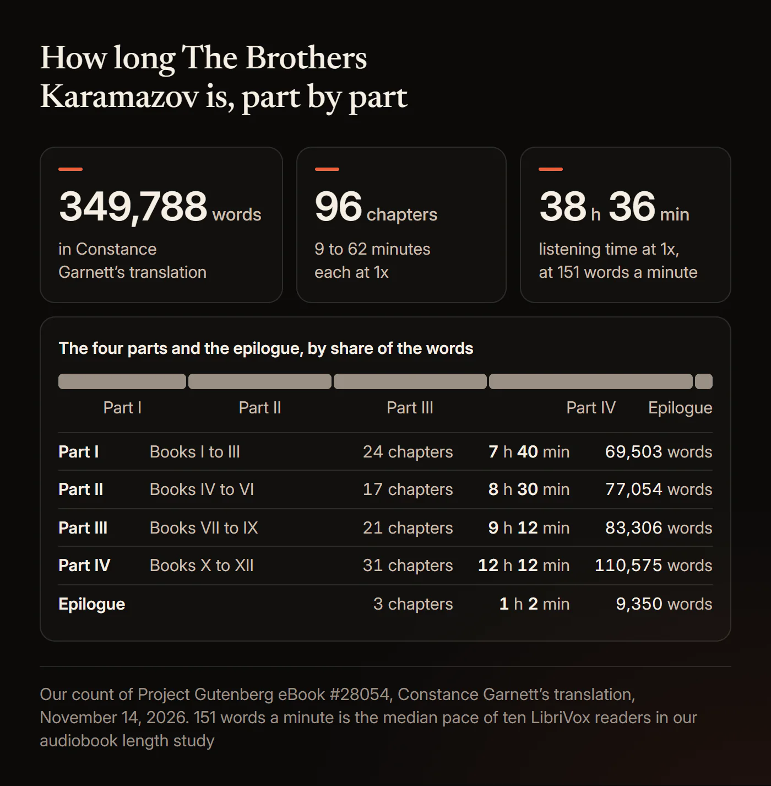
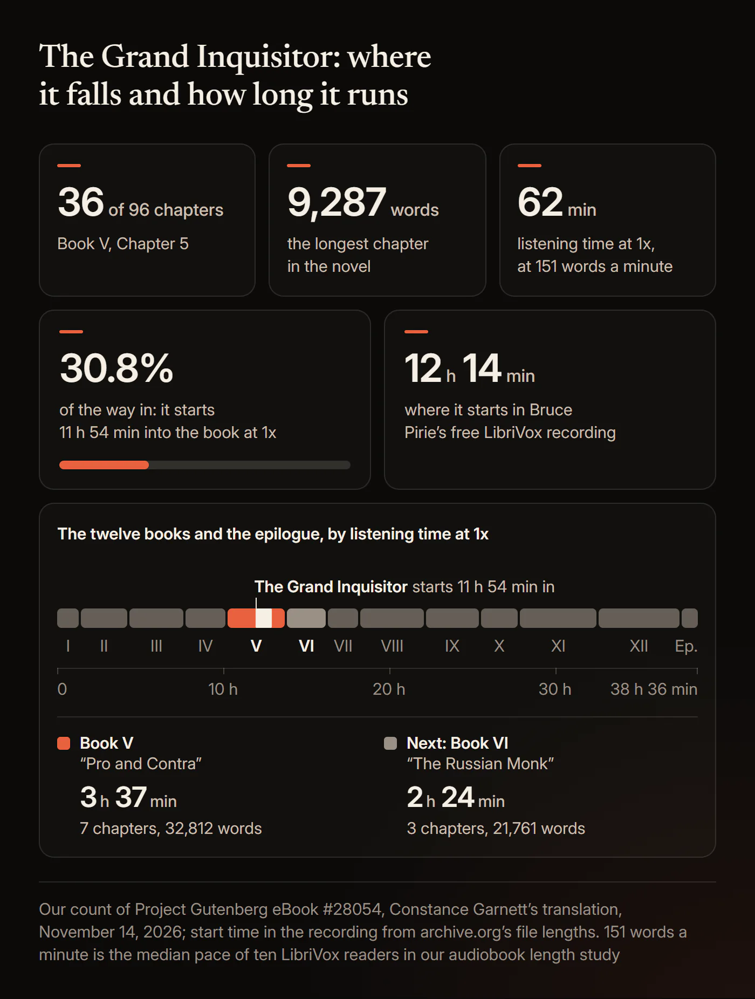
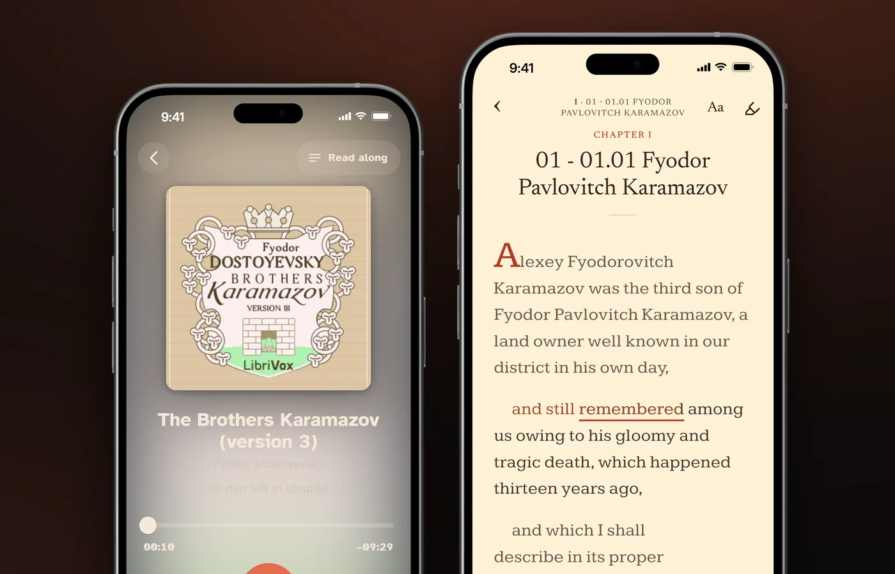

# Best Brothers Karamazov Audiobook: Every Translation and Narrator Compared

The best *Brothers Karamazov* audiobook is Luke Thompson's Penguin Classics recording of David McDuff's translation, 43 hours 6 minutes long. It has 4.7 stars from 858 Audible US ratings, with 4.9 for performance. Constantine Gregory's Naxos recording of Constance Garnett's translation (37 hours 4 minutes) is the most rated, Bruce Pirie's LibriVox reading (39 hours 38 minutes) is the best free one, and Ben Miles's recording of the Pevear and Volokhonsky translation (42 hours 16 minutes) is the best to borrow.

Gregory's recording has 5,910 ratings on Audible US as of November 14, 2026, more than the other 11 complete recordings in our table combined. *The Brothers Karamazov* is Fyodor Dostoevsky's last novel, serialised in 1879 and 1880. Four English translations exist on audio, so the translation you hear matters as much as the voice. Below: every complete recording with the translation it reads, checked against its Audible sample, which audiobook matches your print edition, how long the book takes at each speed, where the Grand Inquisitor falls and how long it runs, the three free LibriVox versions told apart, the abridged ones, and a spoiler-free list of names. Every edition fact was read from the publisher's or store's own page on November 14, 2026.

## Which Brothers Karamazov audiobook is best?

Luke Thompson for most listeners, Constantine Gregory for Garnett's translation, Bruce Pirie's LibriVox reading for free, and Ben Miles to borrow from a library.

### Best overall: Luke Thompson (Penguin Classics, 2021)

Luke Thompson's [Penguin Classics recording](https://www.audible.com/pd/0241533228) reads David McDuff's translation and includes McDuff's introduction. On November 14, 2026 it had 4.7 stars from 858 ratings on Audible US, with 4.9 for performance, and 4.7 from 250 on Audible UK, also with 4.9. Its 4.9 for performance ties Ben Miles's for the highest of any edition with hundreds of ratings. Audible's page says Thompson is "best known for his role in the hit Netflix drama Bridgerton."

A top review on the US page calls it the "Best narration performance I've ever heard, which maintained interest and brought the story and characters of this long classic to life." On r/audiobooks, a 2024 reply said "Luke Thompson is the standout," and in 2026 another listener wrote: "twice now I have paused to re-check that he is indeed doing all the voices?!"

It runs 43 hours 6 minutes, partly because it includes Dostoevsky's short preface and McDuff's introduction. It listed at $19.32 on Audible US and $12.99 on Apple Books on November 14, 2026.

### Most rated: Constantine Gregory (Naxos AudioBooks, 2013)

Constantine Gregory's [Naxos recording](https://www.audible.com/pd/B00EZAXAF8) is the pick for Constance Garnett's translation, the one most recordings read. It has 4.6 stars from 5,910 ratings on Audible US, with 4.7 for performance, and 4.5 from 1,022 on Audible UK, as of November 14, 2026. That is about seven times Thompson's count, and more than the 3,645 ratings of the other 11 complete recordings in our table put together.

A top review says: "This translation (Garnett) is indeed great for first-timers and Gregory's narration is knockout." A 2025 r/audiobooks post explained the choice simply: "I decided to go with the Naxos version read by Constantine Gregory. 4.5 stars with 5,000 reviews." The recording runs 37 hours 4 minutes and listed at $28.16 on Audible US. Because the free LibriVox recordings read the same translation, you can switch between Gregory and a free reading and hear the same text.

### Best free: Bruce Pirie, LibriVox Version 3 (2020)

Bruce Pirie reads all 96 chapters alone in [LibriVox's third recording](https://librivox.org/brothers-karamazov-v3-by-fyodor-dostoyevsky/), catalogued on February 21, 2020, at 39:37:50. Each of its 96 files is one chapter of the book. It reads Garnett's translation from Project Gutenberg eBook #28054, and it is free and in the public domain.

It had 333,073 downloads on the Internet Archive on November 14, 2026. A five-star review there from August 2026 says: "One of the greatest books ever written, and the narrator is extraordinarily good." A 2026 r/audiobooks reply called his reading "wonderful".

### Best to borrow: Ben Miles (Macmillan Audio, 2024)

Ben Miles reads Richard Pevear and Larissa Volokhonsky's 1990 translation, recorded in 2024 as the "Bicentennial Edition", in 42 hours 16 minutes. It is the only unabridged recording of that translation we found, so it is also the pick for Pevear and Volokhonsky readers. It has 4.8 stars from 484 ratings on Audible US with 4.9 for performance, and 4.8 from 46 on Apple Books.

It is the easiest of the main recordings to borrow. [hoopla carries it](https://www.hoopladigital.com/audiobook/the-brothers-karamazov-fyodor-m-dostoevsky/16289312), and on November 14, 2026 its hoopla page showed no waitlist. On Libby the same day, the Los Angeles Public Library had 49 holds on 9 copies, and Thompson's recording 46 holds on 7. To buy, [Ben Miles's recording on Audible](https://www.audible.com/pd/B0CKM7JKD1) listed at $37.49, the highest of the main editions, and $29.99 on Apple Books.

Audible quotes AudioFile: "Ben Miles's English accent is perfect for the text of this recent, award-winning translation." The award is a 1991 translation prize; no recording of this novel appears among the Audie Award winners or finalists from 1996 to 2026, by our scan of the Audio Publishers Association's pages. A 2024 r/audiobooks reply said: "Miles transforms into these characters."

**Also worth knowing.** Frederick Davidson's Blackstone recording of Garnett (34 hours 52 minutes, 4.3 from 1,437) is the most held in libraries: the New York Public Library had 11 copies on Libby, and hoopla carries it too. Listeners split on his voice. "The reader, Frederick Davidson, is British and has a very posh voice," a 2022 r/audiobooks post said. Gabriel Woolf's RNIB recording (37 hours 50 minutes) is the only audiobook of David Magarshack's translation; RNIB notes "This is a vintage recording."

### Every unabridged recording compared

Our table has 12 complete recordings you can buy or borrow, and LibriVox adds three free ones. Ratings are Audible US stars with the number of ratings in brackets, as of November 14, 2026.

| Narrator | Translation | Runtime | Publisher | Year | Audible US rating | Where we found it |
|---|---|---|---|---|---|---|
| Luke Thompson | David McDuff | 43 h 6 min | Penguin Classics | 2021 | 4.7 (858) | Audible, Apple Books, Google Play, Libby |
| Constantine Gregory | Constance Garnett | 37 h 4 min | Naxos AudioBooks | 2013 | 4.6 (5,910) | Audible, Apple Books, Libby |
| Ben Miles | Pevear and Volokhonsky | 42 h 16 min | Macmillan Audio | 2024 | 4.8 (484) | Audible, Apple Books, Libby, hoopla |
| Frederick Davidson | Constance Garnett | 34 h 52 min | Blackstone | 2000 | 4.3 (1,437) | Audible, Apple Books, Libby, hoopla |
| Walter Covell | Constance Garnett | 37 h 1 min | Jimcin Recordings | 1987 | 4.0 (346) | Audible, Apple Books |
| Gabriel Woolf | David Magarshack | 37 h 50 min | RNIB | 2009 | 4.1 (228) | Audible, Apple Books |
| Alastair Cameron | Constance Garnett | 34 h 24 min | A.R.N. Publications | 2016 | 4.4 (153) | Audible, Apple Books |
| James Anderson Foster | Constance Garnett | 34 h 18 min | Brilliance Audio (AmazonClassics) | 2020 | 4.6 (110) | Audible, Apple Books |
| David Rintoul | Constance Garnett | 37 h 19 min | SNR Audio | 2023 | 4.8 (25) | Audible, Apple Books |
| Jason Smith | Constance Garnett | 34 h 33 min | Stream Readers | 2024 | 1.0 (2) | Audible, Apple Books |
| Teddy Garraway | Constance Garnett | 35 h 22 min | NTMC | 2024 | 5.0 (1) | Audible, Apple Books |
| Ralph Lister | Constance Garnett | 40 h 22 min | Spotify Audiobooks | 2026 | 5.0 (1) | Audible, Apple Books |
| Bruce Pirie, LibriVox Version 3 | Constance Garnett | 39 h 38 min | LibriVox | 2020 | Free | LibriVox, Internet Archive, HushBook Discover |
| Tony Addison, LibriVox Version 2 | Constance Garnett | 46 h 25 min | LibriVox | 2016 | Free | LibriVox, Internet Archive, HushBook Discover |
| LibriVox group reading, 27 readers | Constance Garnett | 37 h 55 min | LibriVox | 2010 | Free | LibriVox, Internet Archive, HushBook Discover |

Runtimes are Audible's for the paid editions and LibriVox's for the free ones. Years follow each recording's copyright line: Davidson's is "(P)2000", though Audible lists it from 2009. Libby holdings are from the New York, Los Angeles, San Francisco and Chicago public libraries and the King County Library System.

**Listings we left out.** Audible lists a 13th complete recording, credited to Bruce Peery, which we cover with the free recordings below. Apple Books also lists about a dozen smaller recordings whose translation we did not test, among them Charles Farrow, Mike Joyce and Salomon Bryant, and a Parolita Libro edition read by Bruce Pirie (39 hours 9 minutes). We left out multi-book collections, retellings, study guides and machine-voiced or "adapted" listings.

## Which translation does each Brothers Karamazov audiobook use?

Constance Garnett's 1912 translation, on 10 of the 13 complete recordings on Audible US and on all three free ones; Ben Miles reads Pevear and Volokhonsky, Luke Thompson reads David McDuff and Gabriel Woolf reads David Magarshack.

**How we know.** Some store pages name no translator, so we checked by ear. We transcribed the first 150 seconds of each Audible sample with speech recognition and compared it with Garnett's text in Project Gutenberg eBook #28054, six words at a time. The ten Garnett recordings matched 79 to 95% of their six-word runs. Thompson's, Miles's and Woolf's matched under 2%, and their stores credit McDuff, Pevear and Volokhonsky, and Magarshack.

| Translation | Unabridged audiobook |
|---|---|
| Constance Garnett, 1912 | Gregory, Davidson, Covell, Cameron, Foster, Rintoul and four more; all three free LibriVox recordings |
| Garnett revised by Ralph Matlaw, 1976 | None found |
| David Magarshack, 1958 | Gabriel Woolf (RNIB, 2009) |
| Andrew R. MacAndrew, 1970 | None found |
| Julius Katzer, 1980 | None found |
| Richard Pevear and Larissa Volokhonsky, 1990 | Ben Miles (Macmillan Audio, 2024) |
| David McDuff, 1993 | Luke Thompson (Penguin Classics, 2021) |
| Ignat Avsey, 1994, as *The Karamazov Brothers* | None found |
| Michael R. Katz, 2023 | None found |

"None found" means we searched Audible's US, UK, Canadian and Australian catalogues, Apple Books, Libby at five library systems and hoopla on November 14, 2026, and found no recording. A 2021 r/audiobooks thread asked for an Avsey audiobook and found none either.

Frederick Davidson's Blackstone recording reads Garnett, not Pevear and Volokhonsky. Its sample matched Garnett's text at 81.7%, OverDrive credits Constance Garnett, and the recording dates from 2000, 24 years before Ben Miles's, the only unabridged recording of their translation. Blackstone's Audible and hoopla pages quote critics writing about the Pevear and Volokhonsky translation, which may be where the mix-up starts.

What critics say about the translations you can hear:

- **Constance Garnett (1912).** Peter France, in The Oxford Guide to Literature in English Translation (2000) as quoted on Wikipedia, wrote that her translations "read easily" but that "she shortens and simplifies, muting Dostoevsky's jarring contrasts."
- **Pevear and Volokhonsky (1990).** France found them "a rather more satisfactory compromise between the literal and the readable." Daniel Soar, in the London Review of Books in 2025, judged their version "the closest to getting across the oddness of the writing." It won the PEN/Book-of-the-Month Club Translation Prize in 1991, according to PEN America.
- **David McDuff (1993).** France wrote that McDuff "carries this literalism the furthest of any of the translators" and that such fidelity "makes for difficult reading." France wrote before McDuff revised his translation for Penguin in 2003.
- **David Magarshack (1958).** David Remnick, in The New Yorker in 2005, tells how Larissa Volokhonsky, reading the novel in Magarshack's English over her husband's shoulder, "was outraged. It's not there! she thought. He doesn't have it! He's an entirely different writer!"

Two print translations with fans have no audiobook we could find. France called Ignat Avsey's "an enjoyable version in the domesticating tradition." Soar wrote that Michael Katz "writes, perfectly nicely, as if the thing came out yesterday."

### Which audiobook matches your print edition?

Match the translator, not the cover: Penguin Classics is McDuff and Luke Thompson, Vintage and the Bicentennial Edition are Pevear and Volokhonsky and Ben Miles, and any Garnett edition matches Gregory, Davidson or a free LibriVox reading.

- **Penguin Classics.** Luke Thompson's recording, with McDuff's introduction. A reader with the Penguin Black Classics edition asked exactly this on r/audiobooks in 2025.
- **Vintage, Farrar, Straus and Giroux, Everyman's Library.** Ben Miles's recording.
- **Modern Library, Dover, Wordsworth, Project Gutenberg, AmazonClassics.** Any Garnett recording. The AmazonClassics edition says it "includes editorial revisions", so expect small differences.
- **The Hallow Edition (2026).** Goodreads and the seller Sacrestar list Constance Garnett as its translator, so any Garnett recording reads the same translation, the free ones included.
- **Norton Critical Edition.** Its text is Garnett revised by Ralph Matlaw. We found no recording of the revision: the four Garnett samples that reached the first sentence all read the 1912 wording, "his gloomy and tragic death". Any Garnett recording is the closest.
- **Oxford World's Classics (Avsey), Liveright (Katz), Bantam (MacAndrew).** No matching audiobook found.

### Hear the difference

Dostoevsky opens the novel with a short preface, "From the Author". Garnett's translation leaves it out, so every Garnett recording, the free ones included, starts at Book I, Chapter 1. The two modern recordings start with it, and both Audible samples include its last lines. As transcribed by speech recognition:

| Recording | The end of "From the Author" |
|---|---|
| Ben Miles (Pevear and Volokhonsky) | "Well, that is the end of my introduction. I quite agree that it is superfluous, but since it is already written, let it stand. And now, to business." |
| Luke Thompson (McDuff) | "Well, so much for the preface. I entirely agree that it is superfluous, but, as it has now been written, let it stay. And now to business." |

The London Review of Books set one line of the same preface side by side in four translations. Pevear and Volokhonsky: "One thing, perhaps, is rather doubtless." McDuff: "One thing is, perhaps, fairly beyond doubt." Avsey: "One thing, however, is indisputable." Katz: "In any event, one thing is fairly certain".

Gabriel Woolf's Magarshack sample differs from Garnett in Book I too: where Garnett has "an ill-natured buffoon", Woolf reads "nothing but an ill-natured clown".

## How long is The Brothers Karamazov audiobook?

About 38 hours 36 minutes at 1x: Garnett's translation has 349,788 words, and complete recordings run from 34 hours 18 minutes to 46 hours 25 minutes.

We counted the words ourselves. Project Gutenberg eBook #28054, Garnett's translation, downloaded on November 14, 2026, has 349,788 words in the novel itself, without chapter headings or the translator's footnotes. A second count from Gutenberg's HTML edition with a different method gave 349,820, so call it about 350,000. We used 151 words a minute, the median pace we measured for LibriVox solo readers in our guide to [how long audiobooks run](/blog/how-long-is-an-audiobook). The recordings at speed are each runtime divided by the speed.

| Speed | The novel at 151 words a minute | Luke Thompson | Constantine Gregory | Bruce Pirie (free) | Ben Miles |
|---|---|---|---|---|---|
| 1x | 38 h 36 min | 43 h 6 min | 37 h 4 min | 39 h 38 min | 42 h 16 min |
| 1.25x | 30 h 53 min | 34 h 29 min | 29 h 39 min | 31 h 42 min | 33 h 49 min |
| 1.5x | 25 h 44 min | 28 h 44 min | 24 h 43 min | 26 h 25 min | 28 h 11 min |
| 2x | 19 h 18 min | 21 h 33 min | 18 h 32 min | 19 h 49 min | 21 h 8 min |

For choosing a speed, see [what speed to listen at](/blog/audiobook-listening-speed).

**The real range.** Complete recordings on Audible run from 34 hours 18 minutes (James Anderson Foster) to 43 hours 6 minutes (Luke Thompson), and Tony Addison's free LibriVox reading takes 46 hours 25 minutes. Across the 13 Garnett recordings, the three LibriVox sets included, narrators read at 126 to 170 words a minute, median 157. Read silently at 260 words a minute, Garnett's text takes about 22 hours 25 minutes.

**Days to finish, our calculation** at 151 words a minute, rounded up to whole days:

| Speed | 30 min a day | 60 min a day |
|---|---|---|
| 1x | 78 days | 39 days |
| 1.25x | 62 days | 31 days |
| 1.5x | 52 days | 26 days |
| 2x | 39 days | 20 days |

### How many books and chapters are in The Brothers Karamazov?

Twelve books and an epilogue, 96 chapters, grouped in four parts.

| Part | Books | Chapters | Words (our count) | At 1x |
|---|---|---|---|---|
| Part I | I to III | 24 | 69,503 | 7 h 40 min |
| Part II | IV to VI | 17 | 77,054 | 8 h 30 min |
| Part III | VII to IX | 21 | 83,306 | 9 h 12 min |
| Part IV | X to XII | 31 | 110,575 | 12 h 12 min |
| Epilogue | | 3 | 9,350 | 1 h 2 min |

The books have 5, 8, 11, 7, 7, 3, 4, 8, 9, 7, 10 and 14 chapters. Book XII alone runs 45,840 words, about 5 hours 4 minutes. Bruce Pirie's and the group reading's files number the chapters 1 to 96 straight through, so if you are looking for part 2, Book IV, Chapter 1 is file 25 and Part III starts at file 42.

By our count the average chapter is 3,644 words, about 24 minutes at 1x. 37 of the 96 chapters take under 20 minutes, 19 take 30 minutes or more, and 2 take an hour or more. The shortest, Book I, Chapter 2, "He Gets Rid of His Eldest Son", has 1,297 words, about 9 minutes.

### Is The Brothers Karamazov longer than Crime and Punishment?

Yes: 1.72 times as long, 349,788 words against 203,197 in Garnett's translations, counted with the same script.

At 151 words a minute, *The Brothers Karamazov* takes 38 hours 36 minutes and *Crime and Punishment* 22 hours 26 minutes. *War and Peace*, at 561,870 words in the Maude translation, is 1.6 times longer again, as our [War and Peace audiobook comparison](/blog/best-war-and-peace-audiobook) shows.

## Where is the Grand Inquisitor in The Brothers Karamazov?

Book V, Chapter 5, the 36th of the novel's 96 chapters: it starts about 31% of the way in, roughly 12 hours into a complete recording, and it is the longest chapter in the book.

"The Grand Inquisitor" sits in Part II, in Book V, "Pro and Contra". By our count it begins after 107,753 of the novel's 349,788 words, 30.8% of the way in. At 151 words a minute that is about 11 hours 54 minutes into the book, and in Bruce Pirie's free recording it starts at 12:13:52. The London Review of Books calls it "The most famous, and most famously extraordinary, passage" in the novel: "Whole books have been written about it".

Where it starts in each free recording, from the Internet Archive's file lengths:

| Recording | File | Starts at | Length |
|---|---|---|---|
| Bruce Pirie, LibriVox Version 3 | 36, "05.05 The Grand Inquisitor" | 12:13:52 | 59:15 |
| LibriVox group reading (read by Bob Sherman) | 36 | 11:25:02 | 59:15 |
| Tony Addison, LibriVox Version 2 | 36 and 37, in two parts | 15:22:21 | 1:18:31 |

### How long is the Grand Inquisitor on audio?

About an hour: 9,287 words by our count, about 62 minutes at 151 words a minute, and 59 minutes 15 seconds in Bruce Pirie's file.

That is 49 minutes at 1.25x and 41 minutes at 1.5x. The next longest chapters are Book VI, Chapter 2, "The Duel" (9,153 words, 61 minutes), and Book XI, Chapter 9 (7,941 words, 53 minutes).

It comes straight after "Rebellion", Book V, Chapter 4: 4,949 words, about 33 minutes, and 33:39 in Pirie's file. Together the two chapters run 14,236 words, about 1 hour 34 minutes, or 1:32:54 in Pirie's recording. Book V as a whole has seven chapters and 32,812 words, about 3 hours 37 minutes.

Most of the chapter is talk. 56.2% of its words sit inside quotation marks, and one unbroken stretch of quoted speech runs 4,549 words, about 30 minutes, the longest in the novel by our count. We counted it as consecutive paragraphs that open a quotation without closing it.

### Can you listen to the Grand Inquisitor on its own?

Yes: the chapter is sold on its own, and LibriVox's dramatic reading of it is free.

| Recording | Runtime | Translation | Rating |
|---|---|---|---|
| Alan Lamberg and Dan Ribaudo, Corner Film Productions, 2015 | 1 h 18 min | Not Garnett; the listing does not say which | 4.4 (96) on Audible US |
| LibriVox dramatic reading, four readers, 2012 | 1 h 17 min | H. P. Blavatsky, per LibriVox | Free |
| Saethon Williams, Integrated Media Systems, 2025 | 1 h 2 min | H. P. Blavatsky | 5.0 (1) on Audible US |

Blavatsky's translation of the chapter on its own is free as Project Gutenberg eBook #8578.

### How long is the Zosima section?

Book VI, "The Russian Monk", runs 21,761 words in three chapters, 6.2% of the novel and about 2 hours 24 minutes at 1x.

It comes right after Book V and starts 35.7% of the way in. In Bruce Pirie's recording it is files 39 to 41, 2 hours 24 minutes 2 seconds in all, starting at 14:05:45. Its last two chapters, the elder's life and his teachings, run 15,389 words, about 1 hour 42 minutes. The section is the novel's reply to Ivan: "With Book VI, 'The Russian Monk', Dostoevsky sought to provide the refutation of Ivan's negation of God," Wikipedia writes, summarising Joseph Frank's biography.

### Where is the chapter about Ivan and the devil?

Book XI, Chapter 9, "The Devil. Ivan's Nightmare": 7,941 words by our count, about 53 minutes at 1x.

It is the third longest chapter in the book, in Part IV. Book VII, Chapter 3, "An Onion", is almost as long, 7,818 words, about 52 minutes.

## Is there a free Brothers Karamazov audiobook?

Yes: LibriVox has three complete free recordings, all of Constance Garnett's translation, and Bruce Pirie's solo reading, 39 hours 38 minutes, is the one to pick.

| | Bruce Pirie (solo) | Group reading | Tony Addison (solo) |
|---|---|---|---|
| LibriVox version | Version 3 | Version 1 | Version 2 |
| Title in apps and on the Internet Archive | The Brothers Karamazov (version 3) | The Brothers Karamazov | The Brothers Karamazov |
| Read by | Bruce Pirie | 27 volunteers | Tony Addison |
| Running time | 39:37:50 | 37:55:17 | 46:24:44 |
| Words a minute | 147 | 154 | 126 |
| Catalog date | February 21, 2020 | February 4, 2010 | June 30, 2016 |
| Internet Archive downloads | 333,073 | 1,108,829 | 208,197 |
| Files | 96 | 96 | 97 |
| 64 kbps MP3 download | 1.1 GB | 1.0 GB | 1.2 GB |

Running times and dates come from the LibriVox catalog and API; downloads and file sizes from the Internet Archive on November 14, 2026. Words a minute is our calculation. All three read the text of Project Gutenberg eBook #28054, which is free too. Our guide to whether [LibriVox is free and legal](/blog/is-librivox-safe-and-legal) explains why these recordings cost nothing.

### Which LibriVox Brothers Karamazov should you pick?

Bruce Pirie's: one voice, the whole book, one file per chapter, and the only free version whose title carries its version number.

- **Bruce Pirie, Version 3.** Each file title carries the book and chapter, from "01.01 Fyodor Pavlovitch Karamazov" on. Pirie reads in an American voice, according to We Love Translations, which listened to the samples. At one hour a day it takes 40 days at 1x, 32 at 1.25x, 27 at 1.5x and 20 at 2x.
- **The group reading, Version 1.** The reader changes by chapter, and Bob Sherman reads the Grand Inquisitor. It is the most downloaded of the three, and five of the six entries on its Internet Archive page are five-star reviews.
- **Tony Addison, Version 2.** The other solo reading, in a British voice according to We Love Translations. At 126 words a minute it is the slowest complete recording we found, and it splits the Grand Inquisitor across two files, so its file numbers run one ahead of the chapters from there on.

Two share the plain title, so tell them apart by length: 37 hours 55 minutes is the group reading, 46 hours 25 minutes is Tony Addison's.

Audible also sells a 39 hour 13 minute recording credited to "Bruce Peery" (Hexagon Tech); by our timing check of its sample, nine sentence openings in its first two minutes line up with Bruce Pirie's free LibriVox reading within a quarter of a second, and LibriVox recordings are public domain, so you can have the same reading free.

### Is the YouTube Brothers Karamazov audiobook free?

Full uploads are free to play, but we did not check which recording each one plays; the LibriVox recordings are the free route with a named reader.

LibriVox recordings are in the public domain, so anyone may re-upload them. One r/audiobooks listener in 2026 found a LibriVox recording "read by Bruce Perry" on YouTube "in four segments", most likely Bruce Pirie's under another spelling. For one part or a single chapter, the parts table above gives the file numbers.

## Which Brothers Karamazov audiobooks are abridged or dramatised?

Seven listings we found are cut, retold or dramatised, from 37 minutes to 19 hours 8 minutes; every complete recording in our table runs at least 34 hours 18 minutes.

| Version | Publisher, year | Runtime | What it is |
|---|---|---|---|
| Real Reads, Hattie Briggs | Real Reads, 2020 | 37 min | Retelling |
| Sweet Cherry Publishing, Dan Bottomley | Sweet Cherry, 2026 | 54 min | Children's retelling |
| L.A. Theatre Works, full cast with John de Lancie | L.A. Theatre Works, 2010 | 2 h 15 min | Radio play |
| L.A. Theatre Works, with The Idiot | L.A. Theatre Works, 2006 | 3 h 59 min | Two radio plays |
| BBC Radio 4, Roy Marsden, Paul Hilton, Nicholas Boulton | BBC Audio, 2021 (in a collection) | Not stated alone | Radio dramatisation in five parts |
| Tim Pigott-Smith | Naxos AudioBooks, 2004 | 10 h 33 min | Abridged |
| Simon Vance | Mission Audio, 2005 | 19 h 8 min | Abridged |

Runtimes are Audible's, read November 14, 2026.

**Simon Vance's recording is abridged.** At 19 hours 8 minutes it is long enough to pass for complete, and it has 4.5 stars from 438 Audible US ratings. Audible lists its format as abridged, Libby labels it "Abridged", and its sample reads Garnett's sentences with parts cut. A 2013 r/audiobooks reply recommended "the Simon Vance version" without saying so. Tim Pigott-Smith's Naxos recording is also cut, to 10 hours 33 minutes.

**The BBC dramatisation.** It was "Dramatised in five parts by Melissa Murray" and "First broadcast on BBC Radio 4 in November 2006", according to the BBC. It is sold inside The Fyodor Dostoevsky BBC Radio Drama Collection, 17 hours 28 minutes for four novels, three stories and two documentaries, with 4.4 stars from 18 ratings on Audible US. The collection was a 2022 Audie finalist for audio drama. We found no complete full-cast recording of the novel on sale.

Our guide to [abridged and unabridged audiobooks](/blog/abridged-vs-unabridged-audiobooks) explains how to tell them apart in any store.

## How do you keep track of the names in The Brothers Karamazov?

Learn that each brother answers to two or three names, that all three share one patronymic, and keep every form on one list.

Russian characters go by a first name with a patronymic (the father's name), a surname, and short or pet forms. The table gives each form Garnett uses, with our count from Project Gutenberg eBook #28054, and the chapter that tells you who the person is. It carries no spoilers: every fact in it is told by the chapter shown, all within the first 30% of the novel except Kolya's introduction.

| Character | Names in Garnett's translation (our count) | Who | Told in | Say it |
|---|---|---|---|---|
| The father | Fyodor Pavlovitch 298, Karamazov 171 (all Karamazovs) | A landowner, father of three sons by two wives | Book I, Ch. 1 | FYO-dor |
| The eldest son | Mitya 911, Dmitri 380 (Dmitri Fyodorovitch 170), Mityenka 3, Mitri 2, Mitenka 1 | Son of the first wife; has "only lately left the army" | Book I, Ch. 1 to 2; Book II, Ch. 6 | MEE-tya |
| The second son | Ivan 714 (Ivan Fyodorovitch 59), Vanka 3 (only in a song) | Son of the second wife; writes articles | Book I, Ch. 3; Book II, Ch. 7 | ee-VAHN |
| The youngest son | Alyosha 1,241, Alexey 163 (Alexey Fyodorovitch 113) | Ivan's full brother; a novice at the monastery | Book I, Ch. 1, 4, 5 | a-LYO-sha |
| The servant | Smerdyakov 371, Pavel Fyodorovitch 1 | Fyodor Pavlovitch's servant and cook, raised by Grigory and Marfa | Book III, Ch. 2, 6 | |
| The old servants | Grigory 192 (Grigory Vassilyevitch 29), Marfa 57 (Marfa Ignatyevna 30) | Fyodor Pavlovitch's servant and his wife | Book I, Ch. 2; Book III, Ch. 1 | |
| A young woman of the town | Grushenka 362, Agrafena Alexandrovna 39, Grusha 18 | Agrafena Alexandrovna, called Grushenka | Book II, Ch. 7; Book III, Ch. 10 | GROO-shin-ka |
| Dmitri's betrothed | Katerina Ivanovna 199, Katya 75, Katenka 1 | Engaged to Dmitri | Book II, Ch. 6; Book III, Ch. 4 to 5 | KAH-tya |
| The elder | Zossima 100 (Father Zossima 90) | The elder at the monastery; Alyosha's teacher | Book I, Ch. 4 to 5 | |
| Alyosha's friend | Rakitin 198, Misha 24 | A seminarist | Book II, Ch. 7 | |
| A monk | Father Païssy 73 | A learned monk of the monastery | Book II, Ch. 2 | |
| A relative | Miüsov 79, Pyotr Alexandrovitch 38 | A cousin of Dmitri's mother; a landowner | Book I, Ch. 2 | |
| A rich widow and her daughter | Madame Hohlakov 93; Lise 144 | Visitors to the monastery | Book II, Ch. 3 to 4 | |
| A boy and his father | Ilusha 166; Snegiryov 22 | A schoolboy; his father, "formerly a captain in the Russian infantry" | Book IV, Ch. 3, 6 | |
| A schoolboy | Kolya 210, Krassotkin 68 | A schoolboy | Book IV, Ch. 3; Book X, Ch. 1 | KOH-lya |

The counts are whole words, case-sensitive; a second count with a different method agrees within two. The "Say it" column is our respelling of the Russian pronunciation Wiktionary gives.

**The traps.**

- **One brother, three names.** The eldest is "Mitya" 911 times and "Dmitri" 380; the youngest "Alyosha" 1,241 times and "Alexey" 163. "Dmitri Fyodorovitch" in one scene and "Mitya" in the next are the same man.
- **One patronymic for all three.** Every brother is "Fyodorovitch", son of Fyodor: Dmitri Fyodorovitch 170 times, Alexey Fyodorovitch 113, Ivan Fyodorovitch 59. "Fyodorovitch" alone does not tell you which brother.
- **Two names for the same woman, twice.** Grushenka is also Agrafena Alexandrovna (39) and Grusha (18). Katerina Ivanovna is also Katya (75).
- **The relative with two names.** "I thought Pyoter Alexandrovich and Myusov were two different people for pretty much that whole scene," a listener wrote on r/audiobooks in 2015. Miüsov is Pyotr Alexandrovitch.
- **Fewer pet names than some guides list.** Mitka, Alyoshka, Lyosha, Alyoshenka and Vanya never occur in Garnett's translation, by our count. We did not count other translations or the Russian.
- **Spellings change with the translation.** Garnett's "Zossima", "Hohlakov", "Ilusha", "Krassotkin" and "Pavlovitch" are "Zosima", "Khokhlakov", "Ilyusha", "Krasotkin" and "Pavlovich" in modern translations. In this guide we use Garnett's spellings for her text and the free recordings, and modern ones elsewhere.

By ear, a name you last heard hours ago is hard to place. Seeing each word highlighted as the narrator says it puts the name in front of you, and that is why we built HushBook. Its free character map keeps every name a person goes by on one card: add Mitya once and keep Dmitri and Dmitri Fyodorovitch in his card's notes. Our guide on how to [keep track of characters](/blog/how-to-keep-track-of-characters-in-a-book) has methods that work for any book.

### How do you pronounce Karamazov and Alyosha?

Karamazov is ka-ra-MA-zov, with the stress on "ma", and Alyosha is a-LYO-sha.

Wikipedia gives the Russian title, Братья Карамазовы, as [ˈbratʲjə kərɐˈmazəvɨ], which puts the stress on "ma". For the names, Wiktionary gives Alyosha as [ɐˈlʲɵʂə], Mitya as [ˈmʲitʲə] and Dostoevsky as [dəstɐˈjefskʲɪj], which is duh-sta-YEF-skee. The respellings are ours.

## Is The Brothers Karamazov hard to read?

Not sentence by sentence (Project Gutenberg rates Garnett's text 82.0, "Easy to read"); the length, the names and the long speeches are the hard part.

We measured it against [Crime and Punishment](/blog/best-crime-and-punishment-audiobook) with the same script on both Garnett texts:

| | The Brothers Karamazov | Crime and Punishment |
|---|---|---|
| Words | 349,788 | 203,197 |
| At 1x, 151 words a minute | 38 h 36 min | 22 h 26 min |
| Words a sentence | 14.0 | 12.7 |
| Words inside quotation marks | 55.5% | 55.4% |
| Average chapter | 3,644 words | 4,956 words |
| Project Gutenberg reading ease | 82.0 | 83.0 |

So the sentences are a little longer and the share of talk is the same. The chapters are shorter, and there are more than twice as many of them. Talk is uneven across the book: 52.0% of Part I is inside quotation marks, 54.8% of Part II, 46.7% of Part III and 64.7% of Part IV.

The story is told by a townsman who never names himself: in Daniel Soar's words in the London Review of Books, it "purports to be written by an unnamed inhabitant of Skotoprigonyevsk, the (fictional) small town".

Readers point to the length too. "Why is The brothers Karamazov considered a hard to read book?" drew 104 comments on r/dostoevsky in July 2026, and one reply put it plainly: "the majority of people are not comfortable with reading 800 page 19th century classics". In an October 2026 r/classicliterature thread from a reader who was struggling, a reply advised: "Keep going until 'The Grand Inquisitor' chapter; that's usually where it clicks for people coming from Crime and Punishment".

### Should you read or listen to The Brothers Karamazov?

Either works for following the story, but minds wander most when people only listen, and the dense chapters make it worse.

Across 46 studies with 4,687 people, Clinton-Lisell's 2022 meta-analysis found no reliable overall difference between understanding a text by reading it and by listening to it. Varao Sousa, Carriere and Smilek (2013) found that listening produced the most mind wandering of three ways of taking in a passage.

Difficulty adds to it. In a 2013 study of 80 students, Feng, D'Mello and Graesser found that minds wandered more on difficult texts than on easy versions of the same passages, and that wandering hurt comprehension more on the difficult ones. *The Brothers Karamazov* has two long stretches of that kind: the Grand Inquisitor, with its 30 minutes of unbroken speech, and Book VI, 2 hours 24 minutes of the elder's life and teaching. None of these studies used a novel or tested Russian names by ear. So listen when it fits your day, and have the text in front of you for the Grand Inquisitor and when the names blur.

## What we could not verify

- **Sound.** We did not rank the recordings by listening. No Audible sample reaches the Grand Inquisitor or most of the names, so we could not hear how each narrator handles them or says "Alyosha" and "Karamazov". The accents above are reviewers' and We Love Translations' words.
- **Some stores.** We did not check Spotify (it needs a login), Libro.fm and Kobo (they blocked our requests), Chirp, Scribd, Everand or BBC Sounds.
- **The BBC dramatisation.** Its own running time inside the collection, and whether it includes the Grand Inquisitor.
- **Smaller listings.** The translation of the Apple Books recordings we did not sample and of the Corner Film Productions Grand Inquisitor, and whether the Parolita Libro edition read by Bruce Pirie is his LibriVox recording.
- **Free offers.** Audible's catalogue lists a Kindle Unlimited plan for James Anderson Foster's AmazonClassics edition, which we could not check as an offer.
- **The Hallow app.** Whether Hallow's app has its own audio reading of the Hallow Edition.
- **Your country.** Availability and prices vary by region. Prices, ratings and library holds above are a snapshot of November 14, 2026.

## Is there a Brothers Karamazov audiobook with text?

Yes: HushBook, the app we built, plays an audiobook and shows its words in time with the voice, on iPhone, Android, Windows and Mac.

HushBook is free, with no account, and transcription runs on your own device. In Discover, search "brothers karamazov" and pick "The Brothers Karamazov (version 3)", the card that reads 39h 38m: that is Bruce Pirie's LibriVox reading, 96 chapters in a 1.1 GB download, one chapter per file. The two cards with the plain title are the group reading (37h 55m) and Tony Addison's reading (46h 25m). Play a sample first if you like. HushBook queues the transcription on your phone as soon as the book is added.

Words fill in as the narrator reads them, with a red underline on the current one. Long-press any line to play from there. In Pirie's recording the Grand Inquisitor is the 36th file, so HushBook shows it as Chapter XXXVI, with "05.05 The Grand Inquisitor" in its title: an hour of near-continuous speech, with every word on screen as it is said. Mark a passage to keep it as a highlight, note or quote, and set the speed anywhere from 0.5x to 3x.

For Garnett's own text, attach a matching DRM-free EPUB, PDF or TXT, such as Project Gutenberg's eBook #28054, the text Pirie reads: e-book sync (in beta, first sync free) aligns the book's text to the audio word by word, with Garnett's spellings such as "Zossima" and "Mitya". For the names, add each brother to the character map once, keep Mitya, Dmitri and Dmitri Fyodorovitch in the notes on one card, and see the chapter and time you first heard each person.

For a paid edition, read along with a DRM-free MP3 or M4B copy you own. Penguin UK lists Libro.fm among the stores for Luke Thompson's recording, and Libro.fm's help page, read on November 10, 2026, describes its downloads as "DRM-free files (MP3s or M4B format)". HushBook imports MP3, M4A, M4B and more, and detects the chapters inside M4B files. The desktop app is free on Windows 10 or 11 (64-bit) and macOS 14 or later; it has Discover too and imports MP3 and M4B files or whole folders.

HushBook works with free public domain recordings and audio files you own without DRM.

## Sources

- [Audible, The Brothers Karamazov (Luke Thompson, Penguin Classics)](https://www.audible.com/pd/0241533228)
- [Audible, The Brothers Karamazov (Constantine Gregory, Naxos AudioBooks)](https://www.audible.com/pd/B00EZAXAF8)
- [Audible, The Brothers Karamazov (Ben Miles, Macmillan Audio, Bicentennial Edition)](https://www.audible.com/pd/B0CKM7JKD1)
- [Audible, The Brothers Karamazov (Frederick Davidson, Blackstone)](https://www.audible.com/pd/B002V8LAN0)
- [Audible, The Brothers Karamazov (Gabriel Woolf, RNIB)](https://www.audible.com/pd/B0035A86I0)
- [Audible, The Brothers Karamazov (Walter Covell, Jimcin Recordings)](https://www.audible.com/pd/B002V1NN78)
- [Audible, The Brothers Karamazov (Alastair Cameron, A.R.N. Publications)](https://www.audible.com/pd/B01M1221N5)
- [Audible, The Brothers Karamazov (James Anderson Foster, AmazonClassics)](https://www.audible.com/pd/1799744744)
- [Audible, The Brothers Karamazov (David Rintoul, SNR Audio)](https://www.audible.com/pd/B0C8NHYPDZ)
- [Audible, The Brothers Karamazov (Jason Smith, Stream Readers)](https://www.audible.com/pd/B0CZRNT9P2)
- [Audible, The Brothers Karamazov (Teddy Garraway, NTMC)](https://www.audible.com/pd/B0DFQ49SNG)
- [Audible, The Brothers Karamazov (Ralph Lister, Spotify Audiobooks)](https://www.audible.com/pd/B0HBPQ1V45)
- [Audible, The Brothers Karamazov (credited to Bruce Peery, Hexagon Tech)](https://www.audible.com/pd/B0BDP54D6M)
- [Audible, The Brothers Karamazov (Simon Vance, abridged)](https://www.audible.com/pd/B002V8KQUI)
- [Audible, The Brothers Karamazov (Tim Pigott-Smith, Naxos AudioBooks, abridged)](https://www.audible.com/pd/B002V0QORU)
- [Audible, The Fyodor Dostoevsky BBC Radio Drama Collection](https://www.audible.com/pd/1529141796)
- [Audible, The Brothers Karamazov (L.A. Theatre Works)](https://www.audible.com/pd/B003999U7I)
- [Audible, The Brothers Karamazov and The Idiot (L.A. Theatre Works)](https://www.audible.com/pd/B002V8KWUW)
- [Audible, The Brothers Karamazov (Real Reads)](https://www.audible.com/pd/1911091514)
- [Audible, The Brothers Karamazov (Sweet Cherry Publishing)](https://www.audible.com/pd/B0GPFKDTRV)
- [Audible, The Grand Inquisitor (Alan Lamberg and Dan Ribaudo, Corner Film Productions)](https://www.audible.com/pd/B017WJ5NXA)
- [Audible, The Grand Inquisitor (Saethon Williams)](https://www.audible.com/pd/B0FBNC7KM7)
- [Audible, catalogue API results for "brothers karamazov"](https://api.audible.com/1.0/catalog/products?keywords=brothers+karamazov&num_results=50&response_groups=contributors,product_desc,product_attrs,rating,media,sample,series,relationships)
- [Apple, iTunes Search API, audiobook results for "brothers karamazov"](https://itunes.apple.com/search?term=brothers+karamazov&media=audiobook&country=us&limit=200)
- [Apple Books, The Brothers Karamazov (Luke Thompson)](https://books.apple.com/us/audiobook/id1576340336)
- [Apple Books, The Brothers Karamazov (Ben Miles)](https://books.apple.com/us/audiobook/id1707866001)
- [Apple Books, The Brothers Karamazov (Constantine Gregory)](https://books.apple.com/us/audiobook/id1453518941)
- [Apple Books, The Brothers Karamazov (Bruce Pirie, Parolita Libro)](https://books.apple.com/us/audiobook/id1595590469)
- [Penguin UK, "The Brothers Karamazov" (Audio Download, read by Luke Thompson, translated by David McDuff)](https://www.penguin.co.uk/books/35480/the-brothers-karamazov-by-dostoyevsky-fyodor/9780241533222)
- [Google Play, The Brothers Karamazov (Luke Thompson)](https://play.google.com/store/audiobooks/details/The_Brothers_Karamazov?id=AQAAAEBcO2d7KM)
- [OverDrive, catalogue API for the New York Public Library](https://thunder.api.overdrive.com/v2/libraries/nypl/media?query=brothers%20karamazov&format=audiobook-overdrive,audiobook-mp3&perPage=100)
- [OverDrive, catalogue API for the Los Angeles Public Library](https://thunder.api.overdrive.com/v2/libraries/lapl/media?query=brothers%20karamazov&format=audiobook-overdrive,audiobook-mp3&perPage=100)
- [OverDrive, catalogue API for the King County Library System](https://thunder.api.overdrive.com/v2/libraries/kcls/media?query=brothers%20karamazov&format=audiobook-overdrive,audiobook-mp3&perPage=100)
- [OverDrive, catalogue API for the San Francisco Public Library](https://thunder.api.overdrive.com/v2/libraries/sfpl/media?query=brothers%20karamazov&format=audiobook-overdrive,audiobook-mp3&perPage=100)
- [OverDrive, catalogue API for the Chicago Public Library](https://thunder.api.overdrive.com/v2/libraries/chipublib/media?query=brothers%20karamazov&format=audiobook-overdrive,audiobook-mp3&perPage=100)
- [hoopla, The Brothers Karamazov (Ben Miles)](https://www.hoopladigital.com/audiobook/the-brothers-karamazov-fyodor-m-dostoevsky/16289312)
- [hoopla, The Brothers Karamazov (Frederick Davidson)](https://www.hoopladigital.com/audiobook/the-brothers-karamazov-fyodor-m-dostoevsky/10025362)
- [Libro.fm Support, article on downloading audiobook files to a computer](https://support.libro.fm/support/solutions/articles/48000695426-how-do-i-download-audiobook-files-to-listen-on-my-computer-)
- [LibriVox, API feed for "Brothers Karamazov"](https://librivox.org/api/feed/audiobooks/?title=%5EBrothers%20Karamazov&format=json&extended=1)
- [LibriVox, "The Brothers Karamazov (version 3)", read by Bruce Pirie](https://librivox.org/brothers-karamazov-v3-by-fyodor-dostoyevsky/)
- [LibriVox, "The Brothers Karamazov" (group reading)](https://librivox.org/the-brothers-karamazov-by-fyodor-dostoyevsky/)
- [Internet Archive, "The Brothers Karamazov (version 3)", Bruce Pirie's LibriVox recording](https://archive.org/details/brothers_karamazov_v3_2002_librivox)
- [Internet Archive, LibriVox The Brothers Karamazov (group reading)](https://archive.org/details/brothers_karamazov_1002_librivox)
- [Internet Archive, LibriVox The Brothers Karamazov (Tony Addison)](https://archive.org/details/brotherskaramazov2_1606_librivox)
- [Internet Archive, LibriVox The Grand Inquisitor (dramatic reading)](https://archive.org/details/grand_inquisitor_1202_librivox)
- [Project Gutenberg, "The Brothers Karamazov by Fyodor Dostoyevsky" (eBook #28054, translated by Constance Garnett)](https://www.gutenberg.org/ebooks/28054)
- [Project Gutenberg, plain text of eBook #28054](https://www.gutenberg.org/cache/epub/28054/pg28054.txt)
- [Project Gutenberg, "Crime and Punishment by Fyodor Dostoyevsky" (eBook #2554)](https://www.gutenberg.org/ebooks/2554)
- [Project Gutenberg, "The Grand Inquisitor by Fyodor Dostoyevsky" (eBook #8578, translated by H. P. Blavatsky)](https://www.gutenberg.org/ebooks/8578)
- [Wikipedia, "The Brothers Karamazov"](https://en.wikipedia.org/wiki/The_Brothers_Karamazov)
- [Wiktionary, "Алёша"](https://en.wiktionary.org/wiki/Алёша)
- [Wiktionary, "Митя"](https://en.wiktionary.org/wiki/Митя)
- [Wiktionary, "Достоевский"](https://en.wiktionary.org/wiki/Достоевский)
- [Daniel Soar, "Will I, Won't I? Dostoevsky's Kiss", London Review of Books, Vol. 47 No. 4, 6 March 2025](https://www.lrb.co.uk/the-paper/v47/n04/daniel-soar/will-i-won-t-i)
- [David Remnick, "The Translation Wars", The New Yorker (2005)](https://www.newyorker.com/magazine/2005/11/07/the-translation-wars)
- [PEN America, "PEN Translation Prize"](https://pen.org/pen-translation-prize/)
- [BBC Radio 4 Extra, "Dostoyevsky, The Brothers Karamazov, 1. Inheritance"](https://www.bbc.co.uk/programmes/b00y9455)
- [Audio Publishers Association, Audie Awards winners](https://www.audiopub.org/audie-awards-winners)
- [Audio Publishers Association, 2022 Audie Awards](https://www.audiopub.org/2022audieawards-1)
- [Goodreads, The Brothers Karamazov (Hallow Edition)](https://www.goodreads.com/book/show/246646916-the-brothers-karamazov-hallow-edition)
- [Sacrestar, The Brothers Karamazov (Hallow Edition)](https://www.sacrestar.com/product/the-brothers-karamazov-hallow-edition/)
- [We Love Translations, "What's the best audiobook of The Brothers Karamazov?"](https://welovetranslations.com/2023/02/12/whats-the-best-audiobook-of-the-brothers-karamazov/)
- [Reddit r/audiobooks, "Best audiobook version of Brothers Karamazov on Audible?" (2021)](https://www.reddit.com/r/audiobooks/comments/qwc0j2/)
- [Reddit r/audiobooks, "The Brothers Karamazov is a good choice for an audiobook" (2015)](https://www.reddit.com/r/audiobooks/comments/2t9pp5/)
- [Reddit r/audiobooks, Brothers Karamazov narrators (2013)](https://www.reddit.com/r/audiobooks/comments/1s0icx/)
- [Reddit r/audiobooks, Frederick Davidson's Brothers Karamazov (2022)](https://www.reddit.com/r/audiobooks/comments/wlyow2/)
- [Reddit r/audiobooks, Ben Miles's Brothers Karamazov (2024)](https://www.reddit.com/r/audiobooks/comments/1edba6v/)
- [Reddit r/audiobooks, Avsey audiobook question (2021)](https://www.reddit.com/r/audiobooks/comments/qqnskv/)
- [Reddit r/audiobooks, matching the Penguin Classics edition (2025)](https://www.reddit.com/r/audiobooks/comments/1pyjtve/)
- [Reddit r/audiobooks, Brothers Karamazov translations and narrators (2026)](https://www.reddit.com/r/audiobooks/comments/1sh6egj/)
- [Reddit r/audiobooks, choosing the Naxos recording (2025)](https://www.reddit.com/r/audiobooks/comments/1ig5a4n/)
- [Reddit r/dostoevsky, "Why is The brothers Karamazov considered a hard to read book?" (2026)](https://www.reddit.com/r/dostoevsky/comments/1v9avsa/)
- [Reddit r/classicliterature, "Struggling with The Brothers Karamazov" (2026)](https://www.reddit.com/r/classicliterature/comments/1xgk73f/)
- [Clinton-Lisell (2022), "Listening Ears or Reading Eyes: A Meta-Analysis of Reading and Listening Comprehension Comparisons", Review of Educational Research](https://doi.org/10.3102/00346543211060871)
- [Varao Sousa, Carriere and Smilek (2013), "The way we encounter reading material influences how frequently we mind wander", Frontiers in Psychology](https://doi.org/10.3389/fpsyg.2013.00892)
- [Feng, D'Mello and Graesser (2013), "Mind wandering while reading easy and difficult texts", Psychonomic Bulletin & Review](https://doi.org/10.3758/s13423-012-0367-y)
