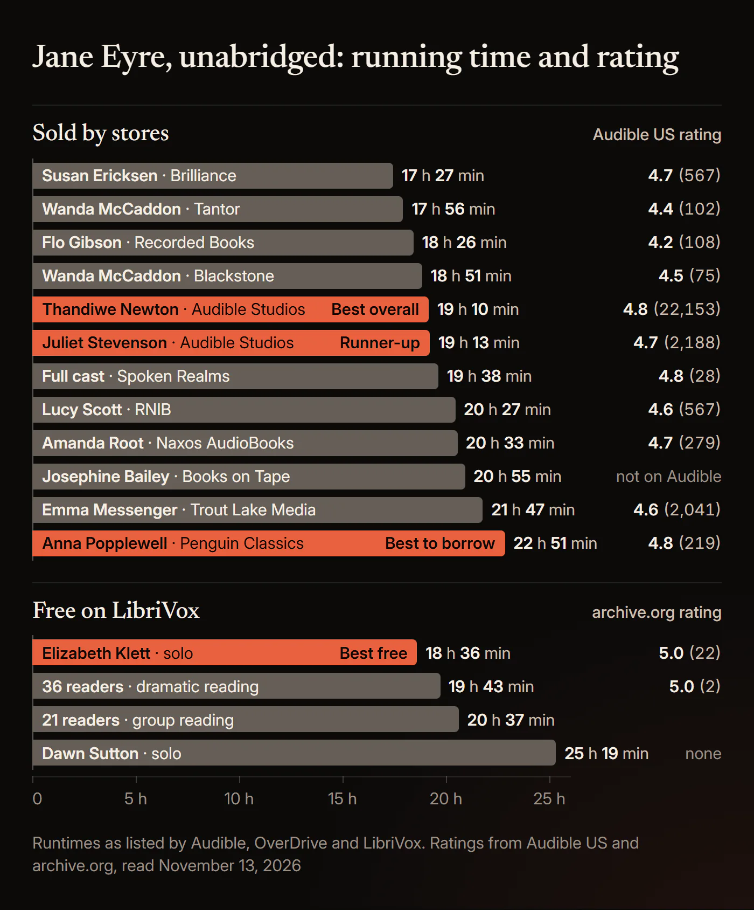
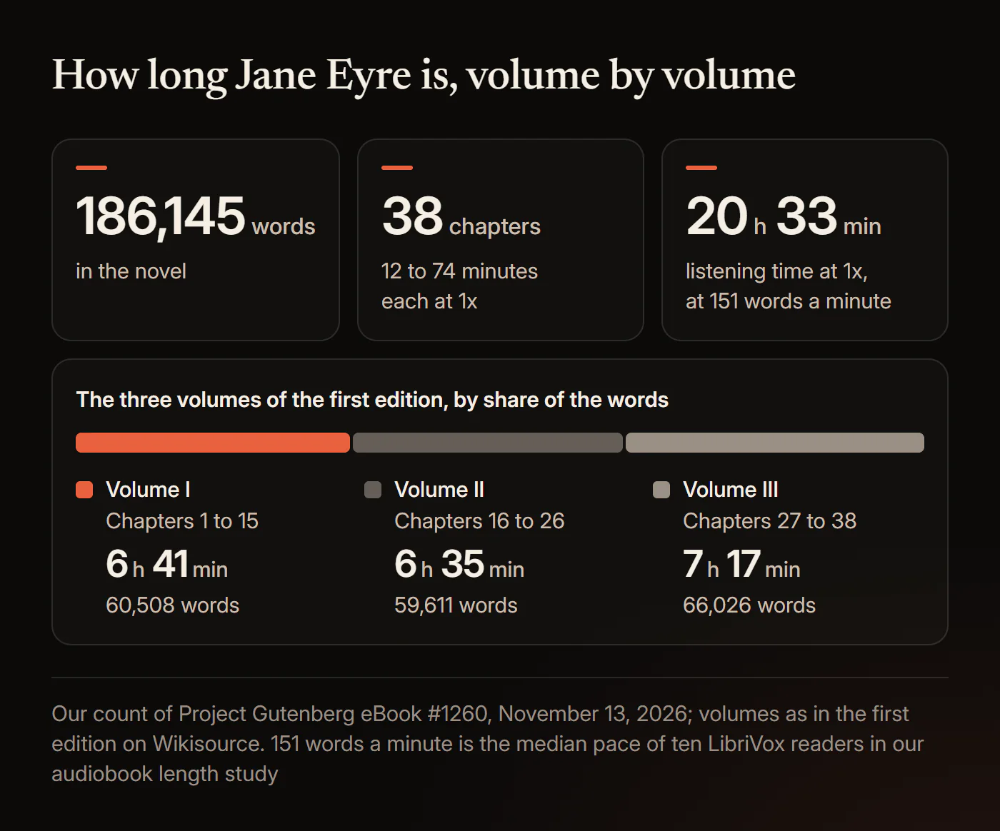
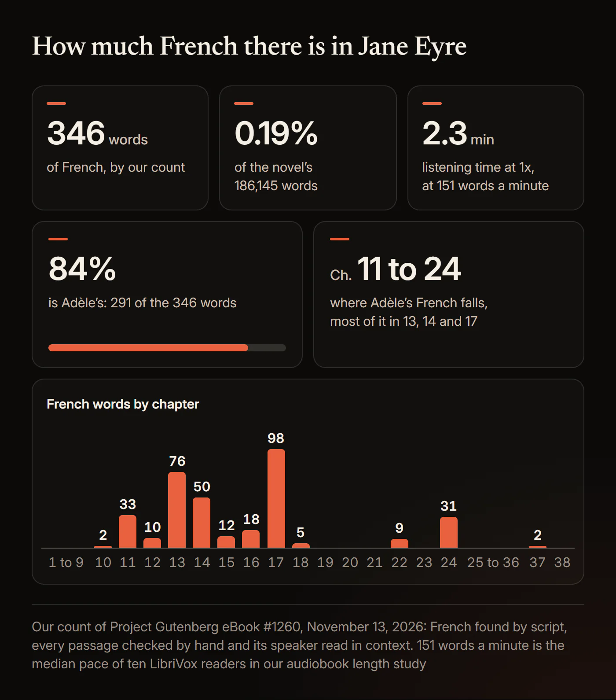
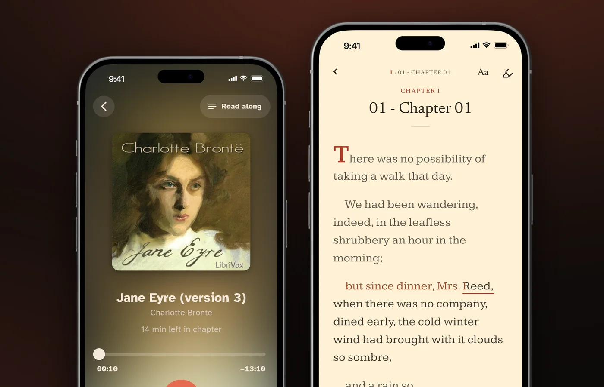

# Best Jane Eyre Audiobook: Every Narrator and Edition Compared

The best *Jane Eyre* audiobook is Thandiwe Newton's unabridged Audible Studios recording, 19 hours 10 minutes long. Juliet Stevenson's (19 hours 13 minutes) is the runner-up, Elizabeth Klett's LibriVox reading (18 hours 36 minutes) is the best free one, and Anna Popplewell's Penguin Classics recording (22 hours 51 minutes) is the best to borrow.

Newton's recording has 4.8 stars from 22,153 ratings on Audible US as of November 13, 2026, ten times as many as the next most rated edition. *Jane Eyre* is Charlotte Brontë's novel, published in 1847 under her pen name "Currer Bell". Below: every complete recording with its runtime and ratings, how long the book takes at each speed, what listeners say about each narrator, the four free LibriVox versions told apart, the abridged and dramatised ones, how much of the book is in French and what Adèle says, how to say Eyre and St. John, and a spoiler-free list of names. Every edition fact was read from the publisher's or store's own page on November 13, 2026.

## Which Jane Eyre audiobook is best?

Thandiwe Newton for most listeners, Juliet Stevenson as the runner-up, Elizabeth Klett's LibriVox reading for free, and Anna Popplewell's Penguin recording to borrow from a library.

### Best overall: Thandiwe Newton (Audible Studios, 2016)

Thandiwe Newton's [Audible Studios recording](https://www.audible.com/pd/B01COOZ5C2) is the most rated *Jane Eyre* audiobook anywhere we checked. On November 13, 2026 it had 4.8 stars from 22,153 ratings on Audible US, with 4.9 for performance, and 4.8 from another 4,363 on Audible UK. The next most rated edition, Juliet Stevenson's, had 2,188 on Audible US. Audible's page calls Newton's recording an "Earphones Award Winner (AudioFile Magazine)"; that is Audible's statement, and we did not check it with AudioFile.

AudioFile's review, quoted on the same page, says she "delivers the voice of Jane from childhood to adulthood with elegant conviction, breezing through the dense sentences as if they were part of a contemporary novel." On r/JaneEyre in 2024, a reply with a score of 11 said of her reading: "It feels like you are listening to Jane's inner monolog."

The recording runs 19 hours 10 minutes, about 162 words a minute by our calculation. On November 13, 2026 it listed at $24.89 on Audible US and $22.99 on Apple Books.

### Runner-up: Juliet Stevenson (Audible Studios, 2009)

Juliet Stevenson's [Audible Studios recording](https://www.audible.com/pd/B002V5CWOY) has 4.7 stars from 2,188 ratings on Audible US, with 4.8 for performance, as of November 13, 2026. On Audible UK it has 4.8 from 1,715 with 4.9 for performance. It runs 19 hours 13 minutes, three minutes longer than Newton's.

A top review on the US page, from a listener who "must've read Jane Eyre at least 15 times between the ages of 7 and 67", says: "Juliet Stevenson does such a good job as reader that for the very first time I actually cried at a point or two". On November 13, 2026, Stevenson's Audible US page showed "Listen for free" to a signed-out visitor; the list price was $24.10.

### Best free: Elizabeth Klett, LibriVox (2008)

Elizabeth Klett reads all 38 chapters alone in [LibriVox's solo recording](https://librivox.org/jane-eyre-version-3-by-charlotte-bronte/), catalogued on October 1, 2008, at 18:36:29. It is the most downloaded *Jane Eyre* on the Internet Archive, with 4,648,589 downloads on November 13, 2026, and 19 of the 22 entries on its page there are five-star reviews of the reading. A reviewer from Manchester wrote in 2009: "Happy to report that her British accent is very creditable, even to the ears of a native speaker." On r/JaneEyre in 2024: "I've listened to the Librivox version with Elizabeth Klett and really enjoyed it."

LibriVox's catalogue calls it "Jane Eyre (version 2)", but its web address and its Internet Archive page say "version 3", so go by the running time, 18 hours 36 minutes. It reads the text of Project Gutenberg eBook #1260.

### Best to borrow: Anna Popplewell (Penguin Classics, 2019)

[Anna Popplewell's Penguin Classics recording](https://www.audible.com/pd/0241438691) is the best rated edition with hundreds of ratings that we found on Libby. On November 13, 2026 the Los Angeles Public Library had 3 copies, with 9 holds. It has 4.8 stars from 219 ratings on Audible US with 4.9 for performance, the same scores as Newton's, and 4.5 from 140 on Apple Books. A top reviewer, a self-described "professor of British novels", wrote "Popplewell gives an impressively sensitive, unabridged reading".

The listing says "This definitive recording includes an Introduction by Stevie Davies", and the recording runs 22 hours 51 minutes with it; Audible's sample starts at Chapter 1. For a shorter wait, Wanda McCaddon's Tantor recording (17 hours 56 minutes) had 9 copies at the King County Library System, 5 of them available.

**Also worth knowing.** For a drama, [BBC Radio 4's dramatisation](https://www.audible.com/pd/B01DE02OHO) has 4.7 stars from 263 ratings on Audible US, but it is a 2 hour 13 minute adaptation. For every sentence with a cast, [LibriVox's free dramatic reading](https://librivox.org/jane-eyre-dramatic-reading-by-charlotte-bronte/) has 36 readers in 19 hours 43 minutes. Amanda Root, who reads the 2005 Naxos recording, played Miss Temple in Zeffirelli's film of *Jane Eyre*, Naxos notes.

### Every unabridged recording compared

Our table has 12 complete recordings you can buy or borrow, and LibriVox adds four free ones. Ratings are Audible US stars with the number of ratings in brackets, as of November 13, 2026.

| Narrator | Runtime | Publisher | Year | Audible US rating | Where we found it |
|---|---|---|---|---|---|
| Thandiwe Newton | 19 h 10 min | Audible Studios | 2016 | 4.8 (22,153) | Audible, Apple Books |
| Juliet Stevenson | 19 h 13 min | Audible Studios | 2009 | 4.7 (2,188) | Audible |
| Emma Messenger | 21 h 47 min | Trout Lake Media | 2012 | 4.6 (2,041) | Audible, Apple Books |
| Lucy Scott | 20 h 27 min | RNIB | 2008 | 4.6 (567) | Audible, Apple Books |
| Susan Ericksen | 17 h 27 min | Brilliance Audio (AmazonClassics) | 2017 | 4.7 (567) | Audible, Apple Books |
| Amanda Root | 20 h 33 min | Naxos AudioBooks | 2005 | 4.7 (279) | Audible, Apple Books, hoopla (Educational Edition) |
| Anna Popplewell | 22 h 51 min (with an introduction) | Penguin Classics | 2019 | 4.8 (219) | Audible, Apple Books, Libby |
| Wanda McCaddon | 17 h 56 min | Tantor | 2008 | 4.4 (102) | Audible, Apple Books, Libby |
| Wanda McCaddon (Nadia May in Libby) | 18 h 51 min | Blackstone | 2009 | 4.5 (75) | Audible, Apple Books, Libby |
| Flo Gibson | 18 h 26 min | Recorded Books | 1999 | 4.2 (108) | Audible, Apple Books, Libby |
| Josephine Bailey | 20 h 55 min | Books on Tape | 2007 | Not on Audible | Apple Books, Libby |
| Full cast: Amanda Friday, Rob Goll and others | 19 h 38 min | Spoken Realms | 2019 | 4.8 (28) | Audible |
| Elizabeth Klett, LibriVox | 18 h 36 min | LibriVox | 2008 | Free | LibriVox, Internet Archive, HushBook Discover |
| LibriVox dramatic reading, 36 readers | 19 h 43 min | LibriVox | 2012 | Free | LibriVox, Internet Archive, HushBook Discover |
| Dawn Sutton, LibriVox | 25 h 19 min | LibriVox | 2022 | Free | LibriVox, Internet Archive, HushBook Discover |
| LibriVox group reading, 21 readers | 20 h 37 min | LibriVox | 2007 | Free | LibriVox, Internet Archive, HushBook Discover |

Runtimes are Audible's, except Josephine Bailey's (OverDrive) and the free ones (LibriVox). Years are the publisher's or store's: Audible dates Root's recording 2004 and Flo Gibson's 1999, OverDrive dates Gibson's 1980, and Apple Books dates Bailey's 2011. Naxos's Educational Edition of Root's reading, 22 hours 2 minutes, adds a guide by Francis Gilbert.

**Listings we left out.** Audible also carries Juliet Mills (19 hours 26 minutes), Anna Bentinck (23 hours 8 minutes), Alison Larkin (21 hours 50 minutes), Susan Ericksen's earlier Classic Collection edition (17 hours 21 minutes) and more than twenty smaller listings. Saga Egmont, Paperless and Erika sell Elizabeth Klett readings of 18 hours 19 to 27 minutes; we could not confirm whether any is her LibriVox recording. We left out retellings, sequels, study guides and machine voices.

## How long is the Jane Eyre audiobook?

About 20 hours 33 minutes at 1x: the novel has 186,145 words, and complete recordings run from 17 hours 21 minutes to 25 hours 19 minutes.

We counted the words ourselves. Project Gutenberg eBook #1260, downloaded on November 13, 2026, has 186,145 words in the novel itself, in 38 chapters, without the chapter headings or the 904 words of Brontë's preface and note to the third edition. We used 151 words a minute, the median pace we measured for LibriVox solo readers in our guide to [how long audiobooks run](/blog/how-long-is-an-audiobook). The recordings at speed are each runtime divided by the speed.

| Speed | The novel at 151 words a minute | Thandiwe Newton | Juliet Stevenson | Elizabeth Klett (free) | Anna Popplewell |
|---|---|---|---|---|---|
| 1x | 20 h 33 min | 19 h 10 min | 19 h 13 min | 18 h 36 min | 22 h 51 min |
| 1.25x | 16 h 26 min | 15 h 20 min | 15 h 22 min | 14 h 53 min | 18 h 17 min |
| 1.5x | 13 h 42 min | 12 h 47 min | 12 h 49 min | 12 h 24 min | 15 h 14 min |
| 2x | 10 h 16 min | 9 h 35 min | 9 h 36 min | 9 h 18 min | 11 h 26 min |

**The real range.** Complete recordings by human readers on sale run from 17 hours 21 minutes (Susan Ericksen's Classic Collection edition) to 23 hours 8 minutes (Anna Bentinck), and Dawn Sutton's free LibriVox reading takes 25 hours 19 minutes. Across 29 complete recordings, the four LibriVox sets included, narrators read at 122 to 179 words a minute, median 157. These paces include any introduction or preface. So there is no single length: an 18.9-hour figure circulates online beside the blurb for Anna Popplewell's recording, which runs 22 hours 51 minutes. Read silently at 260 words a minute, the novel takes about 11 hours 56 minutes.

**Chapters.** By our count the average chapter is 4,899 words, about 32 minutes at 1x. Only 6 of the 38 chapters take under 20 minutes, and 18 take 30 minutes or more. The longest, Chapter 27, has 11,238 words, about 74 minutes (62 minutes in Klett's file). The shortest, Chapter 38, has 1,828 words, about 12 minutes. Chapter 1 has 1,934 words, about 13 minutes; Klett's Chapter 1 file runs 13:20.

**Volumes.** *Jane Eyre* first came out in three volumes, and the 1850 edition was the first in one volume, according to the Naxos booklet. Wikisource's transcription of the first edition gives Volume I 15 chapters, Volume II 11 and Volume III 12:

| Volume | Chapters (Gutenberg and LibriVox numbering) | Words | At 1x |
|---|---|---|---|
| Volume I | 1 to 15 | 60,508 | 6 h 41 min |
| Volume II | 16 to 26 | 59,611 | 6 h 35 min |
| Volume III | 27 to 38 | 66,026 | 7 h 17 min |

Project Gutenberg's text and the LibriVox files number the chapters 1 to 38 straight through. Editions that keep the first edition's layout start again at Chapter 1 in each volume: add 15 to a Volume II chapter number and 26 to a Volume III one. So if you are looking for part 2, Volume II, Chapter 1 is Chapter 16, and Volume III, Chapter 1 is Chapter 27.

**Days to finish, our calculation** at 151 words a minute, rounded up to whole days:

| Speed | 30 min a day | 60 min a day |
|---|---|---|
| 1x | 42 days | 21 days |
| 1.25x | 33 days | 17 days |
| 1.5x | 28 days | 14 days |
| 2x | 21 days | 11 days |

### Is Jane Eyre longer than Wuthering Heights?

Yes: *Jane Eyre* is 1.6 times as long, 186,145 words against 116,440.

We counted both with the same script on Project Gutenberg's texts (eBook #1260 and #768). At 151 words a minute, *Jane Eyre* takes 20 hours 33 minutes at 1x and *Wuthering Heights* 12 hours 51 minutes. Our [Wuthering Heights audiobook comparison](/blog/best-wuthering-heights-audiobook) covers Emily Brontë's novel the same way.

## Thandiwe Newton or Juliet Stevenson: who is the best narrator?

Thandiwe Newton, on ratings and on Reddit recommendations, with Juliet Stevenson a close second; one listener who has heard both says you cannot go wrong with either.

| | Thandiwe Newton | Juliet Stevenson |
|---|---|---|
| Publisher, year | Audible Studios, 2016 | Audible Studios, 2009 |
| Runtime | 19 h 10 min | 19 h 13 min |
| Words a minute | 162 | 161 |
| Audible US stars (ratings) | 4.8 (22,153) | 4.7 (2,188) |
| Audible US performance | 4.9 | 4.8 |
| Audible UK stars (ratings) | 4.8 (4,363) | 4.8 (1,715) |
| Audible UK performance | 4.8 | 4.9 |
| Apple Books | $22.99, 4.4 (70) | Not found in the US store |
| Libby | Not in the five systems we checked | Not in the five systems we checked |

Ratings, prices and Libby copies as of November 13, 2026. The five Libby systems are the New York, Los Angeles, San Francisco and Chicago public libraries and the King County Library System. Words a minute is our count of 186,145 words divided by the runtime.

**Thandiwe Newton.** In the four Reddit threads we read that ask which recording to choose, from 2018 to 2024, Newton is recommended most. "Definitely Thandawe Newton, amazing," one r/audiobooks reply said in 2024, with a score of 10. In 2018: "She's got a beautiful accent and does a great job vocally distinguishing between characters." No *Jane Eyre* recording appears among the Audie Award winners or finalists from 1996 to 2026, by our scan of the Audio Publishers Association's pages; the one hit was a parody, *Texts from Jane Eyre*.

**Juliet Stevenson.** "Juliet Stevenson is the GOAT," a reply in the 2024 r/JaneEyre thread said. The two narrators handle Rochester's song in Chapter 24 differently, according to a 2022 r/ClassicBookClub thread: "Juliet Stevenson made the artistic decision to sing it in the style of a rustic ballad," and of Newton, "listening to the song was just amazing." A 2024 r/audiobooks reply sums up the choice: "I've listened to the Newton & Stevenson and they're both superb. You really can't go wrong with either."

Other narrators with fans:

- **Lucy Scott** (RNIB, 2008, 20 hours 27 minutes): 4.6 stars from 567 ratings. "Lucy Scott, hands down," wrote a listener on r/audiobooks in 2021. RNIB's listing says: "This is a vintage recording. The audio quality may not be up to modern day standards." Her recording includes Brontë's 1848 preface, and Audible's sample opens in it.
- **Amanda Root** (Naxos AudioBooks, 2005, 20 hours 33 minutes): 4.7 from 279, with 4.8 for performance. An Audible reviewer: "Amanda Root is perfect for it! She has an amazing accent that sweeps you into the story."
- **Emma Messenger** (Trout Lake Media, 2012, 21 hours 47 minutes): 4.6 from 2,041, the third most rated edition, at about 142 words a minute.
- **Susan Ericksen** (AmazonClassics, 2017, 17 hours 27 minutes): her AmazonClassics and Classic Collection recordings are the fastest complete readings on sale, at about 178 and 179 words a minute. "It was competently done," a 2024 r/JaneEyre reply said.
- **Wanda McCaddon**: Tantor (2008, 17 hours 56 minutes) and Blackstone (2009, 18 hours 51 minutes). Libby credits the Blackstone recording to Nadia May, Audible and Apple Books to Wanda McCaddon. "Nadia May is probably my favorite narrator," one r/audiobooks reply said in 2021.

### Is Thandie Newton the same as Thandiwe Newton?

Yes: the "Thandie Newton" *Jane Eyre* and the "Thandiwe Newton" one are the same recording.

Audible US and UK, Amazon UK and Amazon Canada credit Thandiwe Newton. Audible's own SoundCloud post from 2016, a sample titled "Jane Eyre by Charlotte Bronte, Narrated by Thandie Newton", links to the same Audible product, B01COOZ5C2. The SoundCloud track is a sample, not the book. The recording is unabridged, 19 hours 10 minutes, released by Audible Studios on April 17, 2016.

### Which Jane Eyre audiobook has a British accent?

Thandiwe Newton's recording and Elizabeth Klett's free reading have British accents by their reviewers' accounts, and listeners praise the accents of Amanda Root, Lucy Scott and Anna Popplewell.

The New York Times Book Review, quoted on Audible's page, says Newton's "taut British diction makes a one-woman play out of the orphan girl's love story". For Klett, the Manchester reviewer quoted above calls her British accent "very creditable" in *Jane Eyre*. Klett's accent changes by book: two Internet Archive reviews describe her free [Pride and Prejudice](/blog/best-pride-and-prejudice-audiobook) as narrated in an American accent with the dialogue in British accents. Of Lucy Scott, an Audible reviewer wrote "Her accent was perfect and easily understood", and a 2024 Reddit reply heard in Popplewell "a nice median resonance with an unpretentious accent". We found no store page or review describing a complete *Jane Eyre* recording read in an American accent.

## Is there a free Jane Eyre audiobook?

Yes: LibriVox has four complete free English recordings, all reading Project Gutenberg's text, and Elizabeth Klett's solo reading, 18 hours 36 minutes, is the one to pick.

| | Elizabeth Klett (solo) | Group reading | Dramatic reading | Dawn Sutton (solo) |
|---|---|---|---|---|
| LibriVox title | Jane Eyre (version 2) | Jane Eyre | Jane Eyre (dramatic reading) | Jane Eyre: An Autobiography |
| Read by | Elizabeth Klett | 21 volunteers | 36 volunteers in a cast | Dawn Sutton |
| Running time | 18:36:29 | 20:36:36 | 19:42:53 | 25:19:06 |
| Words a minute | 167 | 150 | 157 | 122 |
| Catalog date | October 1, 2008 | May 19, 2007 | December 27, 2012 | August 22, 2022 |
| Internet Archive downloads | 4,648,589 | 3,521,496 | 1,229,593 | 62,104 |
| Files | 38 | 39 | 39 | 41 |
| 64 kbps MP3 download | 511 MB | 566 MB | 542 MB | 696 MB |

Running times and dates come from the LibriVox catalog and API; downloads and file sizes from the Internet Archive on November 13, 2026. Words a minute is our calculation. Klett's files run "01 - Chapter 01" to "38 - Chapter 38, Conclusion", one per chapter, so you can start at Chapter 1 or anywhere else.

### Which LibriVox Jane Eyre should you pick?

Elizabeth Klett's: one voice, the whole book, and 19 five-star reviews on its Internet Archive page.

- **Elizabeth Klett.** "Priceless are the numerous duets between Eyre and Mr Rochester for the reader seems to have a neat distinct voice for both and never fades out of character," a reviewer wrote in 2008. The same reviewer found "The first minutes of the first chapter are somehow hard to follow", after which "the reader voice catches up with the beat". At one hour a day it takes 19 days at 1x, 15 at 1.25x, 13 at 1.5x and 10 at 2x.
- **The group reading.** The reader changes by chapter. Its one review on its own page, 2 stars in 2018, says: "I have reached Chapter 11 and the reader (as Jane, in the first person) is a man. Surely that can't be right?" Five of the eight reviews on the group reading's Internet Archive page praise Klett's separate recording, posted on the wrong page, so its average there tells you little about it.
- **The dramatic reading.** Each character has a reader. "This dramatic reading of Jane Eyre is marvelous," a 2013 reviewer wrote. "The lead characters are very well acted, and the supporting cast is pretty darn good too."
- **Dawn Sutton.** The other solo reading, and the slowest complete one at 122 words a minute, preface included. Its file numbers stop matching the book's chapter numbers after Chapter 26.

**Other free routes.** Besides Stevenson's Audible page, which showed "Listen for free", Audible's SoundCloud has a free sample of Newton's recording, not the whole book. Project Gutenberg eBook #1260, the text the LibriVox recordings read, is free too. Two "free audiobook" sites near the top of our searches play machine voices, so we left them out. Our guide to whether [LibriVox is free and legal](/blog/is-librivox-safe-and-legal) explains why these recordings cost nothing.

### Is the YouTube Jane Eyre audiobook free?

Full uploads are free to play, but none we found comes from a publisher or rights holder; the LibriVox recordings are the free route with a named reader.

LibriVox recordings are in the public domain, so anyone may re-upload them, but we did not check which recording each YouTube upload plays. If you are after part 2 or a single chapter, LibriVox's own files are numbered by chapter, and the volumes table above shows where each first-edition volume starts.

## Which Jane Eyre audiobooks are abridged or dramatised?

Nine listings we found are cut, condensed or dramatised, from 2 hours to 6 hours 6 minutes; every complete recording on sale runs at least 17 hours 21 minutes.

| Version | Publisher, year | Runtime | What it is |
|---|---|---|---|
| L.A. Theatre Works, full cast | L.A. Theatre Works, 2016 | 2 h | Radio play |
| BBC Radio 4, Amanda Hale and Tom Burke, adapted by Rachel Joyce | BBC Digital Audio, 2016 | 2 h 13 min | Full-cast radio dramatisation |
| Carole Boyd | CSA Word, 2008 | 2 h 23 min | Abridged |
| Claire Bloom and Anthony Quayle | HarperCollins, 2010 | 2 h 54 min | Dramatised reading, abridged (Audible UK) |
| Wendy Hiller | BN Publishing, 2015 | 3 h 2 min | Abridged |
| Penelope Wilton | Hodder & Stoughton, 2009 | 3 h 10 min | Abridged |
| Ishia Bennison, Oxford Bookworms Library Stage 6 | Oxford University Press, 2011 | 3 h 21 min | Graded reader for learners of English |
| Emma Fielding | Naxos AudioBooks, 2009 | 4 h 1 min | Abridged, with teacher's notes |
| Joanna David | Penguin Group (USA), 2005 | 6 h 6 min | Abridged |

Runtimes are Audible's, except Joanna David's (OverDrive). Read November 13, 2026.

**The BBC dramatisation.** It is the one to choose for a drama, and the best rated audio adaptation we found: 4.7 stars from 263 ratings on Audible US, with 4.8 for performance, and 4.7 from 157 on Audible UK. Audible lists its format as abridged. A top review: "It's always tricky in adaptations as to what to keep and what to cut for space: I thought they made some good choices." It is also tracks 1 to 2 of The Brontë BBC Radio Drama Collection, seven dramatisations in 15 hours 40 minutes with 4.6 stars from 142 ratings. Screen adaptations are outside this guide.

Our guide to [abridged and unabridged audiobooks](/blog/abridged-vs-unabridged-audiobooks) explains how to tell them apart in any store.

### Is the full-cast Jane Eyre the whole book?

Three full-cast recordings read the whole text; the BBC Radio 4 and L.A. Theatre Works casts perform adaptations of about two hours.

| Full cast | Year | Runtime | Words a minute | Rating | Cast |
|---|---|---|---|---|---|
| LibriVox dramatic reading | 2012 | 19 h 43 min | 157 | Free | 36 volunteers; Elizabeth Barr as Jane, Algy Pug as Mr. Rochester |
| Spoken Realms | 2019 | 19 h 38 min | 158 | 4.8 (28) | Amanda Friday as Jane, Rob Goll as Rochester, Elizabeth Klett as Diana Rivers |
| Thrive Audio | 2024 | 21 h 52 min | 142 | 4.8 (21) | Seven readers, roles not listed |

Their paces sit inside the 122 to 179 words a minute of the complete solo readings, which fits the whole text. We did not check them against the text by sample.

## Do you need to know French to listen to Jane Eyre?

No: by our count, French is 346 of the novel's 186,145 words, under 0.2%, about two minutes of listening.

**How we counted.** We ran a French-word detector over all 38 chapters of Project Gutenberg eBook #1260, then read every hit by hand. We dropped 25 false hits, such as "&c." and loanwords like "naïve" and "tête-à-tête", and a few one-word exclamations may still be missed, so call it about 350 words. The 346 words are 0.19% of the novel and 2.3 minutes at 151 words a minute, in 55 passages across 12 chapters:

| Chapter | French words |
|---|---|
| 10 | 2 |
| 11 | 33 |
| 12 | 10 |
| 13 | 76 |
| 14 | 50 |
| 15 | 12 |
| 16 | 18 |
| 17 | 98 |
| 18 | 5 |
| 22 | 9 |
| 24 | 31 |
| 37 | 2 |

By volume, that is 183 words in Volume I, 161 in Volume II and 2 in Volume III.

**Who speaks it.** Adèle, Mr. Rochester's French ward and Jane's pupil, speaks 291 of the 346 words, 84%, all in Chapters 11 to 24. Rochester has 29, mostly single words in Chapter 15 such as "grande passion" and "voiture". Jane's own narration has 10, such as "par parenthèse"; Blanche Ingram 8; Adèle's nurse Sophie 5, among them "bon soir"; Lady Ingram 2 ("Tant pis!"); and Mrs. Fairfax 1.

**Most of Adèle's talk is printed in English.** When Jane meets her in Chapter 11, Adèle announces "La Ligue des Rats: fable de La Fontaine", and Jane tells us she "declaimed the little piece" without giving the poem. Adèle's account of her own life ("With Madame Frédéric and her husband: she took care of me") is printed in English. So two claims you may meet are both off: a 2026 reading guide says Adèle "speaks almost exclusively in French", and a 2024 Reddit comment says "There are like 3 French lines in the whole book."

**Why the French is there.** Charlotte Brontë studied French at the Pensionat Heger in Brussels between 1842 and 1844, with her sister Emily, according to the Naxos booklet. In a 2013 article, Emily Eells writes that "Jane's knowledge of French qualifies her for the post of governess to Parisian born Adèle".

**What the research says.** In a 2013 study of 36 native and 40 non-native listeners, van Zeeland and Schmitt found that "most native and non-native participants could adequately comprehend the spoken texts with only 90 per cent coverage". Even with no French at all, *Jane Eyre* is 99.8% English. The study tested factual comprehension of short informal spoken stories, not a novel, and not passages in another language.

Seeing Adèle's lines while you hear them settles the rest. In HushBook, the app we built, you can pair Elizabeth Klett's free recording with Project Gutenberg's free EPUB of the same text, and e-book sync (in beta, first sync free) aligns Brontë's text, French included, to her voice.

### What does Adèle say?

Mostly chatter about presents, clothes and flowers. Here are her key lines, in our plain English:

| Chapter | Adèle says (Project Gutenberg #1260) | In plain English |
|---|---|---|
| 11 | "C'est là ma gouvernante!" | "So that's my governess!" |
| 11 | "J'ai bien faim, moi!" | "I'm really hungry!" |
| 13 | "Et cela doit signifier, qu'il y aura là dedans un cadeau pour moi, et peut-être pour vous aussi, mademoiselle. Monsieur a parlé de vous: il m'a demandé le nom de ma gouvernante, et si elle n'était pas une petite personne, assez mince et un peu pâle. J'ai dit qu'oui: car c'est vrai, n'est-ce pas, mademoiselle?" | "And that must mean there's a present in there for me, and maybe for you too, miss. Monsieur talked about you: he asked me my governess's name, and whether she wasn't a little person, rather thin and a bit pale. I said yes, because it's true, isn't it, miss?" |
| 14 | "Est-ce que ma robe va bien? et mes souliers? et mes bas? Tenez, je crois que je vais danser!" | "Does my dress look right? And my shoes? And my stockings? Look, I think I'm going to dance!" |
| 16 | "Qu'avez-vous, mademoiselle? Vos doigts tremblent comme la feuille, et vos joues sont rouges: mais, rouges comme des cerises!" | "What's the matter, miss? Your fingers are shaking like a leaf, and your cheeks are red, red as cherries!" |
| 17 | "Est-ce que je ne puis pas prendre une seule de ces fleurs magnifiques, mademoiselle? Seulement pour completer ma toilette." | "Can't I take just one of these beautiful flowers, miss? Only to finish my outfit." |

The English renderings are ours, checked for sense against the "Translations of Adele's French statements" page of The Reader's Guide to Charlotte Brontë's "Jane Eyre", which covers her French in Chapters 11 to 18, 22 and 24.

## How do you pronounce Eyre and St. John?

Eyre sounds like "air", and St. John is said "SIN-jin", the traditional British way and the one listeners report hearing on the recordings.

Wikipedia gives *Jane Eyre* as "/ɛər/ AIR". For St. John, Wikipedia's article on the name says "It can be pronounced /ˈsɪndʒɪn/ or /-ʒən/ sometimes in some places, particularly if it is the first part of a hyphenated family name or a given name", and it gives Sinjin and Sinjun among the name's spellings.

Listeners confirm it. A 2016 Internet Archive reviewer of Elizabeth Klett's recording wrote the name down as "St. John (Sinjhn.)". In a 2022 r/ClassicBookClub thread, one reader asked: "I'm listening to the Audible version and I need to know, why the brits pronounce the name "St. John" as "Sinjin?"" In the same club's Chapter 28 thread: "It's pronounced SinJin."

St. John Rivers is first heard in Chapter 28. Said as Sinjin, his name does not sound like the book's other Johns.

### How many characters are called John?

Four, counting St. John: "John" appears 200 times in the novel by our count, 130 of them as "St. John".

- **John Reed**, Jane's cousin, in Chapters 1 to 4, 10 and 21.
- **John**, a manservant at Thornfield, from Chapter 11.
- **John Green**, a minor character in Chapter 26.
- **St. John Rivers**, a clergyman, from Chapter 28.

## Who is who in Jane Eyre?

The table names each person with the chapter that tells you who they are, and it gives nothing away: every fact in it is told by Chapter 31, in the chapter shown. The counts are ours, from Project Gutenberg eBook #1260.

| Names in the book (our count) | Who | Told in |
|---|---|---|
| Jane (340), Miss Eyre (45), Janet (21) | The narrator, an orphan; Janet is Mr. Rochester's name for her, from Ch. 22 | Ch. 1 to 2 |
| Mrs. Reed (81) | Jane's aunt by marriage: her late husband was Jane's mother's brother | Ch. 2 |
| John Reed (11), Eliza (30), Georgiana (44) | Mrs. Reed's children, Jane's cousins; "John Reed was a schoolboy of fourteen years old" | Ch. 1 |
| Bessie (131), Miss Abbot (25) | Nursemaid and maid at Gateshead; Bessie's surname, Lee, comes in Ch. 4 | Ch. 1 to 2 |
| Mr. Lloyd (12) | The apothecary | Ch. 3 |
| Mr. Brocklehurst (56) | Runs Lowood school | Ch. 4 to 5 |
| Miss Temple (63) | Lowood's superintendent; her first name, Maria, comes in Ch. 5 | Ch. 4 to 5 |
| Helen Burns (Helen 63, Burns 32) | A Lowood pupil; teachers call the girls by their surnames | Ch. 6 |
| Miss Scatcherd (23), Miss Miller (23), Mary Ann Wilson (4) | Lowood teachers, and a later Lowood friend | Ch. 5, 9 |
| Mrs. Fairfax (121) | Housekeeper at Thornfield; "The present Mr. Rochester's mother was a Fairfax, and second cousin to my husband" | Ch. 10 to 11 |
| Adèle Varens (Adèle 135, Adela 4, Varens 12) | Mr. Rochester's French ward and Jane's pupil; Adela is Mrs. Fairfax's form | Ch. 11 |
| Sophie (27) | Adèle's French nurse | Ch. 11 |
| Mr. Rochester (332), Edward Fairfax Rochester | Master of Thornfield; Adèle calls him "Monsieur Edouard Fairfax de Rochester" (Ch. 13) | Named Ch. 11, met Ch. 12 |
| Grace Poole (21), Leah (27), John and his wife | Thornfield servants | Ch. 11 to 12 |
| Pilot (24) | Mr. Rochester's dog | Ch. 12 |
| Blanche Ingram (19), Mary Ingram, Lady Ingram | Guests at Thornfield | Ch. 16 to 17 |
| St. John Rivers (St. John 130, Mr. Rivers 33) | A clergyman; first name heard in Ch. 28, surname in Ch. 29 | Ch. 28 to 29 |
| Diana (76) and Mary Rivers | His sisters | Ch. 28 to 29 |
| Hannah (40) | The Rivers' old servant, who speaks some dialect | Ch. 28 |
| Rosamond Oliver (16) | A wealthy young woman of Morton | Ch. 31 |

Places recur as often as people: Gateshead 43 times (from Ch. 2), Lowood 54 (Ch. 4), Thornfield 100 (Ch. 10), Millcote 29 (Ch. 10), Hay 18 (Ch. 11), Whitcross 10 (Ch. 28), Marsh End 6 and Moor House 16 (Ch. 28 to 29) and Morton 25 (Ch. 29).

**The traps.**

- **Three Marys.** Mary Ann Wilson at Lowood (Ch. 9), Mary Ingram (Ch. 16 to 18) and Mary Rivers (from Ch. 28); "Mary" appears 96 times.
- **Fairfax.** Mrs. Fairfax is the housekeeper, and Fairfax is also Mr. Rochester's middle name: his mother "was a Fairfax" (Ch. 11).
- **Georgiana and Diana.** Georgiana is a Reed, at Gateshead. Diana is St. John's sister.
- **Jane's names.** Jane, Miss Eyre, and from Mr. Rochester, Janet.

Our guide on how to [keep track of characters](/blog/how-to-keep-track-of-characters-in-a-book) has methods that work for any book.

## Is Jane Eyre hard to read?

Not by its sentences: Project Gutenberg rates it 77.4, "Fairly easy to read." What makes *Jane Eyre* demanding is its length.

Project Gutenberg's scores: *Jane Eyre* 77.4 ("7th grade"), *Wuthering Heights* 78.8 (the same band) and *Pride and Prejudice* 69.2 ("8th & 9th grade"). With one sentence splitter for all three, we count 17.6 words a sentence in *Jane Eyre*, 16.1 in *Wuthering Heights* and 17.4 in *Pride and Prejudice*. The difference is length: 186,145 words in chapters that average 32 minutes at 1x.

*Jane Eyre* is told in the first person. Its original title is *Jane Eyre: An Autobiography*, and it opens: "There was no possibility of taking a walk that day." Jane addresses the reader 36 times, in 22 of the 38 chapters. By our count, 43.9% of the words sit inside quotation marks, rising from 35.7% in Volume I to 47.3% in Volume II and 48.8% in Volume III.

Dialect is a small matter here. Hannah, the Rivers' servant, says things like "ye and Mr. St. John is like of different soart". A reader in the 2022 r/ClassicBookClub Chapter 28 thread wrote: "Thank goodness that she is no Joseph lol."

### Should you read or listen to Jane Eyre?

Either works for following the story, but minds wander most when people only listen, and no study has tested this novel.

Across 46 studies with 4,687 people, Clinton-Lisell's 2022 meta-analysis found no reliable overall difference between understanding a text by reading it and by listening to it. Varao Sousa, Carriere and Smilek (2013) found that listening produced the most mind wandering of three ways of taking in a passage.

For *Jane Eyre*, the load on your attention is length, 38 chapters averaging 32 minutes, more than the French (about two minutes) or the names (four Johns, three Marys). Neither study used a novel. No study we found tests first-person narration, the French in *Jane Eyre* or St. John's name on audio. That points to a simple rule: listen when it fits your day, and have the text in front of you for Adèle's lines and the names.

## What we could not verify

- **Sound.** We did not rank the recordings by listening. No Audible sample reaches the French (from Chapter 11) or St. John (Chapter 28), so we could not hear how each paid narrator handles them. The accents above are reviewers' words.
- **Some stores.** We did not check Spotify (it needs a login), Libro.fm, Chirp, Google Play, Scribd, Everand or BBC Sounds.
- **Free offers.** We could not see which membership Stevenson's "Listen for free" means. Audible's catalogue also lists a Kindle Unlimited plan for Susan Ericksen's AmazonClassics edition, which we could not check as an offer.
- **The award.** "Earphones Award Winner" is Audible's statement about Newton's recording; we did not open AudioFile's own page.
- **Full casts.** Whether the Spoken Realms and Thrive Audio recordings read every word; their paces fit the whole text.
- **Repeat releases.** Whether the paid Elizabeth Klett releases are her LibriVox recording, whether Flo Gibson's two listings are one recording, and why Dawn Sutton's files are numbered past Chapter 38. Nadia May and Wanda McCaddon are matched by listings only.
- **Print editions.** Which modern print editions restart chapter numbers in each volume.
- **Your country.** Availability and prices vary by region. Prices and ratings above are a snapshot of November 13, 2026.

## Is there a Jane Eyre audiobook with text?

Yes: HushBook, the app we built, plays an audiobook and shows its words in time with the voice, on iPhone, Android and Windows.

HushBook is free, with no account, and transcription runs on your own device. In Discover, search "jane eyre" and pick "Jane Eyre (version 3)", the card that reads 18h 36m: that is Elizabeth Klett's LibriVox reading, 38 chapters in a 511 MB download, one chapter per file. Play a sample first if you like. HushBook queues the transcription on your phone as soon as the book is added.

Words fill in as the narrator reads them, with a red underline on the current one. Long-press any line to play from there, which helps in a 74-minute chapter like Chapter 27. Mark a passage to keep it as a highlight, note or quote, and set the speed anywhere from 0.5x to 3x. After the one-time engine download, playback and read-along work without an internet connection.

For Brontë's own text, Adèle's French included, attach a matching DRM-free EPUB, PDF or TXT, such as Project Gutenberg's eBook #1260, the text Klett reads: e-book sync (in beta, first sync free) aligns the book's text to the audio word by word. For the names, HushBook's character map keeps one card per person: add St. John Rivers once and note "said Sinjin", keep "Janet" and "Miss Eyre" in the notes on Jane's card, and see the chapter and time you first heard each of them.

For a paid edition, read along with a DRM-free MP3 or M4B copy you own. HushBook imports MP3, M4A, M4B and more, and detects the chapters inside M4B files. The Windows app is free on Windows 10 or 11 (64-bit) and imports MP3 and M4B files or whole folders.

HushBook works with free public domain recordings and audio files you own without DRM.

## Sources

- [Audible, Jane Eyre (Thandiwe Newton, Audible Studios)](https://www.audible.com/pd/B01COOZ5C2)
- [Audible, Jane Eyre (Juliet Stevenson, Audible Studios)](https://www.audible.com/pd/B002V5CWOY)
- [Audible, Jane Eyre (Anna Popplewell, Penguin Classics)](https://www.audible.com/pd/0241438691)
- [Audible, Jane Eyre (Emma Messenger, Trout Lake Media)](https://www.audible.com/pd/B0096TOT4O)
- [Audible, Jane Eyre (Lucy Scott, RNIB)](https://www.audible.com/pd/B0036NAQUC)
- [Audible, Jane Eyre (Susan Ericksen, AmazonClassics)](https://www.audible.com/pd/B073VRW59Y)
- [Audible, Jane Eyre (Amanda Root, Naxos AudioBooks)](https://www.audible.com/pd/B002V1NMBU)
- [Audible, Jane Eyre (BBC Radio 4 full-cast dramatisation)](https://www.audible.com/pd/B01DE02OHO)
- [Audible, catalogue API results for "jane eyre"](https://api.audible.com/1.0/catalog/products?keywords=jane+eyre&num_results=50&response_groups=contributors,product_desc,product_attrs,rating,media,sample,series,relationships)
- [Audible on SoundCloud, "Jane Eyre by Charlotte Bronte, Narrated by Thandie Newton"](https://soundcloud.com/audible/jane-eyre)
- [Apple, iTunes Search API, audiobook results for "jane eyre"](https://itunes.apple.com/search?term=jane+eyre&media=audiobook&country=us&limit=200)
- [Apple Books, Jane Eyre (Thandiwe Newton)](https://books.apple.com/us/audiobook/id1100423838)
- [Apple Books, Jane Eyre (Anna Popplewell)](https://books.apple.com/us/audiobook/id1479199043)
- [Apple Books, Jane Eyre (Lucy Scott)](https://books.apple.com/us/audiobook/id306073683)
- [Apple Books, Jane Eyre (Emma Messenger)](https://books.apple.com/us/audiobook/id561321555)
- [Apple Books, Jane Eyre (Susan Ericksen)](https://books.apple.com/us/audiobook/id1263205707)
- [Apple Books, Jane Eyre (Amanda Root)](https://books.apple.com/us/audiobook/id1748222642)
- [Apple Books, Jane Eyre (Josephine Bailey)](https://books.apple.com/us/audiobook/id1417779639)
- [Apple Books, Jane Eyre (Flo Gibson)](https://books.apple.com/us/audiobook/id1640935106)
- [Apple Books, Jane Eyre (BBC Radio 4 dramatisation)](https://books.apple.com/us/audiobook/id1441222275)
- [Naxos AudioBooks, "Jane Eyre (unabridged)"](https://naxosaudiobooks.com/jane-eyre-unabridged/)
- [Naxos AudioBooks, Jane Eyre booklet (PDF)](https://naxosaudiobooks.com/wp-content/uploads/2020/03/35712_Jane_Eyre.pdf)
- [OverDrive, catalogue API for the New York Public Library](https://thunder.api.overdrive.com/v2/libraries/nypl/media?query=jane%20eyre&format=audiobook-overdrive,audiobook-mp3&perPage=100)
- [OverDrive, catalogue API for the Los Angeles Public Library](https://thunder.api.overdrive.com/v2/libraries/lapl/media?query=jane%20eyre&format=audiobook-overdrive,audiobook-mp3&perPage=100)
- [OverDrive, catalogue API for the King County Library System](https://thunder.api.overdrive.com/v2/libraries/kcls/media?query=jane%20eyre&format=audiobook-overdrive,audiobook-mp3&perPage=100)
- [OverDrive, catalogue API for the San Francisco Public Library](https://thunder.api.overdrive.com/v2/libraries/sfpl/media?query=jane%20eyre&format=audiobook-overdrive,audiobook-mp3&perPage=100)
- [OverDrive, catalogue API for the Chicago Public Library](https://thunder.api.overdrive.com/v2/libraries/chipublib/media?query=jane%20eyre&format=audiobook-overdrive,audiobook-mp3&perPage=100)
- [hoopla, search results for "jane eyre"](https://www.hoopladigital.com/search?q=jane%20eyre&scope=everything&type=direct&kindId=8)
- [hoopla, Jane Eyre (Naxos Educational Edition)](https://www.hoopladigital.com/audiobook/jane-eyre-charlotte-bronte/16934339)
- [Audio Publishers Association, Audie Awards winners](https://www.audiopub.org/audie-awards-winners)
- [Audio Publishers Association, "2016 Audies"](https://www.audiopub.org/2016-audies-1)
- [LibriVox, API feed for "Jane Eyre"](https://librivox.org/api/feed/audiobooks/?title=%5EJane%20Eyre&format=json&extended=1&limit=50)
- [LibriVox, "Jane Eyre (version 2)", read by Elizabeth Klett](https://librivox.org/jane-eyre-version-3-by-charlotte-bronte/)
- [LibriVox, "Jane Eyre" (group reading)](https://librivox.org/jane-eyre-by-charlotte-bront/)
- [LibriVox, "Jane Eyre (dramatic reading)"](https://librivox.org/jane-eyre-dramatic-reading-by-charlotte-bronte/)
- [LibriVox, "Jane Eyre: An Autobiography", read by Dawn Sutton](https://librivox.org/jane-eyre-an-autobiography-by-charlotte-bronte/)
- [Internet Archive, "Jane Eyre (version 3)", Elizabeth Klett's LibriVox recording](https://archive.org/details/jane_eyre_ver03_0809_librivox)
- [Internet Archive, LibriVox Jane Eyre (group reading)](https://archive.org/details/jane_eyre_librivox)
- [Internet Archive, LibriVox Jane Eyre (dramatic reading)](https://archive.org/details/janeeyre3_1212_librivox)
- [Internet Archive, LibriVox Jane Eyre: An Autobiography (Dawn Sutton)](https://archive.org/details/jane_eyre_2208_librivox)
- [Project Gutenberg, "Jane Eyre: An Autobiography by Charlotte Brontë" (eBook #1260)](https://www.gutenberg.org/ebooks/1260)
- [Project Gutenberg, plain text of eBook #1260](https://www.gutenberg.org/cache/epub/1260/pg1260.txt)
- [Project Gutenberg, "Wuthering Heights by Emily Brontë" (eBook #768)](https://www.gutenberg.org/ebooks/768)
- [Project Gutenberg, "Pride and Prejudice by Jane Austen" (eBook #1342)](https://www.gutenberg.org/ebooks/1342)
- [Wikisource, "Jane Eyre (1st edition)"](https://en.wikisource.org/wiki/Jane_Eyre_(1st_edition))
- [Wikipedia, "Jane Eyre"](https://en.wikipedia.org/wiki/Jane_Eyre)
- [Wikipedia, "St John (name)"](https://en.wikipedia.org/wiki/St_John_(name))
- [The Reader's Guide to Charlotte Brontë's "Jane Eyre", "Translations of Adele's French statements"](https://jane-eyre.guidesite.co.uk/french-translations)
- [Reddit r/JaneEyre, "Audio book" (2024)](https://www.reddit.com/r/JaneEyre/comments/1bs2soc/)
- [Reddit r/audiobooks, "Which Jane Eyre narration is your favourite?" (2024)](https://www.reddit.com/r/audiobooks/comments/19eheal/)
- [Reddit r/audiobooks, "Best reading of Jane Eyre?" (2021)](https://www.reddit.com/r/audiobooks/comments/ojuz9s/)
- [Reddit r/audiobooks, "A good narrator for Jane Eyre on audible?" (2018)](https://www.reddit.com/r/audiobooks/comments/7oyip1/)
- [Reddit r/ClassicBookClub, Jane Eyre Chapter 24 discussion (2022)](https://www.reddit.com/r/ClassicBookClub/comments/v2wpz0/)
- [Reddit r/ClassicBookClub, Jane Eyre Chapter 28 discussion (2022)](https://www.reddit.com/r/ClassicBookClub/comments/v5rldi/)
- [Reddit r/ClassicBookClub, Jane Eyre Chapter 30 discussion (2022)](https://www.reddit.com/r/ClassicBookClub/comments/v7cv8x/)
- [Reddit r/literature, "Should I read Jane Eyre?" (2024)](https://www.reddit.com/r/literature/comments/1cqe5ot/)
- [Eells (2013), "The French aire in Jane Eyre", Cahiers victoriens et édouardiens](https://doi.org/10.4000/cve.839)
- [van Zeeland and Schmitt (2013), "Lexical Coverage in L1 and L2 Listening Comprehension: The Same or Different from Reading Comprehension?", Applied Linguistics](https://doi.org/10.1093/applin/ams074)
- [Clinton-Lisell (2022), "Listening Ears or Reading Eyes: A Meta-Analysis of Reading and Listening Comprehension Comparisons", Review of Educational Research](https://doi.org/10.3102/00346543211060871)
- [Varao Sousa, Carriere and Smilek (2013), "The way we encounter reading material influences how frequently we mind wander", Frontiers in Psychology](https://doi.org/10.3389/fpsyg.2013.00892)
