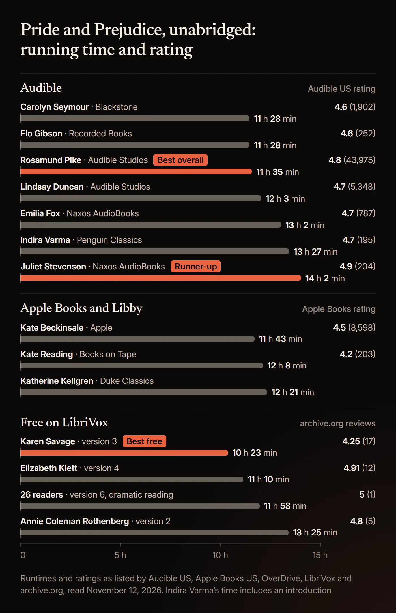
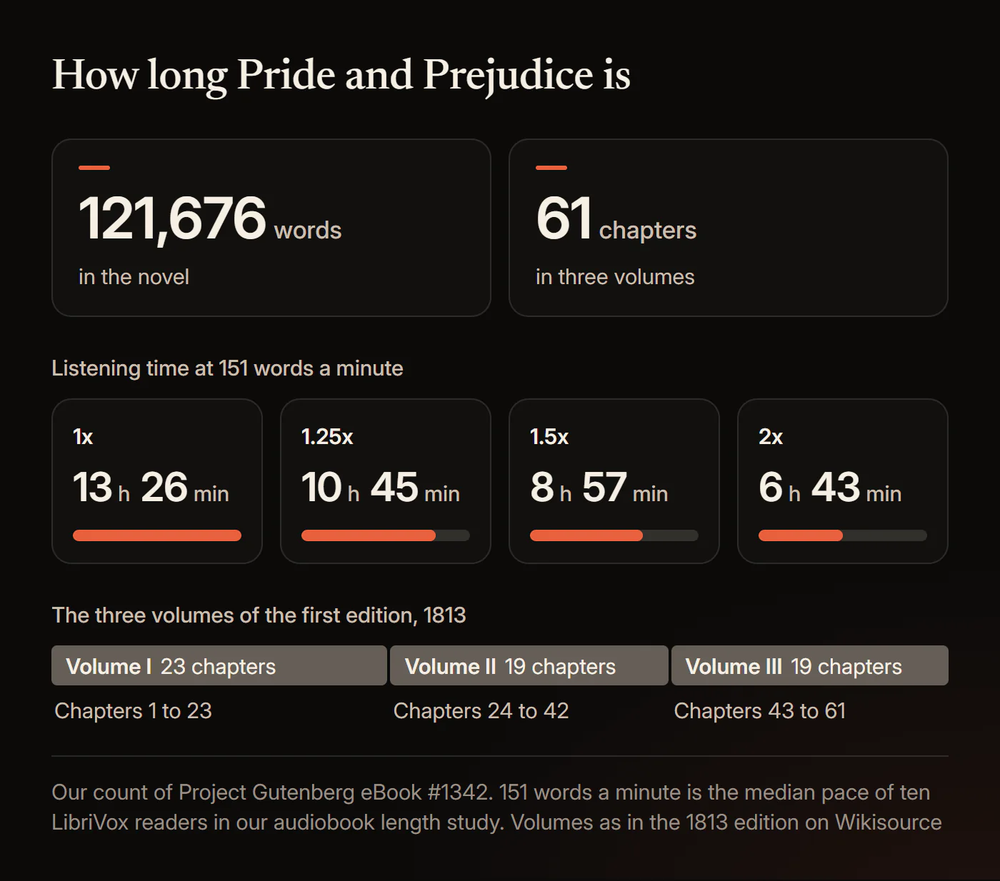
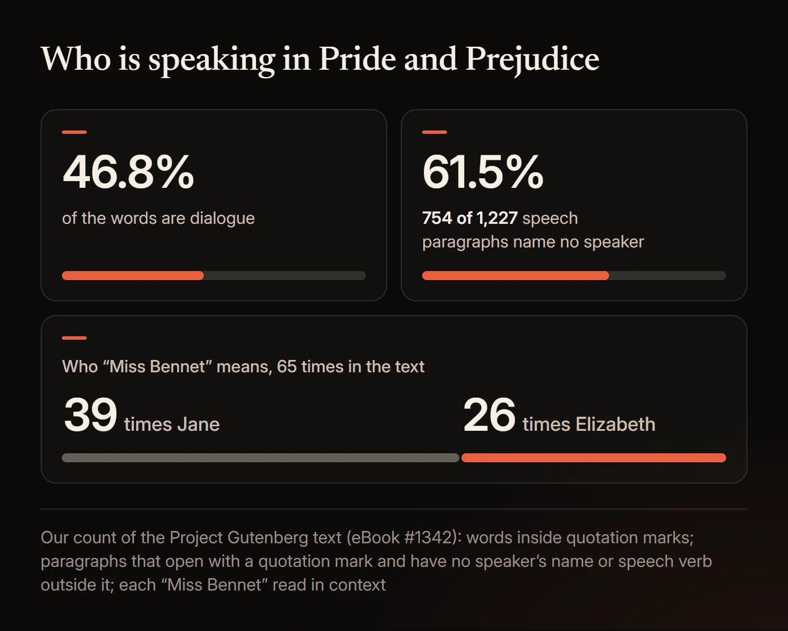
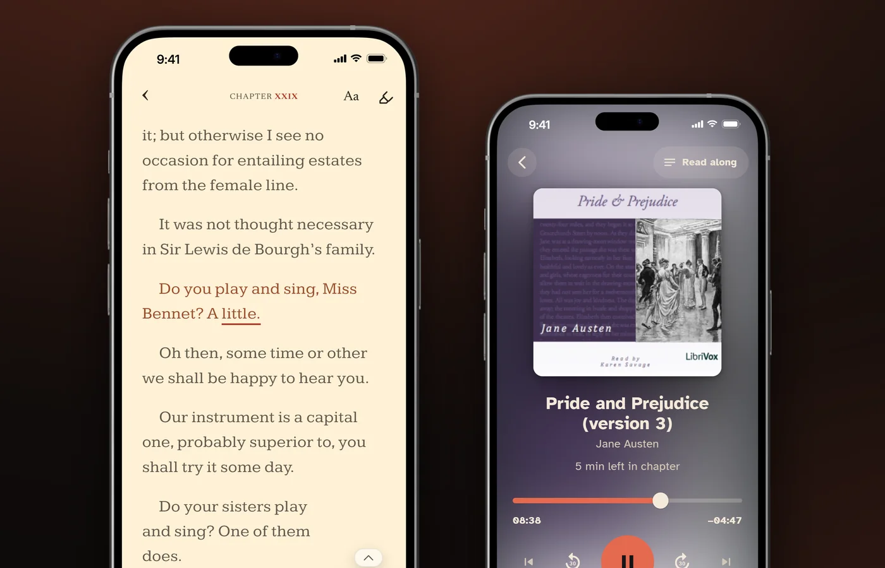

# Best Pride and Prejudice Audiobook: Every Narrator, Free Version and Dramatisation Compared

The best *Pride and Prejudice* audiobook is Rosamund Pike's unabridged Audible Studios recording, which runs 11 hours 35 minutes. The runner-up is Juliet Stevenson's Naxos recording at 14 hours 2 minutes, and the best free one is Karen Savage's LibriVox reading at 10 hours 23 minutes. The best dramatised version is the 2025 Audible Original with a full cast, but it is a 4 hour 34 minute adaptation, not the whole novel.

Pike's recording has 4.8 stars from 43,975 ratings on Audible US as of November 12, 2026, about eight times as many as the next most rated edition. Stevenson's has the highest average of any recording with more than 100 ratings: 4.9 from 204. Below: every unabridged edition with its running time, listening time at each speed, the recording with an American accent, the six free LibriVox versions told apart, which famous versions are not the whole book, and the names that trip up listeners. Every edition fact was read from the publisher's or store's own page on November 12, 2026.

## Which Pride and Prejudice audiobook is best?

Rosamund Pike for most listeners, Juliet Stevenson as the runner-up, Karen Savage's LibriVox reading for free, and the Audible Original for a full cast, as long as you know it is an adaptation.

### Best overall: Rosamund Pike (Audible Studios, 2015)

[Rosamund Pike's recording](https://www.audible.com/pd/B016LN23CC) is the most rated *Pride and Prejudice* audiobook anywhere we checked. On November 12, 2026 it had 4.8 stars from 43,975 ratings on Audible US, with 4.8 for performance, and 4.8 from another 7,704 on Audible UK. The next most rated edition, Lindsay Duncan's, had 5,348. Audible's description notes that Pike played Jane Bennet in the 2005 film, and she is named first in nearly every Reddit thread about the audiobook that we read.

One listener wrote on r/PrideandPrejudice in 2023 that "listening to it was the first time I realised how funny the book can be." The recording runs 11 hours 35 minutes, about 175 words a minute by our calculation, and Audible's list price was $19.74. It is sold only on Audible: we did not find it on Apple Books, Libby, hoopla or the first page of Kobo's results.

### Runner-up: Juliet Stevenson (Naxos AudioBooks, 2021)

[Juliet Stevenson's unabridged recording](https://www.audible.com/pd/1781983755) has 4.9 stars from 204 ratings on Audible US, the highest average of any edition with more than 100 ratings. AudioFile's review, now hosted by Kirkus, gives it an Earphones Award. "Stevenson's flawless performance, sparkling with her distinctive voice and lyrical accent, brings Austen's story to life," it says, and "Dialogue is lively and easy to follow." At 14 hours 2 minutes it is the slowest of the main editions, about 145 words a minute. It cost $22.35 on Audible and $29.99 on Apple Books on November 12, 2026, and the Los Angeles and King County libraries had copies on Libby.

**Check the running time before you buy.** Hodder & Stoughton's 2006 abridged recording, also read by Juliet Stevenson, is sold under the same plain title and runs 2 hours 47 minutes.

### Best free: Karen Savage, LibriVox Version 3 (2007)

Karen Savage reads [LibriVox's third recording](https://librivox.org/pride-and-prejudice-by-jane-austen-2/) alone in 10 hours 23 minutes, one section per chapter, 61 in all. It is the shortest complete recording we found and the free reading that Reddit listeners named most from 2017 to 2024. "Karen Savage on librivox is my absolute favorite. I can't even tell you the number of times I have listened to it," one wrote on r/PrideandPrejudice in 2022. The Internet Archive counted 7,370,665 downloads of it on November 12, 2026. Like every LibriVox version, it reads the text of Project Gutenberg eBook #1342.

**On Apple devices**, [Kate Beckinsale's recording](https://books.apple.com/us/audiobook/id1445220910) is also free. It is an Apple Books exclusive of 11 hours 43 minutes, and on November 12, 2026 it cost $0 and had 4.5 stars from 8,598 ratings, the most of any Apple listing we found. The price may not last: a 2023 Reddit commenter who got it free thought it "might have been a temporary deal".

### Best dramatised: the Audible Original (2025), an adaptation

[Audible's 2025 full-cast *Pride and Prejudice*](https://www.audible.com/pd/B0FBS2CPR7) is adapted by Lulu Raczka. Marisa Abela plays Elizabeth, Harris Dickinson plays Darcy, Bill Nighy and Marianne Jean-Baptiste play Mr and Mrs Bennet, and Glenn Close plays Lady Catherine, with a score by Morgan Kibby. It has 4.8 stars from 7,336 ratings on Audible US and was a finalist for Audiobook of the Year at the 2026 Audie Awards. In our scan of the Audio Publishers Association's Audie pages from 1996 to 2026, the only other *Pride and Prejudice* finalist was Irene Sutcliffe's reading in 1999, which we could not find on sale.

Audible calls the full-cast version "a retelling". It runs 4 hours 34 minutes, less than half the length of the shortest complete reading, so it is a way into the story rather than the novel itself. One 2025 Reddit listener found the actors hard to hear over the music at times.

**Best to borrow.** Katherine Kellgren's Duke Classics recording (12 hours 21 minutes) is the easiest to borrow. On November 12, 2026 the Los Angeles Public Library had 69 copies on Libby, 62 of them available, and San Francisco had 61, with 53 available.

### How the unabridged recordings compare

These are the 22 main complete recordings by named narrators that you can buy or borrow, plus two of LibriVox's free solo readings. Ratings are Audible US stars with the number of ratings in brackets, as of November 12, 2026.

| Narrator | Runtime | Publisher | Year | Audible US rating | Where we found it |
|---|---|---|---|---|---|
| Rosamund Pike | 11 h 35 min | Audible Studios | 2015 | 4.8 (43,975) | Audible |
| Juliet Stevenson | 14 h 2 min | Naxos AudioBooks | 2021 | 4.9 (204) | Audible, Apple Books, Libby, Spotify |
| Lindsay Duncan | 12 h 3 min | Audible Studios | 2006 | 4.7 (5,348) | Audible, Apple Books |
| Emilia Fox | 13 h 2 min | Naxos AudioBooks | 2004 | 4.7 (787) | Audible, Apple Books, Libby, Spotify |
| Indira Varma | 13 h 27 min (with an introduction) | Penguin Classics | 2020 | 4.7 (195) | Audible, Apple Books, Kobo, Libro.fm, Spotify, Google Play |
| Kate Beckinsale | 11 h 43 min | Apple | 2018 | Not on Audible | Apple Books (free on November 12, 2026) |
| Kate Reading | 12 h 8 min | Books on Tape | 2000 | Not on Audible | Apple Books, Libby |
| Katherine Kellgren | 12 h 21 min | Duke Classics | Not listed | Not on Audible | Libby |
| Carolyn Seymour | 11 h 28 min | Blackstone | 2011 | 4.6 (1,902) | Audible, Apple Books, Libby, hoopla |
| Emma Messenger | 14 h 12 min | Trout Lake Media | 2013 | 4.6 (1,940) | Audible, Apple Books |
| Josephine Bailey | 11 h 20 min | Tantor | 2008 | 4.6 (440) | Audible, Apple Books, Libby |
| Flo Gibson | 11 h 28 min | Recorded Books | 2006 | 4.6 (252) | Audible, Apple Books, Libby, Kobo |
| Alison Larkin | 13 h 21 min | BMA and British Classic Audio | 2013 | 4.7 (188) | Audible, Apple Books, Libby |
| Rosalyn Landor | 12 h 36 min | Dreamscape | 2016 | 4.8 (82) | Audible, Apple Books, Libby, hoopla |
| Adjoa Andoh | 12 h 33 min | Saga Egmont | 2022 | 5.0 (6) | Audible, Apple Books, Kobo, hoopla |
| B. J. Harrison | 12 h 30 min | B.J. Harrison (Classic Tales Edition) | 2018 | 4.7 (155) | Audible, hoopla |
| Joanne Froggatt | 13 h 16 min | SNR Audio | 2024 | 4.8 (8) | Audible, Apple Books |
| Marguerite Gavin | 12 h 3 min | Gildan | 2013 | 4.6 (277) | Audible, Apple Books |
| Helen Lisanti | 13 h 0 min | Cherry Hill | 2010 | 4.5 (491) | Audible, Apple Books |
| Victoria McGee | 12 h 17 min | Trout Lake Media | 2012 | 4.4 (575) | Audible, Apple Books |
| Sharon Williams | 11 h 7 min | Brilliance Audio (AmazonClassics) | 2017 | 4.5 (246) | Audible, Apple Books |
| Jasmine Blackborow | 13 h 21 min (with an introduction) | Penguin | 2026 | Not on Audible US | Audible UK and Australia |
| Karen Savage, LibriVox Version 3 | 10 h 23 min | LibriVox | 2007 | Free | LibriVox, Internet Archive, HushBook Discover |
| Elizabeth Klett, LibriVox Version 4 | 11 h 10 min | LibriVox | 2010 | Free | LibriVox, Internet Archive, HushBook Discover |

Runtimes are Audible's for the editions sold there, Apple's for Kate Beckinsale and Kate Reading, OverDrive's for Katherine Kellgren and LibriVox's for the free ones. Years are the publisher's or store's; Kate Reading's 2000 is Apple's date. Spotify for the Naxos titles comes from Naxos's own links, and the stores for Indira Varma's recording from Penguin UK's list. Jasmine Blackborow's 2026 Penguin recording has an introduction by Dolly Alderton, and Audible UK's description says Blackborow is in the cast of Netflix's coming adaptation. Audible US also lists a separate Netflix tie-in edition from Vintage Digital, dated November 19, 2026, with no narrator or running time yet.

**Listings we left out.** Audible also sells releases by Karen Savage (Saga Egmont, 11 hours 1 minute) and Elizabeth Klett (Paperless, 10 hours 57 minutes); we could not confirm whether they are their LibriVox recordings. Christian Neale's Library of Alexandria listing is labelled "unabridged" but runs 4 hours 37 minutes, far too short for the whole text. We also left out more than twenty smaller listings on Audible, Kobo, hoopla and Spotify, and the machine-voiced "Virtual Voice" and "AI Voice" editions. Our [Wuthering Heights audiobook comparison](/blog/best-wuthering-heights-audiobook) uses the same method for another English classic.

## How long is the Pride and Prejudice audiobook?

About 13 hours 26 minutes at 1x: the novel has 121,676 words, and complete readings run from 10 hours 23 minutes to 14 hours 27 minutes.

The 121,676 words are our count of Project Gutenberg eBook #1342, from the first line of the story to the last, published in our guide to [how long audiobooks run](/blog/how-long-is-an-audiobook). A recount on November 12, 2026 with slightly different rules gave 121,850, 0.1% more, which moves none of the times below by more than a minute. At 151 words a minute, the median pace we measured for LibriVox solo readers in that guide:

| Speed | Listening time | 30 min a day | 60 min a day |
|---|---|---|---|
| 1x | 13 h 26 min | 27 days | 14 days |
| 1.25x | 10 h 45 min | 22 days | 11 days |
| 1.5x | 8 h 57 min | 18 days | 9 days |
| 2x | 6 h 43 min | 14 days | 7 days |

Days to finish are our calculation, rounded up to whole days.

Real recordings differ because narrators read at different speeds. Complete readings of the text, with no added music or study guide, run from 10 hours 23 minutes (Karen Savage, LibriVox Version 3) to 14 hours 27 minutes (LibriVox Version 5, read by two volunteers). Dividing the word count by each running time, Karen Savage reads at about 195 words a minute and Emma Messenger at about 143. Savage's pace is above the average for reading aloud, 183 words a minute, in Brysbaert's 2019 review of 77 studies with 5,965 participants. At 1.5x, Pike's recording takes 7 hours 43 minutes and Savage's 6 hours 55 minutes. LibriVox recordings include short spoken announcements, so their readers are slightly faster than these figures.

Reading it yourself is quicker. Brysbaert's review of 190 studies with 18,573 participants puts the average silent reading rate for fiction at 260 words a minute, which gives about 7 hours 48 minutes for the novel. His typical range for fiction, 200 to 320 words a minute, gives 6 hours 20 minutes to 10 hours 8 minutes.

**Chapters: 61, in three volumes.** The first edition, published by T. Egerton on January 28, 1813 according to Wikisource's editors, came in three volumes of 23, 19 and 19 chapters. Editions that keep that division start again at Chapter 1 in each volume. Project Gutenberg's text, which the LibriVox recordings read, numbers the chapters 1 to 61 straight through. To convert, add 23 to a Volume II chapter number and 42 to a Volume III one: Volume II, Chapter 1 is Chapter 24, and Volume III, Chapter 1 is Chapter 43.

Austen noticed the middle volume's size. In January 1813 she wrote to her sister Cassandra: "The second volume is shorter than I could wish, but the difference is not so much in reality as in look, there being a larger proportion of narrative in that part." By our count of the words, Volume II is also the shortest: about 3 hours 45 minutes at 1x, against about 4 hours 32 minutes for Volume I and 5 hours 10 minutes for Volume III. It also has the smallest share of words inside quotation marks, 45.1%, against 48.8% and 46.3%.

Chapters average about 2,000 words, about 13 minutes at 1x, and 47 of the 61 take 10 minutes or more. The longest, Chapter 18, the ball at Netherfield, takes about 34 minutes; Chapter 43 takes about 32. The shortest, Chapter 12, takes about 4.5 minutes.

## Who is the best Pride and Prejudice narrator, Rosamund Pike or Juliet Stevenson?

Rosamund Pike for most listeners. Juliet Stevenson if you want a slower reading that you can also borrow from a library.

Pike has far more ratings, 43,975 at 4.8 on Audible US against Stevenson's 204 at 4.9. Pike is Audible only; Stevenson is also on Apple Books and Libby, and Naxos links to her recording on Spotify.

The biggest difference you will hear is pace. Pike's reading takes 11 hours 35 minutes and Stevenson's 14 hours 2 minutes, 2 hours 27 minutes longer for the same text. That is about 175 words a minute against about 145. One listener on r/audible in 2025 still found Pike's speed "already on slow side"; by running time she is one of the faster readers. The same thread has the one complaint about her that we found: "I love Rosamund I couldn't get through it. Returned it. I eventually found Indira Varma did a version and I'm in love."

On r/janeausten in 2023, a thread asking for an audiobook with an English accent put Pike's recording at the top, and one reader wrote: "Juliet Stevensons are very good! Calm and charming." Naxos's Educational Edition (17 hours 1 minute) adds an audio guide by Francis Gilbert to her complete reading.

Other narrators with fans:

- **Lindsay Duncan** (Audible Studios, 2006, 12 hours 3 minutes): 4.7 stars from 5,348 ratings, the second most rated edition.
- **Emilia Fox** (Naxos AudioBooks, 2004, 13 hours 2 minutes): 4.7 from 787.
- **Indira Varma** (Penguin Classics, 2020, 13 hours 27 minutes with an introduction): 4.7 from 195. Penguin UK lists Libro.fm among its stores.
- **Adjoa Andoh** (Saga Egmont, 2022, 12 hours 33 minutes): "She is excellent at bringing out the humour" (r/janeausten, 2023).

## Is there a Pride and Prejudice audiobook with an American accent?

Yes: Elizabeth Klett's free LibriVox Version 4, 11 hours 10 minutes, is narrated in an American accent with the dialogue in British accents, according to two Internet Archive reviews.

"She narrates with an American accent yet, to my ear, nails the dialog with perfect expression, tempo, and accent," one reviewer wrote on May 5, 2010. The same review adds: "It certainly does help us quickly distinguish (as could a reader of the book itself) when the piece is changing from narration to dialog." That matters in this novel, where most speeches carry no "said she". A second review, on October 28, 2010, says: "I think the American / British accents worked wonderfully." We read both on the Internet Archive on November 12, 2026.

Klett teaches at a university in Houston, Texas, according to her own site. Her recording is [on LibriVox](https://librivox.org/pride-and-prejudice-solo-version-3-by-jane-austen/) and in HushBook Discover as "Pride and Prejudice (version 4)".

American narrators whose accent for Austen we could not confirm; play a sample:

- **Kate Reading** (Books on Tape, 12 hours 8 minutes, Apple Books and Libby). Wikipedia describes her as an "American actress and audiobook narrator" who has "won 6 Audie Awards and 46 Earphone Awards".
- **Flo Gibson** (Recorded Books, 11 hours 28 minutes, Audible, Libby and Kobo). Wikipedia calls her an "American narrator of audiobooks".
- **Katherine Kellgren** (Duke Classics, 12 hours 21 minutes, Libby, where she is listed as Kate Kellgren). Wikipedia calls her an "American actress, known for her narration of audiobooks".

A listing by "Kate Redding" (InAudio, 11 hours 58 minutes) is a different recording from Kate Reading's.

Most of the best-known recordings are by British actresses: Wikipedia describes Rosamund Pike and Indira Varma as British, Juliet Stevenson, Emilia Fox and Kate Beckinsale as English, and Lindsay Duncan as Scottish. Listeners ask in both directions. The 2023 r/janeausten thread began with a request for "an audiobook with an English accent" from someone "having a bit of trouble with the American accented ones", and another reader replied: "I'm an American, but I can't imagine listening to Jane Austen in an American accent. All wrong!" For a British accent at no cost, an April 19, 2009 Internet Archive review of Karen Savage's Version 3 says she brings "a nice British accent", though the reviewer heard American English come in at times, especially in the vowels.

## Is there a free Pride and Prejudice audiobook?

Yes: LibriVox has six complete free recordings, all made from Project Gutenberg's text, and Karen Savage's Version 3 is the one to start with.

| Version | Read by | Running time | Sections | Catalog date | Internet Archive downloads |
|---|---|---|---|---|---|
| Version 3 | Karen Savage | 10:23:00 | 61 | November 26, 2007 | 7,370,665 |
| Version 4 | Elizabeth Klett | 11:09:53 | 61 | May 5, 2010 | 5,471,661 |
| Version 6, dramatic reading | 26 readers, one per character | 11:57:51 | 61 | July 24, 2011 | 535,507 |
| Version 1 | 13 volunteers | 13:06:44 | 37 | March 14, 2006 | 10,311,607 |
| Version 2 | Annie Coleman Rothenberg | 13:25:01 | 35 | January 25, 2006 | 6,270,522 |
| Version 5 | Micah Sheppard and Linda Lee Paquet | 14:26:52 | 57 | February 27, 2011 | 714,968 |

Running times, sections and dates come from the LibriVox catalog and API; downloads were read from the Internet Archive on November 12, 2026. LibriVox also has a free recording of a 4-act stage adaptation, "Pride and Prejudice: A Play", which runs 2:42:55.

**Which one to pick.** Version 3 is one voice, one section per chapter and the shortest. The one complaint that recurs is about her characters: "all of the voices sound the same and it's hard for me to differentiate between characters" (r/audiobooks, 2024). Version 4, Elizabeth Klett's, has the best Internet Archive average, 4.91 stars from 12 reviews, with review titles such as "Professional quality, highly recommend", and two of those reviews describe American narration with British-accented dialogue. Version 6 gives each character a separate reader. Version 1 is the most downloaded, but its reader changes between sections. Version 2 is the recording behind the 13 hours 25 minutes in our length guide.

Other free ways to hear it, as of November 12, 2026:

- **Julie Andrews** reads it in Noiser's free podcast "Jane Austen Stories" (next section).
- **Kate Beckinsale's** Apple Books exclusive (11 hours 43 minutes) cost $0, a price that may not last (see the best free pick above).
- **Ballarat National Theatre's podcast**, an Australian community theatre production, has 27 actors over 30 episodes, 14 hours 28 minutes in all, with ambient sound and music, and was a 2021 Webby Award Honoree.

**On YouTube.** Full uploads of the audiobook came up in our web searches for "pride and prejudice audiobook youtube" on November 12, 2026; we did not check their source or rights. Jennifer Ehle read the book aloud on her YouTube channel in 2020, and we could not confirm she finished it. The LibriVox recordings are the free route with a named reader.

## Are the Audible full-cast, BBC and Julie Andrews versions the whole book?

Only Julie Andrews' series, by its publisher's account. The Audible Original runs 4 hours 34 minutes and the BBC versions are dramatisations or a 3 hour 49 minute reading, while every complete reading takes at least 10 hours 23 minutes.

| Version | Publisher, year | Runtime | What it is |
|---|---|---|---|
| Audible Original, adapted by Lulu Raczka | Audible Originals, 2025 | 4 h 34 min | Full-cast adaptation with an original score |
| BBC Radio 4 full-cast dramatisation, with Amanda Root and David Troughton | BBC Audio, 2014 | 2 h 50 min | Radio drama |
| BBC Radio 4 "Drama on 4", dramatised by Rachel Joyce | BBC Radio 4, December 2025 | Two parts | Radio drama on BBC Sounds |
| Patricia Hodge, "A BBC Radio 4 reading" | BBC Digital Audio, 2026 | 3 h 49 min | A reading; Audible's format field says "unabridged" |
| Juliet Stevenson | Hodder & Stoughton, 2006 | 2 h 47 min | Abridged |
| Jenny Agutter | Naxos AudioBooks, 2009 | 3 h 40 min | Abridged |
| Joanna David | Penguin, 2012 | 5 h 41 min | Abridged |
| Joanna Lumley | CSA Word, 2005 | 2 h 12 min | Abridged |
| Kate Burton, Miriam Margolyes and cast | L.A. Theatre Works, 2009 | 2 h 5 min | Stage play recorded for radio |
| Julie Andrews, "Jane Austen Stories" | Noiser, 2025 | 17 h 16 min of episodes in 25 parts | A reading with music and sound design, "unabridged" in Noiser's words |

Runtimes are Audible's; the Julie Andrews figure is our sum of its podcast feed. A listing far below 10 hours is an abridgment or an adaptation. Our guide to [abridged and unabridged audiobooks](/blog/abridged-vs-unabridged-audiobooks) explains how to tell them apart in a store.

**The Audible full cast.** Audible's cast list for the 2025 production also includes Sophie Wilde, Will Poulter, Jessie Buckley, Toheeb Jimoh and Bertie Carvel. It is available in Dolby Atmos and cost $14.79 on Audible US.

**The BBC versions.** The 2014 dramatisation has 4.6 stars from 287 ratings on Audible US. The 2025 drama casts Luke Thompson as Darcy and Miles Jupp as Mr Bennet. Patricia Hodge's 2026 reading, at 3 hours 49 minutes, cannot be the whole novel. None of them is the 1995 television series.

**Julie Andrews.** Noiser's podcast says: "Join Dame Julie Andrews as she reads Jane Austen's original, unabridged classics, brought to life with original music and immersive sound design." *Pride and Prejudice* is its first season: 25 parts released between September 29 and December 23, 2025, free in podcast apps and on BBC Sounds. The 17 hours 16 minutes include the music and any ads, so it is not comparable with a plain reading. It is a podcast, not an audiobook you buy.

**The whole novel with a cast.** For every sentence and a voice for each character, LibriVox's free Version 6 has 26 readers in 11 hours 58 minutes. Paid multi-voice editions include Thrive Audio's full-cast recording (2023, 12 hours 39 minutes) and Spoken Realms' (2026, 13 hours 30 minutes).

## How do you keep track of the names in Pride and Prejudice?

Learn that one title can mean two people: "Miss Bennet" is usually Jane, the eldest sister, but Darcy, Bingley, Wickham and Lady Catherine also use it for Elizabeth. And expect long runs of talk with no "said she".

**Who is speaking.** By our count of the Gutenberg text, 46.8% of the novel's words sit inside quotation marks. That is less than *Crime and Punishment* in Garnett's translation (55.4%, in our [comparison of its audiobooks](/blog/best-crime-and-punishment-audiobook)) but more than twice the 21.8% of *War and Peace* in the Maude translation. Of the 1,227 paragraphs that open with a quotation mark, 754, or 61.5%, have no speaker's name and no "said" or other speech verb outside the quotes. That is a rough count: it misses names given inside the quotes and counts the paragraphs of letters as speech.

The longest runs come in conversations between two people. The first chapter has ten unattributed speeches in a row between Mr. and Mrs. Bennet, starting "Is that his design in settling here?". In Chapter 29, Lady Catherine asks "Do you play and sing, Miss Bennet?" and the reply, "A little.", opens a run of 12 speeches with no names attached; that "Miss Bennet" is Elizabeth. Chapter 60 has a run of 18.

Austen saw it coming. In her January 1813 letter to Cassandra, she wrote that a "said he" or a "said she" "would sometimes make the dialogue more immediately clear; but 'I do not write for such dull elves' as have not a great deal of ingenuity themselves." She also found a printing error that made the problem worse: "The greatest blunder in the printing that I have met with is in page 220, v. 3, where two speeches are made into one" (February 1813).

**The names.** The five Bennet sisters, from eldest to youngest, are Jane, Elizabeth, Mary, Catherine (called Kitty) and Lydia. The text calls Jane the eldest daughter in Chapter 3, Elizabeth "next to Jane in birth" in Chapter 15, Catherine and Lydia "the two youngest" in Chapter 7, and Lydia "the youngest" in Chapter 2. Here is how often each form appears, by our count of the Gutenberg text. The "Miss Bennet" split is our reading of all 65 uses in context. These roles give nothing away.

| Character | Names you will hear (count) | The trap |
|---|---|---|
| Elizabeth Bennet | Elizabeth 634, Lizzy 95, Eliza 23, Miss Elizabeth 12, Miss Bennet 26 | Her family say Lizzy; Charlotte, Sir William and Miss Bingley say Eliza. "Miss Bennet" 11 times in Chapter 56 alone |
| Jane Bennet | Jane 292, Miss Bennet 39 | As the eldest daughter she is "Miss Bennet"; every use in Chapters 1 to 9 means Jane |
| Mr. Darcy | Darcy 417, of which Mr. Darcy 273 | His first name, Fitzwilliam, is heard only twice: "Mr. Fitzwilliam Darcy" (Chapter 25) and the signature of his letter (Chapter 35) |
| Colonel Fitzwilliam | Colonel Fitzwilliam 30, Fitzwilliam 5 | Darcy's cousin: his surname is Darcy's first name |
| Mr. Bingley | Bingley 306, of which Mr. Bingley 114; Charles 7 | "Bingley" alone can be him; "Miss Bingley" is his sister |
| Caroline Bingley | Miss Bingley 87, Caroline 16 | |
| Georgiana Darcy | Miss Darcy 39, Georgiana 15 | |
| Mary Bennet | Mary 37 | "Mary King", named twice, is a different young woman |
| Kitty Bennet | Kitty 71, Catherine 10 | The narration sometimes calls her Catherine, as in "Catherine and Lydia" |
| Lydia Bennet | Lydia 170, of which Miss Lydia 4 | |
| Lady Catherine de Bourgh | Lady Catherine 116, "her ladyship" or "your ladyship" 42 | Not Kitty |
| Mr. and Mrs. Bennet | Mr. Bennet 89, Mrs. Bennet 154 | No first names |

Places recur as often as people: Longbourn 88 times, Netherfield 73, Meryton 57, Pemberley 53, Rosings 49 and Hunsford 25. The free Project Gutenberg edition has no list of characters.

Letters carry long stretches too. "Letter" or "letters" appears 131 times, in 33 of the 61 chapters. Darcy's letter in Chapter 35 (Volume II, Chapter 12) runs 2,604 words, about 17 minutes at 1x, all in his first person and all in the narrator's one voice.

By ear, a run of unattributed speeches goes past with nothing to look back at. Seeing the words as the narrator speaks them gives your eyes the exchange too, and that is why we built HushBook; with its e-book sync, in beta, Austen's own paragraphs show each change of speaker. Its free character map keeps every name a person goes by on one card: add Elizabeth once and keep Lizzy, Eliza and Miss Bennet in her card's notes. The card also records the chapter and time you first heard her. Our guide on how to [keep track of characters](/blog/how-to-keep-track-of-characters-in-a-book) has methods that work without any app.

## Should you read or listen to Pride and Prejudice?

Either works for the story. Listening alone brings the most mind wandering, and when Austen heard her novel read aloud in 1813, her complaint was about the reader.

*Pride and Prejudice* is not hard to read by the usual measure, and it is not in Old English: it is modern English, published in 1813. Project Gutenberg gives it a reading ease score of 69.2 ("8th & 9th grade") and calls it "Neither easy nor difficult to read." That formula measures only sentence and word length, so it misses what makes the book harder by ear: the long runs of dialogue with no speaker named, counted in the names section above.

The novel was read aloud from the start. In a January 1813 letter to Cassandra, Austen called the book "my own darling child" and reported: "Miss B. dined with us on the very day of the book's coming, and in the evening we fairly set at it, and read half the first vol. to her." In February she was less pleased: "Our second evening's reading to Miss B. had not pleased me so well, but I believe something must be attributed to my mother's too rapid way of getting on: though she perfectly understands the characters herself, she cannot speak as they ought." Her two tests still work for choosing a narrator: a speed you can follow, and voices for the characters.

Two general findings matter, both read on November 12, 2026. A 2022 meta-analysis by Clinton-Lisell of 46 studies with 4,687 people found no reliable difference between understanding a text by reading and by listening. In a 2013 study of 211 students, Varao Sousa, Carriere and Smilek found that people's minds wandered most when they only listened.

Two studies used *Pride and Prejudice* itself:

- **Austen's style.** Austen often gives a character's thoughts in the narrator's voice, without "she thought". In a 2014 reading experiment with a passage from *Pride and Prejudice*, Mikulan and Legac found that only about a quarter of 78 Croatian students, 38 reading it in English and 40 in Croatian translation, could hear this "dual voice". It tested reading, not listening.
- **Audio holds attention.** In a 2020 study of 102 adults, Richardson and colleagues played audiobook scenes or showed film and TV versions of the same scenes; *Pride and Prejudice* was one of eight stories. Heart rate and skin conductance rose more for the audio, though people rated the video as more involving. The results are pooled across all eight stories.

None of these four studies tested a whole novel by ear, and none measured how listeners follow unattributed dialogue. For *Pride and Prejudice*, that points to a simple rule: listen when it fits your day, pick a narrator whose voices you can tell apart, and have the text in front of you for the long conversations. Our guide on [how to read classics without getting bored](/blog/how-to-read-classics-without-getting-bored) covers long books in general.

## What we could not verify

- **Sound.** We did not rank the recordings by listening. The accents above are reviewers' words; we judged no narrator's accent ourselves.
- **Some stores.** Libro.fm and Chirp blocked us, Spotify needs a login, and we read only the first page of Kobo's results, so their listings are unchecked.
- **Free offers.** Lindsay Duncan's Audible US page showed "Listen for free" to a signed-out visitor; we could not see which membership that means, or how long Kate Beckinsale's recording stays at $0.
- **Podcasts.** We did not check Julie Andrews' or Ballarat National Theatre's episodes against the text; "unabridged" is Noiser's word.
- **The 2025 BBC drama.** Its running time, and whether it is sold as an audiobook.
- **Penguin's introduction.** Penguin and Audible credit both Tony Tanner and Vivien Jones, and we could not tell who reads it.
- **Juliet Stevenson's year.** Naxos and Audible say 2021; AudioFile's review on Kirkus gives a release date of June 5, 2020.
- **Repeat releases.** Whether the paid Karen Savage and Elizabeth Klett releases are their LibriVox recordings, and whether Kate Reading and Kate Redding are the same person.
- **Names in searches.** We found no *Pride and Prejudice* recording by Claire Foy, Alexis Bledel or Sally Ann Burnett on Audible, Apple Books or OverDrive.
- **Your country.** Availability and prices vary by region. Prices and ratings above are a snapshot of November 12, 2026.

## Is there a Pride and Prejudice audiobook with text?

Yes: HushBook, the app we built, highlights each word as the narrator reads the free LibriVox recordings of *Pride and Prejudice*, on iPhone, Android and Windows.

HushBook is free, with no account, and transcription runs on your own device. For this book, open Discover, search "pride and prejudice" and pick "Pride and Prejudice (version 3)", the card that reads 10h 23m. That is Karen Savage's reading: on November 12, 2026 the card showed 61 chapters and a 299 MB download, and the book arrives with one chapter per file, "Chapter 01" to "Chapter 61". For Elizabeth Klett's reading, pick "Pride and Prejudice (version 4)", 11h 10m and 307 MB. Play a 30-second sample before you download.

HushBook transcribes the book on your phone, and each chapter is ready to read the moment it finishes. Words fill in as the narrator reads them, with a red underline on the current one, so in Chapter 29 you see Lady Catherine's "Do you play and sing, Miss Bennet?" and Elizabeth's "A little." as they are spoken. Long-press any line to play from there. Mark a passage to keep it as a highlight, note or quote, set the speed anywhere from 0.5x to 3x, and add each person to the book's character map. After the one-time HushBook Engine download, playback and read-along work without an internet connection.

For Austen's own text on screen, attach a matching DRM-free EPUB, PDF or TXT, such as Project Gutenberg's free eBook #1342, the text Karen Savage reads. HushBook's e-book sync (in beta, first sync free) aligns that text to the audio word by word. Austen's quotation marks and paragraphs then appear in time with the voice, so each change of speaker starts a new paragraph.

For Indira Varma's Penguin recording, read along with a DRM-free MP3 or M4B copy you own; Penguin UK lists Libro.fm among the stores for it. HushBook imports MP3, M4B and 13 other audio formats and detects the chapters inside M4B files. The Windows app has Discover too and transcribes on your computer, free and unlimited.

HushBook works with free public domain recordings and audio files you own without DRM.

## Sources

- [Audio Publishers Association, 2026 Audie Awards winners and finalists](https://www.audiopub.org/2026audieawards-winners)
- [Audio Publishers Association, 1999 Audie Awards](https://www.audiopub.org/1999-audies-1)
- [Audible, Pride and Prejudice (Rosamund Pike, Audible Studios)](https://www.audible.com/pd/B016LN23CC)
- [Audible, Pride and Prejudice (Lindsay Duncan, Audible Studios)](https://www.audible.com/pd/B0036JWYQ0)
- [Audible, Pride and Prejudice (Juliet Stevenson, Naxos AudioBooks)](https://www.audible.com/pd/1781983755)
- [Audible, Pride and Prejudice (Emilia Fox, Naxos AudioBooks)](https://www.audible.com/pd/B002V5CWJ4)
- [Audible, Pride and Prejudice (Indira Varma, Penguin Classics)](https://www.audible.com/pd/024145526X)
- [Audible, Pride and Prejudice (Carolyn Seymour, Blackstone)](https://www.audible.com/pd/B004L72YX4)
- [Audible, Pride and Prejudice (Kate Redding, InAudio)](https://www.audible.com/pd/1467610496)
- [Audible, Pride and Prejudice (Audible Original, full cast, adapted by Lulu Raczka)](https://www.audible.com/pd/B0FBS2CPR7)
- [Audible, Pride and Prejudice (BBC Radio 4 full-cast dramatisation)](https://www.audible.com/pd/B00M9AYWC6)
- [Audible, catalogue API results for "pride and prejudice"](https://api.audible.com/1.0/catalog/products?keywords=pride+and+prejudice&num_results=50&response_groups=contributors,product_desc,product_attrs,rating,media,sample,series,relationships)
- [Apple, iTunes Search API, audiobook results for "pride and prejudice"](https://itunes.apple.com/search?term=pride+and+prejudice&media=audiobook&country=us&limit=200)
- [Apple Books, Pride and Prejudice (Kate Beckinsale)](https://books.apple.com/us/audiobook/id1445220910)
- [Apple Books, Pride and Prejudice (Kate Reading)](https://books.apple.com/us/audiobook/id1417126571)
- [Apple Books, Pride and Prejudice (Juliet Stevenson)](https://books.apple.com/us/audiobook/id1740088641)
- [Naxos AudioBooks, Pride and Prejudice (unabridged, Juliet Stevenson)](https://naxosaudiobooks.com/pride-and-prejudice-unabridged-2/)
- [Naxos AudioBooks, Pride and Prejudice (unabridged, Emilia Fox)](https://naxosaudiobooks.com/pride-and-prejudice-unabridged/)
- [Naxos AudioBooks, Pride and Prejudice (abridged, Jenny Agutter)](https://naxosaudiobooks.com/pride-and-prejudice-abridged/)
- [Naxos AudioBooks, Pride and Prejudice (Educational Edition)](https://naxosaudiobooks.com/pride-and-prejudice-educational-edition/)
- [Penguin UK, "Pride and Prejudice" (Audio Download, read by Indira Varma, ISBN 9780241455265)](https://www.penguin.co.uk/books/55905/pride-and-prejudice-by-austen-jane/9780241455265)
- [Kirkus Reviews (AudioFile), Pride and Prejudice audiobook review (Juliet Stevenson)](https://www.kirkusreviews.com/audiobook-reviews/jane-austen/pride-and-prejudice-2/)
- [OverDrive, catalogue API for the Los Angeles Public Library](https://thunder.api.overdrive.com/v2/libraries/lapl/media?query=pride%20and%20prejudice&format=audiobook-overdrive,audiobook-mp3&perPage=100)
- [OverDrive, catalogue API for the New York Public Library](https://thunder.api.overdrive.com/v2/libraries/nypl/media?query=pride%20and%20prejudice&format=audiobook-overdrive,audiobook-mp3&perPage=100)
- [hoopla, search results for "pride and prejudice"](https://www.hoopladigital.com/search?q=pride%20and%20prejudice&scope=everything&type=direct&kindId=8)
- [Kobo, audiobook search results for "pride and prejudice austen"](https://www.kobo.com/us/en/search?query=pride%20and%20prejudice%20austen&fcmedia=AudioBook)
- [LibriVox, API feed for "Pride and Prejudice"](https://librivox.org/api/feed/audiobooks/?title=%5EPride%20and%20Prejudice&format=json&extended=1&limit=50)
- [LibriVox, Pride and Prejudice (Version 1)](https://librivox.org/pride-and-prejudice-by-jane-austen/)
- [LibriVox, Pride and Prejudice (Version 2, Annie Coleman Rothenberg)](https://librivox.org/pride-and-prejudice-by-jane-austen-solo-project/)
- [LibriVox, Pride and Prejudice (Version 3, Karen Savage)](https://librivox.org/pride-and-prejudice-by-jane-austen-2/)
- [LibriVox, Pride and Prejudice (Version 4, Elizabeth Klett)](https://librivox.org/pride-and-prejudice-solo-version-3-by-jane-austen/)
- [LibriVox, Pride and Prejudice (Version 5)](https://librivox.org/pride-and-prejudice-v-4-by-jane-austen/)
- [LibriVox, Pride and Prejudice (Version 6, dramatic reading)](https://librivox.org/pride-and-prejudice-by-jane-austen-3/)
- [LibriVox, Pride and Prejudice: A Play, by Mary Keith Medbery Mackaye](https://librivox.org/pride-and-prejudice-a-play-by-mary-keith-medbery-mackaye/)
- [Internet Archive, LibriVox Pride and Prejudice Version 3 item metadata and reviews](https://archive.org/metadata/pride_prejudice_krs_librivox)
- [Internet Archive, LibriVox Pride and Prejudice Version 4 item metadata and reviews](https://archive.org/metadata/prideandprejudice_1005_librivox)
- [Noiser, Jane Austen Stories](https://www.noiser.com/jane-austen-stories)
- [Noiser, Jane Austen Stories podcast feed (Acast)](https://feeds.acast.com/public/shows/68cc0f36f3dd257283d8eda1)
- [Sounds Profitable, press release on Noiser's Pride and Prejudice podcast with Dame Julie Andrews (September 30, 2025)](https://soundsprofitable.com/press-release/noiser-launches-pride-and-prejudice-podcast-with-dame-julie-andrews)
- [Ballarat National Theatre, Pride and Prejudice podcast](https://bnt.org.au/podcast/pride-prejudice-podcast)
- [Ballarat National Theatre, Pride and Prejudice podcast feed (Buzzsprout)](https://rss.buzzsprout.com/1078322.rss)
- [Sue Terry Voices, Luke Thompson, Miles Jupp and Gaia Wise in new Pride and Prejudice for BBC Radio 4](https://www.sueterryvoices.com/news/luke-thompson-miles-jupp-gaia-wise-in-new-pride-prejudice-for-bbc-radio-4)
- [BBC Media Centre, Jane Austen birthday special programming on Radio 4 (2025)](https://www.bbc.com/mediacentre/2025/jane-austen-radio-4-birthday-special-programming)
- [YouTube, Jennifer Ehle, "Reading Pride and Prejudice Part 1"](https://www.youtube.com/watch?v=cVbLdOWjfhg)
- [Wikipedia, Kate Reading](https://en.wikipedia.org/wiki/Kate_Reading)
- [Wikipedia, Flo Gibson](https://en.wikipedia.org/wiki/Flo_Gibson)
- [Wikipedia, Katherine Kellgren](https://en.wikipedia.org/wiki/Katherine_Kellgren)
- [Elizabeth Klett Audio](https://www.elizabethklettaudio.com/)
- [Reddit r/PrideandPrejudice, "I love the audiobook." (2023)](https://www.reddit.com/r/PrideandPrejudice/comments/158o7bt/)
- [Reddit r/janeausten, "Jane Austen Audiobooks" (2023)](https://www.reddit.com/r/janeausten/comments/159zxo2/)
- [Reddit r/audible, "Cannot focus on listening Pride and Prejudice (Resumed Pike's narration)" (2025)](https://www.reddit.com/r/audible/comments/1kv9c4r/)
- [Reddit r/PrideandPrejudice, "Best Audio recording." (2022)](https://www.reddit.com/r/PrideandPrejudice/comments/xgg1bl/)
- [Reddit r/audiobooks, "Are there any good 'Pride and Prejudice' audiobooks out there?" (2020)](https://www.reddit.com/r/audiobooks/comments/g759jf/)
- [Reddit r/audiobooks, "Good narration for Pride & Prejudice?" (2024)](https://www.reddit.com/r/audiobooks/comments/1exxj71/)
- [Reddit r/audiobooks, "Just finished the Audible version of Pride and Prejudice" (2025)](https://www.reddit.com/r/audiobooks/comments/1nr5x2q/)
- [Reddit r/audiobooks, "Best Narrators for Little Women and Pride and Prejudice" (2017)](https://www.reddit.com/r/audiobooks/comments/6u32xm/)
- [Project Gutenberg, "Pride and Prejudice by Jane Austen | Project Gutenberg" (eBook #1342)](https://www.gutenberg.org/ebooks/1342)
- [Project Gutenberg, plain text of eBook #1342](https://www.gutenberg.org/cache/epub/1342/pg1342.txt)
- [Project Gutenberg, "The Letters of Jane Austen" (Brabourne selection, eBook #42078), letters XL and XLI](https://www.gutenberg.org/ebooks/42078)
- [Wikisource, "Pride and Prejudice" (versions page: 1813 first edition in three volumes)](https://en.wikisource.org/wiki/Pride_and_Prejudice)
- [Wikisource, "Pride and Prejudice (1813)" (contents: Volume I, 23 chapters; Volumes II and III, 19 each)](https://en.wikisource.org/wiki/Pride_and_Prejudice_(1813))
- [Brysbaert (2019), "How many words do we read per minute? A review and meta-analysis of reading rate", Journal of Memory and Language](https://doi.org/10.1016/j.jml.2019.104047)
- [Clinton-Lisell (2022), "Listening Ears or Reading Eyes: A Meta-Analysis of Reading and Listening Comprehension Comparisons", Review of Educational Research](https://doi.org/10.3102/00346543211060871)
- [Varao Sousa, Carriere and Smilek (2013), "The way we encounter reading material influences how frequently we mind wander", Frontiers in Psychology](https://doi.org/10.3389/fpsyg.2013.00892)
- [Mikulan and Legac (2014), "The 'Dual Voice' of Free Indirect Discourse: A Reading Experiment with Croatian Speakers Reading a Literary Text in English and Croatian", Procedia - Social and Behavioral Sciences](https://doi.org/10.1016/j.sbspro.2014.12.077)
- [Richardson, Griffin, Zaki, Stephenson, Yan, Curry, Noble, Hogan, Skipper and Devlin (2020), "Engagement in video and audio narratives: contrasting self-report and physiological measures", Scientific Reports](https://doi.org/10.1038/s41598-020-68253-2)
