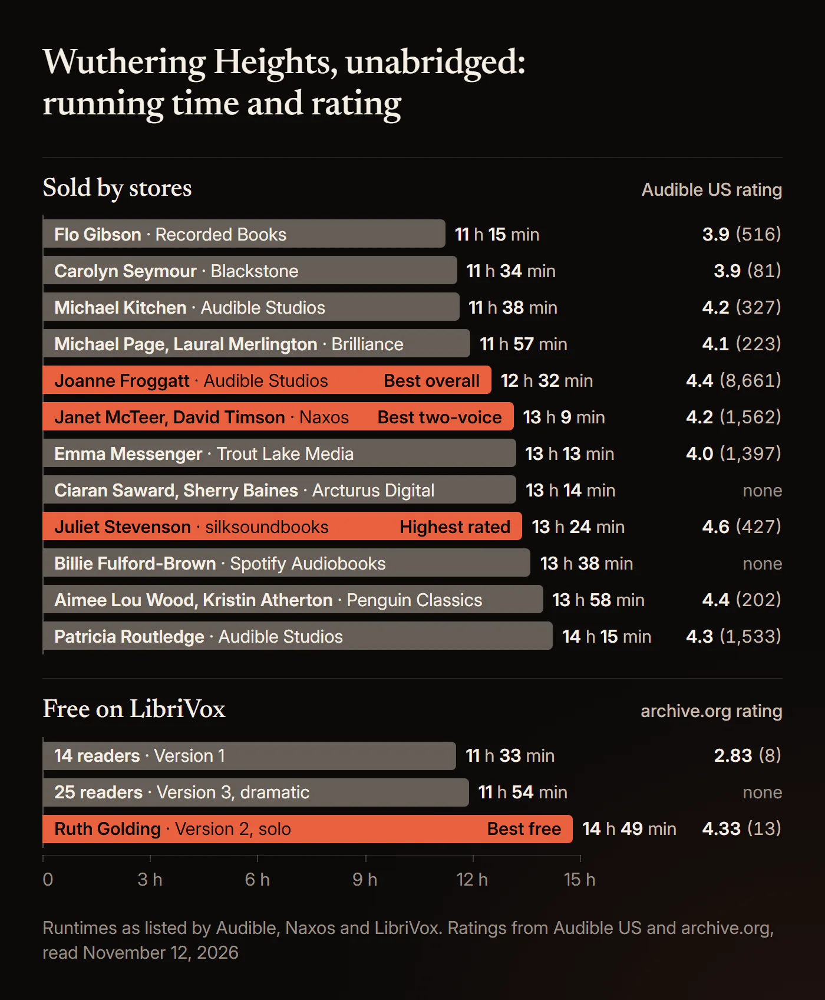
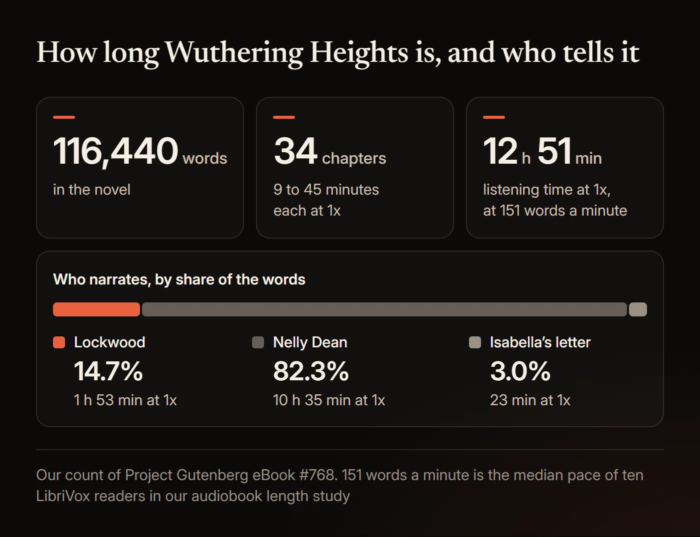
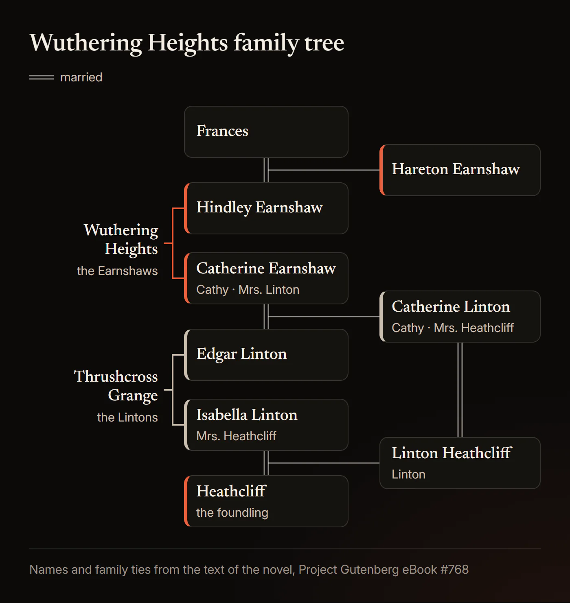
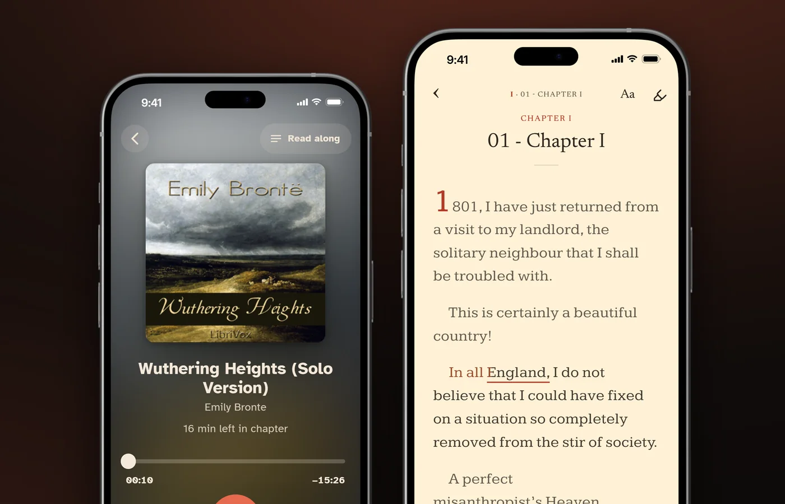

# Best Wuthering Heights Audiobook: Every Narrator and Edition Compared

The best *Wuthering Heights* audiobook is Joanne Froggatt's unabridged Audible Studios recording, 12 hours 32 minutes long. Juliet Stevenson's (13 hours 24 minutes) is the highest rated, Janet McTeer and David Timson's Naxos recording (13 hours 9 minutes) is the best with two voices, and Ruth Golding's LibriVox reading (14 hours 49 minutes) is the best free one.

Froggatt's recording has 4.4 stars from 8,661 ratings on Audible US as of November 12, 2026, with 4.8 for performance. That is more ratings than all the other recordings in our table put together. Below: every complete recording with its runtime and ratings, how long the book takes at each speed, who narrates each chapter, which recordings give Lockwood and Nelly Dean separate voices, what Joseph is saying in plain English, the three free LibriVox versions told apart, the abridged and dramatised ones, and the names. Every edition fact was read from the publisher's or store's own page on November 12, 2026.

## Which Wuthering Heights audiobook is best?

Joanne Froggatt for most listeners, Juliet Stevenson for the highest ratings, the Naxos recording for two voices and a library loan, and Ruth Golding's LibriVox reading for free.

### Best overall: Joanne Froggatt (Audible Studios, 2017)

Joanne Froggatt's [Audible Studios recording](https://www.audible.com/pd/B076PPDCYD) has 4.4 stars from 8,661 ratings on Audible US and 4.8 for performance, as of November 12, 2026. On Audible UK it has 4.5 from 1,385. Audible's own pages bill it as the "Winner of Audible UK's 2017 Narrator of the Year Award"; that is Audible's statement about its own production.

A top review on the US page says "The voices for different characters were very effective, almost as if performed by a whole cast." On r/audible in 2020, one listener called her reading "very clear and crisp".

One catch when you sample it. The recording opens with an introduction by Ann Dinsdale, Chief Curator of the Brontë Museum, read by Rachel Atkins, and Audible's five-minute sample is all introduction. You will not hear Froggatt in it. The recording runs 12 hours 32 minutes. On November 12, 2026 it listed at $21.30 on Audible US and $20.99 on Apple Books; we found it only on those two.

### Highest rated: Juliet Stevenson (silksoundbooks, 2015)

Juliet Stevenson's [silksoundbooks recording](https://www.audible.com/pd/B0186DGBCI) has the best stars of any edition with hundreds of ratings: 4.6 from 427 on Audible US with 4.9 for performance, and 4.7 from 507 on Audible UK, as of November 12, 2026. Reviewers single out her accents: "I was really impressed with Stevenson's ability to handle the different accents and emotional states of not only the female but also the male characters." It runs 13 hours 24 minutes.

Stevenson also recorded an abridgement of 2 hours 41 minutes for Penguin in 2012, so check the runtime before you buy.

### Best with two voices: Janet McTeer with David Timson (Naxos AudioBooks, 2006)

The [Naxos recording](https://www.audible.com/pd/B002UZX6M2) puts Lockwood, who opens and closes the book, in a different voice from Nelly Dean, who tells most of it. Naxos does not say who reads which part; in our test of its Audible sample, a male voice reads Lockwood (see which audiobooks give Lockwood and Nelly separate voices, below). It has 4.2 stars from 1,562 ratings on Audible US and 4.5 from 426 on Audible UK. The Naxos booklet says McTeer "grew up in York and has a distinct ear for accents which made her an ideal reader for Wuthering Heights."

It runs 13 hours 9 minutes by Naxos's own listing (13 hours 8 minutes on Audible), and Naxos released it in March 2006. You can borrow it too: on November 12, 2026, the New York Public Library had 14 copies on Libby and the Los Angeles Public Library 4. Audible includes the Naxos PDF booklet, with a full track list.

### Best free: Ruth Golding, LibriVox Version 2 (2009)

Ruth Golding reads all 34 chapters alone in [LibriVox's second recording](https://librivox.org/wuthering-heights-by-emily-bronte-2/), catalogued on May 18, 2009, at 14:48:42. It is the only solo LibriVox reading and by far the most downloaded of the three LibriVox versions: 1,949,246 downloads on the Internet Archive on November 12, 2026, with 4.33 stars from 13 reviews. A 2025 reviewer called her "very expressive, professional and steadily paced". It reads the text of Project Gutenberg eBook #768.

**Also worth knowing.** Aimee Lou Wood's 2020 Penguin Classics recording, 13 hours 58 minutes, was the Guardian's audiobook of the week in February 2026 and has the most library copies of any edition (see the narrator comparison below). Patricia Routledge's 2012 Audible Studios recording is the most rated on Audible UK, with 4.5 stars from 2,286 ratings. For a play instead of the book, BBC Radio 4's dramatisation runs 2 hours 17 minutes.

### Every unabridged recording compared

Our table has 16 complete recordings on sale by named human narrators, and LibriVox adds three free ones. Ratings are Audible US stars with the number of ratings in brackets, as of November 12, 2026. Runtimes are Audible's, except the Naxos recording's (Naxos), Donada Peters's (OverDrive) and the free ones (LibriVox).

| Narrator | Lockwood and Nelly | Runtime | Publisher | Year | Audible US rating | Where we found it |
|---|---|---|---|---|---|---|
| Joanne Froggatt | One voice | 12 h 32 min | Audible Studios | 2017 | 4.4 (8,661) | Audible, Apple Books |
| Juliet Stevenson | One voice | 13 h 24 min | silksoundbooks | 2015 | 4.6 (427) | Audible, Apple Books |
| Janet McTeer with David Timson | Two voices | 13 h 9 min | Naxos AudioBooks | 2006 | 4.2 (1,562) | Audible, Apple Books, Libby, Spotify |
| Patricia Routledge | One voice | 14 h 15 min | Audible Studios | 2012 | 4.3 (1,533) | Audible, Apple Books |
| Aimee Lou Wood | One voice | 13 h 58 min | Penguin Classics | 2020 | 4.4 (202) | Audible, Apple Books, Libby |
| Emma Messenger | One voice | 13 h 13 min | Trout Lake Media | 2012 | 4.0 (1,397) | Audible, Apple Books |
| Michael Kitchen | One voice | 11 h 38 min | Audible Studios | 2006 | 4.2 (327) | Audible, Apple Books |
| Michael Page and Laural Merlington | Two voices | 11 h 57 min | Brilliance Audio (AmazonClassics) | 2017 | 4.1 (223) | Audible, Apple Books |
| Flo Gibson | One voice | 11 h 15 min | Recorded Books | 1999 | 3.9 (516) | Audible, Libby |
| Anne Flosnik | One voice | 12 h 19 min | Tantor | 2008 | 3.8 (229) | Audible, Apple Books, Libby |
| Carolyn Seymour | One voice | 11 h 34 min | Blackstone | 2010 | 3.9 (81) | Audible, Apple Books, Libby, hoopla |
| Kate Petrie | One voice | 11 h 1 min | A.R.N. Publications | 2015 | 4.6 (70) | Audible, Apple Books |
| Judy Holt | One voice | 13 h 37 min | Damian Bonsall | 2018 | 4.5 (28) | Audible, Apple Books, hoopla |
| Ciaran Saward and Sherry Baines | Two voices | 13 h 14 min | Arcturus Digital | 2026 | No ratings yet | Audible, Apple Books, hoopla, Kobo |
| Billie Fulford-Brown | One voice | 13 h 38 min | Spotify Audiobooks | 2024 | Audible UK only | Audible UK, Apple Books, hoopla, Kobo |
| Donada Peters | One voice | 11 h 13 min | Books on Tape | 2007 | Not on Audible | Apple Books, Libby |
| Ruth Golding, LibriVox Version 2 | One voice | 14 h 49 min | LibriVox | 2009 | Free | LibriVox, Internet Archive, HushBook Discover |
| 25 volunteers, LibriVox Version 3 (dramatic reading) | Full cast | 11 h 54 min | LibriVox | 2013 | Free | LibriVox, Internet Archive, HushBook Discover |
| 14 volunteers, LibriVox Version 1 | Reader changes by chapter | 11 h 33 min | LibriVox | 2008 | Free | LibriVox, Internet Archive, HushBook Discover |

Years are the store's or publisher's. Flo Gibson's recording is dated 1999 on Audible and 1981 on OverDrive. OverDrive dates Donada Peters's recording 2007 and Apple Books 2009, but it was already a finalist in the Classic category of the 2004 Audie Awards, according to the Audio Publishers Association. Spotify for the Naxos edition comes from the Naxos page's own link. Billie Fulford-Brown's edition is published by Spotify Audiobooks, but Spotify's catalogue needs a login, so we list only the stores where we saw it. The "Lockwood and Nelly" column comes from our sample test, explained below.

**Listings we left out.** Two full-cast readings of the whole text are covered in the abridged section below. Audible also carries smaller listings we did not test, among them Anna Bentinck, Charlton Griffin, B.J. Harrison, Wanda McCaddon and Adjoa Andoh, plus machine-voiced editions and "Modern English" rewrites. Audible and Apple Books also sell Ruth Golding readings from Paperless, Erika and Booktrack, of 14 hours 39 to 42 minutes; we could not confirm whether any of them is her LibriVox recording.

## How long is the Wuthering Heights audiobook?

About 12 hours 51 minutes at 1x: the novel has 116,440 words, and complete recordings run from 11 hours 1 minute to 14 hours 49 minutes.

We counted the words ourselves. Project Gutenberg eBook #768, downloaded on November 12, 2026, has 116,440 words in the novel itself, in 34 chapters. We used 151 words a minute, the median pace we measured for LibriVox solo readers in our guide to [how long audiobooks run](/blog/how-long-is-an-audiobook). The recordings at speed are each runtime divided by the speed.

| Speed | The novel at 151 words a minute | Joanne Froggatt | Juliet Stevenson | Naxos | Aimee Lou Wood | Ruth Golding (free) |
|---|---|---|---|---|---|---|
| 1x | 12 h 51 min | 12 h 32 min | 13 h 24 min | 13 h 9 min | 13 h 58 min | 14 h 49 min |
| 1.25x | 10 h 17 min | 10 h 2 min | 10 h 43 min | 10 h 31 min | 11 h 10 min | 11 h 51 min |
| 1.5x | 8 h 34 min | 8 h 21 min | 8 h 56 min | 8 h 46 min | 9 h 19 min | 9 h 52 min |
| 2x | 6 h 26 min | 6 h 16 min | 6 h 42 min | 6 h 35 min | 6 h 59 min | 7 h 24 min |

**The real range.** Across the 18 complete recordings we timed from their Audible or LibriVox runtimes, the three free ones included, narrators read at 131 to 176 words a minute, median 151. Donada Peters's recording is the one without a pace figure, because it is not on Audible. Kate Petrie's is the shortest at 11 hours 1 minute and Ruth Golding's the longest at 14 hours 49 minutes; she is also the slowest reader, at 131 words a minute. These paces include any introduction, so an edition with one reads the novel a little faster than its figure. A "12 to 14 hours" figure circulates online, but 10 of the 19 complete recordings in our table fall outside it: eight run under 12 hours and two over 14.

**Chapters.** By our count the average chapter is 3,425 words, about 23 minutes at 1x. The longest, Chapter 17, has 6,832 words, about 45 minutes. The shortest, Chapter 5, has 1,414, about 9 minutes.

**Days to finish, our calculation** at 151 words a minute, rounded up to whole days:

| Speed | 30 min a day | 60 min a day |
|---|---|---|
| 1x | 26 days | 13 days |
| 1.25x | 21 days | 11 days |
| 1.5x | 18 days | 9 days |
| 2x | 13 days | 7 days |

## Joanne Froggatt, Juliet Stevenson or Aimee Lou Wood: who is the best narrator?

Froggatt has the most listeners behind her, Stevenson the highest ratings, and Wood the most press since the 2026 film; all three read Lockwood and Nelly in one voice.

| | Joanne Froggatt | Juliet Stevenson | Aimee Lou Wood |
|---|---|---|---|
| Publisher, year | Audible Studios, 2017 | silksoundbooks, 2015 | Penguin Classics, 2020 |
| Runtime | 12 h 32 min | 13 h 24 min | 13 h 58 min |
| Audible US stars (ratings) | 4.4 (8,661) | 4.6 (427) | 4.4 (202) |
| Audible US performance | 4.8 | 4.9 | 4.5 |
| Audible UK stars (ratings) | 4.5 (1,385) | 4.7 (507) | 4.5 (94) |
| Apple Books price | $20.99 | $21.99 | $12.99 |
| Libby | Not in the five systems we checked | Not in the five systems we checked | Los Angeles Public Library, 47 copies |

Ratings, prices and Libby copies as of November 12, 2026. The five Libby systems we checked are the New York, Los Angeles, San Francisco and Chicago public libraries and the King County Library System.

**Joanne Froggatt.** In the Reddit threads we read, Froggatt, Stevenson and Ruth Golding are the names listeners recommend most.

**Juliet Stevenson.** One Audible reviewer planned to use her recording with students "to illustrate accents from the north of England." Not every listener stays with it: in a 2020 r/audible thread, one "ended up swapping it for Patricia Routledge".

**Aimee Lou Wood.** Fiona Sturges, reviewing Wood's recording as the Guardian's audiobook of the week on February 5, 2026, wrote "I favour this 2020 edition narrated by Aimee Lou Wood" and "Wood breathes fresh life into this tempestuous novel, capturing Nellie's gossipy tone and the early wildness of Catherine and Heathcliff." The Independent, on February 12, 2026, credited "Wood's northern accent". On November 12, 2026, the Los Angeles Public Library had 47 copies on Libby, 32 of them available, the most of any edition. Apple Books says the edition "includes an introduction by Pauline Nestor"; Kristin Atherton is credited too, and no store says what she reads.

**Why her name is everywhere in 2026.** Warner Bros.' *Wuthering Heights*, from Emerald Fennell with Margot Robbie and Jacob Elordi, opened in US theaters on February 13, 2026, and internationally from February 11. The Guardian's review of Wood's recording opened "As Emerald Fennell's provocative adaptation hits screens". No one from the film narrates the book: on November 12, 2026, Audible US and UK narrator searches for the cast and the director returned no Brontë title, and Audible searches for a "movie tie-in" returned only the ordinary editions.

Our pick stays Froggatt: no other recording comes close to her 8,661 ratings, and her performance score is 4.8. Choose Stevenson if accents matter most to you, and Wood if you want to borrow rather than buy.

## Who narrates Wuthering Heights?

Two narrators tell *Wuthering Heights*: Mr. Lockwood, the tenant who opens and closes the book, and Nelly Dean, the housekeeper who tells him most of it.

Lockwood narrates Chapters 1 to 3 and the start of Chapter 4, then Nelly takes over. By our count of Project Gutenberg eBook #768, the narration changes hands 16 times:

| Who tells it | Words | Share | At 151 words a minute |
|---|---|---|---|
| Mr. Lockwood: Chapters 1 to 3, the start of 4, five short breaks, the end of 30 to the start of 32, and the end of 34 | 17,103 | 14.7% | 1 h 53 min |
| Nelly Dean: her tale, with the speeches she reports | 95,830 | 82.3% | 10 h 35 min |
| Isabella's letter, inside Nelly's tale in Chapter 13 | 3,507 | 3.0% | 23 min |

**Who narrates each chapter**, checked against the text of eBook #768:

| Chapters | Who tells it |
|---|---|
| 1 to 3 | Lockwood |
| 4 | Lockwood, then Nelly from "Before I came to live here, she commenced" |
| 5 to 30 | Nelly. Isabella's letter fills the end of Chapter 13. Lockwood breaks in five times, for 120 to 675 words: at the end of Chapter 7, in the middle of 8, from the end of 9 into 10, from the end of 14 into 15, and at the start of 25. He takes over for the last 81 words of 30 |
| 31 | Lockwood |
| 32 | Lockwood from "1802.—This September", then Nelly from "I was summoned to Wuthering Heights" |
| 33 | Nelly |
| 34 | Nelly, then Lockwood from "They are going to the Grange, then?" to the last line |

Nelly's story catches up with the present at the end of Chapter 30. There Lockwood, recovering in "the second week in January", plans to ride to the Heights and give notice. Chapter 31 is that visit: he tells Heathcliff he is leaving for London and will not keep the Grange. Chapter 32 opens "1802.—This September", when he comes back, finds Nelly living at the Heights, and hears the rest from her.

### Which audiobooks give Lockwood and Nelly separate voices?

Of the complete recordings on sale, Naxos, AmazonClassics and Arcturus put Lockwood in a man's voice.

Lockwood's opening stretch, from Chapter 1 to "Before I came to live here, she commenced" in Chapter 4, is 10,997 words, about 73 minutes. So in a one-voice recording you spend your first hour hearing Lockwood in the narrator's own voice. One listener on r/audiobooks in 2022: "I thought the narrator was a woman for the first 3 chapters until I read chapter summaries online!"

Which recordings split the two:

| Recording | Who reads Lockwood | How we know |
|---|---|---|
| Janet McTeer with David Timson (Naxos, 2006) | A male voice | Sample test, median pitch 125 Hz. Naxos does not say who reads which part |
| Michael Page and Laural Merlington (AmazonClassics, 2017) | A male voice | Sample test, 129 Hz, and an Audible review: "A man narrates Lockwood's part, and a woman narrates the tale told by Mrs. Dean." |
| Ciaran Saward and Sherry Baines (Arcturus, 2026) | A male voice | Sample test, 89 Hz |
| Spoken Realms, full cast (2021) | David Shears | The publisher's cast list, which names Lillian Rachel for Ellen Dean |
| Moira Quirk and Dan Stevens (Literati Audio, 2026) | A male voice | Sample test, 98 Hz. Listed as unabridged at 7 h 41 min (see the abridged section) |
| Aimee Lou Wood (Penguin Classics, 2020) | A female voice, the same as Nelly's | Sample test, about 190 to 205 Hz |
| Froggatt, Stevenson, Routledge, Kitchen, Messenger, Seymour, Flosnik, Gibson, Holt, Fulford-Brown | The one narrator | One reader for the whole novel |

**How we know.** The novel opens in Lockwood's voice, so the first minutes of an Audible sample show who reads him. On November 12, 2026 we transcribed the first two to four minutes of each sample with speech recognition, matched the words to the Gutenberg text six at a time, and measured the median pitch of the narrating voice. Adult men's voices sit roughly 85 to 180 Hz and women's roughly 165 to 255 Hz. We used the same sample test in our [War and Peace comparison](/blog/best-war-and-peace-audiobook) to tell translations apart.

LibriVox's free dramatic reading casts Mr. Lockwood (Jason Mills) and Ellen Dean (Tiffany Halla Colonna) separately.

## What is Joseph saying in Wuthering Heights?

Joseph speaks Yorkshire dialect spelled as it sounds: his first line, "T' maister's down i' t' fowld," means "The master's down in the fold," the sheep pen.

Joseph is the old servant at Wuthering Heights. Irene Wiltshire, writing in Brontë Studies in 2005, puts the contrast this way: "The outsider Lockwood speaks received English while the servant Joseph speaks the purest form of Yorkshire dialect." His first lines come in Chapter 2, when Lockwood arrives at the gate; they are in the table below, in two spellings and in plain English.

By our count of Project Gutenberg eBook #768, Joseph's 42 speeches in dialect come to 1,814 words, 1.56% of the novel, in 13 chapters. A quarter of those words are Yorkshire forms such as t', i', wi', nobbut, maister and mun. Here is where they fall:

| Chapter | Joseph's words in dialect |
|---|---|
| 2 | 96 |
| 3 | 101 |
| 9 | 348 |
| 10 | 215 (one speech, quoted by Nelly) |
| 13 | 401 (in Isabella's letter) |
| 17 | 30 |
| 19 | 60 |
| 20 | 67 |
| 23 | 10 |
| 24 | 71 |
| 32 | 179 |
| 33 | 207 |
| 34 | 29 |

That averages about 43 words a speech. His longest, in Chapter 10, is 215 words, under a minute and a half at 151 words a minute. Joseph is not the only one, either: Hareton, Zillah, old Mr. Earnshaw and a few others speak some dialect, briefly.

**Which spelling you hear.** Charlotte Brontë changed Joseph's spelling for the 1850 edition. She wrote to her publisher's reader, W. S. Williams, on September 29, 1850: "It seems to me advisable to modify the orthography of the old servant Joseph's speeches; for though, as it stands, it exactly renders the Yorkshire dialect to a Yorkshire ear, yet, I am sure Southerns must find it unintelligible; and thus one of the most graphic characters in the book is lost on them." Here are his first words in both versions, and what they mean:

| 1847 text (Harper & Brothers reprint, New York, 1848) | 1850 text (Project Gutenberg eBook #768) | In plain English |
|---|---|---|
| "Whet are ye for?" he shouted. "T' maister's dahn i' t' fowld. Goa rahnd by th' end ut' laith, if yah went tuh spake tull him." | "What are ye for?" he shouted. "T' maister's down i' t' fowld. Go round by th' end o' t' laith, if ye went to spake to him." | "What do you want?" he shouted. "The master's down in the fold. Go round by the end of the barn if you want to speak to him." |
| "They's nobbut t' missis, and shoo'll nut oppen't an ye mak yer flaysome dins till neeght." | "There's nobbut t' missis; and shoo'll not oppen 't an ye mak' yer flaysome dins till neeght." | "There's nobody but the mistress, and she won't open it even if you make your frightful din till night." |

The 1889 Smith, Elder edition from London matches Gutenberg's first line. All three LibriVox recordings read the Gutenberg text, so the free recordings give you Joseph as Charlotte respelled him.

The plain English is ours. For the rest of his lines, the "Joseph's Speech" page at wuthering-heights.co.uk translates 29 of his 42 speeches into modern English, in all 13 chapters where he speaks dialect, by our match on November 12, 2026.

**His most common words.** Every Yorkshire form Joseph uses seven times or more in his 42 speeches:

| Joseph says | Means | Times in his speeches |
|---|---|---|
| t', th' | the | 83 |
| yah, ye | you | 64 |
| o' | of | 26 |
| maister | master | 23 |
| un, und | and | 21 |
| i' | in | 15 |
| wi' | with | 10 |
| nowt | nothing, or a good-for-nothing | 10 |
| wer | was, were, or our | 10 |
| hev | have | 8 |
| mun | must | 7 |
| shoo | she | 7 |
| soa | so | 7 |

Our count of Project Gutenberg eBook #768 on November 12, 2026, including joined forms such as t'other and shoo'll. Meanings from the "Joseph's Speech" and Glossary pages at wuthering-heights.co.uk, read the same day, and the lines around each word.

With these, most of his lines read straight through.

### Which audiobook makes Joseph's Yorkshire easiest to follow?

Reviewers single out Emma Messenger's Joseph and Juliet Stevenson's northern accents, and LibriVox's free dramatic reading gives Joseph a reader of his own.

**What listeners say about Joseph on audio.**

- **Emma Messenger:** an Audible US reviewer wrote "the voicing of Joseph is amazing", though the same reviewer struggled with "the lack of distinction between the main male characters". Another wrote "The narrator did a fine job with the 'country' dialects."
- **Juliet Stevenson:** reviewers praise her "ability to handle the different accents".
- **Naxos:** the booklet says McTeer grew up in York, but one Audible US reviewer wrote "the servant Joseph's accent was not understandable. I would have to read the book to see what he actually said".
- **Judy Holt:** the only edition whose publisher promises "authentic Yorkshire accent and dialect". It has 28 ratings on Audible US, and we did not listen to it.
- **LibriVox Version 3:** the dramatic reading gives Joseph his own volunteer, Algy Pug.

Print readers struggle too. On r/books in 2018: "i can never ever understand what Joseph is saying". On r/classicliterature in 2026, a reader from just south of Yorkshire wrote "seeing it written down is an interesting challenge and I normally have to sound it out", and another replied "I read along with an audio book".

**What the research says about unfamiliar accents.**

- **Listeners adapt fast.** In 2004, Clarke and Garrett found that people processed foreign-accented English more slowly at first, but that the deficit "diminishes within one minute of exposure". Floccia and colleagues (2006) found a similar short slowdown for regional French accents. Adank and colleagues (2009) found that an unfamiliar native accent slowed processing under difficult listening conditions. None of the three abstracts gives a sample size.
- **Joseph gives you little time to adapt.** His 12 minutes are spread across 13 chapters, at about 43 words a speech.
- **Seeing the words helps.** In 2009, Mitterer and McQueen had 121 Dutch participants watch Scottish or Australian English clips. Those who watched with English subtitles later repeated new clips in that accent better; Dutch subtitles made them worse.
- **Knowing the words makes hard speech clearer.** Davis and colleagues (2005) found listeners learned distorted speech faster when they knew what was being said, and Sohoglu and colleagues (2012) found that matching text made degraded words sound clearer. Both used computer-distorted speech, not accents, and neither abstract gives a sample size.

No study has tested a written dialect like Joseph's, or a whole novel. The one tested aid for an unfamiliar accent is seeing the words while you hear them, and that is why we built HushBook. It plays an audiobook and shows its words in time with the voice, transcribed on your device. Pair Ruth Golding's free recording with the free Project Gutenberg EPUB, and HushBook's e-book sync (in beta, first sync free) aligns that text to the audio word by word, so Joseph's lines appear in the 1850 spelling as you hear them.

## Is there a free Wuthering Heights audiobook?

Yes: LibriVox has three complete free recordings, and Ruth Golding's solo reading, 14 hours 49 minutes, is the one to pick.

| | Version 2 (solo) | Version 1 | Version 3 (dramatic reading) |
|---|---|---|---|
| Read by | Ruth Golding | 14 volunteers | 25 volunteers in a cast |
| Running time | 14:48:42 | 11:33:10 | 11:54:13 |
| Words a minute | 131 | 168 | 163 |
| Catalog date | May 18, 2009 | January 23, 2008 | June 12, 2013 |
| Internet Archive downloads | 1,949,246 | 655,039 | 292,643 |
| Internet Archive rating | 4.33 (13 reviews) | 2.83 (8 reviews) | No reviews |
| Zip download | 424.9 MB | 317 MB | 342.9 MB |

Running times, dates and zip sizes come from the LibriVox catalog and API; downloads and ratings were read from the Internet Archive on November 12, 2026. Words a minute is our calculation.

**Which one to pick.** Version 2 is one voice, complete, and the best reviewed: "Ruth Golding's unhurried and lively way of reading brought out much more of the detail and imagery," one reviewer wrote in 2013. At one hour a day it takes 15 days at 1x, 12 at 1.25x, 10 at 1.5x and 8 at 2x. Version 1 changes reader by chapter; a 2009 reviewer wrote "The voices of the narrators were so bad I could not even listen", and a 2013 review points listeners to Version 2. Version 3 gives the characters their own readers, Joseph included (Algy Pug).

**Other free routes.** Full uploads on YouTube rank for "wuthering heights audiobook youtube"; we did not check their source or rights. Other Internet Archive items called Wuthering Heights name no reader, and one item's name suggests a machine voice, so we left them out. Project Gutenberg eBook #768, the text all three LibriVox versions read, is free too. Our guide to [free read-along audiobooks](/blog/free-read-along-audiobooks) explains where recordings like these come from.

## Which Wuthering Heights audiobooks are abridged or dramatised?

Nine listings we found are cut, condensed or dramatised, from 1 hour to 7 hours 41 minutes; every complete recording in our table runs at least 11 hours 1 minute.

| Version | Publisher, year | Runtime | What it is |
|---|---|---|---|
| Montgomery Clift and Joan Lorring | Andrews UK, 2009 | 1 h | Radio play |
| BBC Radio 4, adapted by Rachel Joyce, with Ben Batt, Chloe Pirrie and Emma Fielding | BBC Digital Audio, 2018 | 2 h 17 min | Full-cast radio dramatisation |
| Hannah Gordon | CSA Word, 2006 | 2 h 23 min | Abridged |
| Juliet Stevenson | Penguin, 2012 | 2 h 41 min | Abridged |
| Martin Shaw | HarperCollins, 2005 | 3 h 3 min | Abridged |
| Ishia Bennison, Oxford Bookworms Stage 5 | Oxford University Press, 2011 | 3 h 17 min | Graded reader adaptation |
| Freda Dowie and Ken Drury | Naxos AudioBooks, 2000 | 3 h 42 min | Abridged |
| Prunella Scales and Samuel West | Penguin Group (USA), 2005 | 5 h 30 min | Abridged |
| Moira Quirk and Dan Stevens | Literati Audio, 2026 | 7 h 41 min | Listed as unabridged (see below) |

Runtimes are Audible's, except Prunella Scales and Samuel West's (OverDrive). Read November 12, 2026.

**The BBC dramatisation.** It is the one to choose for a drama. It has 4.5 stars from 39 ratings on Audible UK, where its format reads "unabridged" even though it is an adaptation. In the US it is sold only inside The Brontë BBC Radio Drama Collection, seven dramatisations in 15 hours 40 minutes with 4.6 stars from 141 ratings.

**The film tie-in link.** Penguin UK's page for its 2026 film tie-in paperback (ISBN 9780241819937, published January 22, 2026) lists an "Audio Download" format. It links to Juliet Stevenson's 2012 abridgement, which Penguin lists at "Length: 161 minutes".

**The 2026 Literati edition.** Literati Audio's recording with Moira Quirk and Dan Stevens, released March 10, 2026, is listed as unabridged at 7 hours 41 minutes. For all 116,440 words, that would be 253 words a minute; the complete recordings we timed run at 131 to 176. Its Audible sample covers the end of Chapter 1 and the start of Chapter 2. At the start of Chapter 2, 242 of the 493 words in the Project Gutenberg text are not read, including Lockwood's "Wretched inmates!" and all three of Joseph's lines there. The words that are read match the text.

**Full-cast readings of the whole text.** Two complete multi-voice readings are on Audible: Spoken Realms (2021, 12 hours 9 minutes, 5.0 stars from 4 ratings) and Voices of Today (2023, 12 hours 38 minutes, 4.8 from 9). Their samples matched the Gutenberg text; with so few ratings, we did not rank them.

**Machine voices.** Audible also lists machine-voiced editions. We left them out: in a 2023 study, Rodero and Lucas found that listeners enjoyed stories narrated by a human voice more than by a synthetic one. The abstract gives no sample size. Our guide to [abridged and unabridged audiobooks](/blog/abridged-vs-unabridged-audiobooks) explains how to tell them apart in any store.

## How do you keep the two Catherines, the Lintons and the Earnshaws straight?

Sort them by house and by generation: the two Catherines are mother and daughter, and the daughter's names run the other way from her mother's.

The tree has no spoilers. Lockwood learns every marriage and parent in it by the end of Chapter 4, where Nelly tells him the young widow's "husband was her cousin also: one on the mother's, the other on the father's side: Heathcliff married Mr. Linton's sister." The one exception is that Frances is Hareton's mother, which the book makes plain at his birth in Chapter 8.

By our count of Project Gutenberg eBook #768, "Catherine" appears 379 times for two women: Catherine Earnshaw and her daughter, Catherine Linton. "Linton" appears 404 times: it is the surname of Edgar, Isabella and their parents, and the first name of Isabella's son. "Mrs. Heathcliff" means Isabella or the younger Catherine (25 times), and "Mr. Earnshaw" (38 times) can be the father, Hindley or, once, Hareton.

In Chapter 3, Lockwood finds the mother's names written on a window ledge: "Catherine Earnshaw, here and there varied to Catherine Heathcliff, and then again to Catherine Linton." Her daughter, born a Linton, is already Mrs. Heathcliff when Lockwood meets her in Chapter 2.

The chapter in brackets is where the book says so.

| Names in the book (our count) | Who | House |
|---|---|---|
| Mr. Earnshaw, "the old master" | Hindley and Catherine's father; brings home a boy found "starving, and houseless, and as good as dumb, in the streets of Liverpool" (Ch. 4) | Wuthering Heights |
| Hindley (80), later "Mr. Earnshaw" | Catherine's elder brother; comes home with a wife, Frances (Ch. 6); Hareton's father (Ch. 4) | Wuthering Heights |
| Catherine Earnshaw, later Mrs. Linton | The heroine; "the late Mrs. Linton" by 1801 (Ch. 4) | Wuthering Heights, then Thrushcross Grange |
| Heathcliff (475), Mr. Heathcliff (130) | The foundling, named for "a son who died in childhood", "both for Christian and surname" (Ch. 4); owns the Grange in 1801 (Ch. 1) | Wuthering Heights |
| Edgar Linton (116), Mr. Linton | The elder Catherine's husband and the younger Catherine's father (Ch. 4); "Mr. Linton" is also his father (Ch. 6) | Thrushcross Grange |
| Isabella Linton (62), later Mrs. Heathcliff | Edgar's sister; marries Heathcliff, and her son is christened Linton (Ch. 17) | Thrushcross Grange, then Wuthering Heights |
| Catherine Linton, Cathy, later Mrs. Heathcliff | The elder Catherine's daughter: "Catherine Linton was her maiden name" (Ch. 4); Heathcliff's "daughter-in-law" (Ch. 2) | Thrushcross Grange, then Wuthering Heights |
| Linton Heathcliff, "Linton" | Heathcliff and Isabella's son; dead by 1801 (Ch. 4) | Wuthering Heights |
| Hareton Earnshaw (179) | Hindley's son, "the last of the ancient Earnshaw stock", born in the summer of 1778 (Ch. 7 to 8); "the late Mrs. Linton's nephew" (Ch. 4) | Wuthering Heights |
| Nelly (89), Ellen (98), Mrs. Dean (37) | Servant, then housekeeper; tells most of the story | Both houses |
| Mr. Lockwood (19) | Tenant of the Grange in 1801; opens and closes the book | Thrushcross Grange |
| Joseph (140) | The old servant | Wuthering Heights |
| Zillah (35) | Housekeeper at the Heights in Lockwood's time | Wuthering Heights |

For dates, the text gives 1801 when Lockwood arrives (Ch. 1), 1802 when he comes back (Ch. 32), and "the summer of 1778" for Hareton's birth: those are the last words of Chapter 7, and Chapter 8 opens with the birth. Our guide on how to [keep track of characters](/blog/how-to-keep-track-of-characters-in-a-book) has methods that work for any book.

## Should you read or listen to Wuthering Heights?

Either works for following the story, but minds wander most when people only listen, and no study has tested a whole novel.

Is *Wuthering Heights* hard to read? In places, yes. Joseph's Yorkshire dialect is only 1.56% of the words by our count, about 12 minutes of listening, but two narrators share the telling and two women are called Catherine. In TODAY's February 19, 2026 report on the rush to re-read the novel, a teacher named "the terminology, the sentence structure and the density of the prose" and the "incomprehensible Yorkshire dialect".

Following the story holds up by ear. Clinton-Lisell's 2022 meta-analysis pooled 46 studies with 4,687 people and found no reliable difference between understanding a text you read and one you hear. Attention is the weak spot: when Varao Sousa, Carriere and Smilek tested 211 students in 2013, minds wandered most, and memory was poorest, when the students only listened to a passage.

Neither study used a whole novel, a story with two narrators, or a dialect. For *Wuthering Heights*, that points to a simple rule: listen when it fits your day, and have the text in front of you for Joseph and the names. Our guide on [how to read classics without getting bored](/blog/how-to-read-classics-without-getting-bored) covers older books in general.

## What we could not verify

- **Sound.** We did not rank the recordings by listening, and no sample we tested reached Joseph's lines except the Literati one, which leaves them out.
- **Who reads which part.** Naxos does not say who reads Lockwood; our answer comes from voice pitch. No store gives Kristin Atherton's part in the Penguin edition, and we did not check how the dramatic reading divides the narration.
- **Which spelling of Joseph.** We checked one passage of Project Gutenberg's text against the 1848 and 1889 editions, and no commercial recording.
- **Some stores.** Spotify needs a login, Libro.fm and Chirp blocked our automated browser, and we did not check Google Play, Scribd or BBC Sounds.
- **Two older recordings.** We could not find the BBC dramatisation's first broadcast year, or Daniel Massey's recording, which the Guardian mentions but Audible does not carry.
- **Free on Audible.** Patricia Routledge's US page showed "Listen for free" to a signed-out visitor; we could not see which membership that means.
- **The award.** "Narrator of the Year" is Audible's statement about Froggatt's recording on its own page; we did not check it independently.
- **Your country.** Prices and ratings are a snapshot of November 12, 2026, and vary by region.

## Is there a Wuthering Heights audiobook with text?

Yes: HushBook, the app we built, plays an audiobook and shows its words in time with the voice, on iPhone, Android and Windows.

HushBook is free, with no account, and transcription runs on your own device. In Discover, search "wuthering heights" and pick "Wuthering Heights (Solo Version)", 14h 49m: that is Ruth Golding's LibriVox reading, 34 chapters in a 407 MB download. Play a sample first if you like. HushBook queues the transcription on your phone as soon as the book is added.

Words fill in as the narrator reads them, with a red underline on the current one. Long-press any line to play from there. Mark a passage to keep it as a highlight, note or quote, and set the speed anywhere from 0.5x to 3x. After the one-time engine download, playback and read-along work without an internet connection.

For Joseph's own spelling, attach a matching DRM-free EPUB, PDF or TXT, such as Project Gutenberg's eBook #768: e-book sync (in beta, first sync free) aligns the book's text to the audio word by word. For the names, HushBook's character map keeps one card per person: add Catherine Linton once, keep "Cathy" and "Mrs. Heathcliff" in her card's notes, link her to her parents, and see the chapter and time you first heard her.

For a paid edition, read along with a DRM-free MP3 or M4B copy you own. HushBook imports MP3, M4A, M4B and more, and detects the chapters inside M4B files. The Windows app is free on Windows 10 or 11 (64-bit) and imports MP3 and M4B files or whole folders.

HushBook works with free public domain recordings and audio files you own without DRM.

## Sources

- [Audible, Wuthering Heights (Joanne Froggatt, Audible Studios)](https://www.audible.com/pd/B076PPDCYD)
- [Audible, Wuthering Heights (Janet McTeer and David Timson, Naxos AudioBooks)](https://www.audible.com/pd/B002UZX6M2)
- [Audible, Wuthering Heights (Patricia Routledge, Audible Studios)](https://www.audible.com/pd/B002V8MFK2)
- [Audible, Wuthering Heights (Juliet Stevenson, silksoundbooks)](https://www.audible.com/pd/B0186DGBCI)
- [Audible, Wuthering Heights (Aimee Lou Wood, Penguin Classics)](https://www.audible.com/pd/0241440963)
- [Audible, Wuthering Heights (Michael Kitchen, Audible Studios)](https://www.audible.com/pd/B002V07ZY6)
- [Audible, Wuthering Heights (Michael Page and Laural Merlington, AmazonClassics)](https://www.audible.com/pd/B073X64BC3)
- [Audible, Wuthering Heights (Emma Messenger, Trout Lake Media)](https://www.audible.com/pd/B0098ONW18)
- [Audible UK, Wuthering Heights (BBC Radio 4 full-cast dramatisation)](https://www.audible.co.uk/pd/B07F1X5V76)
- [Audible, catalogue API results for "wuthering heights"](https://api.audible.com/1.0/catalog/products?keywords=wuthering+heights&num_results=50&response_groups=contributors,product_desc,product_attrs,rating,media,sample,series,relationships)
- [Apple, iTunes Search API, audiobook results for "wuthering heights"](https://itunes.apple.com/search?term=wuthering+heights&media=audiobook&country=us&limit=200)
- [Apple Books, Wuthering Heights (Joanne Froggatt)](https://books.apple.com/us/audiobook/id1316105143)
- [Apple Books, Wuthering Heights (Juliet Stevenson)](https://books.apple.com/us/audiobook/id1060712362)
- [Apple Books, Wuthering Heights (Aimee Lou Wood)](https://books.apple.com/us/audiobook/id1529117303)
- [Apple Books, Wuthering Heights (Janet McTeer and David Timson)](https://books.apple.com/us/audiobook/id1748220544)
- [Apple Books, Wuthering Heights (Moira Quirk and Dan Stevens, Literati Audio)](https://books.apple.com/us/audiobook/id1879611284)
- [Apple Books, Wuthering Heights (Ciaran Saward and Sherry Baines, Arcturus)](https://books.apple.com/us/audiobook/id1867458010)
- [Apple Books, Wuthering Heights (Billie Fulford-Brown)](https://books.apple.com/us/audiobook/id1694155341)
- [Apple Books, Wuthering Heights (Donada Peters)](https://books.apple.com/us/audiobook/id1417450541)
- [Apple Books, Wuthering Heights (Juliet Stevenson, abridged)](https://books.apple.com/us/audiobook/id1440418905)
- [Apple Books, Wuthering Heights (BBC Radio 4 dramatisation)](https://books.apple.com/us/audiobook/id1446038987)
- [Naxos AudioBooks, "Wuthering Heights (unabridged)"](https://naxosaudiobooks.com/wuthering-heights-unabridged/)
- [Naxos AudioBooks, Wuthering Heights booklet (PDF)](https://naxosaudiobooks.com/wp-content/uploads/2020/03/39712_Wuthering_Heights.pdf)
- [Penguin Books UK, "Wuthering Heights" (Penguin Classics, film tie-in, ISBN 9780241819937)](https://www.penguin.co.uk/books/183707/wuthering-heights-by-bronte-emily/9780241819937)
- [Penguin Books UK, "Wuthering Heights" (read by Juliet Stevenson, 161 minutes, ISBN 9780718198763)](https://www.penguin.co.uk/books/183707/wuthering-heights-by-bronte-emily/9780718198763)
- [OverDrive, catalogue API for the New York Public Library](https://thunder.api.overdrive.com/v2/libraries/nypl/media?query=wuthering%20heights&format=audiobook-overdrive,audiobook-mp3&perPage=100)
- [OverDrive, catalogue API for the Los Angeles Public Library](https://thunder.api.overdrive.com/v2/libraries/lapl/media?query=wuthering%20heights&format=audiobook-overdrive,audiobook-mp3&perPage=100)
- [hoopla, search results for "wuthering heights"](https://www.hoopladigital.com/search?q=wuthering%20heights&scope=everything&type=direct&kindId=8)
- [hoopla, Wuthering Heights (Literati Audio)](https://www.hoopladigital.com/audiobook/wuthering-heights-emily-bronte/19506918)
- [Kobo, audiobook search results for "wuthering heights"](https://www.kobo.com/us/en/search?query=wuthering%20heights&fcmedia=AudioBook)
- [Audio Publishers Association, "2004 Audie Awards"](https://www.audiopub.org/2004-audies-1)
- [LibriVox, API feed for "Wuthering Heights"](https://librivox.org/api/feed/audiobooks/?title=%5EWuthering%20Heights&format=json&extended=1&limit=50)
- [LibriVox, "Wuthering Heights (Version 2)"](https://librivox.org/wuthering-heights-by-emily-bronte-2/)
- [LibriVox, "Wuthering Heights"](https://librivox.org/wuthering-heights-by-emily-bronte/)
- [LibriVox, "Wuthering Heights (version 3 dramatic reading)"](https://librivox.org/wuthering-heights-dramatic-reading-by-emily-bronte/)
- [Internet Archive, "Wuthering Heights (Solo Version)"](https://archive.org/details/wuthering_heights_rg_librivox)
- [Internet Archive, LibriVox Wuthering Heights (Version 1)](https://archive.org/details/wuthering_heights_0801_librivox)
- [Internet Archive, LibriVox Wuthering Heights (dramatic reading)](https://archive.org/details/wutheringheights_1306_librivox)
- [Project Gutenberg, "Wuthering Heights by Emily Brontë" (eBook #768)](https://www.gutenberg.org/ebooks/768)
- [Project Gutenberg, plain text of eBook #768](https://www.gutenberg.org/cache/epub/768/pg768.txt)
- [Project Gutenberg, "The Life of Charlotte Brontë, Volume 2 by Elizabeth Cleghorn Gaskell" (eBook #1700)](https://www.gutenberg.org/ebooks/1700)
- [Internet Archive, "Wuthering Heights: a novel" (New York, Harper & Brothers, 1848)](https://archive.org/details/wutheringheights04bron)
- [Internet Archive, "Wuthering Heights" (London, Smith, Elder & Co., 1889)](https://archive.org/details/wutheringheights00bron)
- [Understanding Joseph's speech in Wuthering Heights (wuthering-heights.co.uk)](https://wuthering-heights.co.uk/josephs-speech.php)
- [Glossary (wuthering-heights.co.uk)](https://wuthering-heights.co.uk/glossary)
- [Warner Bros., "Wuthering Heights"](https://www.warnerbros.com/movies/wuthering-heights)
- [The Guardian, "Wuthering Heights by Emily Brontë audiobook review: Aimee Lou Wood reads the romance of the moment" (Fiona Sturges, 5 February 2026)](https://www.theguardian.com/books/2026/feb/05/wuthering-heights-by-emily-bronte-audiobook-review-aimee-lou-wood-reads-the-romance-of-the-moment)
- [The Independent, "Aimee Lou Wood voices audiobook of Wuthering Heights, here's where to listen" (12 February 2026)](https://www.independent.co.uk/extras/indybest/books/wuthering-heights-audiobook-aimee-lou-wood-b2918366.html)
- [TODAY, "People Are Re-Reading 'Wuthering Heights.' It Isn't Going Well" (19 February 2026)](https://www.today.com/popculture/books/reading-wuthering-heights-book-trend-rcna259613)
- [Reddit r/audible, "Wuthering Heights" (2020)](https://www.reddit.com/r/audible/comments/fxtq06/)
- [Reddit r/audible, "Which version of Wuthering Heights is best?" (2018)](https://www.reddit.com/r/audible/comments/7p6zng/)
- [Reddit r/audiobooks, "What is the best version of Wuthering heights?" (2022)](https://www.reddit.com/r/audiobooks/comments/ul16bc/)
- [Reddit r/classicliterature, "Joseph Wuthering Heights" (2026)](https://www.reddit.com/r/classicliterature/comments/1qtb2ku/)
- [Reddit r/books, thread on reading Joseph's lines (2018)](https://www.reddit.com/r/books/comments/9ubk2s/)
- [Wiltshire (2005), "Speech in Wuthering Heights: Joseph's Dialect and Charlotte's Emendations", Brontë Studies](https://doi.org/10.1179/147489304x18821)
- [Clarke and Garrett (2004), "Rapid adaptation to foreign-accented English", Journal of the Acoustical Society of America](https://doi.org/10.1121/1.1815131)
- [Floccia, Goslin, Girard and Konopczynski (2006), "Does a regional accent perturb speech processing?", Journal of Experimental Psychology: Human Perception and Performance](https://doi.org/10.1037/0096-1523.32.5.1276)
- [Adank, Evans, Stuart-Smith and Scott (2009), "Comprehension of familiar and unfamiliar native accents under adverse listening conditions", Journal of Experimental Psychology: Human Perception and Performance](https://doi.org/10.1037/a0013552)
- [Mitterer and McQueen (2009), "Foreign Subtitles Help but Native-Language Subtitles Harm Foreign Speech Perception", PLoS ONE](https://doi.org/10.1371/journal.pone.0007785)
- [Davis, Johnsrude, Hervais-Adelman, Taylor and McGettigan (2005), "Lexical Information Drives Perceptual Learning of Distorted Speech: Evidence From the Comprehension of Noise-Vocoded Sentences", Journal of Experimental Psychology: General](https://doi.org/10.1037/0096-3445.134.2.222)
- [Sohoglu, Peelle, Carlyon and Davis (2012), "Predictive Top-Down Integration of Prior Knowledge during Speech Perception", Journal of Neuroscience](https://doi.org/10.1523/JNEUROSCI.5069-11.2012)
- [Rodero and Lucas (2023), "Synthetic versus human voices in audiobooks: The human emotional intimacy effect", New Media & Society](https://doi.org/10.1177/14614448211024142)
- [Clinton-Lisell (2022), "Listening Ears or Reading Eyes: A Meta-Analysis of Reading and Listening Comprehension Comparisons", Review of Educational Research](https://doi.org/10.3102/00346543211060871)
- [Varao Sousa, Carriere and Smilek (2013), "The way we encounter reading material influences how frequently we mind wander", Frontiers in Psychology](https://doi.org/10.3389/fpsyg.2013.00892)
