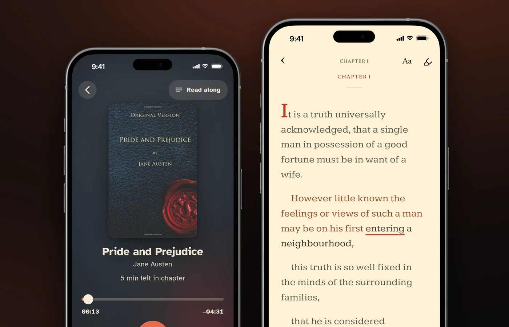

# Can Kindle Read to You? How to Make Kindle Read Aloud, by Device

Yes. The free Kindle app and newer Kindle e-readers read books aloud with Assistive Reader, a text-to-speech feature that highlights the words as it reads.

Assistive Reader costs nothing. It runs in the Kindle app on iPhone, iPad, Android, Mac and Fire tablets, and on Kindle e-readers from the 11th generation on, Kindle Scribe and Kindle Colorsoft. The voice is your device's text-to-speech voice. A person reading costs extra: you add the Audible audiobook to your Kindle book at a discount, or borrow a Kindle+ title that comes with one. This guide gives the steps for each device, Alexa (which can't do it on Alexa+), the voice and speed, why some books won't read, and what research says about computer voices against human narrators. The Amazon facts come from Amazon's help pages, read on November 9, 2026.

## Can Kindle read to you?

Yes, on almost every Kindle app and device, and every built-in route is free and uses a computer voice.

| Where you read | Read-aloud option | Cost | Highlights the words? |
|---|---|---|---|
| Kindle app on iPhone, iPad, Android, Mac | Assistive Reader | Free | Yes |
| Kindle for Windows (Windows 11) | Assistive Reader (per Amazon's shortcut page), Narrator, NVDA or JAWS | Free | Not stated |
| Kindle e-readers, 11th generation and newer, Scribe, Colorsoft | Assistive Reader, over Bluetooth | Free | Yes |
| Most Kindle e-readers from 2016 on | VoiceView screen reader, over Bluetooth | Free | Not stated |
| Fire tablets | Assistive Reader in the Kindle app, VoiceView | Free | Yes, with Assistive Reader |
| Echo and other Alexa devices | Kindle Assistive Reader on the original Alexa, not Alexa+ | Free | Not stated |
| Kindle for Web (browser) | None documented | n/a | n/a |
| Kindle app with the Audible audiobook | A human narrator | Paid add-on, or included with some Kindle+ titles | Yes, in the iOS and Android apps and on Fire tablets |

![Chart titled "Every Kindle read-aloud is free and synthetic. A person reading costs extra." Free computer-voice routes: Assistive Reader in the Kindle apps on iPhone, iPad, Android and Mac; Kindle for Windows 11 with Assistive Reader shortcuts or a screen reader; Assistive Reader on Kindle e-readers 11th generation and newer, Kindle Scribe and Kindle Colorsoft; VoiceView on older Kindles; Fire tablets; Echo devices on the original Alexa, not Alexa+. Paid route, a person reading: Audible narration added to the Kindle book or included with a Kindle+ title, with highlighted words in the Kindle app on iOS and Android and on Fire tablets; on Kindle e-readers the narration plays over Bluetooth and Amazon does not say whether words are highlighted. Source: Amazon help pages, checked November 9, 2026.](/assets/img/blog/can-kindle-read-to-you-routes.webp "wide")

Amazon's help page says Assistive Reader gives "new options to control TTS (Text-to-Speech) on the free Kindle app for iPhone, iPad, Android phones and tablets, Mac, and Fire tablets," with "real-time text highlighting while listening." Amazon's accessibility post calls Assistive Reader "Kindle's latest accessibility feature."

Two features sound alike but do different jobs. VoiceView is a screen reader for blind and low-vision readers: it reads everything on the screen, menus included. Assistive Reader reads the book, with a player and highlighted words.

## How do you get your Kindle to read to you?

In the Kindle app, open a book, tap **Aa**, then **More**, and turn on Assistive Reader. Amazon writes the steps for the Kindle app on iOS, Android and Fire tablets. The Mac app is on Amazon's Assistive Reader list, but its steps are not written out.

### 1. Open the book in the Kindle app

Open the Kindle app and the book you want to hear. Check that the book is eligible first (see "Which books work" below), because Assistive Reader only reads some Kindle books.

### 2. Tap the top center, then Aa, then More

Tap the top center of the screen to show the menus. Then tap the reading settings menu, **Aa**, and tap **More**.

### 3. Turn on Assistive Reader

Switch on **Assistive Reader**. Amazon says Assistive Reader "remains available until you turn it off again," so you only do this once.

### 4. Tap the screen and press play

Tap the screen to show the player. Its controls change the reading speed and rewind by 30 seconds. To start from a particular spot, long-press a word to open the quick actions menu and choose **Play**. Assistive Reader pauses by itself when you open the navigation menu or make a highlight or note.

**Which books work.** Amazon says Assistive Reader "works with any Kindle book with Enhanced Typesetting." Look for "Enhanced Typesetting: Enabled" in the book's details on its Kindle store page. The book also has to be:

- bought from the Kindle store,
- borrowed from Kindle+ (formerly Kindle Unlimited), Prime Reading or "other official Kindle partner sources",
- or shared with you in your Family Library.

It must also be in a language your device's text-to-speech engine supports. Amazon's accessibility page adds that "print replica and image-based fixed layout Kindle books aren't readable in read aloud and braille." Public library loans are not on Amazon's list; our guide to whether [Libby can read to you](/blog/can-libby-read-to-you) covers sending library ebooks to Kindle.

**If Assistive Reader won't start**, a screen reader is the fallback Amazon documents. The Kindle app for iOS supports VoiceOver: swipe down with two fingers to read continuously, with pages turning on their own, and tap once with two fingers to pause. The Kindle app for Android supports TalkBack: swipe down then right to open the TalkBack menu and choose "Read from focused item". Both screen readers change how your whole phone responds to touch.

iPhone's Speak Screen (Settings, Accessibility, Read & Speak in iOS 26) and Android's Select to Speak read whatever is on screen. They are worth a try, but Amazon, Apple and Google do not say they work in the Kindle app.

## Can a Kindle Paperwhite read to you?

Yes, if the Paperwhite is an 11th generation model or newer: Assistive Reader works on Kindle e-readers from the 11th generation on, Kindle Scribe and Kindle Colorsoft, with sound through Bluetooth.

### 1. Pair Bluetooth headphones or a speaker

Kindle e-readers play sound over Bluetooth. Amazon's Bluetooth guide says you can "listen to VoiceView commands or an audiobook with a supported Bluetooth device" and that "only devices released during or after 2016 support Bluetooth connectivity." Pair your headphones or speaker before you open the book.

### 2. Open the book, then Aa, then More

Open the book and tap the top center of the screen. Then tap the reading settings menu, **Aa**, and tap **More**.

### 3. Turn on Assistive Reader and press play

Turn on **Assistive Reader**. The player at the bottom of the screen plays, pauses, changes the reading speed and rewinds by 30 seconds. Amazon says you can "follow along with the words highlighted as they're read aloud."

On e-readers, Amazon says Assistive Reader supports books in five languages: English, Spanish, French, German and Italian. It "only works with books that have Enhanced Typesetting." Amazon's software page lists the 11th generation and newer models as the Kindle (2022 and 2024 releases), Kindle Paperwhite 11th and 12th generation, Kindle Colorsoft and the Kindle Scribe models. The Kindle Oasis stopped at the 10th generation, so Assistive Reader is not listed for it. Amazon's Assistive Reader page does not name the 2026 Kindles.

**Older Kindles: VoiceView.** Amazon introduced VoiceView in 2016 "to provide screen reader support for blind and low-vision users." VoiceView runs over Bluetooth in six languages, according to Amazon's help page. To start VoiceView on an 11th generation or newer Kindle, put your headphones in pairing mode and press the power button three times within two seconds. When you hear audio, hold two fingers spaced apart on the screen. On older models, hold the power button for nine seconds, then press two fingers on the screen for one second. Once VoiceView is on, VoiceView starts reading when you open a book and turns the pages itself. Tap the screen with two fingers to pause.

## Can Kindle read to you on PC or Mac?

Yes, in the desktop Kindle apps, but Amazon documents no read-aloud in the Kindle for Web browser reader.

- **Mac.** The Kindle app for Mac is on Amazon's Assistive Reader list. Amazon's Mac shortcut page still uses older wording: press Command T, or choose Start Text-to-Speech from the Tools menu. Amazon says you set the speech language in your Mac's System Preferences.
- **Windows.** The old Kindle for PC app "isn't supported as of June 30, 2026," Amazon says, and the current Kindle for Windows app needs Windows 11. Kindle for Windows works with the Narrator screen reader built into Windows 11, NVDA 2017.1 or higher, and JAWS. Amazon's main Assistive Reader page does not list Windows, but its Kindle for Windows shortcut page does describe Assistive Reader: press Ctrl and A, or use the Aa menu, to turn it on, then Ctrl and T to toggle text-to-speech.
- **Kindle for Web.** Amazon lists font, font size, page color, layout, margin and reading progress as the settings at read.amazon.com. No read-aloud option is documented there.

## Can Alexa read your Kindle books?

Yes, on the original Alexa, but Amazon's help says "Kindle Assistive Reader isn't available on Alexa+."

On the original Alexa, Amazon says Kindle Assistive Reader is "available on all Alexa built-in devices." Ask Alexa to read a book by its title, or turn the feature on in the Alexa app under More, Settings, Accessibility, Kindle Assistive Reader. While Alexa reads, you can pause and restart, move by chapter or by time, slow down or speed up, and set a timer to stop. Alexa starts from the most recent page you read on any device.

The book rules match the app: bought from the Kindle store, borrowed through Kindle Unlimited (now Kindle+) or Prime Reading, or shared in Family Library, with Enhanced Typesetting, in a language Alexa supports. To see which of your books qualify, ask Alexa to "Show my Kindle books."

The Alexa+ catch matters because Alexa+ is now part of Prime. Amazon's Alexa+ article says Alexa+ costs $19.99 a month in the US and is "included at no additional cost to Prime members," which it has been since February 2026. If your Echo runs Alexa+, Kindle Assistive Reader is not available on it, by Amazon's own account.

## How do you change the Kindle Assistive Reader voice and speed?

Change the speed in the Assistive Reader player; the voice comes from your device's own text-to-speech settings, not from the Kindle app.

**Speed.** The Assistive Reader player in the app and on e-readers has a reading-speed control. On Alexa, ask Alexa to slow down or speed up. Amazon's pages give no speed range.

**Voice.** Amazon says Assistive Reader "uses your device's OS-level Text-to-Speech engines." Amazon describes no voice setting inside the Kindle app, so the voice and accent depend on your phone, tablet or computer. For the Mac and Windows apps, Amazon says you set the language in your computer's settings. On iPhone, Apple's Read & Speak settings include "Voices: Choose a voice and dialect." Apple does not say whether the Kindle app uses that voice, so change it and listen for a difference.

How fast is a comfortable listening speed? Human narrators are slower than readers. ACX, Amazon's audiobook production marketplace, says most narrators read "about 9,300 words per hour," about 155 a minute. Brysbaert's 2019 meta-analysis of 190 studies with 18,573 participants put adult silent reading in English at 238 words a minute for non-fiction and 260 for fiction. In a 2024 experiment, Chen, Kumar, Varkhedi and Murphy played podcast clips to 200 undergraduates at 1x, 1.5x, 2x or 2.5x and found no significant effect of speed on comprehension, though the authors "still do not advise exceeding 2x speed." Those were podcasts, not computer voices reading novels. Our guide to [audiobook listening speed](/blog/audiobook-listening-speed) covers how to pick a speed.

## Does Kindle read to you like Audible?

No. Assistive Reader, VoiceView and Alexa read in a synthetic voice, while Audible narration is a person performing the book.

Does a computer voice make a book harder to enjoy or remember? The research has moved as voices improved, and none of it tests Kindle's voices:

- **Older voices lost clearly.** Richard Mayer's 2017 review put the median benefit of a human voice over a machine voice at d = 0.74, from experiments run with early-2000s synthetic voices.
- **Modern voices teach about as well.** In a 2019 experiment, Craig and Schroeder found that learners taught by a modern text-to-speech voice did not differ in learning or perceptions from those taught by a recorded human voice. The abstract does not give the sample size.
- **No single voice wins.** Cambre and colleagues' 2020 evaluation of 18 text-to-speech voices and 3 human voices for long-form listening concluded that "TTS voices are close to rivaling human voices, yet no single voice outperforms the others across all evaluation dimensions."
- **Stories still favour a person.** In a 2023 study of audiobook-style stories, Rodero and Lucas found that listeners enjoyed a human voice more, were more engaged and "remembered more information." The abstract does not give the sample size. A 2025 study by Dylman and colleagues found a human voice helped people remember a text right after listening, but the advantage was gone a week later.
- **Ratings are close.** In a 2026 study, Ahrens-Schwabe and colleagues had audiobook listeners rate excerpts read by AI voices and by professional voice actors. The differences were "minute." The study measured ratings, not comprehension.
- **Read-aloud tools help struggling readers.** A 2018 meta-analysis of 22 studies by Wood and colleagues found that text-to-speech and other read-aloud tools gave students with reading disabilities a modest comprehension boost (g = 0.35). Whether the voice was synthetic or human did not make a significant difference.

**What the evidence does not show.** No study has compared a computer voice with a narrator across a whole book; the studies use excerpts, lessons and short stories. No study tests the voices in Assistive Reader, VoiceView or Alexa, and results from one engine don't carry over to another. Mayer's d = 0.74 rests on old voices and is not the size of today's gap. Seeing the words while you listen has mixed evidence too. Clinton-Lisell's 2023 meta-analysis of 30 studies with 1,945 participants found no reliable benefit when readers set their own pace (g = 0.06). In a 2026 study of 86 Chinese learners of English, Hui and Godfroid found readers understood excerpts of a novel less well when reading while listening than when reading silently. Our guide to whether [reading along helps](/blog/does-reading-along-with-an-audiobook-help) goes through who benefits.

If the computer voice is what keeps you from finishing, a recorded narrator is the fix. On Amazon that means a second purchase, and on an e-ink Kindle Amazon describes switching between reading and listening, not reading along. We built **HushBook** for the reader who wants both at once: a human narrator, with each word highlighted on screen as it is spoken, in free public domain classics and audio files you own. **HushBook** can't open Kindle books; more at the end.

## How do I turn my Kindle book into an audiobook?

Buy or borrow the matching Audible narration for a human voice, or turn on Assistive Reader for a free computer voice.

**1. Add the Audible audiobook.** Amazon's Read & Listen store page says: "Have the Kindle eBook? Get the Audible audiobook at a discount." The Kindle book's store page shows the offer when an Audible edition exists. Amazon's troubleshooting page says "you must own or borrow both the audiobook and eBook versions." In the Kindle app, Amazon's reading-options page says words are highlighted while Audible narrates. On an e-ink Kindle, Amazon describes using a paired Bluetooth device "to switch between your Kindle e-book and the matching Audible audiobook without losing your place." Audible said on October 26, 2026 that Read & Listen covers "more than 800,000 English and German-language titles." Our guide to [reading along with Audible](/blog/can-you-read-along-with-audible) explains how Read & Listen works in the Audible app.

**2. Borrow a Kindle+ title with audio.** Kindle+ costs $11.99 a month in the US and is not included with Prime, Amazon says. Amazon also says "thousands of eBooks also include companion audiobooks" at "no additional cost." Kindle+ members who borrow a title labeled "Books with Audio" get both versions automatically. Look for the headphone icon next to the Kindle+ logo.

**3. Check Prime Reading.** Some Prime Reading pages say: "This title is also available to read and listen for free with Prime."

**4. Use Assistive Reader.** Assistive Reader turns any eligible Kindle book into listening right away, free, in a computer voice.

Text-to-speech companies offer workarounds. ElevenReader says its iPhone and iPad app can read Kindle for Web pages aloud inside its own browser, and that this "doesn't import, download, copy, store, or create audio files from your Kindle books." Its free plan includes 10 hours of listening a month. NaturalReader's Chrome extension reads Kindle for Web on desktop browsers, but its help page says word-by-word highlighting is not available there. We have not tested either. None of the routes in this guide needs you to remove copy protection. For text-to-speech apps compared with human narration, see our [Speechify alternatives](/alternatives/speechify-alternatives).

## How can I listen to my Kindle books for free?

Use Amazon's built-in read-aloud features, which all cost nothing:

- **Assistive Reader** in the Kindle app on iPhone, iPad, Android, Mac and Fire tablets.
- **Assistive Reader** on 11th generation and newer Kindle e-readers, Kindle Scribe and Kindle Colorsoft, with Bluetooth audio.
- **VoiceView** on most Kindle e-readers from 2016 on, with Bluetooth audio, and on Fire tablets.
- **Alexa** reading your Kindle books, on the original Alexa only.
- **Screen readers**: VoiceOver and TalkBack in the mobile apps, and Narrator, NVDA or JAWS with Kindle for Windows.

Human narration is the part you pay for, through an Audible add-on or a Kindle+ subscription at $11.99 a month. Free human-narrated audiobooks exist too, mostly public domain classics and library loans; see [how to listen to audiobooks for free](/blog/how-to-listen-to-audiobooks-for-free).

## Why won't my Kindle read a book aloud?

Usually because the book lacks Enhanced Typesetting or came from a source Amazon doesn't list. Work through these in order:

- **No Enhanced Typesetting.** Check the book's Kindle store page for "Enhanced Typesetting: Enabled". Assistive Reader and Alexa both need it.
- **The book came from somewhere else.** Amazon's list names Kindle store purchases, Kindle+, Prime Reading, other official Kindle partners and Family Library. Files you add yourself are not on it.
- **The layout.** Print replica and image-based fixed-layout books can't be read aloud.
- **The language.** In the app, your device's text-to-speech engine has to support the book's language. On e-readers, Assistive Reader covers five languages.
- **No sound on an e-reader.** Pair Bluetooth headphones or a speaker first. Kindles older than the 11th generation have VoiceView instead of Assistive Reader.
- **Alexa+.** Kindle Assistive Reader is not available on Alexa+.

There is history here too. On February 27, 2009, after the Authors Guild objected to the Kindle 2's experimental text-to-speech, Amazon said rightsholders could "decide on a title by title basis whether they want text-to-speech enabled or disabled." Some guides still tell you to look for a "Text-to-Speech: Enabled" line on the book's page. On the five US Kindle pages we checked on November 9, 2026, that line was gone; they showed "Screen Reader: Supported" instead. Amazon's current help does not say whether a publisher's choice still affects Assistive Reader.

## What we could not confirm

- We did not test these steps on a device. They come from Amazon, Apple and Google help pages read on November 9, 2026, and app menus change.
- Assistive Reader's speed range. Amazon's pages offer a speed control and a 30-second rewind but give no range.
- Whether Assistive Reader works with public library loans, sideloaded files or Send-to-Kindle documents. Amazon does not list them.
- Whether you can switch an Echo back from Alexa+ to the original Alexa to use Kindle Assistive Reader.
- Whether the 2009 publisher switch still blocks reading aloud on some titles. We checked five product pages, not the whole store.
- Which phone setting changes the Assistive Reader voice. Amazon names only "your device's OS-level Text-to-Speech engines."
- When Assistive Reader reached e-readers. Amazon gives no date; The eBook Reader blog reported the rollout in July and August 2025.
- VoiceView's languages. Amazon's Kindle Paperwhite listing says English only, while its VoiceView help lists six languages.
- How ElevenReader and NaturalReader behave. Their descriptions come from their own pages.

## Reading along with HushBook

Kindle's read-aloud is free and reads the books already in your Kindle library. **[HushBook](/)** does a different job: a recorded narrator *and* the words on screen. **HushBook** can't open Kindle or Audible books, which stay inside Amazon's apps, and it has no computer voice of its own.

It has a built-in catalogue of free public domain audiobooks from LibriVox and the Internet Archive, in six languages, and you can import audio files you own, such as MP3 and M4B. **HushBook** transcribes the recording on your phone and highlights each word as the narrator says it. Long-press a line to play from there. It is free to download, with **no ads and no account**. The read-along and the free library cost nothing. After a one-time engine download, it *works offline*.

Two limits. Speech recognition can misread names and unusual words, so a character's name may be spelled wrong on screen. And **HushBook** is a reading aid, not a medical tool.

## Sources

- [Amazon, "Use Assistive Reader to Read Aloud in Kindle Apps"](https://www.amazon.com/gp/help/customer/display.html?nodeId=TqLHvK6eo6O7DJVQoZ)
- [Amazon, "How to Use the Assistive Reader on Your Kindle"](https://www.amazon.com/gp/help/customer/display.html?nodeId=TdHCSXXqsdhaVKt3Tc)
- [Amazon, "Accessible Reading Options for Kindle Reading Apps"](https://www.amazon.com/gp/help/customer/display.html?nodeId=TABlJ4ot69emTO8jJG)
- [Amazon, "Learn About Accessibility Information for Kindle Books"](https://www.amazon.com/gp/help/customer/display.html?nodeId=TzZzGnAX8N8zL1qWfT)
- [Amazon, "Use VoiceView Over Bluetooth on Kindle"](https://www.amazon.com/gp/help/customer/display.html?nodeId=TKfsDEx2U1RrGi8o1C)
- [Amazon, "Guide to VoiceView Gestures on Your Kindle"](https://www.amazon.com/gp/help/customer/display.html?nodeId=TAy5KCy5PpYSoGtEA3)
- [Amazon, "Connect and Sync Bluetooth to Your Kindle E-Reader"](https://www.amazon.com/gp/help/customer/display.html?nodeId=TIHMXAou9Wm1q17sg5)
- [Amazon, "Latest Kindle Software Updates and Versions"](https://www.amazon.com/gp/help/customer/display.html?nodeId=GKMQC26VQQMM8XSW)
- [Amazon, "How to Find Out Your Kindle Model and Generation"](https://www.amazon.com/gp/help/customer/display.html?nodeId=GK33S847NN4V6Y83)
- [Amazon, "Kindle Paperwhite 16 GB, Fastest Kindle E-Reader"](https://www.amazon.com/clp/B0CFPJYX7P)
- [Amazon, "Use Alexa to Read Your Kindle Books"](https://www.amazon.com/gp/help/customer/display.html?nodeId=TAyb6hr4lsK1J9eK2S)
- [Amazon, "Which Books Can Alexa Read with Kindle Assistive Reader?"](https://www.amazon.com/gp/help/customer/display.html?nodeId=GYDXGLMJXN5D73UN)
- [Amazon, "Turn On Kindle Assistive Reader on Echo Devices with a Screen"](https://www.amazon.com/gp/help/customer/display.html?nodeId=T0vuvMLQPkuh4jBLkm)
- [Amazon, "Syncing Issues with Books Read by Alexa with Kindle Assistive Reader"](https://www.amazon.com/gp/help/customer/display.html?nodeId=GDNJ68Z4KQE9VRRT)
- [Amazon, "Install or Update the Kindle App for Desktop"](https://www.amazon.com/gp/help/customer/display.html?nodeId=TlLrSvAdaGJObw5fIG)
- [Amazon, "Kindle for Windows Accessibility Features"](https://www.amazon.com/gp/help/customer/display.html?nodeId=G74WVD3PVFJ8N3KL)
- [Amazon, "Kindle for Windows Keyboard Shortcuts"](https://www.amazon.com/gp/help/customer/display.html?nodeId=GPC7U392HH93VPC8)
- [Amazon, "Kindle for Mac Keyboard Shortcuts"](https://www.amazon.com/gp/help/customer/display.html?nodeId=GFBT6Y7AFLJY947N)
- [Amazon, "Customize Kindle for Web"](https://www.amazon.com/gp/help/customer/display.html?nodeId=TT200NNkr2BE4Jnsy9)
- [Amazon, "Use VoiceOver with the Kindle App on iOS"](https://www.amazon.com/gp/help/customer/display.html?nodeId=G4PD9B7BHV4GQP5U)
- [Amazon, "Use TalkBack with the Kindle App on Android"](https://www.amazon.com/gp/help/customer/display.html?nodeId=GFEDJC3YY98GPZW7)
- [Amazon, "Guide to Reading Books with VoiceView on Fire Tablet"](https://www.amazon.com/gp/help/customer/display.html?nodeId=Tlyb2fwnqEsM9z3lb8)
- [Amazon, "Other Reading Accessibility Settings on Fire Tablet"](https://www.amazon.com/gp/help/customer/display.html?nodeId=TjCHGCnIKBM42lnQrE)
- [Amazon, "Switch Between Reading and Listening Experience"](https://www.amazon.com/gp/help/customer/display.html?nodeId=TZkqDMewOPQ0FqrSqX)
- [Amazon, "Troubleshoot Read & Listen"](https://www.amazon.com/gp/help/customer/display.html?nodeId=TBOgUdeE7YXXcq28Ac)
- [Amazon, "Whispersync for Voice - Learn More: Kindle Store"](https://www.amazon.com/Whispersync-for-Voice/b?ie=UTF8&node=12527156011)
- [Amazon, "Project Hail Mary: A Novel eBook" (Kindle product page)](https://www.amazon.com/Project-Hail-Mary-Andy-Weir-ebook/dp/B08FHBV4ZX)
- [Amazon, "Wuthering Heights (AmazonClassics Edition)" (Kindle product page)](https://www.amazon.com/Wuthering-Heights-AmazonClassics-Emily-Bront%C3%AB-ebook/dp/B073QM98F5)
- [About Amazon, "Kindle accessibility features like text-to-speech, visual customization, more"](https://www.aboutamazon.com/news/books-and-authors/kindle-accessibility-features-for-all-readers)
- [About Amazon, "Kindle Unlimited is now Kindle+: Everything you need to know"](https://www.aboutamazon.com/news/devices/what-is-kindle-plus)
- [About Amazon, "How to get Alexa Plus free with Prime membership"](https://www.aboutamazon.com/news/devices/alexa-plus-available-free-prime-members-us)
- [Amazon Press Center (February 27, 2009), "Statement from Amazon.com Regarding Kindle 2's Experimental Text-to-Speech Feature"](https://press.aboutamazon.com/2009/2/statement-from-amazon-com-regarding-kindle-2s-experimental-text-to-speech-feature)
- [The Authors Guild (March 2, 2009), "Amazon Reverses Stance on Computer-Generated Audio for the Kindle 2"](https://authorsguild.org/news/amazon-reverses-stance-on-computer-generated-audio-for-the-kindle-2/)
- [Audible (October 26, 2026), "Audible's Read & Listen Experience Comes to More Listeners Around the Globe"](https://www.audible.com/about/newsroom/audibles-read-and-listen-experience-comes-to-more-listeners-around-the-globe)
- [Apple Support, "Hear iPhone speak the screen, selected text, and typing feedback" (iOS 26)](https://support.apple.com/guide/iphone/hear-whats-on-the-screen-or-typed-iph96b214f0/ios)
- [Android Accessibility Help, "Use Select to Speak"](https://support.google.com/accessibility/android/answer/7349565?hl=en)
- [ElevenReader, "How to Listen to Kindle Books Without Audible on Kindle, iPhone, and Android" (vendor page)](https://elevenreader.io/blog/how-to-listen-to-kindle-books-without-audible)
- [ElevenReader, "Kindle Read Aloud: Listen to Kindle Books with Natural Voices" (vendor page)](https://elevenreader.io/kindle-read-aloud)
- [NaturalReader Help Center, "Reading with Kindle Online (Chrome Extension)" (vendor page)](https://help.naturalreaders.com/en/articles/6214013-reading-with-kindle-online-chrome-extension)
- [The eBook Reader (August 27, 2025), "Kindle's New Assistive Reader (Text-to-Speech) Video Demo"](https://blog.the-ebook-reader.com/2025/08/27/kindles-new-assistive-reader-text-to-speech-video-demo/)
- [ACX, "How long will my narrated audiobook be?"](https://help.acx.com/s/article/how-long-will-my-narrated-audiobook-be)
- [Brysbaert (2019), "How many words do we read per minute? A review and meta-analysis of reading rate", Journal of Memory and Language](https://doi.org/10.1016/j.jml.2019.104047)
- [Chen, Kumar, Varkhedi and Murphy (2024), "The Effect of Playback Speed and Distractions on the Comprehension of Audio and Audio-Visual Materials", Educational Psychology Review](https://doi.org/10.1007/s10648-024-09917-7)
- [Mayer (2017), "Using multimedia for e-learning", Journal of Computer Assisted Learning](https://doi.org/10.1111/jcal.12197)
- [Craig and Schroeder (2019), "Text-to-Speech Software and Learning: Investigating the Relevancy of the Voice Effect", Journal of Educational Computing Research](https://doi.org/10.1177/0735633118802877)
- [Cambre, Colnago, Maddock, Tsai and Kaye (2020), "Choice of Voices: A Large-Scale Evaluation of Text-to-Speech Voice Quality for Long-Form Content", Proceedings of the 2020 CHI Conference on Human Factors in Computing Systems](https://doi.org/10.1145/3313831.3376789)
- [Rodero and Lucas (2023), "Synthetic versus human voices in audiobooks: The human emotional intimacy effect", New Media & Society](https://doi.org/10.1177/14614448211024142)
- [Dylman, Glarén Diaz, Blysa and Jansson (2025), "The effect of prosody on listening comprehension: Immediate and delayed recall", Cogent Psychology](https://doi.org/10.1080/23311908.2025.2576785)
- [Ahrens-Schwabe, Kosch, Stocker and Boomgaarden (2026), "Who cares about artificial intelligence? Human and artificial voices in audiobooks", Computers in Human Behavior Reports](https://doi.org/10.1016/j.chbr.2026.101068)
- [Wood, Moxley, Tighe and Wagner (2018), "Does Use of Text-to-Speech and Related Read-Aloud Tools Improve Reading Comprehension for Students With Reading Disabilities? A Meta-Analysis", Journal of Learning Disabilities](https://doi.org/10.1177/0022219416688170)
- [Clinton-Lisell (2023), "Does Reading While Listening to Text Improve Comprehension Compared to Reading Only? A Systematic Review and Meta-Analysis", Educational Research: Theory and Practice](https://eric.ed.gov/?id=EJ1403866)
- [Hui and Godfroid (2026), "Listening, Reading, or Both? Rethinking the Comprehension Benefits of Reading-While-Listening", Language Learning](https://doi.org/10.1111/lang.12721)
