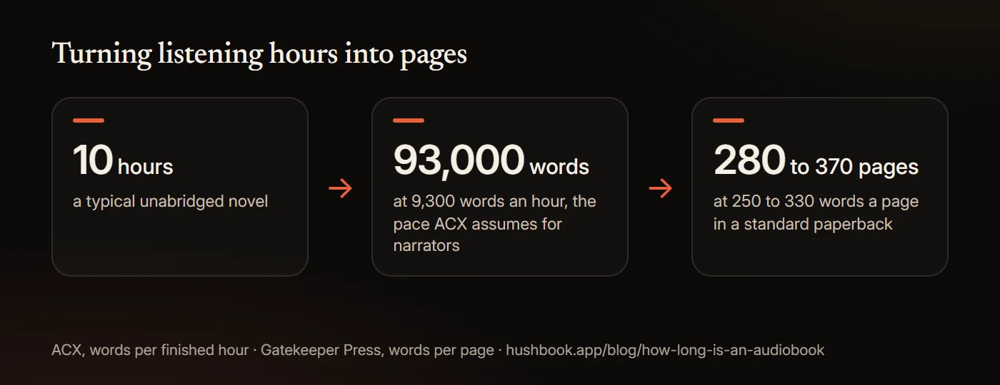
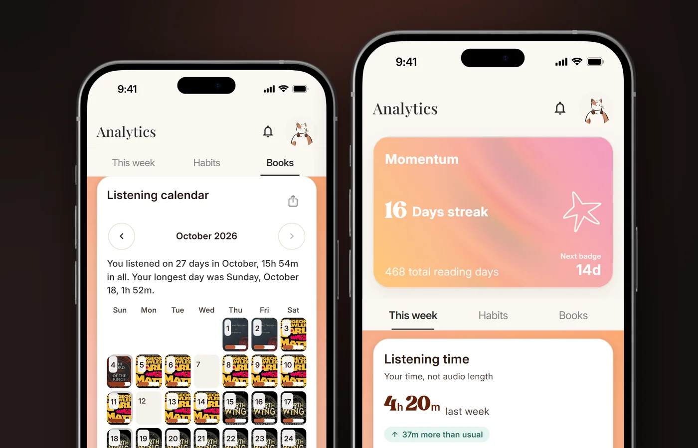

# Do Audiobooks Count on Goodreads? Reading Challenge Rules and How to Log Them

Yes. Goodreads counts any book on your Read shelf that has a read date in the challenge year, and its rules never mention format. An audiobook you finished in 2026 counts toward the 2026 Reading Challenge and your Year in Books exactly like a hardcover. The catch is logging. Goodreads cannot import from Audible, Libby or OverDrive, and only Kindle books are marked Read on their own, so every audiobook goes on the shelf by hand with a finish date. StoryGraph and Fable count audiobooks too. The one famous challenge that does not is 75 Hard, which asks for ten pages of a physical non-fiction book.

This guide gives the Goodreads rules in Goodreads' own words, the steps to add an audiobook and pick the audio edition, what the Audible link actually does, why a book sometimes refuses to count, how pages work for audiobooks, and the rules on StoryGraph, Fable, library summer reading and 75 Hard. Every rule was read from the service's help pages on November 3, 2026.

## Do audiobooks count on Goodreads?

Yes. Goodreads' help page on the Reading Challenge says: "All books on your Read shelf with a read date set in the current year are included in this year's Reading Challenge goal." Nothing about pages, formats or editions. The Year in Books page is even plainer: "Audiobooks you complete count toward your Year in Books the same as ebooks and print books."

Two smaller rules follow from the same page. A book on the Did Not Finish shelf with a current-year read date counts as well. And a reread counts again, as long as you give it a separate finish date.

Goodreads members settled the social question years ago. A member poll titled "Do audiobooks count on Goodreads?", open since 2018, has 637 votes: 73.3% chose "YES, audiobooks ARE just another vehicle for the story", 11.1% were undecided, 11% picked "Who cares. You do you." and 4.6% said no. It is a self-selected poll, not a survey, but the ratio tells you how the room feels.

## Does listening to an audiobook count as reading?

Yes for comprehension, with one honest exception for assigned reading practice. We cover the studies in [does listening to audiobooks count as reading](/blog/does-listening-to-audiobooks-count-as-reading). The short version: a 2022 meta-analysis of 46 studies found no reliable overall difference in comprehension between listening and reading.

The public is still split. In an NPR/Ipsos poll of 2,033 US adults in February 2025, 41% agreed that "audiobooks are not a form of reading". Meanwhile the audience keeps growing: Pew Research Center's October 2025 survey of 8,046 adults found 26% had listened to an audiobook in the past year, up from 23% in 2021 and 11% in 2011. Goodreads, StoryGraph and Fable have all taken a side. They count the book.

## How to add audiobooks to Goodreads

Five steps, and the third one is the one people miss.

1. Search for the title and open the book page.
2. Shelve it as Read, or as Currently Reading until you finish.
3. Set the read date. Goodreads' reread announcement states the rule: "You don't have to have a start date, but you must have a finish year for the book to count toward your Reading Challenge." Without a date in the challenge year the book sits on your shelf and counts for nothing.
4. Switch to the audiobook edition if you want your shelf to show what you actually listened to. Goodreads' steps: on the iOS and Android apps, "Select Book Details, then tap the number of editions"; on the web, "Under More editions, select Show all [number] editions." Then "Select Switch to this edition next to that edition." The editions list has a format filter with Audiobook, Audible Audio, Audio CD and MP3 CD.
5. Rate it or not. Ratings do not affect the challenge.

If you listen in an app that does not talk to Goodreads, which is most of them, the finish date is the thing to write down the day you finish. In HushBook the Library has a Finished filter, so the list of what to log is one tap away, and the Finished this year card in Pro keeps each book with its listening time.

## Can you link Audible to Goodreads?

Only in one direction, and not the one you want.

Goodreads' import page says: "Note: You can't import from Audible, OverDrive, or Libby. To track books from these services, search for the title on Goodreads and add it to your shelves." Linking your Amazon account does two things, per Goodreads' help: it will "Sync your Kindle and Goodreads reading challenges and Year in Books progress" and "Sync your Want to Read shelf to your Audible app library." The second one arrived in November 2025 and shows your Goodreads Want to Read shelf as a list inside the Audible app. It sends books toward Audible. Nothing comes back.

Automatic logging is Kindle only. Goodreads: "When you link your Amazon account, Kindle books automatically count toward your reading challenge goal and achievements." Kindle books can be marked Currently Reading when you open them and Read when you finish. No page says the same of Audible listens, and the link is only offered to Amazon accounts "from the US marketplace". So an Audible finish is a manual entry, same as a Libby loan or a file you own.

## Why is my audiobook not showing up in my reading challenge?

Nine times out of ten, the read date. Check these in order.

- **No finish date.** The book is on your Read shelf but the date field is empty. Add a finish date in the challenge year.
- **Wrong year.** You logged a January 2026 finish with a 2025 date, or Goodreads kept an old date from a previous read. Edit the date.
- **The challenge is stuck.** Goodreads' own fix for a book that will not count: "To add the book back to your reading challenge, remove and re-add the book's read date."
- **You switched editions after dating it.** Check that the date survived the switch; re-enter it if not.
- **It is on Did Not Finish.** That still counts if the date is in the current year, so this is not the problem, but a DNF book moved back to Want to Read loses its place.
- **Kindle sync lag.** A linked Kindle book can take a while to show; audiobooks never sync, so if you are waiting for an Audible title to appear on its own, it will not.

## Does rereading a book count on the Goodreads Challenge?

Yes, once for each finish date. Goodreads added reread support on February 7, 2017, and its help pages still say: "If you've re-read a book, make sure to set individual read dates for each time you finished it." Add a new read date instead of changing the old one, and the book counts in both years. The same applies to listening to a book you once read in print: a 2026 finish date on the audio edition counts in 2026.

## How does Goodreads count pages for audiobooks?

Two different ways, and neither is what most people expect.

On the edition record, Goodreads librarians are told to put hours in the pages field. The librarian manual says: "For audio books, the number of hours rounded up should be used in lieu of number of pages, when that information is known." That is why the Audible edition of Project Hail Mary shows "16 pages, Audible Audio" while the hardcover shows 476. Other audio editions of the same book show 17 pages, 476 pages or nothing, depending on who edited them.

In your Year in Books, Goodreads ignores all of that. The help page says: "The page count comes from the book's primary print edition (usually hardcover or paperback)." So your yearly page total is the print length of the books you listened to, however many hours they took.

If you want your own conversion, the maths is short. ACX, Audible's production platform, says "most performers narrate about 9,300 words per hour". Gatekeeper Press puts a 5 by 8 inch paperback page at 240 to 260 words and a 5.5 by 8.5 inch page at 300 to 330. Divide and you get about 28 to 37 pages per listening hour. A 10-hour audiobook is roughly 93,000 words, or 280 to 370 pages. The full working, with word counts for ten classics, is in [how long is an audiobook](/blog/how-long-is-an-audiobook).

## How do you track audiobooks on StoryGraph?

Pick the audio edition and StoryGraph does the rest. Its June 1, 2022 changelog, "Audiobook Tracking and Stats!", explains the model: "Simply choose your audio edition, track your progress, and we'll automatically convert everything to pages for you!" Pages are the default. "If you choose to track via minutes, you'll see some new charts", and you can "set an Hours Goal". If you logged a book as print and want it as audio, StoryGraph's support article says to switch editions, and under Preferences there is a link that says "Convert all data to minutes".

Three facts people ask about:

- **Does StoryGraph sync with Audible?** No. StoryGraph's support page says: "At the moment the only bulk imports we can process are those from Goodreads." A request to link Audible and Kindle accounts has been open since 2023; staff replied that "We're not sure there's an available API that we'd be able to use given Kindle and Audible are Amazon companies".
- **Do audiobooks count in StoryGraph challenges?** A prompt completes "Once the book is marked as 'read' with a finish date that falls within the start and end dates of the challenge". Format is not a rule, though a community challenge host can set their own.
- **Moving from Goodreads?** Export your Goodreads CSV and import it. Audiobook editions come across as the editions you shelved.

Fable works the same way. Its guide to reading goals says: "Audiobooks are REAL books! Ebooks are REAL books! It is not just physical books that count. All types of books count towards a reading goal." A book needs "a finished date added" to count, and listening on Everand syncs to Fable automatically.

## Do audiobooks count for 75 Hard, summer reading and other challenges?

It depends on who set the challenge, so here is the list.

- **75 Hard: no, by the program's design.** Andy Frisella's official page gates the full rules behind an email signup, but it answers the substitution question in public: "Can I Do {Insert Your Random Task} Instead of One of the 75 HARD Tasks? NO ... Because that's the entire problem." The reading task, as reproduced across the many sites that list the rules, is ten pages of a non-fiction book, read, not listened to. If you are doing 75 Hard, treat audiobooks as extra, not as the task.
- **Library summer reading: almost always yes.** Beanstack, the app most US libraries use, says: "You can track the minutes spent listening to an audiobook, the pages read of a graphic novel, or the number of picture books read with a child." Boise Public Library's 2026 FAQ: "Do audiobooks count as reading? Of course!" Appomattox Regional Library: "Audiobooks count as books." Andersen Base Library: "Audiobooks? Yep!" Check your own library's page, but expect a yes.
- **School Accelerated Reader: yes.** The quiz asks how you read the book, and "I listened to the book" is one of the three answers.
- **Fable and StoryGraph challenges: yes**, by finish date, as above.
- **Reading trackers that count time:** Bookmory tracks "by page, percent, episode or time", and Bookly lets you add audiobooks and use its timer, but notes that "Audiobooks are now ignored when calculating the reading speed and book pace".

## Keeping your own count

Goodreads counts books. It cannot see how long you listened, which days you listened or how far you are through the book on your phone. If that is the part you want to track, the app you listen in has to do it.

[HushBook](/) is an audiobook player for iPhone and Android that shows the words as the narrator reads them, highlighting each word as it is spoken. Its Library has a Finished filter, and the analytics keep a listening calendar of every day you listened, a streak and, in Pro, a Finished this year card with each book's listening time. It does not sync with Goodreads or StoryGraph, so you still log the finish date there by hand; the Finished list just makes that a one-minute job. Free public domain classics from LibriVox and the Internet Archive are built in, and a classic you finish in HushBook counts on Goodreads like any other edition. Nothing is uploaded, and there is no account and no ads.

Honest limits. HushBook plays files you can import, such as MP3, M4A and M4B, and its free library. It cannot import copy-protected books from Audible, Libby, hoopla, Apple Books or Spotify, so an Audible listen is still logged from the Audible app's own history. The transcript comes from speech recognition, so names can come out wrong.

## What this guide does not settle

- Goodreads never says "audiobooks count" in those words. The rule is format-blind by omission, and the one direct statement we found is a volunteer's forum answer, not staff.
- 75 Hard's official rules are behind a signup form. The ten-pages rule and the audiobook exclusion are quoted from third-party copies of the rules, not from Frisella's own page.
- The member poll and the NPR/Ipsos question measure opinion, not reading. Neither says anything about what listening does for comprehension.
- Services change. Goodreads, Audible, StoryGraph, Fable, Beanstack and library pages were read on November 3, 2026.

## Sources

- [Goodreads Help, "I can't see my Reading Challenge goal or achievements"](https://help.goodreads.com/s/article/000001780)
- [Goodreads Help, "Add, update or remove read dates"](https://help.goodreads.com/s/article/000001769)
- [Goodreads Help, "Remove a book from your Reading Challenge"](https://help.goodreads.com/s/article/000001542)
- [Goodreads Help, "Year in Books"](https://help.goodreads.com/s/article/000001520)
- [Goodreads Help, "Import or export your books"](https://help.goodreads.com/s/article/000001100)
- [Goodreads Help, "Link your Amazon and Goodreads account"](https://help.goodreads.com/s/article/000001167)
- [Goodreads Help, "Automatically update your reading status on Kindle app"](https://help.goodreads.com/s/article/000001371)
- [Goodreads Help, "Use Kindle Notes & Highlights from Goodreads" (edition switching steps)](https://help.goodreads.com/s/article/000001803)
- [Goodreads Help, "Librarian Manual: Book edit page, number of pages"](https://help.goodreads.com/s/article/Librarian-Manual-Book-edit-page-number-of-pages)
- [Goodreads Help (2025), "Your Want to Read Shelf is Now in Audible"](https://help.goodreads.com/s/announcements/a03ar00000ZzYqFAAV/your-want-to-read-shelf-is-now-in-audible)
- [Goodreads (2017), "Rereading Is Here! Let's Say It Again. Rereading Is Here!"](https://www.goodreads.com/blog/show/817-rereading-is-here-let-s-say-it-again-rereading-is-here)
- [Goodreads member poll (2018), "Do audiobooks count on Goodreads?"](https://www.goodreads.com/poll/show/172864-do-audiobooks-count-on-goodreads-i-know-this-can-be-a-polarizing-topi)
- [Goodreads, "Editions of Project Hail Mary by Andy Weir"](https://www.goodreads.com/work/editions/79106958?filter_by_format=Audible+Audio)
- [Audible Help (2026), "View your Goodreads Want to Read shelf in the Audible app"](https://help.audible.com/s/article/view-your-goodreads-want-to-read-list-in-audible)
- [The StoryGraph (2022), "Audiobook Tracking and Stats!"](https://roadmap.thestorygraph.com/changelog/audiobook-tracking-and-stats-)
- [The StoryGraph, "Switching Editions/Formats on The StoryGraph"](https://thestorygraph.freshdesk.com/support/solutions/articles/79000141927-switching-editions-formats-on-the-storygraph)
- [The StoryGraph, "Bulk Import Template"](https://thestorygraph.freshdesk.com/support/solutions/articles/79000146300-bulk-import-template)
- [The StoryGraph, "Getting Started with StoryGraph"](https://thestorygraph.freshdesk.com/support/solutions/articles/79000142013-getting-started-with-storygraph)
- [The StoryGraph roadmap (2023), "Link Audible/Kindle account"](https://roadmap.thestorygraph.com/requests-ideas/posts/link-audible-kindle-account)
- [Fable (2025), "Setting and Reaching Your Reading Goals: A Comprehensive Guide"](https://fable.co/blog/setting-and-reaching-your-reading-goals)
- [Fable Help, "How do I add a book to my stats (and goal)?"](https://help.fable.co/article/125-how-do-i-count-a-book-towards-my-reading-goal)
- [Fable Help, "Does my Everand reading automatically sync to Fable?"](https://help.fable.co/article/191-do-my-everand-books-and-activity-sync-to-fable)
- [App Store, "Bookly: Book Tracker App"](https://apps.apple.com/us/app/id1085047737)
- [App Store, "Bookmory - reading tracker App"](https://apps.apple.com/us/app/id1515533482)
- [Andy Frisella, "75 Hard | A Tactical Guide to Winning the War with Yourself"](https://andyfrisella.com/pages/75hard-info)
- [Beanstack Help (2026), "What type of reading can I log on the mobile app?"](https://help.beanstack.com/hc/en-us/articles/4425070988567-what-type-of-reading-can-i-log-on-the-mobile-app)
- [Boise Public Library (2026), "Summer Reading Program FAQs"](https://www.boisepubliclibrary.org/media/da1btmq2/2026-faqs.pdf)
- [Andersen Base Library (2026), "Beanstack: Reading Challenges and Personalized Recommendations"](https://andersenairforce.beanstack.org/)
- [Appomattox Regional Library System (2026), "Summer Reading"](https://www.arls.org/summer-reading/)
- [Renaissance Support, "Taking an Accelerated Reader Quiz"](https://support.renaissance.com/s/article/Taking-an-Accelerated-Reader-Quiz-1752608936799?language=en_US)
- [ACX Help, "Narrate an audiobook"](https://help.acx.com/s/article/producing-and-recording-your-audiobook)
- [Gatekeeper Press (2025), "How Many Pages Will My Book Be?"](https://kb.gatekeeperpress.com/help/how-many-pages-will-my-book-be)
- [Pew Research Center (2026), "Americans still opt for print books over digital or audio versions; few are in book clubs"](https://www.pewresearch.org/short-reads/2026/04/09/americans-still-opt-for-print-books-over-digital-or-audio-versions-few-are-in-book-clubs/)
- [Ipsos (2025), "Most Americans read, but it's not our priority leisure activity"](https://www.ipsos.com/en-us/most-americans-read-its-not-our-priority-leisure-activity)
- [Clinton-Lisell (2022), "Listening ears or reading eyes: A meta-analysis of reading and listening comprehension comparisons", Review of Educational Research](https://doi.org/10.3102/00346543211060871)
