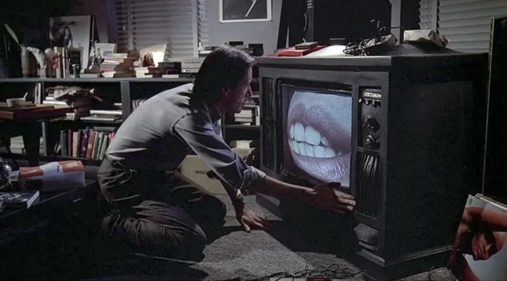
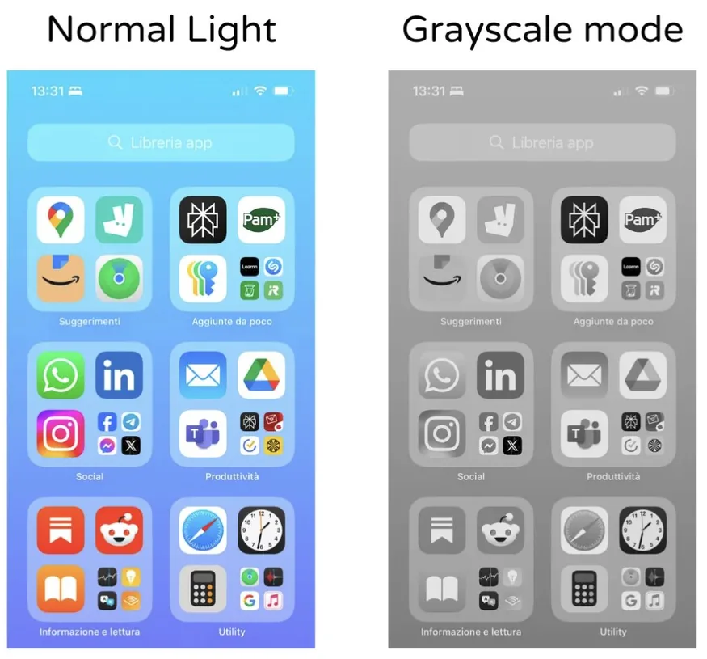
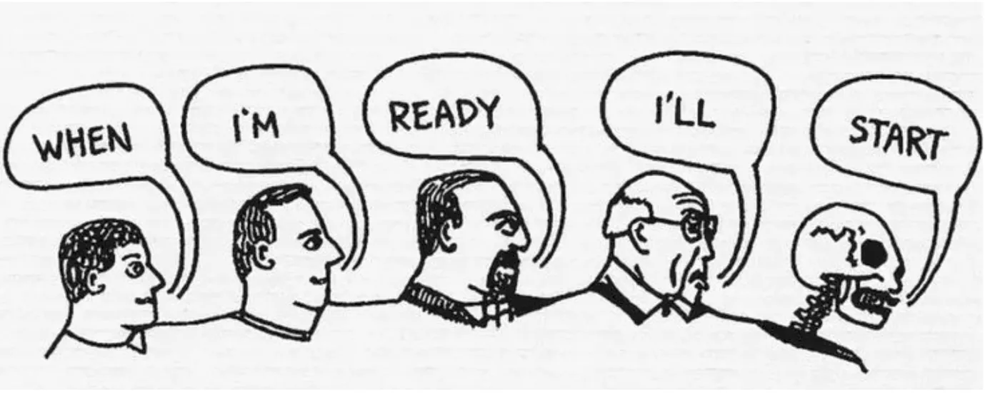

# The Information Diet: How to Swap Scrolling for Audiobooks

An information diet means you choose what goes into your head instead of letting a feed choose for you. Garbage in, garbage out. How do you go on one? Notifications off. A phone that looks boring. One dopamine thing at a time. Your own sources instead of the algorithm's. Then the hours the feed used to eat go to books. For most people that means audiobooks, because scrolling lives in the gaps of the day, and that is exactly where a book by ear fits.

*What you have to know:* The first step to staying sane in insane times is to curate the information you consume and not allow garbage information to enter your headspace.

## Curate what goes in

Give this movie a watch. Videodrome, 1983.

**Garbage in, garbage out:** The same applies to the information you are allowing yourself to use. When it comes to the news, stick to headlines on websites where the content is strongly professional and actually matters. Build your war chest with archives and books you keep coming back to. Your goal when consuming information is to use ONLY what will move you forward. No negativity. No brain rot. No doomscrolling.

**Pick the voices:** What you think about the most and spend your time on is what you become. A feed is a crowd of strangers picked for you by a ranking system. A book is one voice, picked by you, talking for hours. If someone is going to be in your ear all day, make it someone you chose.

## Notifications off at all times

Everyone has heard this one, and most people still have not done it. All of your notifications should be off. The only exception is your close family and the people who matter. Everything else off. This is the first thing you have to do, and it will set the tone for the rest.

Yes, that includes reading apps. HushBook included. It has streak reminders, and if they pull at you, turn them off in your phone settings. A chapter needs a clear run. One buzz and you are back in the feed while the narrator keeps talking to nobody.

## Grayscale mode

Coloured icons are sweets. Grey ones are cardboard. Put the phone in grayscale and the feed goes dull fast. A book in grey is the same book. Words do not need colour, and HushBook's reading screen is words on a dark background, so grayscale costs it nothing. On iPhone it is Settings, Accessibility, Display and Text Size, Colour Filters, Grayscale, and you can add it to the triple-click of the side button. Android keeps it under Accessibility or Digital Wellbeing, depending on the phone.

## No dopamine stacking

What does this even mean? From now on, you are forbidden to do multiple dopamine things at once. No more music and scrolling at the same time. No more TV and food. Only one dopamine-heavy activity at a time.

Why does it matter? Because over time you build a tolerance, and to feel "satisfied" you will have to spend hours consuming content you should not be consuming.

Audiobooks are not exempt. Audiobook plus a feed is stacking. Audiobook plus a game is stacking. You will remember neither.

What is not stacking? Audiobook plus a walk, the dishes or a drive you know by heart. The hands are busy and the mind is free, so the book gets all of it. We broke down which tasks pair with listening in [how to focus on audiobooks](/blog/how-to-focus-on-audiobooks).

Reading along is the opposite of stacking. Eyes and ears on the same sentence, nowhere else for your attention to go. That is why HushBook highlights each word as the narrator says it. More on [whether reading along with an audiobook helps](/blog/does-reading-along-with-an-audiobook-help).

## Build your own feed

**RSS feed:** Our advice? Start diving deeper into anti-algorithm information gathering. Why have your own feed? So the algorithm does not get to play with your mind. An RSS reader pulls in the sites you picked, newest first. Nothing ranked. Nothing recommended. It should not take you more than 2 hours to set up. Never heard about RSS? Time to dig deeper.

**Your reading list:** Same idea, longer items. Pick the next five books you will listen to and write them down. Not a wishlist. Five. When one ends, the next is already chosen. Your library's app lends audiobooks for free, and HushBook has a built-in library of free public domain classics from LibriVox and Internet Archive, so the list can start without spending a thing. More places in [how to listen to audiobooks for free](/blog/how-to-listen-to-audiobooks-for-free). Two hours to set up, same as the RSS reader.

## Unconventional way to meditate

We have never been big on meditation, because it does not work for us. It feels impossible to unplug. What has worked wonders, and what we suggest to everyone who is fully tuned in? Lying down and doing nothing on purpose.

What is the difference? You do not try to do anything. No external stimulation. You do not even have to close your eyes. Just lie down and turn off the light. Earplugs if you want to take things to another level. Without a doubt one of the best ways to unplug and get the answers you are looking for. The best part? You get up energised and refreshed.

Yes, this is an audiobook blog telling you to turn the audiobook off. If every silence gets a narrator, the narrator becomes another feed.

## Do nothing

Similar to the unconventional way to meditate. Sit somewhere and do nothing for 10 to 15 minutes. Do not bother capturing your thoughts or coming up with new things. Just be present and embrace the moment. Headphones out. Over time you will notice the improvement, and how you feel after it.

## Cognitive offloading

Depending on what kind of person you are, there are two correct ways to approach cognitive offloading.

1. Take your phone, open the notes app, press the microphone and start unloading your thoughts into it.
2. Take your journal and a pen, open it up and start writing your thoughts down.

Both systems work. The end goal? The same. It is not about how your journal looks or what method you use. The goal is to get your thoughts and ideas out. You are looking to open that loop and close it, not leave it open without ever putting it into reality. When you write things down, you separate yourself from them, which is what you want.

Which method works for us? The writing one. Most people, handed a microphone, go on rants. Which works. As long as you go back and pull out the core concept.

**After the chapter:** The best moment to unload is right after a chapter, when something the author said collides with something in your life. Pause. Voice note or one line in the journal. Skip the summary and write the thing it made you think. If the line itself matters, in HushBook you tap Mark, tap the first and last word, and keep it as a quote or note while the audio waits. More in [how to take notes on audiobooks](/blog/how-to-take-notes-on-audiobooks).

## Self-acceptance and accepting where you are

*What you have to know:* None of this matters if you are not realistic. Not just realistic. Completely transparent with yourself about what it will take. Also optimistic about what comes after.

**Be transparent:** Open your phone's screen time report and read all of it. Then count the books you finished this year. Put the two side by side. That is where you are.

**Two-option framework:** For each situation that is costing you sleep, stressing you out or holding you back, you only have two options. Fix it or leave it. There is no third. Forget about complaining. Forget about wasting time on things you have no direct impact on. Forget about being stuck in the indecision phase. This frame lets you fully accept the position you are in and take full control over it.

Same with the book you are stuck on. Fix it: slow the speed down, listen with the words in front of you, skip the preface. Or leave it: abandon it, no guilt, next one on the list. What you do not do is leave it half-finished for months.

**Your past doesn't matter:** Talk with most people about their past and they have negative associations with it. They think the life they have been living is permanent and never see themselves turning the page. You can't fight what has happened. What you can do is reframe it so your focus is on what happens next.

"I haven't finished a book since school" is a fact about the past. The next book is the only one that matters. If you have not touched one in years, the guide for that is [how to get into audiobooks](/blog/how-to-get-into-audiobooks). Start today, not when you are ready.

## Doing this with HushBook

[HushBook](/) is an audiobook player for iPhone and Android that shows the words while you listen. It transcribes the audiobook on your phone and highlights each word as the narrator says it. Long-press a line and the audio plays from there. Free LibriVox and Internet Archive classics are built in, and Mark keeps a line as a quote or a note. Speed control, a sleep timer and a low-vision profile with large, high-contrast text. Nothing is uploaded. No account. No ads.

Honest limits. The text comes from speech recognition, so unusual names can come out wrong. It plays audio files you import, such as MP3, M4A and M4B, plus its free public domain library. It cannot import copy-protected books such as Audible downloads or Libby and Hoopla loans.
