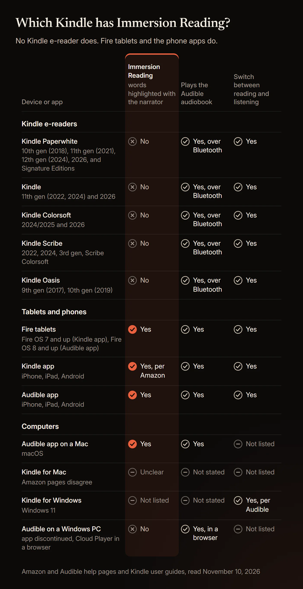
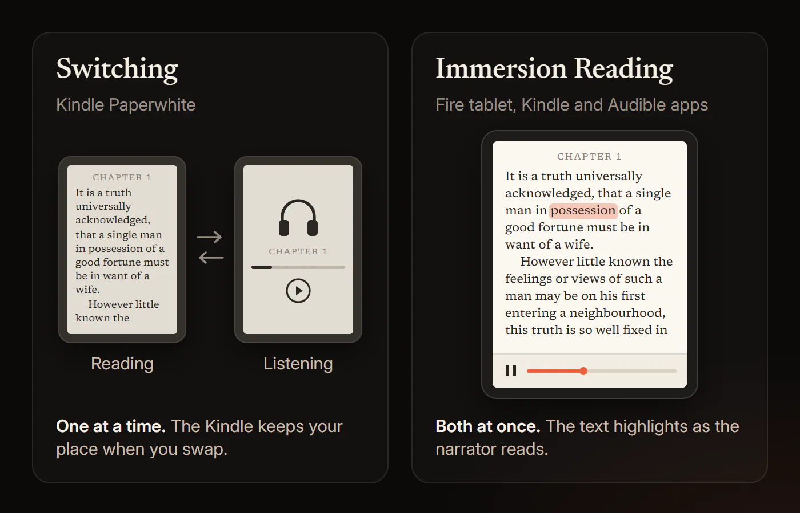
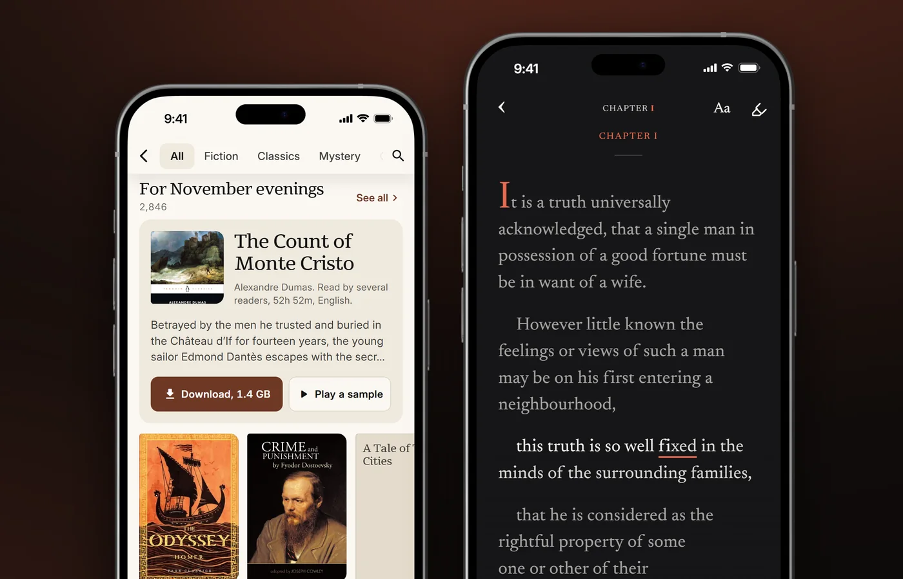

# Does Kindle Paperwhite Support Immersion Reading? Every Kindle, Checked

No. No Kindle e-reader highlights words in sync with Audible narration; Immersion Reading works on Fire tablets and in the Kindle and Audible apps.

That covers every Kindle Paperwhite from the 10th generation to the 2026 models, the Signature Editions, and the basic Kindle, Kindle Colorsoft, Kindle Scribe and Kindle Oasis. Each plays the Audible audiobook over Bluetooth and switches between ebook and audiobook at the same spot. That switching is Read & Listen, formerly Whispersync for Voice. Below: a table for every model and app, setup steps, the PC answer, fixes, and what research says about reading along. Amazon and Audible facts come from their help pages, user guides and press releases, read on November 10, 2026.

## Does Kindle Paperwhite support Immersion Reading?

No. No Kindle Paperwhite generation or Signature Edition supports it, because Amazon lists Immersion Reading only for its Kindle apps and Fire tablets.

Amazon has no page that says "the Paperwhite can't." The answer rests on three things Amazon and Audible do publish:

- **Amazon's wording.** The "Add Audible narration" pop-up on Kindle ebook pages says: "Immersion Reading is available on the Kindle Apps (iOS/Android) and Fire tablets." It names "Bluetooth enabled Kindle eReaders" only as places to listen.
- **Audible's device list.** Audible's immersion reading help page lists its apps for Android, iOS, iPad, Android tablets and macOS, and Fire tablets with FOS8 and above. No Kindle e-reader is on it.
- **Amazon's user guides.** We searched 16 Kindle e-reader user guides, from the 2018 Kindle Paperwhite to the 2026 models. All 16 describe playing Audible books and switching to listening. None contains the word "immersion."

Amazon staff on its UK forum said the same on February 7, 2023: "Unfortunately, you cannot perform this on the Kindle Paperwhite. This feature is only available on devices with the Kindle Reading App, such as phones and tablets." Other Amazon reps have said yes; see the section on conflicting answers.

If your real goal is words lighting up as a human narrator reads, and the audiobook is a file you own, **HushBook**, the app we built, does that on a phone, free.

## Which Kindle has Immersion Reading?

No Kindle e-reader has it. Immersion Reading runs on Fire tablets, the Kindle apps for iOS and Android, and the Audible app.

| Device or app | Immersion Reading (words highlighted with Audible narration) | Plays the Audible audiobook | Switch between reading and listening | Assistive Reader (computer voice, words underlined) |
|---|---|---|---|---|
| Kindle Paperwhite 10th generation (2018) | No | Yes, over Bluetooth | Yes | No |
| Kindle Paperwhite 11th generation (2021) and Signature Edition | No | Yes, over Bluetooth | Yes | Yes |
| Kindle Paperwhite 12th generation (2024) and Signature Edition | No | Yes, over Bluetooth | Yes | Yes |
| Kindle Paperwhite and Signature Edition (2026 release) | No | Yes, over Bluetooth | Yes | Yes |
| Kindle 11th generation (2022, 2024) and Kindle (2026) | No | Yes, over Bluetooth | Yes | Yes |
| Kindle Colorsoft (2024) and Kindle Colorsoft (2026) | No | Yes, over Bluetooth | Yes | Yes |
| Kindle Scribe, all models, including Kindle Scribe Colorsoft | No | Yes, over Bluetooth | Yes | Yes |
| Kindle Oasis (2017, 2019) | No | Yes, over Bluetooth | Yes | No |
| Fire tablets | Yes (Kindle app: FireOS 7 and above; Audible app: FOS8 and above) | Yes | Yes | Yes, in the Kindle app |
| Kindle app for iPhone, iPad and Android | Yes, per Amazon | Yes | Yes | Yes |
| Audible app for iPhone, iPad, Android and macOS | Yes | Yes | Yes, on iOS and Android | n/a |
| Kindle for Windows (Windows 11) | Not listed | Not stated | Yes, per Audible | Not checked |
| Kindle for Mac | Unclear: one Amazon page says yes | Not stated | Not listed | Yes |
| Audible on a Windows PC | No; the Windows app is discontinued | In a browser, with the Cloud Player | n/a | n/a |

"Not listed" means the Amazon and Audible pages we read on November 10, 2026 do not mention it. "Not checked" means this guide did not research it; our [Kindle read-aloud guide](/blog/can-kindle-read-to-you) covers read-aloud on Windows. On e-readers, Amazon's guides say "you must first pair a Bluetooth audio device, such as headphones, speakers or earbuds." Fire tablets show two versions because Amazon gives one for the Kindle app and Audible another for its own app.

## Can you read and listen at the same time on a Kindle Paperwhite?

Not with the words highlighted. A Kindle Paperwhite switches between the ebook and the audiobook, one at a time.

Amazon's e-reader help says you "use a paired Bluetooth audio device to switch between your Kindle e-book and the matching Audible audiobook without losing your place." When you switch to listening, the Audible player replaces the page.

Readers have found ways to keep the text in view while the narration plays. These are user reports, not Amazon features, and none highlights words or turns pages:

- **Audio on your phone, text on the Kindle.** The top answer in a July 2026 r/kindle thread: "it's also an option to play audio from your phone and then read from your kindle."
- **The headphone-button trick.** Play the audiobook on the Kindle, go back to the ebook so the audio stops, then press play on the headphones. Its author warned: "This method will not highlight or turn pages for you." Results vary: one reader wrote "I can't get this to work," while a Kindle Colorsoft owner, in a thread about a similar workaround, replied "IT WORKS!"
- **An Echo** playing the audiobook while you read, also user-reported.

The nearest thing a Kindle e-reader does have is Assistive Reader. Amazon's guides say it lets you "listen to your books with Text-to-Speech and read along with synchronized real-time underlining." Amazon's Assistive Reader page lists 11th generation and newer Kindles, Kindle Scribe and Kindle Colorsoft. The voice is a computer voice, not the narrator. Our guide to whether [Kindle can read to you](/blog/can-kindle-read-to-you) has the steps.

## What is the difference between Whispersync and Immersion Reading?

Whispersync for Voice, now called Read & Listen, keeps your place when you switch formats. Immersion Reading highlights the words while the narrator reads.

Audible says Read & Listen "keeps track of where you are when you switch between the audiobook and Kindle eBook." Amazon's Read & Listen store page lists the two jobs side by side. Syncing lets you "Switch between reading and listening across supported devices without losing your place." Immersion Reading lets you "Read along while you listen with text highlighting and audio synced in real-time."

On a Kindle Paperwhite, you read a chapter on the bus, tap the headphone icon, and the narrator picks up from that page while you walk. At home you switch back, and the ebook opens where the narrator stopped. With Immersion Reading, the page stays on screen and each word is highlighted as it is spoken. Audible calls it "like karaoke for books," using "the professional narrator from your audiobook, not text-to-speech."

Both need the Kindle ebook and the Audible audiobook of the same title on one Amazon account. Our explainer on [what immersive reading is](/blog/what-is-immersive-reading) covers the idea beyond Amazon.

## Does Whispersync work on Kindle Paperwhite?

Yes, as switching. Every Kindle Paperwhite with Bluetooth audio plays the Audible audiobook from the page you were reading.

Amazon's Paperwhite user guides for the 10th generation (2018), 11th generation (2021), 12th generation (2024) and 2026 release all have "Playing Audible books" and "Switch to Listening." The setting has a new name: the 12th generation guide says "tap Device Options > Sync" and never says Whispersync. That explains forum posts from owners who can't find Whispersync under Advanced Options. Amazon's sync page says Sync "is already enabled by default on all Kindle devices and apps."

Audible's help says switching works on "Kindle Ereader devices from 2022 and above." Amazon's guides for older models disagree; the conflicts section explains why we go by Amazon.

## How do you use Whispersync on a Kindle Paperwhite?

Pair Bluetooth headphones, download the matching audiobook over Wi-Fi, then tap the headphone icon while reading. Steps from Amazon's e-reader help and Paperwhite guides, read on November 10, 2026.

### 1. Pair Bluetooth headphones or a speaker

Open Quick Actions, select All Settings, then Wi-Fi & Bluetooth, and turn Bluetooth on. Select Bluetooth Devices, pick yours and connect. Amazon notes that "only devices released during or after 2016 support Bluetooth connectivity."

### 2. Own both editions and download the audiobook

You need "a Kindle e-book with a matching Audible audiobook," and a book with audio "shows a headphone icon in your library," Amazon says. Download the audiobook over Wi-Fi first. The guides warn: "When you own both items, deleting the Kindle book will also delete the audiobook."

### 3. Switch from reading to listening

While reading, tap the top of the screen, tap the headphone icon, then select Play. "The audiobook starts from last reading page," Amazon says. The player has 30-second rewind and fast-forward, speed, chapters, bookmarks and volume.

### 4. Switch back to reading

Tap the screen, then tap the book icon or select Switch to Reading; the 12th generation guide calls it "Switch to Kindle book." The ebook opens where you stopped listening.

### 5. Check that Sync is on

If the formats don't line up, go to All Settings, Device Options, Sync, and turn Sync on. In your Amazon account, check Sync Settings under Manage Your Content and Devices, Preferences.

## Does the Kindle Paperwhite 12th generation have Immersion Reading?

No. The 12th generation Kindle Paperwhite (2024) and its Signature Edition switch formats but do not highlight words with the narration.

Amazon's product page for the 2024 Kindle Paperwhite lists "Audible audio format (AAX)" and warns that "Audible audiobook streaming over Bluetooth will reduce battery life." The word "immersion" appears there only in the waterproofing line. The 12th generation user guide never mentions Immersion Reading.

## Does the Kindle Paperwhite 11th generation or Signature Edition have Immersion Reading?

No. The 11th generation Kindle Paperwhite and its Signature Edition, both released in 2021, switch formats but have no Immersion Reading.

Amazon's 11th generation user guide, which covers both, has Switch to Listening and Assistive Reader but no Immersion Reading. On Best Buy's Q&A for the 2021 Signature Edition, "Amazon Devices Customer Support" said the Paperwhite "does not support Immersion Reading at this time." No Amazon page we read mentions plans to add it.

## Does the Kindle Colorsoft have Immersion Reading?

No. Kindle Colorsoft plays Audible over Bluetooth and switches formats, but Amazon does not list it for Immersion Reading.

Amazon staff wrote on its forum on September 14, 2025: "Current, the Kindle Colorsoft does not support Immersion Reading." The Kindle Colorsoft guides for the 2024 and 2026 models describe switching and Assistive Reader. The 2024 guide still calls the setting "Whispersync for Books."

## Does the Kindle Scribe support Immersion Reading?

No. No Kindle Scribe has Immersion Reading, including the 3rd generation and Kindle Scribe Colorsoft.

Amazon's four Kindle Scribe user guides (2022, 2024, 3rd generation, Kindle Scribe Colorsoft) cover Audible playback, Switch to Listening and Assistive Reader. None mentions Immersion Reading.

## Does the Kindle Oasis have Immersion Reading?

No. The Kindle Oasis plays Audible over Bluetooth and switches formats, but has neither Immersion Reading nor Assistive Reader.

Audible came to e-ink Kindles with the Oasis. Amazon's press release of October 11, 2017 promised to "easily switch between reading and listening." Amazon lists the last Oasis, the 10th generation, as "Released 2019."

## Does Immersion Reading work on a Fire tablet?

Yes. Fire tablets were the first devices with Immersion Reading, and they have it in both the Kindle app and the Audible app.

Amazon's Fire tablet help says the feature "is available on Fire Tablets with FireOS 7 and above" and "Synchronized highlighting of the text is available while the audio is playing." Audible lists "Fire Tablet FOS8 and above" for its app. Immersion Reading launched in 2012 "exclusively with the all-new Kindle Fire and Kindle Fire HD family," per Amazon's press release of September 6, 2012.

## How do you set up Immersion Reading?

Get the Kindle ebook and the Audible audiobook of the same title on one Amazon account, then open it in the Audible app, or in the Kindle app on a phone or Fire tablet.

### 1. Own both editions on the same account

Amazon says: "You must own or borrow both the audiobook and eBook versions of a title that supports Read & Listen." Audible adds that "Both purchases need to be on the same Amazon account" and that they "must be for the same edition of the title."

### 2. Check that the title supports Read & Listen

Audible says the product details show "Read & Listen," formerly "Whispersync for Voice-ready," when a title supports it. Amazon: "Have the Kindle eBook? Get the Audible audiobook at a discount." Kindle+, the new name for Kindle Unlimited, gives both versions with "Books with Audio" titles; it costs $11.99 a month in the US and is not part of Prime, About Amazon says.

### 3. In the Audible app, toggle Read & Listen

Open an audiobook with a Read & Listen badge. While it plays, use the toggle above the cover image to switch from Listen to Read & Listen. Audible says the ebook text loads from the internet, though "Some pages are saved so you can still see them without an internet connection." Our guide to [reading along with Audible](/blog/can-you-read-along-with-audible) covers the Audible app in detail.

### 4. On a Fire tablet, use the Kindle app

Open the book in the Kindle app, tap the page, then tap the download icon at the bottom to get the audiobook. Tap the play icon to start. To turn highlighting off, open the reading settings menu, Aa, select More, and turn off Real-time Text Highlighting.

On October 26, 2026, Audible said Read & Listen covers "more than 800,000 English and German-language titles."

## Can you use Audible Read & Listen or Immersion Reading on a PC?

Not on Windows. Amazon and Audible list no Immersion Reading for a Windows PC; on a Mac, use the Audible app for macOS.

- **Kindle for Windows.** Amazon says "The Legacy Kindle app (previously called Kindle for PC) isn't supported as of June 30, 2026," and the current app needs Windows 11. Audible lists "Kindle Apps (Android, iOS, Fire Tablet, PC)" for switching, not for immersion reading.
- **Audible on Windows.** Audible says "The Audible Android app is no longer available or supported on Windows 11," after Microsoft discontinued the Amazon Appstore in March 2024. Its suggested Cloud Player at Audible.com is not on its immersion reading list.
- **Mac.** Audible lists the "Audible App for macOS" for immersion reading. One Amazon page mentions Audible highlighting in Kindle for Mac, but the product pop-up and Audible's lists don't name it.

For audiobook files you own rather than Audible titles, the free [HushBook for your computer](/desktop) highlights every word as the narrator reads, on Windows 10 or 11 and macOS 14 or later.

## Why doesn't my Kindle have Immersion Reading?

Amazon has never said why. No Amazon help page, product page, user guide or press release we read on November 10, 2026 gives a reason.

The usual explanation is the e-ink screen. In 2018, The eBook Reader blog wrote that "The lack of Immersion Reading likely comes down to the limitations with the slow refresh rate of E Ink screens." The same author changed his mind in 2020, after running the Kindle app on Onyx e-readers: "I've tried Immersion Reading with Onyx's ereaders using the Kindle app and it works fine." And Amazon's own guides say Assistive Reader on these same e-readers reads "with synchronized real-time underlining," a point a reader on r/kindle raised in May 2026. The reason remains an open question.

The history, briefly. Immersion Reading and Whispersync for Voice launched in September 2012 on Kindle Fire only, with "nearly 15,000 Kindle books and 15,000 Audible audiobooks." Audible reached e-ink Kindles with the Kindle Oasis in October 2017, as a switching feature, and the Kindle Paperwhite in 2018. In February 2026, Audible put immersion reading into its own app.

## Why is Kindle Immersion Reading not working?

On an e-ink Kindle, because the feature does not exist there. In the apps, the usual causes are a missing edition, a sync setting or old software. Amazon's and Audible's checks:

- **You're on a Kindle e-reader.** Switching is all it offers. Most "not working" threads in the Kindle subreddits come from owners looking for a mode their Kindle never had.
- **One edition is missing.** Audible: "If you only have the audiobook, the toggle won't appear."
- **The editions or accounts don't match.** Both must be the same edition, bought on the same Amazon account.
- **The title or country isn't eligible.** Audible says "Not all titles support Read & Listen" and lists regional availability as a cause.
- **No connection, or Sync is off.** Amazon says to check the wireless connection, Sync Settings under Manage Your Content and Devices, Preferences, and the Sync setting on the device or app.
- **Old software or an old copy of the book.** Update the device or app. In Manage Your Content and Devices, select Update if the book shows "Update available."
- **Last resort.** Amazon: remove the book's download, sync again and redownload. In the Audible app, turn the Sync device position slider off and on under Profile, Settings, Player.

## Why do Amazon and Audible give different answers?

Because their pages and support staff contradict each other on four points, all read on November 10, 2026.

- **Which e-readers can switch.** Audible says "Kindle Ereader devices from 2022 and above." Amazon's guides for the Kindle Paperwhite 10th generation (2018) and 11th generation (2021) and the Kindle Oasis 10th generation (2019) all document Switch to Listening. We go by Amazon: Kindle e-readers with Bluetooth audio can switch, not only 2022 and newer models.
- **Whether a Paperwhite can read along.** Amazon forum staff said no for the Paperwhite in 2023 and the Colorsoft in 2025. But a staff answer on June 29, 2025 told a Paperwhite owner you "can read and listen simultaneously, with real-time text highlighting." On Best Buy's Q&A for the 2024 Paperwhite, "Amazon Devices Customer Support" answered "Yes," voted unhelpful 32 to 4. A staff reply on October 12, 2026 overcorrected: "Read & Listen isn't available on the Kindle Paperwhite." Switching is Read & Listen, and the Paperwhite has it.
- **Whether the Kindle app still highlights.** A September 2026 r/kindle thread says "the active highlight feature has moved to Audible." That report is unverified. Amazon's pages still list the Kindle apps for iOS and Android. If the Kindle app doesn't highlight for you, try the Audible app.
- **Which countries.** Audible's FAQ says immersion reading is "currently available for supported English and German language titles in the United States, United Kingdom, Australia, and Germany." Its October 26, 2026 press release says it "is now rolling out to customers in Canada, India, France, Italy, Spain, Japan, and Brazil."

## Is reading along worth it?

For some readers. Reading along beats listening alone, adds little over reading alone, and no study shows that the highlighting itself helps.

- **Against reading only, the gain is small.** In a 2023 meta-analysis of 30 studies with 1,945 participants, Virginia Clinton-Lisell found a "trivial" benefit over reading alone (g = 0.18). It appeared when the pace was set for readers (g = 0.41) and vanished at their own speed (g = 0.06).
- **Against listening only, it helps.** In a 2024 study of 46 university English learners reading fiction, Bronson Hui found reading along beat listening alone but gave no edge over reading. In a 2026 registered report with 86 adult English learners, Hui and Godfroid found readers understood a novel's excerpts less when reading along than when reading silently, and least when only listening.
- **Language learners gain words.** In a 2008 study of 35 Japanese university students, Brown, Waring and Donkaewbua found reading along taught about as many new words as reading (16% vs 15%) and far more than listening (2%).
- **Struggling readers gain a little.** A 2018 meta-analysis of 22 studies by Wood and colleagues found read-aloud tools gave students with reading difficulties a modest comprehension boost (d = 0.35).
- **Highlighting is unproven.** In a 2023 study of children aged 8 to 12 with reading difficulties, Keelor and colleagues found text-to-speech scored the same with and without highlighting; the abstract does not give the sample size. Karaoke-style highlighting helped word meaning in a 2015 study of 35 pupils by Gerbier, Bailly and Bosse, and hurt it in their 2018 study of 40 children.
- **Ears drift.** In a 2013 study of 211 students, Varao Sousa, Carriere and Smilek found minds wandered at about half of check-ins while listening, against about a third while reading silently.
- **E-ink and tired eyes.** In a 2013 study, Benedetto and colleagues had 12 adults read for over an hour on a Kindle Paperwhite, a Kindle Fire HD and paper. The LCD tablet caused more visual fatigue; the Paperwhite was no different from paper.

Amazon and Audible cite no study. Audible's February 2026 press release says "Research shows that combining the two can improve focus and comprehension," but names none. Its "more than nine in ten" figure comes from a survey of people who already read and listen together, with no sample size or method published.

**What the evidence does not show.** No study tests Amazon's Immersion Reading or any commercial read-along app. No study shows synced highlighting helps adults. No study compares reading along on e-ink with a phone, and the eye-strain result rests on 12 people and 2013 hardware. Most studies use passages, not whole books. Reading along is a reading aid, not a treatment for dyslexia or ADHD. Our guide to whether [reading along with an audiobook helps](/blog/does-reading-along-with-an-audiobook-help) goes deeper.

## Is there a better alternative to Immersion Reading on a Kindle?

Yes, for audiobook files you own. HushBook highlights each word as the narrator reads, on a phone or a Windows PC.

| | Kindle Paperwhite and other e-ink Kindles | Immersion Reading (Kindle or Audible app, Fire tablet) | HushBook (iPhone, Android, Windows) |
|---|---|---|---|
| Voice | The Audible narrator when listening, or Assistive Reader's computer voice | The audiobook's professional narrator | The narrator in your audio file |
| Words highlighted with the narration | No, you switch between reading and listening | Yes, word by word | Yes, every spoken word |
| Text you read | The publisher's Kindle ebook | The publisher's Kindle ebook | A transcript made on your device from the audio |
| Audio files you own, such as MP3 and M4B | No | No | Yes |
| Free audiobooks with read-along | No | No; Kindle+ titles with audio need a paid subscription | Public domain classics from LibriVox and the Internet Archive |
| What you pay for | The Kindle ebook and the Audible audiobook | Both editions, or a Kindle+ title with audio | Nothing for read-along; Pro is optional |
| Account | Amazon account | Amazon account, with both editions on it | None |
| Offline | The audiobook downloads over Wi-Fi first | The Audible app loads the ebook text from the internet; some pages are saved | Yes, after a one-time engine download |
| Windows PC | No | No documented route | Yes, Windows 10 or 11, 64-bit |

The Kindle route is the right one when the book lives in your Kindle and Audible libraries, when you want the publisher's exact text, or when you want e-ink. HushBook fits audiobook files you own, free public domain classics, and reading along on a big screen. Our comparison of [apps to read and listen at the same time](/blog/best-apps-to-read-and-listen-at-the-same-time) covers other options.

## What we could not confirm

- **People Also Ask.** Google blocked our check, so the questions here come from autocomplete, DuckDuckGo and forums.
- **Why Amazon leaves Immersion Reading off e-ink Kindles.** Amazon gives no reason.
- **Whether the Kindle app still highlights for everyone.** Amazon's pages say yes; one Reddit thread says the highlighting moved to the Audible app.
- **Whether Kindle for Mac does Immersion Reading.** One Amazon page suggests it; the others do not list it.
- **Which countries have immersion reading today.** Audible's FAQ and its October 2026 press release disagree.
- **Where Amazon's "See supported devices" link leads.** We did not follow it.
- **Audible Plus titles and Audible Standard credits.** Only forum and Reddit posts say whether they get Read & Listen.
- **The user-reported workarounds and these steps on a real device.** We did not test them, and menus change.

## HushBook for audiobooks you own

HushBook highlights each word as the narrator reads, for audiobook files you own and free classics. [Get HushBook for iPhone and Android](/), or [HushBook for your computer on Windows or Mac](/desktop).

On the phone, HushBook is free for read-along. It imports 15 audio formats, including MP3 and M4B, and has free public domain audiobooks from LibriVox and the Internet Archive in six languages. HushBook transcribes on your phone, with no upload and no account, and works offline after a one-time engine download. Long-press a line to play from there.

On Windows 10 or 11, HushBook for your computer is free and unlimited. It transcribes on your graphics card, or the processor, and lights up every word as the narrator reads it. It pairs with the phone app over the same Wi-Fi.

## Sources

- [Amazon, "Troubleshoot Read & Listen"](https://www.amazon.com/gp/help/customer/display.html?nodeId=TBOgUdeE7YXXcq28Ac)
- [Amazon, "Switch Between Reading and Listening Experience"](https://www.amazon.com/gp/help/customer/display.html?nodeId=TZkqDMewOPQ0FqrSqX)
- [Amazon, "Other Reading Accessibility Settings on Fire Tablet"](https://www.amazon.com/gp/help/customer/display.html?nodeId=TjCHGCnIKBM42lnQrE)
- [Amazon, "Accessible Reading Options for Kindle Reading Apps"](https://www.amazon.com/gp/help/customer/display.html?nodeId=TABlJ4ot69emTO8jJG)
- [Amazon, "Whispersync for Voice - Learn More: Kindle Store"](https://www.amazon.com/Whispersync-for-Voice/b?ie=UTF8&node=12527156011)
- [Amazon, "Project Hail Mary: A Novel eBook" (Kindle product page with the Immersion Reading note)](https://www.amazon.com/Project-Hail-Mary-Andy-Weir-ebook/dp/B08FHBV4ZX)
- [Amazon, "Kindle Paperwhite 16 GB, Fastest Kindle E-Reader"](https://www.amazon.com/clp/B0CFPJYX7P)
- [Amazon, "Connect and Sync Bluetooth to Your Kindle E-Reader"](https://www.amazon.com/gp/help/customer/display.html?nodeId=TIHMXAou9Wm1q17sg5)
- [Amazon, "Update Your Sync Settings for Kindle"](https://www.amazon.com/gp/help/customer/display.html?nodeId=GGFEXXS8Z7DPJSTN)
- [Amazon, "How to Use the Assistive Reader on Your Kindle"](https://www.amazon.com/gp/help/customer/display.html?nodeId=TdHCSXXqsdhaVKt3Tc)
- [Amazon, "How to Find Out Your Kindle Model and Generation"](https://www.amazon.com/gp/help/customer/display.html?nodeId=GK33S847NN4V6Y83)
- [Amazon, "Kindle E-Reader User and Quick Start Guides"](https://www.amazon.com/gp/help/customer/display.html?nodeId=G7N7RPHV2SW8CKBW)
- [Amazon, Kindle User Guide, Kindle Paperwhite (12th Generation)](https://d1ergij2b6wmg5.cloudfront.net/kug/kindle_paperwhite_12th/v1/en-US/html/kug.html)
- [Amazon, Kindle User Guide, Kindle Paperwhite (11th Generation)](https://d1ergij2b6wmg5.cloudfront.net/kug/kindle_paperwhite_11th/v1/en-US/html/kug.html)
- [Amazon, Kindle User Guide, Kindle Paperwhite (2026 release)](https://d1ergij2b6wmg5.cloudfront.net/kug/kindle_paperwhite_2026/v1/en-US/html/kug.html)
- [Amazon, Kindle User Guide, Kindle Colorsoft](https://d1ergij2b6wmg5.cloudfront.net/kug/kindle_colorsoft/v1/en-US/html/kug.html)
- [Amazon, Kindle User Guide, Kindle Scribe (3rd Generation)](https://d1ergij2b6wmg5.cloudfront.net/kug/kindle_scribe_3rd_generation/v1/en-US/html/kug.html)
- [Amazon, Kindle User Guide, Kindle (11th Generation) 2024](https://d1ergij2b6wmg5.cloudfront.net/kug/kindle_11th_2024/v1/en-US/html/kug.html)
- [Amazon, Kindle User Guide, Kindle Oasis](https://d1ergij2b6wmg5.cloudfront.net/kug/kindle_all_new_oasis_v2/v1/en-US/html/kug.html)
- [Amazon, "Install or Update the Kindle App for Desktop"](https://www.amazon.com/gp/help/customer/display.html?nodeId=TlLrSvAdaGJObw5fIG)
- [Audible, "Learn about immersion reading"](https://www.audible.com/help/article/learn-about-immersion-reading)
- [Audible, "Learn about Read & Listen"](https://www.audible.com/help/article/listen-with-whispersync-for-voice)
- [Audible, "Read & Listen on Audible, Read Along with Synced Narration"](https://www.audible.com/ep/read-listen)
- [Audible, "Audible App Download Discontinued on Windows 11"](https://www.audible.com/help/article/audible-app-download-discontinued-on-win11)
- [Audible (February 18, 2026), "Audible Launches Immersion Reading for Deeper Engagement with Books"](https://www.audible.com/about/newsroom/audible-launches-immersion-reading-for-deeper-engagement-with-books)
- [Audible (October 26, 2026), "Audible's Read & Listen Experience Comes to More Listeners Around the Globe"](https://www.audible.com/about/newsroom/audibles-read-and-listen-experience-comes-to-more-listeners-around-the-globe)
- [About Amazon, "Kindle Unlimited is now Kindle+: Everything you need to know"](https://www.aboutamazon.com/news/devices/what-is-kindle-plus)
- [Amazon Press Center (September 6, 2012), "Audible and Amazon Introduce "Immersion Reading" and "Whispersync for Voice" - Two Momentous Steps Forward for Reading"](https://press.aboutamazon.com/2012/9/audible-and-amazon-introduce-immersion-reading-and-whispersync-for-voice-two-momentous-steps-forward-for-reading)
- [Amazon Press Center (October 11, 2017), "Meet the All-New Kindle Oasis: Featuring a 7-inch, 300 ppi Display, Waterproof Design, and Audible"](https://press.aboutamazon.com/2017/10/meet-the-all-new-kindle-oasis-featuring-a-7-inch-300-ppi-display-waterproof-design-and-audible)
- [The eBook Reader (December 11, 2018), "List of Devices that Support Immersion Reading for Kindle Books"](https://blog.the-ebook-reader.com/2018/12/11/list-of-devices-that-support-immersion-reading-for-kindle-books/)
- [The eBook Reader (December 29, 2020), "Is Amazon Ever Going to Add Immersion Reading to Kindles?"](https://blog.the-ebook-reader.com/2020/12/29/is-amazon-ever-going-to-add-immersion-reading-to-kindles/)
- [Amazon Forum, "Can you read & listen at same time on Kindle Paperwhite?"](https://uk.amazonforum.com/s/question/0D56Q0000AtiF2MSQU/can-you-read-listen-at-same-time-on-kindle-paperwhite)
- [Amazon Forum, "read and listen at the same time"](https://www.amazonforum.com/s/question/0D5Kf00003gtbz0KAA/read-and-listen-at-the-same-time)
- [Amazon Forum, "Immersion Reading" (Kindle Colorsoft)](https://www.amazonforum.com/s/question/0D5at00000QlbBkCAJ/immersion-reading)
- [Amazon Forum, "Does the Kindle Paperwhite no longer support Whispersync?"](https://www.amazonforum.com/s/question/0D5at00000y2YmOCAU/does-the-kindle-paperwhite-no-longer-support-whispersync)
- [Best Buy, "Does this new Kindle allow for immersion reading?" (Kindle Paperwhite 2024 Q&A)](https://www.bestbuy.com/site/questions/amazon-kindle-paperwhite-16-gb-2024-black/6602737/question/4a0f6552-f3bf-3d61-bbbb-1df640b81284)
- [Best Buy, "Does the kindle paperwhite support immersion read" (Kindle Paperwhite Signature Edition 2021 Q&A)](https://www.bestbuy.com/site/questions/amazon-kindle-paperwhite-signature-edition-32gb-2021-black/6482036/question/8673fe3a-a35e-307c-a596-48a4204ad385)
- [Reddit r/kindle, "So freaking bummed that I can't do Immersion Reading on my Kindle!"](https://www.reddit.com/r/kindle/comments/1v3z0hn/so_freaking_bummed_that_i_cant_do_immersion/)
- [Reddit r/kindle, "Immersion Reading on Paperwhite"](https://www.reddit.com/r/kindle/comments/1ubju8e/immersion_reading_on_paperwhite/)
- [Reddit r/kindle, "I think I found an immersive reading work around on Kindle Paperwhite SE?"](https://www.reddit.com/r/kindle/comments/1t1wnwx/i_think_i_found_an_immersive_reading_work_around/)
- [Reddit r/kindle, "Did read & listen migrate to audible app?"](https://www.reddit.com/r/kindle/comments/1wa9yc8/)
- [Clinton-Lisell (2023), "Does Reading While Listening to Text Improve Comprehension Compared to Reading Only? A Systematic Review and Meta-Analysis", Educational Research: Theory and Practice (ERIC EJ1403866)](https://eric.ed.gov/?id=EJ1403866)
- [Hui (2024), "Scaffolding comprehension with reading while listening and the role of reading speed and text complexity", The Modern Language Journal](https://doi.org/10.1111/modl.12905)
- [Hui and Godfroid (2026), "Listening, Reading, or Both? Rethinking the Comprehension Benefits of Reading-While-Listening", Language Learning](https://doi.org/10.1111/lang.12721)
- [Brown, Waring and Donkaewbua (2008), "Incidental vocabulary acquisition from reading, reading-while-listening, and listening to stories", Reading in a Foreign Language (ERIC EJ815119)](https://files.eric.ed.gov/fulltext/EJ815119.pdf)
- [Wood, Moxley, Tighe and Wagner (2018), "Does Use of Text-to-Speech and Related Read-Aloud Tools Improve Reading Comprehension for Students With Reading Disabilities? A Meta-Analysis", Journal of Learning Disabilities](https://doi.org/10.1177/0022219416688170)
- [Keelor, Creaghead, Silbert, Breit and Horowitz-Kraus (2023), "Impact of text-to-speech features on the reading comprehension of children with reading and language difficulties", Annals of Dyslexia](https://doi.org/10.1007/s11881-023-00281-9)
- [Gerbier, Bailly and Bosse (2015), "Using Karaoke to enhance reading while listening: impact on word memorization and eye movements", SLaTE 2015](https://doi.org/10.21437/slate.2015-11)
- [Gerbier, Bailly and Bosse (2018), "Audio-visual synchronization in reading while listening to texts: Effects on visual behavior and verbal learning", Computer Speech & Language](https://doi.org/10.1016/j.csl.2017.07.003)
- [Varao Sousa, Carriere and Smilek (2013), "The way we encounter reading material influences how frequently we mind wander", Frontiers in Psychology](https://doi.org/10.3389/fpsyg.2013.00892)
- [Benedetto, Drai-Zerbib, Pedrotti, Tissier and Baccino (2013), "E-Readers and Visual Fatigue", PLoS ONE](https://doi.org/10.1371/journal.pone.0083676)
