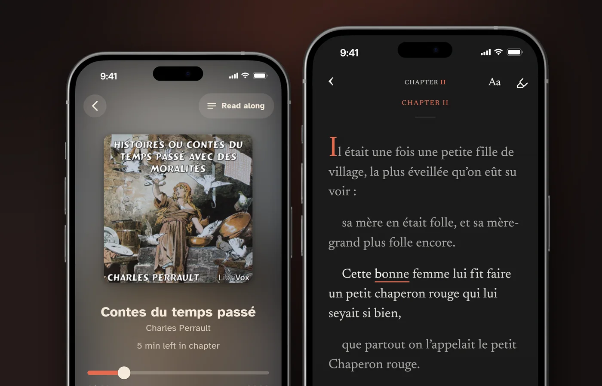
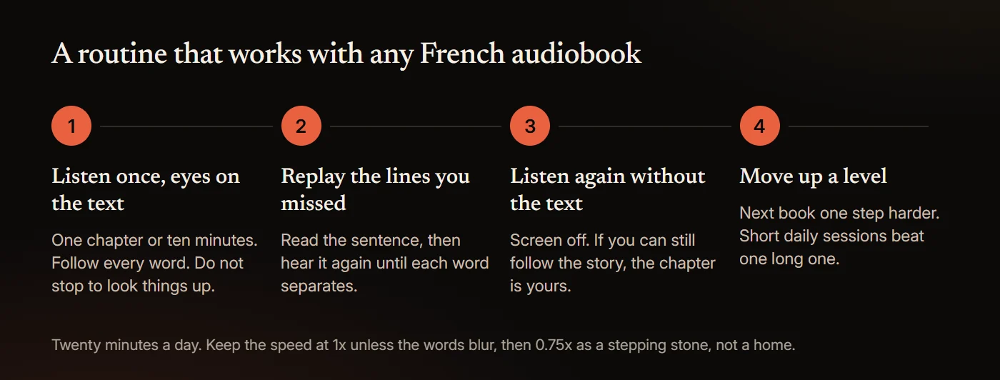

# How to Learn French With Audiobooks (and Free Ones With Text)

Audiobooks help you learn French when you can see the words as you hear them. Start with stories written for learners or fairy tales you already know, follow the French text while the narrator reads, and replay each chapter until it makes sense without the text, then move up to native-speed books. Much free French audio comes with its text: RFI posts a 10-minute news bulletin in easy French every weekday with a full transcript, and LibriVox held 316 finished French-language books on November 4, 2026. The text matters because liaison runs French words together, so you often cannot hear where one ends and the next begins.

Below we cover the research, why spoken French blurs, books by level, free audio with transcripts, and a routine. Prices and counts were read on each service's own pages on November 4, 2026.

## Can you learn French from audiobooks?

Partly. Audiobooks build your ear and your vocabulary, not your speaking or writing, and no study has tested how well adults learn French from them.

The first limit is vocabulary. In a 2013 study of 36 native and 40 non-native listeners, van Zeeland and Schmitt found learners followed spoken English fairly well once they knew 95% of the words. For French, the best figure comes from TV: in Fievez and colleagues' 2023 study of the series *Dix pour cent*, the 3,000 most frequent words covered 95% of the first three episodes. School French falls short: in a 2006 analysis of UK school learners, Milton found the average learner sits GCSE French with under 1,000 words and A level with about 2,000.

Input outside class closes the gap. In a 2019 study of 138 Flemish students, Peters and colleagues found that despite more years of French, they knew far more English, thanks to "their large amounts of out-of-school exposure to English language input", mostly online and on TV.

The second limit is output. In a 2002 report, Lightbown and colleagues found that French-speaking children in Canada who learned English for six years only by listening and reading kept pace on comprehension, "but not on measures of written production". In 2009, Trofimovich and colleagues found that listener ratings of fluency and comprehensibility in a similar program "favored learners in the regular program". Speaking and writing need practice of their own.

French is the second most learned language after English, according to the 2026 report of the Organisation internationale de la Francophonie, which counts 396 million speakers by a new method (348 million by its old one). In US colleges, the Modern Language Association counted 135,088 French enrollments in fall 2021, down 23.1% since 2016.

## What does the research say about reading while you listen?

No study has tested adults reading along with French audiobooks. The nearest evidence is captioned video, and French has plenty, much of it from a KU Leuven team working with Dutch-speaking learners.

- **Every word beats key words.** In a 2014 study, Montero Perez, Peters and Desmet showed 226 Flemish university students three short French clips with no captions, full captions or key-word captions. The full-caption group "outperformed both the no captioning and the keyword captioning group" on gist questions, with no difference on details.
- **A Netflix season.** In Fievez and colleagues' 2023 study, 65 Dutch-speaking university learners watched six episodes of *Dix pour cent* with French captions and click-to-translate. Against 37 learners who only took the tests, they learned far more (d = 1.56 for word forms, 1.62 for meanings), recalling on average the form of 14 of 78 target words and the meaning of 13: relative gains of 27% and 36%.
- **Across studies.** A 2022 meta-analysis of 20 studies by Reynolds and colleagues, five of them on French, found a large effect of captions on vocabulary (d = 0.88), largest for captions in the language being learned.
- **Against silent reading.** In a preregistered 2025 study of 86 Chinese learners of English reading a novel, Hui and Godfroid found reading while listening gave weaker comprehension than silent reading, though both beat listening alone.

So the French text helps you follow the gist and pick up words, but is not proven to beat silent reading. Matching guides cover [learning English](/blog/learn-english-with-audiobooks), [learning Spanish](/blog/learn-spanish-with-audiobooks) and [learning German with audiobooks](/blog/learn-german-with-audiobooks).

## Why does spoken French sound so fast?

Partly because it is. In a 2011 study, Pellegrino, Coupé and Marsico had six to ten adults per language read 20 short texts aloud. French came out at 7.18 syllables a second against 6.19 for English, about 16% more. Each French syllable carried less information (0.74 against 0.91), so French passed on slightly less per second (0.99 against 1.08).

The bigger problem is that French hides where words start. In liaison and enchaînement, the last consonant of one word is pronounced as the start of the next. "Liaison creates a misalignment of the syllable and word boundaries," Tremblay and Spinelli wrote in a 2014 eye-tracking study of English-speaking learners and native listeners. The only clue is timing: liaison consonants are "15 per cent shorter than word-initial consonants", and the learners leaned on that clue more than native listeners did. In an example from Thomas's 2004 study, *avec une amie* ("with a friend") is said /a-vE-ky-na-mi/, so the n of *une* seems to start *amie*.

In a 2006 study of English students aged 16 to 18 learning French, Graham found their main listening problems were "the speed of delivery of texts, making out individual words in a stream of spoken French, and making sense of any words identified".

It is a hurdle, not a wall. In 2019, Shoemaker and Wauquier reported that learners who met French mostly by ear processed liaison like French children, though earlier studies had found spelling shapes how learners process it. A read-along gives you the spelling and the sound together.

The US Foreign Service Institute still puts French in its easiest group, Category I, "Languages close to English" (24 to 30 weeks, or 552 to 690 class hours), at the top of the range: 30 weeks, or about 1,200 hours of class and self-study by our arithmetic.

Replaying a line has better support than slowing it. In a 2003 study of 84 upper-intermediate learners of Spanish, Jensen and Vinther played each line three times, slowed or not, and all three groups improved, with no difference between them. No study has tested 0.75x, so treat a slower speed as a step back to 1x. More in [what speed to listen to audiobooks at](/blog/audiobook-listening-speed).

When liaison swallows the start of a word, seeing the text puts it back: [HushBook](/read-along-audiobooks) transcribes a French audiobook on your phone, underlines each word as the narrator says it, and plays a line again when you long-press it.

## What are the best French audiobooks for beginners?

Stories for learners first, then fairy tales you know. Input pays off more once you know some words: in the Fievez study, learners with bigger vocabularies picked up more new ones.

**Graded readers.** Olly Richards's *Short Stories in French for Beginners* (Teach Yourself, 2018) is mapped by its publisher to "A2-B1", not A1, with "Controlled language at your level, including the 1000 most frequent words". The Audible edition, read by Louis Bernard, runs 4 h 26 min and cost $11.06 on November 4, 2026, with reference material in your Audible library, not synced to the audio. Libro.fm also lists it, and sells "DRM-free files (MP3s or M4B format)". Lingo Mastery's *[French Short Stories for Beginners](https://www.audible.com/pd/B07SD2H3ZF)* runs 6 h 39 min ($16.54) with a PDF, but gives no level.

**Free picks from LibriVox.** Public domain, read by volunteers. Levels are our estimates; running times are from LibriVox on November 4, 2026.

| Book | Length and readers | Why it suits a beginner |
|---|---|---|
| *[ABC: Petits Contes](https://librivox.org/abc-petits-contes-by-jules-lemaitre/)*, Jules Lemaître | 46 min, 26 sections, one reader | 25 short tales, mostly about animals, one per letter of the alphabet. The easiest start. Roughly A2 |
| *[Il était une fois... 001](https://librivox.org/contes-et-histoires-preferes-des-enfants-001/)*, Andersen, Perrault and Grimm in French | 4 h, 20 sections, 7 readers | Stories you know, such as "Cendrillon" and "Le Vilain Petit Canard". Roughly A2 |
| *[Histoires ou contes du temps passé](https://librivox.org/contes-du-temps-passe-avec-des-moralites-by-charles-perrault/)*, Charles Perrault, 1742 edition | 2 h 33 min, 11 sections, one reader | "Le Petit Chaperon rouge", "Le Chat botté" and more in older French, carried by plots you know. Roughly A2 and up |
| *[Nouveaux contes de fées pour les petits enfants](https://librivox.org/nouveaux-contes-de-fees-pour-les-petits-enfants-by-sophie-comtesse-de-segur/)*, Comtesse de Ségur, 1857 | 5 h 29 min, 19 sections, one reader | Tales that had amused Ségur's granddaughters. Roughly A2 to B1 |
| *[Fables de La Fontaine, livre 01](https://librivox.org/fables-de-jean-la-fontaine-livre-01-jl/)* | 52 min, 23 fables, one reader | "Le Corbeau et le Renard" and more, 1 to 3 minutes each, in 17th-century verse. Roughly B1 |

Some favourites are missing. *Le Petit Prince* (New York, 1943) stays in US copyright through 2038 and *Le Petit Nicolas* (1959) is in copyright, so LibriVox has neither. *Les Malheurs de Sophie* and *Sans famille* are public domain but have no LibriVox recording; for Ségur's best-known book, try Littérature audio, below.

## French audiobooks for intermediate learners

When fairy tales feel easy, move to short stories for adults, then a novel. One narrator for a whole book is easier to tune into than a new voice each chapter.

| Book | Length and readers | Why it suits an intermediate learner |
|---|---|---|
| *[Lettres de mon moulin](https://librivox.org/lettres-de-mon-moulin-by-alphonse-daudet-0901/)*, Alphonse Daudet, 1869 | 4 h 23 min, 25 sections, one reader | Stories of 5 to 15 minutes from Provence, Algeria and Corsica, including "La chèvre de monsieur Seguin". Roughly B1 |
| *[Contes du jour et de la nuit](https://librivox.org/contes-du-jour-et-de-la-nuit-by-guy-de-maupassant/)*, Guy de Maupassant, 1885 | 5 h 58 min, 27 sections, 7 readers | 27 short stories, including "La parure". Roughly B1 and up |
| *[Le Tour du monde en quatre-vingts jours](https://librivox.org/le-tour-du-monde-en-quatre-vingts-jours-by-jules-verne/)*, Jules Verne, 1872 | 8 h 05 min, 37 sections, 8 readers | A fast plot in short chapters. Verne's *Michel Strogoff* (9 h 33 min) has one reader throughout. Roughly B1 to B2 |

We found no study comparing how well learners understand Québec and European French. The one learner study, Baker and Smith's 2010 test of three vowels, found English speakers learning Québec French told them apart better in both accents. Pick the accent you will need. LibriVox does not say where readers are from, but some texts are from Québec, such as *[Contes, anecdotes et récits canadiens](https://librivox.org/contes-anecdotes-et-recits-canadiens-by-aristide-filiatreault/)* (1 h 13 min, one reader) and *[La Chasse-galerie](https://librivox.org/la-chasse-galerie-by-honore-beaugrand/)* (1 h 43 min).

## Where can you listen to French audiobooks for free?

Most of these put the words on the page. Levels are the publisher's where given, otherwise our estimate.

| Source | Level | What you get | Audio file to keep |
|---|---|---|---|
| [RFI, Journal en français facile](https://francaisfacile.rfi.fr/fr/podcasts/journal-en-fran%C3%A7ais-facile/) | Learners | 10 minutes of world news every weekday, with the transcript on the page and as a PDF | Yes, MP3 |
| [Podcast Français Facile](https://www.podcastfrancaisfacile.com/) | Beginner and intermediate | Short dialogues with the text on the page and a PDF | Yes, MP3 |
| [Français Authentique](https://www.francaisauthentique.com/) | Learners who already understand spoken French well | Episodes with the full transcript on the page | Yes, MP3 |
| [TV5MONDE EDU](https://apps.apple.com/us/app/tv5monde-edu-learn/id1482250598) | A1 to B2 | Videos with subtitles, a transcript and exercises, in French from Paris, Geneva, Dakar, Montreal and Brussels | No; offline only in the app |
| [Littérature audio](https://www.litteratureaudio.com/) | Native | About 10,100 volunteer-read audiobooks, each linked to its text | Yes, MP3 or Zip; reuse needs permission |
| [LibriVox](https://librivox.org/) | Native; fairy tales from about A2 | 316 finished French books, public domain | Yes, MP3 |

On LibriVox, 188 of the 316 French books are read by one person. Its advanced search shows 505, because it also counts French pieces inside multilingual collections. "All our audio is in the public domain," LibriVox says, and it takes "all volunteers in all languages, with all kinds of accents"; no page says whether a reader is from France or Québec. More in [is LibriVox safe and legal](/blog/is-librivox-safe-and-legal) and [free read-along audiobooks](/blog/free-read-along-audiobooks).

## Do French audiobooks come with text or a transcript?

The free sources above often do; paid audiobooks rarely. Audible's immersion reading, which highlights the Kindle text as the narrator reads, covers only "supported English and German language titles". Spotify's audiobook player has speed, 15-second skips and a sleep timer, but no text.

Routes that show French text, as listed on November 4, 2026, in US dollars:

| Route | What you see while it plays | Your own audiobooks | Price |
|---|---|---|---|
| Graded reader on Audible | Nothing in the player; a PDF in your library | No | $11.06 to $16.54 |
| [Beelinguapp](https://apps.apple.com/us/app/beelinguapp-language-learning/id1225056371) | Its own stories in two languages side by side, karaoke-style | No | $7.99 a month or $49.90 a year |
| [Readle](https://apps.apple.com/us/app/learn-french-news-by-readle/id6450673740) | Its own French news stories, A1 to B2, audio sentence by sentence, tap to translate | No | In-app purchases from $12.99 |
| [LingQ](https://apps.apple.com/us/app/lingq-learn-languages/id379385811) | Lessons, and AI transcription of podcasts and audiobooks you import | Yes, by import | $14.99 a month or $119.99 a year |
| [Lingopie](https://apps.apple.com/us/app/lingopie-learn-languages-w-tv/id1534737981) | TV and films with French and English subtitles, tap to translate | No, video only | $13.99 a month or $83.99 a year |
| **HushBook** | The French words, transcribed on your phone, current word underlined | Yes, DRM-free files, plus LibriVox French built in | Free; Pro adds extras |

Translation helps one word at a time: in the Fievez study, looking up captioned words predicted which ones learners picked up. Check meanings in English, and listen with the French.

## Can you learn French on Audible, Spotify or Libby?

You can listen to French on all three, and none shows the French text.

- **Audible.** audible.com listed [over 30,000 French-language audiobooks](https://www.audible.com/search?feature_six_browse-bin=18685582011) on November 4, 2026, and France has audible.fr. The best-known courses are taught in English: *Learn French with Paul Noble for Beginners* runs 12 h 38 min ($28.97), and *Pimsleur French Level 1 Lessons 1-5* is listed at 3 h for five 30-minute lessons ($19.76). Both are copy-protected Audible files.
- **Spotify.** Premium in France has included 12 hours of audiobooks a month since October 2024, with 15,000 French titles at launch; US Premium includes 15 hours. Speed changes cost nothing extra, but "If you relisten to a book, or part of the book, your listening time will continue to reduce as normal." We could not confirm whether US Premium carries French titles.
- **Libby.** Libby's blog suggests narrowing results "with filters like format, language, subject, and more", so pin French and audiobooks. Loans "can't be transferred to MP3 players or iPods", and we found no help page that mentions text for audiobooks.

## A routine that works

1. **Listen once with the text.** Follow a chapter with your eyes on the French, without stopping to look words up. Full captions helped the 226 learners in the 2014 study follow the gist.
2. **Replay the lines you missed.** Read each lost sentence and play it until you hear every word, including the consonants liaison moves onto the next word. Three hearings helped Jensen and Vinther's learners, slowed or not; 0.75x is a practical setting, not a researched one.
3. **Listen again without the text.** This pass trains the ear alone. Shoemaker and Wauquier's learners who met French mostly by ear processed liaison like French children.
4. **Move up a level.** When a chapter makes sense on the second listen without text, step up from graded readers to fairy tales, then short stories, then a novel.

None of this trains your speaking. Read lines aloud with the narrator, and find someone to talk to.

## What the evidence does not show

- No study has tested adults learning French from audiobooks. The French evidence is captioned video, mostly with Dutch-speaking learners in Belgium; the reading-while-listening evidence is from learners of English.
- Reading along is not proven to beat silent reading. It beat listening alone.
- Seeing the words does not make meanings stick by itself. In a 2014 study of 133 Flemish undergraduates watching French clips, Montero Perez and colleagues found captions helped learners recognise word forms, but "Captioning did not affect comprehension nor meaning recall."
- Listening does not fix how you say liaison. In Thomas's 2004 study of 87 English-speaking third-year students in Ontario, 48 of whom spent the year in France, the students made "nearly three times as many errors as Francophones" on compulsory liaison, and eight months of immersion "cannot drastically change the pronunciation of advanced students".
- No study has tested 0.75x or any other playback speed for learners, and there is no verified number of hours to fluency. FSI's hours are for full-time classes.
- The speech-rate figures come from read texts by six to ten speakers per language, not conversation.

## How to read along with a French audiobook in HushBook

[HushBook](/) is an audiobook player for iPhone and Android that shows the words as the narrator reads them.

1. **Find a book.** In Discover, set the language filter to French. It searches LibriVox and the Internet Archive together: about 1,040 French items on November 4, 2026, 275 of them from LibriVox, which itself lists 316, and the rest Internet Archive uploads of mixed quality. Or import a DRM-free MP3 or M4B you own, such as a Libro.fm purchase or an RFI bulletin.
2. **Keep the Universal engine.** It is the default and the only multilingual engine (about 57 MB), and it detects French by itself. The other three engines are English-only.
3. **Let it transcribe.** Transcription runs on your phone, and nothing is uploaded. "Transcribe on my PC" (Pro) may say "English books only for now".
4. **Read along.** The current word is underlined. Long-press a line to play from there; "Tap a line to jump there" is off by default, in the player's Appearance sheet.
5. **Set the speed.** From 0.5x to 3x in 0.05x steps, saved per reading profile, not per book.
6. **Keep what you learn.** Mark, then Highlight, Note or Quote, saves a line to Quotes & notes.

Honest limits. There is no translation. The dictionary is English-only, part of Pro, needs the internet and cannot read accented words such as *été*, so keep a French dictionary open. Speech recognition gets names, old words and noisy recordings wrong, and Universal is a smaller model than the English-only Large engine. There is no plain-text export. Copy-protected books from Audible, Libby or Spotify cannot be imported, so Paul Noble and Pimsleur are out. Discover misses about 40 newer French LibriVox recordings today, such as *Michel Strogoff*. It is a reading aid, not a course. No account, no ads.

## Sources

- [van Zeeland and Schmitt (2013), "Lexical Coverage in L1 and L2 Listening Comprehension: The Same or Different from Reading Comprehension?", Applied Linguistics](https://doi.org/10.1093/applin/ams074)
- [Fievez, Montero Perez, Cornillie and Desmet (2023), "Promoting incidental vocabulary learning through watching a French Netflix series with glossed captions", Computer Assisted Language Learning](https://doi.org/10.1080/09588221.2021.1899244)
- [Milton (2006), "Language Lite? Learning French Vocabulary in School", Journal of French Language Studies](https://doi.org/10.1017/S0959269506002420)
- [Peters, Noreillie, Heylen, Bulté and Desmet (2019), "The Impact of Instruction and Out-of-School Exposure to Foreign Language Input on Learners' Vocabulary Knowledge in Two Languages", Language Learning](https://doi.org/10.1111/lang.12351)
- [Lightbown, Halter, White and Horst (2002), "Comprehension-Based Learning: The Limits of 'Do It Yourself'", The Canadian Modern Language Review](https://doi.org/10.3138/cmlr.58.3.427)
- [Trofimovich, Lightbown, Halter and Song (2009), "Comprehension-based practice: The development of L2 pronunciation in a listening and reading program", Studies in Second Language Acquisition](https://doi.org/10.1017/s0272263109990040)
- [Organisation internationale de la Francophonie (2026), "La langue française dans le monde. Synthèse, édition 2026"](https://www.francophonie.org/sites/default/files/2026-04/Synthese_rapport_Langue_francaise_dans_le_monde_2026.pdf)
- [Modern Language Association (2023), "Enrollments in Languages Other Than English in US Institutions of Higher Education, Fall 2021"](https://www.mla.org/content/download/191324/file/Enrollments-in-Languages-Other-Than-English-in-US-Institutions-of-Higher-Education-Fall-2021.pdf)
- [Montero Perez, Peters and Desmet (2014), "Is less more? Effectiveness and perceived usefulness of keyword and full captioned video for L2 listening comprehension", ReCALL](https://doi.org/10.1017/s0958344013000256)
- [Reynolds, Cui, Kao and Thomas (2022), "Vocabulary Acquisition through Viewing Captioned and Subtitled Video: A Scoping Review and Meta-Analysis", Systems](https://doi.org/10.3390/systems10050133)
- [Hui and Godfroid (2025), "Listening, Reading, or Both? Rethinking the Comprehension Benefits of Reading-While-Listening", Language Learning](https://doi.org/10.1111/lang.12721)
- [Pellegrino, Coupé and Marsico (2011), "A cross-language perspective on speech information rate", Language](https://doi.org/10.1353/lan.2011.0057)
- [Tremblay and Spinelli (2014), "English Listeners' Use of Distributional and Acoustic-Phonetic Cues to Liaison in French: Evidence from Eye Movements", Language and Speech](https://doi.org/10.1177/0023830913504569)
- [Thomas (2004), "Phonetic norm versus usage in advanced French as a second language", International Review of Applied Linguistics in Language Teaching](https://doi.org/10.1515/iral.2004.42.4.365)
- [Graham (2006), "Listening comprehension: The learners' perspective", System](https://doi.org/10.1016/j.system.2005.11.001)
- [Shoemaker and Wauquier (2019), "The emergence of speech segmentation in adult L2 learners of French", Language, Interaction and Acquisition](https://doi.org/10.1075/lia.17016.sho)
- [U.S. Department of State, "Foreign Language Training"](https://www.state.gov/national-foreign-affairs-training-center/foreign-language-training)
- [Jensen and Vinther (2003), "Exact Repetition as Input Enhancement in Second Language Acquisition", Language Learning](https://doi.org/10.1111/1467-9922.00230)
- [Audible, "Short Stories in French for Beginners"](https://www.audible.com/pd/1473683459)
- [Libro.fm Support, "How do I download audiobook files to listen on my computer?"](https://support.libro.fm/support/solutions/articles/48000695426-how-do-i-download-audiobook-files-to-listen-on-my-computer-)
- [Baker and Smith (2010), "The Impact of L2 Dialect on Learning French Vowels: Native English Speakers Learning Québécois and European French", The Canadian Modern Language Review](https://doi.org/10.3138/cmlr.66.5.711)
- [LibriVox, "About LibriVox"](https://librivox.org/pages/about-librivox/)
- [Audible, "Read & Listen"](https://www.audible.com/ep/read-listen)
- [Spotify Support, "Unlock Audiobooks"](https://support.spotify.com/us/article/audiobooks/)
- [Audible, "Learn French with Paul Noble for Beginners – Complete Course"](https://www.audible.com/pd/B01D1XVJV6)
- [Audible, "Pimsleur French Level 1 Lessons 1-5"](https://www.audible.com/pd/B07FXMJVJN)
- [Spotify Newsroom (2024), "Spotify Launches Audiobooks in France, Belgium, the Netherlands, and Luxembourg"](https://newsroom.spotify.com/2024-10-14/audiobooks-launch-france-belgium-netherlands-luxembourg/)
- [Spotify, "Spotify Audiobooks" (US)](https://www.spotify.com/us/audiobooks/)
- [Spotify Support, "Audiobooks in Premium plans"](https://support.spotify.com/us/article/audiobooks-premium-plans/)
- [Libby Life (2025), "Search like a pro: Expert tips for finding your next read in the Libby app"](https://www.libbylife.com/2025-03-06-search-like-a-pro-expert-tips-for-finding-your-next-read-in-the-libby-app)
- [Libby Help, "Can I transfer audiobooks to an MP3 player with Libby?"](https://help.libbyapp.com/en-us/6131.htm)
- [Montero Perez, Peters, Clarebout and Desmet (2014), "Effects of captioning on video comprehension and incidental vocabulary learning", Language Learning & Technology](https://doi.org/10.64152/10125/44357)
