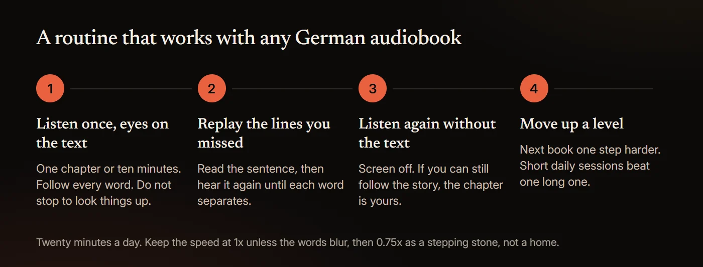

# How to Learn German With Audiobooks (and Free Ones With Text)

You can learn a lot of German from audiobooks if you see the words while you hear them. Begin with short stories written for learners, at about A2, and follow the German text as the narrator reads. Replay each chapter until it makes sense without the text, then move up to novels at full speed. Free audio is easy to find: the Internet Archive's LibriVox collection held 850 finished German-language books on November 4, 2026, and Deutsche Welle publishes slow news with the full text. The text matters because German often saves the verb for the end of the clause.

This guide covers the research, why German is hard to follow by ear, books by level, free audio with text, and a routine. Service details and prices were read from each company's own pages on November 4, 2026.

## Can you learn German from audiobooks?

Partly. Audiobooks train listening and understanding, not speaking or writing.

Vocabulary is the first limit. In a 2013 study of 36 native and 40 non-native listeners of English, van Zeeland and Schmitt found most people understood speech adequately once they knew 90% of the words, and the learners understood fairly well, with far less spread, at 95%.

Output is the second. In a 2002 report on children taught English only through listening and reading, Lightbown and colleagues found that after six years they matched comparison groups in comprehension and some oral production, "but not on measures of written production". In a two-year study of a similar program in 2009, Trofimovich and colleagues found ratings of fluency and comprehensibility "favored learners in the regular program".

## What does the research say about reading while you listen?

No study has tested learners of German reading along with audiobooks. Studies in other languages mostly find that text with audio beats audio alone.

- **German, without audio.** In a 2002 study, Maxim had 27 first-semester US college students of German read a 142-page romance novel in class instead of textbook readings. They matched a comparison group of 32 on three department tests and a posttest.
- **Japanese.** In Peterson's year-long 2025 study, learners who read with audio "outperformed all other groups" on a standardized test. The abstract gives no sample size.
- **Chinese.** In 2024, Zhang and Peng found that added audio significantly helped intermediate-low learners of Chinese and made no significant difference for intermediate-high ones.
- **English.** In a preregistered 2025 study of 86 Chinese learners of English reading a novel, Hui and Godfroid found they "comprehended the text less well when reading-while-listening than when reading it silently", while "both reading conditions yielded better comprehension than listening-only."

So the text helps while the audio alone is too hard, but it is not proven to beat silent reading. The Spanish evidence, including captioned video, is in [how to learn Spanish with audiobooks](/blog/learn-spanish-with-audiobooks); French has its own guide, [how to learn French with audiobooks](/blog/learn-french-with-audiobooks).

## Why is spoken German so hard to follow?

Not speed. In a 2011 study in *Language*, Pellegrino, Coupé and Marsico had six to ten adult speakers per language read the same 20 short texts aloud. German came out at 5.97 syllables a second, a little under English at 6.19 and well under Spanish at 7.82. The trouble is where the meaning lands.

- **The verb waits.** After *weil* or *dass*, the verb comes last: *…weil ich das Buch gestern gekauft habe*. Mark Twain's literary German, in *A Connecticut Yankee in King Arthur's Court* (1889, chapter XXII), dives into a sentence and surfaces "on the other side of his Atlantic with his verb in his mouth."
- **Verbs split.** In *Ich rufe dich morgen an*, the *an* that turns *rufen* (call) into *anrufen* (phone) comes last. Twain's *A Tramp Abroad* (1880), Appendix D, "The Awful German Language", describes "splitting a verb in two and putting half of it at the beginning of an exciting chapter and the OTHER HALF at the end of it."
- **Compounds run long.** *Lebensmittelgeschäft* (grocery store) is one word, and the part that names the thing comes last: a *Handschuh* (glove) is a kind of *Schuh*.
- **Case endings blur.** *Der*, *den* and *dem* are short and unstressed, yet they decide who did what. In *Den Hund sieht der Mann*, only *den* tells you the man sees the dog.

Learners miss those endings by ear. In a 2015 eye-tracking study, Hopp found that 45 English-speaking learners of German predicted what came next in spoken sentences from word meanings alone, unlike 12 native speakers, with "no indication that increasing proficiency" changed this. In a 2026 study by Marsden and colleagues, intermediate learners showed no use of case while listening before training. Afterwards the 28 trained learners gained on every measure, and the 13 untrained ones "showed no evidence of real-time processing of case." In a 2008 reading study, Jackson found intermediate learners were slow to use case wherever the verb sat, while for advanced learners an early main verb changed how hard object-first sentences were.

So learn each noun with *der*, *die* or *das*. In a 2016 study, Hopp trained 34 intermediate English-speaking learners on noun gender; afterwards they used it to predict while listening, and how well they did "correlated with accuracy in gender assignment". Reading teaches part of it: in a 2017 study, Bordag and colleagues found advanced learners noticed gender errors after three or four meetings with a new noun, for feminine and neuter nouns but not masculine ones; the abstract gives no sample size.

When the verb is still a line away, it helps to see it coming: [HushBook](/read-along-audiobooks) transcribes a German audiobook on your phone, underlines each word as the narrator says it, and replays a line when you long-press it.

Novels also need a big vocabulary. In a 2018 count of 26 German literary titles from a Dutch school reading list, van der Knaap found the 1,000 most common words covered 74.6% of the text on average, 3,000 covered 84.2% and 5,000 covered 87.4%: one unknown word in eight. Kafka's *Die Verwandlung* needed 268 words beyond the top 5,000 to reach 95% coverage; *Im Westen nichts Neues* needed 1,338.

German also takes longer. The US Foreign Service Institute puts it in Category II, "Approximately 36 weeks (828 class hours)", against 30 weeks for Spanish or French; with FSI's 17 weekly self-study hours, that is about 1,440 hours by our arithmetic. Germany's Federal Foreign Office reported "more than 15.4 million" learners of German in 2020, and its 2025 survey published no total. In US colleges, the Modern Language Association counted 80,594 German enrollments in 2016 and 53,543 in 2021, down 33.6%, the biggest fall of any language.

## What are the best German audiobooks for beginners?

Stories written for learners first, then children's classics. Audio with text seems to pay off most early: in Zhang and Peng's study, only the lower-level learners gained.

**Graded readers.** Olly Richards and Alex Rawlings's *Short Stories in German for Beginners* (Teach Yourself, 2018) is "Mapped to A2-B1" by its publisher, despite the title. The Audible edition runs 3 h 12 min, cost $11.06 on November 4, 2026, and comes with "the accompanying PDF". Lingo Mastery's [*German Short Stories for Beginners*](https://www.audible.com/pd/B07PHLVZXN) is "recommended for A2+ level learners" (6 h 29 min, $9.43, also with a PDF).

**André Klein's Learn German with Stories.** [*Café in Berlin*](https://books.learnoutlive.com/), book 1 of the Dino lernt Deutsch series, sells on his site as a $4.99 MP3 download you can import into a read-along app. It also comes as a $3.99 [TalkingBook](https://books.learnoutlive.com/learn-german-stories-cafe-berlin-10-short-stories-beginners-talkingbook/), an EPUB3 that "aligns audio narration with the words on the page" but has no MP3 files.

**Free picks from LibriVox.** Levels are our suggestions; running times are from LibriVox on November 4, 2026.

| Book | Length and readers | Why it suits a beginner |
|---|---|---|
| *[Ausgewählte Märchen der Brüder Grimm](https://librivox.org/maerchen-der-brueder-grimm-by-jacob-wilhelm-grimm/)*, 1857 edition | 5 h 21 min, 24 sections, one reader | Tales you know, in one voice. "Der Froschkönig" is section 1, "Rotkäppchen" section 10. Roughly A2 |
| *[Der kleine Häwelmann](https://librivox.org/der-kleine-haewelmann-by-theodor-storm/)*, Theodor Storm | 8 min, one reader | A children's tale you can finish in one sitting. Roughly A2 |
| *[Der Struwwelpeter](https://librivox.org/der-struwwelpeter-von-heinrich-hoffman/)*, Heinrich Hoffmann, 1845 | 18 min, one reader | Grim rhymed tales written "für Kinder von 3-6 Jahren". Roughly A2 to B1 |
| *[Max und Moritz](https://librivox.org/max-und-moritz-by-wilhelm-busch/)*, Wilhelm Busch, 1865 | 20 min, one reader | Two boys' pranks, in rhyme. Roughly A2 to B1 |

## German audiobooks for B1 and B2 learners

Deutsche Welle's B1 and B2 audio is in the free table below. For books, prefer one narrator; a new voice every chapter is harder to tune into.

| Book | Length and readers | Why it suits B1 and B2 |
|---|---|---|
| *[Heidis Lehr- und Wanderjahre](https://librivox.org/heidis-lehr-und-wanderjahre-von-johanna-spyri/)*, Johanna Spyri, 1880 | 6 h 00 min, 14 sections, 8 readers | The first Heidi novel, a story many learners know. Roughly B1 |
| *[Die Verwandlung](https://librivox.org/die-verwandlung-von-franz-kafka/)*, Franz Kafka, 1915 | 2 h 08 min, 3 sections, one reader | Short, and lighter on vocabulary than *Im Westen nichts Neues* (see above). Roughly B1 and up |
| *[Münchhausen](https://librivox.org/muenchhausen-by-gottfried-august-buerger/)*, Gottfried August Bürger, 1786 | 3 h 22 min, 17 sections, 8 readers | Tall tales in short chapters, in 18th-century German. Roughly B2 |
| *[Der Schimmelreiter](https://librivox.org/der-schimmelreiter-by-theodor-storm/)*, Theodor Storm, 1888 | 4 h 17 min, 7 sections, one reader | A North German novella; a 2026 solo version runs 5 h 08 min. Roughly B2 and up |

Old texts bring old spelling: Project Gutenberg's *Die Verwandlung* writes "daß" (now *dass*) 132 times, and LibriVox's 1812 Grimm titles a tale "Rothkäppchen". Gutenberg's *Heidi* uses modern spelling.

LibriVox has Hermann Hesse only in English. His pre-1931 novels, such as *Der Steppenwolf* and *Siddhartha*, are public domain in the US (Duke lists *Der Steppenwolf* "in the original German" for 2023) but stay under copyright in Germany until the end of 2032. LibriVox has no Erich Kästner. No study we found tests how learners follow Austrian, Swiss or northern German, and these LibriVox pages do not say where readers come from, so sample a chapter first.

## Where can you listen to German audiobooks for free?

Much free German audio comes with its full text, mostly from Deutsche Welle (DW). The text is not synced word by word.

| Source | Level | What you get | Download |
|---|---|---|---|
| [Langsam gesprochene Nachrichten](https://learngerman.dw.com/de/langsam-gesprochene-nachrichten/s-60040332) (DW) | B2 | The news, Monday to Saturday, read slowly, with the full text on the page | MP3, slow and normal speed |
| [Top-Thema mit Vokabeln](https://learngerman.dw.com/de/top-thema/s-55861562) (DW) | B1 | A short weekly article with its transcript and a vocabulary list | MP3 |
| [Nicos Weg](https://learngerman.dw.com/en/nicos-weg/c-36519789) (DW) | A1 to B1 | A video course with a Script tab; login only for the certificate | No |
| [Slow German](https://slowgerman.com/) | B1 and up | A podcast with each episode's text on the page and as a PDF | MP3 and PDF |
| [Vorleser.net](https://www.vorleser.net/ueber-vorleser) | Not graded | About 800 titles, mostly classics, PDF text where available; private use only | MP3, some PDF |
| [Ohrka](https://www.ohrka.de/ueber-ohrka/das-projekt) | Children | Free, ad-free children's audio | MP3; a few stream only |
| [Easy German](https://www.easygerman.org/membership) | Not stated | A free podcast; transcripts for members, from €11.99 a month | Not checked |
| [Coffee Break German Level 1](https://coffeebreaklanguages.com/courses/coffee-break-german-level-1/) | A1 to A2 | A free podcast; the $269 course adds transcripts in its lesson notes | Audio and notes, paid |

For whole books, use LibriVox. The Internet Archive's LibriVox collection held 850 finished German-language books on November 4, 2026. LibriVox's own catalogue search shows 949 complete recordings, because it also counts single pieces inside multilingual collections. They are public domain in the US; elsewhere, check your own country's rules. Readers are volunteers, quality varies, and group recordings change voice by chapter. More in [is LibriVox safe and legal](/blog/is-librivox-safe-and-legal) and [free read-along audiobooks](/blog/free-read-along-audiobooks).

## Do German audiobooks come with text or a transcript?

Some do; German has an edge here. Audible's Read & Listen, which highlights the Kindle eBook as the narrator reads, covers "supported English and German language titles in the United States, United Kingdom, Australia, and Germany." You need the eBook and the audiobook of "the same edition", on "the same Amazon account", and the title must carry the Read & Listen badge. Setup is in [can you read along with Audible](/blog/can-you-read-along-with-audible).

Routes that show German text, as listed on November 4, 2026, in US dollars:

| Route | What you see while it plays | Your own audiobooks | Price |
|---|---|---|---|
| Audible Read & Listen | The Kindle eBook, highlighted in sync | No | Audiobook plus Kindle eBook |
| Graded reader on Audible | Nothing in the player; a PDF in your library | No | $11.06 for Olly Richards's book |
| André Klein's TalkingBook | An EPUB3 with the narration aligned to the words | No | $3.99 for *Café in Berlin* |
| Readle | Its own news stories from A1 to C1, with audio and tap-to-translate | No | $9.99 a month, $69.99 a year or $249.99 lifetime |
| Beelinguapp | Its own stories in two languages, with karaoke-style scrolling text | No | $7.99 a month or $49.90 a year |
| LingQ | "Matching text" for its lessons, and AI transcription of audiobooks you import | Yes, by import | $14.99 a month or $119.99 a year |
| **HushBook** | The German words, transcribed on your phone, current word underlined | Yes, DRM-free files, plus LibriVox German built in | Free; Pro adds extras |

[Lingopie](https://apps.apple.com/us/app/lingopie-learn-a-language/id1534737981) does this for video, with German and English subtitles, for $13.99 a month or $83.99 a year.

An English translation helps you follow; the German text teaches the words. In a 2022 meta-analysis of 20 studies, more than half of them with English learners, Reynolds and colleagues found captions had a large effect on vocabulary (d = 0.88), largest when they were in the language being learned. Check meanings in English, then listen with the German.

## Can you learn German on Audible, Spotify or Libby?

You can listen to German on all three. Only Audible can show the text, and only with the Kindle eBook.

- **Audible.** Germany has its own store, audible.de. On audible.com the German category leads with courses taught in English: [*Learn German with Paul Noble for Beginners*](https://www.audible.com/pd/B01D51B1IA) runs 12 h 14 min ($24.14 on November 4, 2026), and [*Pimsleur German Level 1 Lessons 1-5*](https://www.audible.com/pd/B0DQQPJ3ML) runs 2 h 43 min ($19.76). Both are copy-protected.
- **Spotify.** Since April 2025, Premium in Germany, Austria, Switzerland and Liechtenstein has included 12 hours of audiobooks a month, with "titles in German, French, and Italian". US Premium includes 15 hours; we could not confirm its German catalogue, so search for the book. It shows no book text; the German site's "Follow-Along" is "illustrations, photos, and graphics" for select titles.
- **Libby.** Filter results by "format, language, subject, and more" to find your library's German audiobooks. Loans "can't be transferred to MP3 players or iPods", and we found no Libby page that offers their text.

## A routine that works

1. **Listen once with the text.** Follow a chapter or news item with your eyes on the German, without stopping for every unknown word.
2. **Replay the lines you missed.** Find the verb or prefix at the end of each lost sentence, and listen for *der*, *den* and *dem*. In Jensen and Vinther's 2003 study, 84 upper-intermediate learners of Spanish heard each line three times, slowed or not, and slowing made no difference. In Zhao's 1997 study of English learners, comprehension rose when listeners could slow the audio. No study has tested 0.75x; see [what speed to listen to audiobooks at](/blog/audiobook-listening-speed).
3. **Listen again without the text.** This checks your ear alone.
4. **Move up a level.** Once a chapter makes sense on the second listen without text, step up: from graded readers and Top-Thema to children's classics, the slow news, then a one-narrator novel such as *Die Verwandlung*.

None of this practises speaking. Read lines aloud with the narrator, or find someone to talk to.

## What the evidence does not show

- No study has tested learners of German using audiobooks or reading along. Maxim's students read without audio.
- Reading along is not proven to beat silent reading, only listening alone.
- Listening alone has not been shown to teach case endings. We found no study comparing plain input with teaching for German case.
- No study we found covers learners hearing separable verbs or splitting compounds. That part rests on grammar and Twain.
- The speech-rate figures come from read texts by six to ten speakers per language, not conversation or narration.

## How to read along with a German audiobook in HushBook

[HushBook](/) is an audiobook player for iPhone and Android that shows the words as the narrator reads them.

1. **Find a book.** In Discover, set the language filter to German. On November 4, 2026 it listed 848 German LibriVox titles and none from the Internet Archive. Or import a DRM-free MP3 or M4B, such as André Klein's MP3 edition, a Vorleser.net file or a Libro.fm purchase.
2. **Keep the Universal engine.** The default, and the only multilingual engine (about 57 MB); it detects the language itself. The other three are English-only, so check which engine is selected before you transcribe a German book.
3. **Let it transcribe.** It runs on your phone; nothing is uploaded. "Transcribe on my PC" (Pro) shows "English books only for now".
4. **Read along.** The current word is underlined. Long-press a line to play from there. "Tap a line to jump there" is off by default in the player's Appearance sheet.
5. **Set the speed.** 0.5x to 3x in 0.05x steps, saved per reading profile.
6. **Keep what you learn.** Mark, then Highlight, Note or Quote, saves the line to Quotes & notes. Use a Note for each new noun and its article.

Honest limits. There is no translation. The dictionary is English-only, part of Pro and needs the internet, and it splits words at ä, ö, ü and ß, so keep a German dictionary handy. Speech recognition gets names, old words and noisy recordings wrong, and the transcript may not match an old e-text letter for letter. There is no plain-text export. Copy-protected books from Audible, Libby or Spotify cannot be imported, so Paul Noble and Pimsleur are out. It is a reading aid, not a course. No account, no ads.

## Sources

- [van Zeeland and Schmitt (2013), "Lexical Coverage in L1 and L2 Listening Comprehension: The Same or Different from Reading Comprehension?", Applied Linguistics](https://doi.org/10.1093/applin/ams074)
- [Lightbown, Halter, White and Horst (2002), "Comprehension-Based Learning: The Limits of 'Do It Yourself'", The Canadian Modern Language Review](https://doi.org/10.3138/cmlr.58.3.427)
- [Trofimovich, Lightbown, Halter and Song (2009), "Comprehension-based practice: The development of L2 pronunciation in a listening and reading program", Studies in Second Language Acquisition](https://doi.org/10.1017/s0272263109990040)
- [Maxim (2002), "A Study into the Feasibility and Effects of Reading Extended Authentic Discourse in the Beginning German Language Classroom", The Modern Language Journal](https://doi.org/10.1111/1540-4781.00134)
- [Peterson (2025), "Exploring general language ability development through monitored extensive reading, extensive listening, and audio-assisted extensive reading", Foreign Language Annals](https://doi.org/10.1111/flan.70043)
- [Zhang and Peng (2024), "Multimodal reading in reading-only versus reading-while-listening modes: evidence from Chinese language learners", Chinese as a Second Language Research](https://doi.org/10.1515/caslar-2024-2003)
- [Hui and Godfroid (2025), "Listening, Reading, or Both? Rethinking the Comprehension Benefits of Reading-While-Listening", Language Learning](https://doi.org/10.1111/lang.12721)
- [Pellegrino, Coupé and Marsico (2011), "A cross-language perspective on speech information rate", Language](https://doi.org/10.1353/lan.2011.0057)
- [Twain (1889), "A Connecticut Yankee in King Arthur's Court", Project Gutenberg](https://www.gutenberg.org/ebooks/86)
- [Twain (1880), "A Tramp Abroad", Appendix D: "The Awful German Language", Project Gutenberg](https://www.gutenberg.org/ebooks/119)
- [Hopp (2015), "Semantics and morphosyntax in predictive L2 sentence processing", International Review of Applied Linguistics in Language Teaching](https://doi.org/10.1515/iral-2015-0014)
- [Marsden, Marsden, Hopp, Jackson, Jochum-Critchley and Rogers (2026), "The Effects of Prediction Training on the Real-Time Processing, Offline Comprehension, and Oral Production of case in L2 German", Language Teaching Research](https://doi.org/10.1177/13621688261444298)
- [Jackson (2008), "Proficiency Level and the Interaction of Lexical and Morphosyntactic Information During L2 Sentence Processing", Language Learning](https://doi.org/10.1111/j.1467-9922.2008.00481.x)
- [Hopp (2016), "Learning (not) to predict: Grammatical gender processing in second language acquisition", Second Language Research](https://doi.org/10.1177/0267658315624960)
- [Bordag, Kirschenbaum, Rogahn, Opitz and Tschirner (2017), "Misbehaved masculines: Incidental acquisition of grammatical gender in L2 German during reading", Bilingualism: Language and Cognition](https://doi.org/10.1017/s1366728917000608)
- [van der Knaap (2018), "Zur Bedeutung der Lexik für das literarische Lesen: Didaktische Erkenntnisse einer Textdeckungsuntersuchung", Informationen Deutsch als Fremdsprache](https://doi.org/10.1515/infodaf-2018-0069)
- [U.S. Department of State, "Foreign Language Training"](https://www.state.gov/national-foreign-affairs-training-center/foreign-language-training)
- [Auswärtiges Amt (2020), "German as a foreign language: Growing numbers learning German in Africa and Asia"](https://www.auswaertiges-amt.de/en/newsroom/news/german-as-a-foriegn-language/2347090)
- [Auswärtiges Amt (2025), "Aktuelle Trendanalyse zeigt Relevanz von Deutsch als Fremdsprache weltweit"](https://www.auswaertiges-amt.de/de/newsroom/deutsch-als-fremdsprache-2728478)
- [Modern Language Association (2023), "Enrollments in Languages Other Than English in US Institutions of Higher Education, Fall 2021"](https://www.mla.org/content/download/191324/file/Enrollments-in-Languages-Other-Than-English-in-US-Institutions-of-Higher-Education-Fall-2021.pdf)
- [Audible, "Short Stories in German for Beginners"](https://www.audible.com/pd/1473683394)
- [Duke Center for the Study of the Public Domain, "Public Domain Day 2023"](https://law.duke.edu/cspd/publicdomainday/2023/)
- [Audible, "Read & Listen"](https://www.audible.com/ep/read-listen)
- [App Store, "Learn German: News by Readle"](https://apps.apple.com/us/app/learn-german-news-by-readle/id1483552317)
- [App Store, "Beelinguapp: Language Learning App"](https://apps.apple.com/us/app/beelinguapp-language-learning/id1225056371)
- [App Store, "LingQ | Learn Languages App"](https://apps.apple.com/us/app/lingq-learn-languages/id379385811)
- [Reynolds, Cui, Kao and Thomas (2022), "Vocabulary Acquisition through Viewing Captioned and Subtitled Video: A Scoping Review and Meta-Analysis", Systems](https://doi.org/10.3390/systems10050133)
- [Spotify Newsroom (2025), "Spotify Expands Our Audiobooks Offering to Listeners In Germany, Austria, Switzerland, and Liechtenstein"](https://newsroom.spotify.com/2025-04-15/spotify-expands-its-audiobooks-offering-to-listeners-in-germany-austria-switzerland-and-liechtenstein/)
- [Spotify, "Spotify Audiobooks" (US)](https://www.spotify.com/us/audiobooks/)
- [Libby Life (2025), "Search like a pro: Expert tips for finding your next read in the Libby app"](https://www.libbylife.com/2025-03-06-search-like-a-pro-expert-tips-for-finding-your-next-read-in-the-libby-app)
- [Libby Help, "Can I transfer audiobooks to an MP3 player with Libby?"](https://help.libbyapp.com/en-us/6131.htm)
- [Jensen and Vinther (2003), "Exact Repetition as Input Enhancement in Second Language Acquisition", Language Learning](https://doi.org/10.1111/1467-9922.00230)
- [Zhao (1997), "The Effects of Listeners' Control of Speech Rate on Second Language Comprehension", Applied Linguistics](https://doi.org/10.1093/applin/18.1.49)
- [Libro.fm Support, "How do I download audiobook files to listen on my computer?"](https://support.libro.fm/support/solutions/articles/48000695426-how-do-i-download-audiobook-files-to-listen-on-my-computer-)
