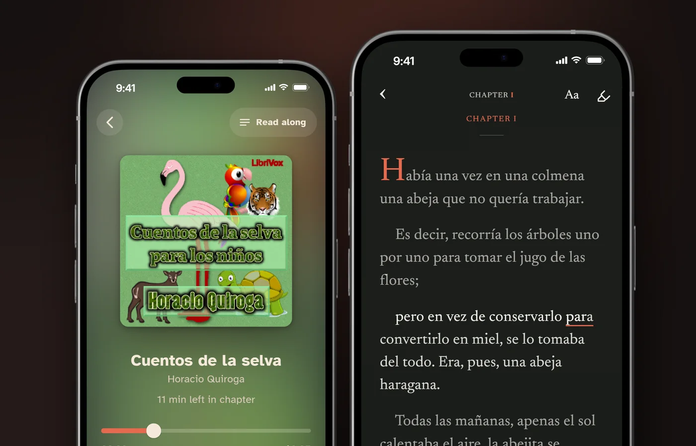
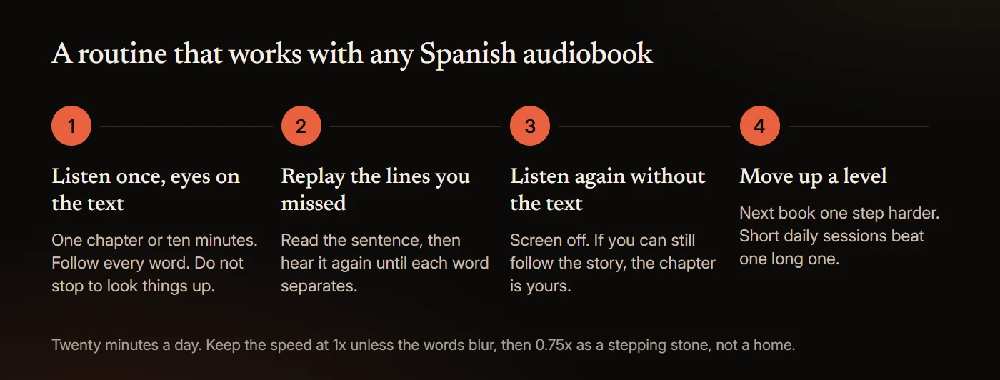

# How to Learn Spanish With Audiobooks (and Free Ones With Text)

Audiobooks help you learn Spanish when you can follow the words. Start with short stories written for learners, at roughly A2, and keep the Spanish text in front of you while you listen. Replay each chapter until it makes sense without the text, and only then move on to native-speed novels. The free ones are on LibriVox, which held 564 finished Spanish-language books on November 4, 2026. The text matters because spoken Spanish packs more syllables into each second than English, and seeing the words shows you what you just heard.

This guide covers the research, why Spanish sounds fast, books for each level, free sources, which services show the text, and a routine to follow. Service details were read from each company's own pages on November 4, 2026.

## Can you learn Spanish from audiobooks?

Partly. Audiobooks train your ear and your understanding, not your speaking or writing, and no study has tested how well adults learn Spanish from them.

The first limit is vocabulary. In a 2013 study of 36 native and 40 non-native listeners, van Zeeland and Schmitt found most people understood spoken English adequately when they knew 90% of the words, and learners understood fairly well, with much less variation, at 95%. Reading needs more. The usual target of 98% comes from Hu and Nation's 2000 study of 66 university students, and when Kremmel and colleagues repeated it in 2023 with 104 adult learners, "the results of the original study could not be fully replicated". Treat these numbers as rough guides. Know too few of the words and a novel at full speed is noise.

The second limit is output. Lightbown and colleagues followed children in an English program built only on listening and reading. After six years, their 2002 report says, the children matched comparison groups on comprehension and some oral production, "but not on measures of written production". In a 2009 two-year study of a similar program, Trofimovich and colleagues found listener ratings of fluency and comprehensibility "favored learners in the regular program". Speaking and writing need practice of their own.

## What does the research say about reading while you listen?

No study has tested adults reading along with Spanish audiobooks. The closest evidence comes from other languages and from Spanish video with captions, and most of it says text with audio beats audio alone.

- **Japanese.** In a year-long study published in 2025, Peterson found that learners of Japanese who read with audio "outperformed all other groups" on a standardized test, against groups doing extensive reading or listening alone. The abstract does not give the sample size.
- **Chinese.** In 2024, Zhang and Peng found that adding audio to reading significantly improved comprehension for intermediate-low learners of Chinese, and made no significant difference for intermediate-high learners.
- **A novel, read three ways.** In a preregistered 2025 study of 86 Chinese learners of English, Hui and Godfroid found that participants "comprehended the text less well when reading-while-listening than when reading it silently", while "both reading conditions yielded better comprehension than listening-only."
- **Spanish video.** In a 2010 study of US learners of Spanish, Arabic, Chinese and Russian, Winke, Gass and Sydorenko found "captioning was more effective than no captioning", and for Spanish, captions on the first viewing generally beat captions on the second. A 2022 meta-analysis of 20 studies by Reynolds and colleagues found a large effect of captions on vocabulary (d = 0.88), largest for same-language captions. More than half the studies it reviewed were of English learners.
- **Word boundaries.** In 2025, Montero Perez and Pattemore had 37 intermediate learners of Spanish watch a 72-minute episode of a Spanish series. Watching improved how well they split that show's speech into words, "irrespective of captioning presence", and the gain did not carry over to an unrelated series.

So the text helps most when the audio alone is too hard, which is where most Spanish learners start. It is not proven to beat silent reading. The English-learner studies are in [how to learn English with audiobooks](/blog/learn-english-with-audiobooks), and the wider debate is in [does reading along with an audiobook help](/blog/does-reading-along-with-an-audiobook-help).

## Why does spoken Spanish sound so fast?

Counted in syllables, it is fast. In a 2011 study in *Language*, Pellegrino, Coupé and Marsico had six to ten adult speakers per language read the same 20 short texts aloud. The Spanish speakers produced 7.82 syllables a second against 6.19 for English, about 26% more. Each Spanish syllable carried less information (0.63 against 0.91 on the study's scale), so the information per second came out close (0.98 against 1.08). Spanish spreads the same meaning over more, lighter syllables, and to a new ear they run together.

The vocabulary news is better. In a 2005 count from a 20th-century Spanish corpus, Davies found that the 1,000 most common words covered 87.8% of speech but only 79.6% of fiction, and that fiction needs about 7,000 words to reach even 90% coverage. A novel is a far bigger vocabulary job than a conversation, which is why beginners do better with stories written for learners.

Spanish is also close to English. The US Foreign Service Institute puts it in Category I, "Languages close to English": 24 to 30 weeks, or 552 to 690 class hours, with Spanish at 30 weeks of 23 class hours and 17 self-study hours a week. Older versions of the page said 600 to 750 class hours. By our arithmetic, Spanish comes to about 1,200 hours of full-time study.

Hearing a line again helps more than slowing it down. In a 2003 study, Jensen and Vinther had 84 upper-intermediate learners of Spanish hear each line of native dialogue three times, as fast-slow-fast, fast-slow-slow or fast throughout. All three groups improved in comprehension and decoding, with no difference between the patterns. Slowing does help in the moment: in a 1997 study of English learners, Zhao found comprehension rose when listeners could control the speed, mostly by slowing it. No study has tested 0.75x, so treat a slower speed as a step on the way back to 1x. More in [what speed to listen to audiobooks at](/blog/audiobook-listening-speed).

When the syllables blur, seeing them helps: [HushBook](/read-along-audiobooks) transcribes a Spanish audiobook on your phone, underlines each word as the narrator says it, and plays a line again when you long-press it.

## What are the best Spanish audiobooks for beginners?

Stories written for learners first, then children's classics. Audio with text seems to pay off most at lower levels: in Zhang and Peng's study, it helped only the lower-level learners.

**Graded readers.** Olly Richards's *Short Stories in Spanish for Beginners* (Teach Yourself, 2018) is mapped by its publisher to "A2-B1", despite the title, with "controlled language at your level, including the 1000 most frequent words". The Audible edition runs 4 h 30 min and cost $11.06 on November 4, 2026, with "the accompanying PDF" in your library: the text, though not in sync. Libro.fm also lists it, and Libro.fm sells "DRM-free files (MP3s or M4B format)".

**Free picks from LibriVox.** Public domain, read by volunteers. The levels are our suggestions, not publisher ratings, and running times are from LibriVox on November 4, 2026. The shortest start is *[Las Fábulas de Esopo, vol. 01](https://archive.org/details/fabulas_esopo_01_librivox)*: 30 fables in 42 minutes, and with 3.47 million downloads the most downloaded Spanish LibriVox recording on the Internet Archive.

| Book | Length and readers | Why it suits a beginner |
|---|---|---|
| *[Cuentos de la selva para los niños](https://librivox.org/cuentos-de-la-selva-para-los-ninos-by-horacio-quiroga/)*, Horacio Quiroga, 1918 | 2 h 07 min, 8 sections, 5 readers | Animal stories written for children, in short chapters. Roughly A2 |
| *[Cuentos de hadas, Vol. 1](https://librivox.org/cuentos-de-hadas-vol-1-by-jacob-wilhelm-grimm/)*, Jacob and Wilhelm Grimm, in Spanish translation | 3 h 48 min, 20 sections, 8 readers | Stories you already know, such as "Blancanieves" and "La Cenicienta", so the plot fills the gaps. Roughly A2 |
| *[Cuentos, adivinanzas y refranes populares](https://librivox.org/cuentos-adivinanzas-y-refranes-populares-by-fernan-caballero/)*, Fernán Caballero, 1921 edition | 2 h 55 min, 39 sections, 10 readers | Folk tales, riddles and proverbs, a few minutes each. Roughly A2 to B1 |
| *[La Edad de Oro](https://librivox.org/la-edad-de-oro-by-jose-marti/)*, José Martí, 1889 | 8 h 20 min, about 13 readers | A children's magazine Martí wrote himself, in fairly plain language. Roughly B1 |

Most of these are group recordings, so the voice changes from chapter to chapter. The Grimm set continues in volumes 2 and 3. If you were hoping for *Platero y yo* by Juan Ramón Jiménez, LibriVox has no recording of it.

## Spanish audiobooks for intermediate learners

Once short stories feel easy, move to a whole book with one narrator, which is easier to tune into than a new voice every chapter.

| Book | Length and readers | Why it suits an intermediate learner |
|---|---|---|
| *[El Capitán Veneno](https://librivox.org/el-capitan-veneno-by-pedro-antonio-de-alarcon/)*, Pedro Antonio de Alarcón, 1881 | 2 h 14 min, one reader | A short comic novel from Spain, and a good first whole book. Roughly B1 |
| *[Marianela](https://librivox.org/marianela-by-benito-perez-galdos/)*, Benito Pérez Galdós, 1878 | 6 h 01 min, 22 sections, one reader | A short classic novel from Spain. Roughly B1 and up |
| *[Antología de cuentos hispanoamericanos](https://librivox.org/antologia-de-cuentos-hispanoamericanos-by-various/)*, various authors | 3 h 41 min, 14 sections, 9 readers | Each story is read by a volunteer from the author's country, or one fluent in its accent. Roughly B1 to B2 |
| *[Leyendas](https://librivox.org/leyendas-by-gustavo-adolfo-becquer/)*, Gustavo Adolfo Bécquer, 1858 to 1864 | 10 h 05 min, several readers | Gothic legends often taught in Spanish schools, with Romantic-era vocabulary. Roughly B2 |

No study ranks Latin American or Castilian Spanish as easier to learn from. In a 2018 study of 60 English-speaking learners hearing six regional varieties, Schoonmaker-Gates found that familiarity predicted how well they identified a variety and, for advanced students, how well they understood it. Start with the accent you most need and add others later. LibriVox pages do not say where readers are from; of the pages we checked, only the *Antología* matches readers to each story's country.

## Where can you listen to Spanish audiobooks for free?

- **LibriVox.** The Internet Archive's LibriVox collection held 564 finished Spanish-language books on November 4, 2026. LibriVox's own catalogue search shows 628 complete recordings, because it also counts single Spanish pieces inside multilingual collections. "All our audio is in the public domain," LibriVox says. It accepts "all volunteers in all languages, with all kinds of accents", sound quality varies, and the vocabulary is from the 19th and early 20th centuries. More in [is LibriVox safe and legal](/blog/is-librivox-safe-and-legal).
- **The Internet Archive.** It hosts the LibriVox recordings. Outside LibriVox its Spanish shelf is thin, and some uploads carry no licence; a recent commercial title with none is probably an unauthorised upload.
- **Libby.** Libby's blog says you can filter results by "format, language, subject, and more" and pin filters, so pin Spanish and audiobooks to see your library's Spanish shelf. Loans stay in the app: audiobooks "can't be transferred to MP3 players or iPods".

More free sources with text are in [free read-along audiobooks](/blog/free-read-along-audiobooks). For French, [how to learn French with audiobooks](/blog/learn-french-with-audiobooks) lists free audio that comes with a transcript, such as RFI's weekday news in easy French.

## Do Spanish audiobooks come with text or a transcript?

Rarely. Audible's Read & Listen highlights the Kindle ebook as the narrator reads, but only "for supported English and German language titles". Spotify's audiobook player offers speed, 15-second skips and a sleep timer, and no text. German learners have more options: Read & Listen covers German, and [how to learn German with audiobooks](/blog/learn-german-with-audiobooks) lists free German audio published with its full text.

Routes that do show Spanish text, as listed on November 4, 2026, in US dollars:

| Route | What you see while it plays | Your own audiobooks | Price |
|---|---|---|---|
| Graded reader on Audible | Nothing in the player; a PDF of the book in your library | No | $11.06 for Olly Richards's beginners' book |
| Audible Read & Listen | The Kindle ebook, highlighted, for English and German titles only | No | Audiobook plus Kindle ebook |
| Beelinguapp | Its own stories in two languages side by side, with karaoke-style scrolling text | No, its own catalogue | $7.99 a month or $49.90 a year |
| LingQ | "Matching text" for its lessons, and AI transcription of audiobooks you import | Yes, by import | Premium $14.99 a month or $119.99 a year |
| **HushBook** | The Spanish words, transcribed on your phone, current word underlined | Yes, DRM-free files, plus LibriVox Spanish built in | Free; Pro adds extras |

An English translation helps in a different way. In a 2001 study of 169 fourth-semester university Spanish students watching a Spanish episode, Markham, Peter and McCarthy found English captions gave the best comprehension, Spanish captions came next, and no captions came last. That was one session, so it shows nothing about building your listening. Check the meaning in English, and listen with the Spanish.

## Can you learn Spanish on Audible, Spotify or Libby?

You can listen to Spanish on all three, but none shows the Spanish text.

- **Audible.** audible.com has a Spanish-language storefront with an Audible Latino section, and Spain has audible.es. Courses such as Paul Noble and Pimsleur are spoken in English: *Learn Spanish with Paul Noble for Beginners* runs 13 h 21 min ($28.97 on November 4, 2026), and *Pimsleur Spanish Level 1 Lessons 1-5* runs 3 h 4 min ($19.76). Both are copy-protected Audible files.
- **Spotify.** Select Premium plans in the US include 15 hours of audiobooks a month. The markets that got audiobooks in October 2026, including Spain, Mexico, Colombia, Chile and Peru, get 12 hours and "new catalogs in Spanish". We could not confirm the size of the US Spanish catalogue, so search for the book you want.
- **Libby.** Pin the Spanish filter and borrow. We found no Libby help page that mentions text for audiobooks.

## A routine that works

1. **Listen once with the text.** Follow a chapter with your eyes on the Spanish, without stopping to look words up. In Winke, Gass and Sydorenko's 2010 study, Spanish learners did better with captions on the first viewing than on the second.
2. **Replay the lines you missed.** Read each sentence you lost and play it until you hear every word. Three hearings helped all of Jensen and Vinther's learners, slowed or not. If you slow a passage to 0.75x, that is a practical setting, not a researched one.
3. **Listen again without the text.** Learners in the 2010 study said they used captions "as a crutch". This pass checks your ear without one.
4. **Move up a level.** When a chapter makes sense on the second listen without text, move from graded readers to children's classics, then to a short novel with one narrator.

None of this is speaking practice. Read lines aloud with the narrator, or find someone to talk to.

## What the evidence does not show

- No study has tested adults learning Spanish from audiobooks. The reading-while-listening evidence comes from learners of Japanese, Chinese and English, and the Spanish evidence from video.
- Reading along is not proven to beat silent reading. It beat listening alone.
- Seeing the words does not make meanings stick by itself. In a 2014 study of 133 Flemish undergraduates watching French clips, Montero Perez and colleagues found captions helped learners recognise word forms, but "Captioning did not affect comprehension nor meaning recall."
- No study has tested 0.75x or any other playback speed for learners.
- There is no verified number of hours to fluency. Dreaming Spanish sets hour milestones that its FAQ says "were initially based on the experiences of thousands of students that learned Thai with comprehensible input at AUA", and it cites Stephen Krashen, whose input hypothesis is a theory. FSI's hours are for full-time classes.
- No study ranks Spanish accents or compares podcasts with audiobooks. Whatever the format, the research points to two things: understand most of what you hear, and see the words while you learn them.
- The speech-rate figures come from read texts by six to ten speakers per language, not conversation.

## How to read along with a Spanish audiobook in HushBook

[HushBook](/) is an audiobook player for iPhone and Android that shows the words as the narrator reads them.

1. **Find a book.** In Discover, set the language filter to Spanish. It searches LibriVox and the Internet Archive together: about 660 Spanish books on November 4, 2026. Or import a DRM-free Spanish MP3 or M4B you own, such as a Libro.fm purchase.
2. **Keep the Universal engine.** It is the default and the only multilingual engine (about 57 MB), and it detects the language itself. The other three are English-only, so check which engine is selected before you transcribe a Spanish book.
3. **Let it transcribe.** Transcription runs on your phone, and nothing is uploaded. "Transcribe on my PC" (Pro) may say "English books only for now".
4. **Read along.** The current word is underlined. Long-press a line to play from there. "Tap a line to jump there" is off by default; turn it on in the player's Appearance sheet.
5. **Set the speed.** From 0.5x to 3x in 0.05x steps, saved per reading profile, not per book.
6. **Keep what you learn.** Mark, then Highlight, Note or Quote, saves the line to Quotes & notes, in Spanish as in English.

Honest limits. There is no translation, and the dictionary is English-only, part of Pro and needs the internet, so keep a Spanish dictionary handy. Speech recognition gets names, old words and noisy recordings wrong, and Universal is a smaller model than the English-only Large engine. There is no plain-text export. Copy-protected books from Audible, Libby, hoopla or Spotify cannot be imported, so Pimsleur and Paul Noble are out. It is a reading aid, not a course. No account, no ads.

## Sources

- [van Zeeland and Schmitt (2013), "Lexical Coverage in L1 and L2 Listening Comprehension: The Same or Different from Reading Comprehension?", Applied Linguistics](https://doi.org/10.1093/applin/ams074)
- [Hu and Nation (2000), "Unknown vocabulary density and reading comprehension", Reading in a Foreign Language](https://doi.org/10.64152/10125/66973)
- [Kremmel, Indrarathne, Kormos and Suzuki (2023), "Unknown Vocabulary Density and Reading Comprehension: Replicating Hu and Nation (2000)", Language Learning](https://doi.org/10.1111/lang.12622)
- [Lightbown, Halter, White and Horst (2002), "Comprehension-Based Learning: The Limits of 'Do It Yourself'", The Canadian Modern Language Review](https://doi.org/10.3138/cmlr.58.3.427)
- [Trofimovich, Lightbown, Halter and Song (2009), "Comprehension-based practice: The development of L2 pronunciation in a listening and reading program", Studies in Second Language Acquisition](https://doi.org/10.1017/s0272263109990040)
- [Peterson (2025), "Exploring general language ability development through monitored extensive reading, extensive listening, and audio-assisted extensive reading", Foreign Language Annals](https://doi.org/10.1111/flan.70043)
- [Zhang and Peng (2024), "Multimodal reading in reading-only versus reading-while-listening modes: evidence from Chinese language learners", Chinese as a Second Language Research](https://doi.org/10.1515/caslar-2024-2003)
- [Hui and Godfroid (2025), "Listening, Reading, or Both? Rethinking the Comprehension Benefits of Reading-While-Listening", Language Learning](https://doi.org/10.1111/lang.12721)
- [Winke, Gass and Sydorenko (2010), "The effects of captioning videos used for foreign language listening activities", Language Learning & Technology](https://doi.org/10.64152/10125/44203)
- [Reynolds, Cui, Kao and Thomas (2022), "Vocabulary Acquisition through Viewing Captioned and Subtitled Video: A Scoping Review and Meta-Analysis", Systems](https://doi.org/10.3390/systems10050133)
- [Montero Perez and Pattemore (2025), "Effects of captioned video on L2 speech segmentation in intermediate learners of Spanish", Language Learning & Technology](https://doi.org/10.64152/10125/73653)
- [Pellegrino, Coupé and Marsico (2011), "A cross-language perspective on speech information rate", Language](https://doi.org/10.1353/lan.2011.0057)
- [Davies (2005), "Vocabulary Range and Text Coverage: Insights from the Forthcoming Routledge Frequency Dictionary of Spanish", Selected Proceedings of the 7th Hispanic Linguistics Symposium](https://www.lingref.com/cpp/hls/7/paper1091.pdf)
- [U.S. Department of State, "Foreign Language Training"](https://www.state.gov/national-foreign-affairs-training-center/foreign-language-training)
- [Jensen and Vinther (2003), "Exact Repetition as Input Enhancement in Second Language Acquisition", Language Learning](https://doi.org/10.1111/1467-9922.00230)
- [Zhao (1997), "The Effects of Listeners' Control of Speech Rate on Second Language Comprehension", Applied Linguistics](https://doi.org/10.1093/applin/18.1.49)
- [Audible, "Short Stories in Spanish for Beginners"](https://www.audible.com/pd/1473683297)
- [Libro.fm Support, "How do I download audiobook files to listen on my computer?"](https://support.libro.fm/support/solutions/articles/48000695426-how-do-i-download-audiobook-files-to-listen-on-my-computer-)
- [Schoonmaker-Gates (2018), "Dialect comprehension and identification in L2 Spanish: Familiarity and type of exposure", Studies in Hispanic and Lusophone Linguistics](https://doi.org/10.1515/shll-2018-0007)
- [LibriVox, "About LibriVox"](https://librivox.org/pages/about-librivox/)
- [Libby Life (2025), "Search like a pro: Expert tips for finding your next read in the Libby app"](https://www.libbylife.com/2025-03-06-search-like-a-pro-expert-tips-for-finding-your-next-read-in-the-libby-app)
- [Libby Help, "Can I transfer audiobooks to an MP3 player with Libby?"](https://help.libbyapp.com/en-us/6131.htm)
- [Audible, "Read & Listen"](https://www.audible.com/ep/read-listen)
- [Spotify Support, "Unlock Audiobooks"](https://support.spotify.com/us/article/audiobooks/)
- [App Store, "Beelinguapp: Language Learning App"](https://apps.apple.com/us/app/beelinguapp-language-learning/id1225056371)
- [App Store, "LingQ | Learn Languages App"](https://apps.apple.com/us/app/lingq-learn-languages/id379385811)
- [Markham, Peter and McCarthy (2001), "The Effects of Native Language vs. Target Language Captions on Foreign Language Students' DVD Video Comprehension", Foreign Language Annals](https://doi.org/10.1111/j.1944-9720.2001.tb02083.x)
- [Audible, "Spanish Language Libros | Escucha en Audible"](https://www.audible.com/es_US/topic/audiobooks-spanish-language)
- [Audible, "Learn Spanish with Paul Noble for Beginners – Complete Course"](https://www.audible.com/pd/B01D1VJS16)
- [Audible, "Pimsleur Spanish Level 1 Lessons 1-5"](https://www.audible.com/pd/1508255555)
- [Spotify, "Spotify Audiobooks" (US)](https://www.spotify.com/us/audiobooks/)
- [Spotify Newsroom (2026), "Audiobooks on Spotify Are Going Global"](https://newsroom.spotify.com/2026-10-07/audiobooks-global-expansion/)
- [Montero Perez, Peters, Clarebout and Desmet (2014), "Effects of captioning on video comprehension and incidental vocabulary learning", Language Learning & Technology](https://doi.org/10.64152/10125/44357)
- [Dreaming, "Frequently Asked Questions"](https://www.dreaming.com/faq)
- [Krashen (1982), "Principles and Practice in Second Language Acquisition"](https://www.sdkrashen.com/content/books/principles_and_practice.pdf)
