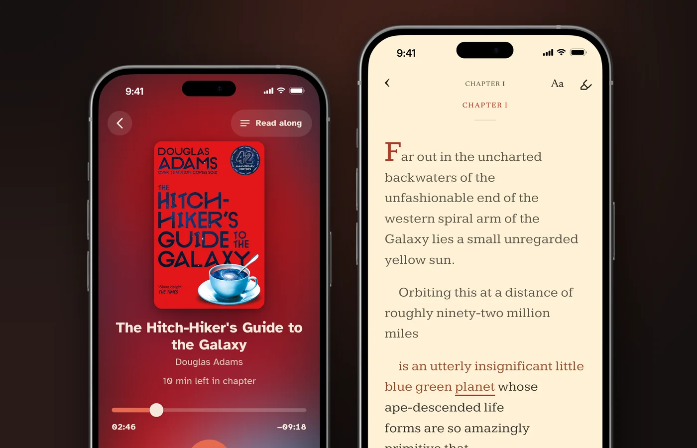

# Why Can't I Focus on Reading Anymore? Causes and What Helps

You usually can't focus on reading because you are tired or stressed, notifications keep interrupting, or the book is too hard for now. Some drifting is normal: in a 2013 study of 211 students, Varao Sousa, Carriere and Smilek found readers' minds were off the page at 35.6% of random check-ins during silent reading. The fixes are ordinary too: shorter sittings, an easier or more interesting book, notifications off, and on hard days, reading along with the audiobook so a narrator sets the pace. If the trouble started suddenly, comes with low mood, or print blurs up close, see a doctor or an optometrist.

This guide covers the usual causes, what the research on phones actually found, when to get checked, reading slumps, nine things to try, and what the evidence does not show.

## Why can't my brain focus on reading?

Because reading runs on attention you supply yourself, and tiredness, stress, hard text and time all wear it down.

The 35.6% from the Varao Sousa study is a baseline, and several things push it up:

- **Harder text.** In a 2013 study of 80 undergraduates, Feng, D'Mello and Graesser found mind wandering at 42.3% of probes on difficult texts, against 36.2% on easy versions of the same passages.
- **Time on task.** A 2025 meta-analysis by Zanesco, Denkova and Jha pooled 68 research reports covering more than 10,000 people and found that mind wandering becomes more frequent the longer a task runs.
- **Short sleep.** In a 2003 lab study of 48 healthy adults, Van Dongen and colleagues found that sleeping 6 hours or less a night for 14 days caused deficits equal to up to 2 nights without sleep, and the participants were largely unaware of them.
- **Stress.** A 2016 meta-analysis by Shields, Sazma and Yonelinas (34 studies, 1,353 people) found that acute stress impaired working memory a little.

## Why can't I focus when I read but I can watch TV or scroll?

Because a show or a feed moves on its own, and a book only moves when you move it.

Jonathan Smallwood's 2011 review of mind wandering while reading names the catch: when the mind wanders, "the eyes often continue to scan the words without due attention to their meaning." Nothing in a book pulls you forward, so a lapse can run for a page.

Being carried along is not the same as paying attention, though: in the Varao Sousa study, listening produced more mind wandering than silent reading (50.6% against 35.6%). No study we found compares TV with reading directly.

Heavy scrolling does travel with weaker attention. A 2025 meta-analysis by Nguyen and colleagues (71 studies, 98,299 participants) found heavier short-form video use associated with poorer attention (r = -0.38). It is a correlation, so the direction is unknown.

## Is my phone ruining my attention span?

Not in the way the headlines say, but notifications do pull you off the page.

- **The goldfish figure is a myth.** The claim that people now lose focus after eight seconds has no traceable source. A 2017 BBC investigation by Simon Maybin found that the figure in a Microsoft Canada report was credited to a website whose listed sources had no record of the research.
- **The 47 seconds is about office screens.** In a 2016 study that logged the computers of 40 office workers for about 12 working days, Mark, Iqbal, Czerwinski, Johns and Sano found they stayed on one screen for 47 seconds on average before switching (median 40 seconds). That is window switching at work, not how long you can concentrate on a book.
- **A phone on the table may not matter much.** The 2017 "brain drain" study by Ward and colleagues, with nearly 800 smartphone users, found people did better with their phone in another room. A direct replication by Ruiz Pardo and Minda in 2022 reported that the effect "did not replicate", and a 2024 meta-analysis by Hartanto and colleagues (33 studies, 4,368 participants) found no significant effect of a phone's mere presence (d = -0.02).
- **Notifications are the clearer cost.** In a 2015 lab study, Stothart, Mitchum and Yehnert found that notifications alone disrupted performance on an attention task, even when people never touched the phone.

Reading for pleasure has fallen, though. In a 2025 analysis of the American Time Use Survey (236,270 people), Bone, Bu, Sonke and Fancourt found the share of Americans reading for pleasure on a given day fell from 28% in 2004 to 16% in 2023. The survey counts listening to audiobooks as reading. Whether digital distraction caused the fall was, in the authors' words, "beyond the scope of our study".

## Is it ADHD, anxiety, depression or my eyes?

Sometimes, and the clues are when it started, how long it has lasted and what comes with it.

- **ADHD.** The National Institute of Mental Health (NIMH) lists trouble concentrating while "reading papers" among the signs of inattention, but says ADHD symptoms "must begin in childhood (before age 12)", and adults need at least five symptoms for at least 6 months in two or more settings. Focus trouble that began recently is not, by itself, a sign of ADHD. More in [are audiobooks good for ADHD](/blog/are-audiobooks-good-for-adhd).
- **Depression.** NIMH lists "difficulty concentrating, remembering, or making decisions", with symptoms most of the day, nearly every day, for at least 2 weeks.
- **Anxiety.** NIMH says people with generalized anxiety disorder may "have a hard time concentrating", with hard-to-control worry on most days for at least 6 months.
- **Eyes after 40.** The American Academy of Ophthalmology says you may notice presbyopia "shortly after age 40", and will probably start holding reading material farther away to see it clearly.
- **Eye teaming.** The National Eye Institute lists trouble concentrating among the most common symptoms of convergence insufficiency: "You might lose your place, read slowly, or feel like the words move or float around on the page."
- **After an illness.** The NHS lists "problems with your memory and concentration, also called brain fog" among the most common symptoms of long COVID.

**See a doctor or optometrist if:**

- the trouble started suddenly, or after an illness
- it comes with low mood, constant worry or poor sleep on most days for 2 weeks or more
- print blurs up close, or words seem to move or float
- it affects work, study or daily life, not only books

This guide is a reading aid, not medical advice.

## Why do I read the same page over and over?

Because your eyes can keep moving along the lines after your mind has left, so you reach the bottom of the page with nothing taken in.

Researchers call it mindless reading. In a small 2010 eye-tracking study, Reichle, Reineberg and Schooler had four undergraduates read Jane Austen's *Sense and Sensibility* over a dozen or more one-hour sessions each. When their minds wandered, their eyes kept going, but the pauses grew longer and were "less affected by lexical and linguistic variables". The eyes had stopped responding to the words.

A 2023 meta-analysis by Bonifacci and colleagues (25 studies) found a modest correlation of r = -0.21 between mind wandering and reading comprehension. Going back is not a failure either: Rayner and colleagues' 2016 review notes that skilled readers move their eyes backwards 10% to 15% of the time, often to repair a sentence they did not take in.

What helps is something that keeps moving when you stop. If you have the audiobook, reading along gives your eyes a place to be: the narrator keeps moving, and in HushBook the spoken word is underlined, so when you drift you can long-press the line you missed and it plays from there.

## Why can't I finish books anymore?

Often because the book is wrong for now or longer than it looks, and quitting is more common than people admit.

In reading tests by the analytics firm Jellybooks, a completion rate of 25% to 50% is "a good result and is achieved by the majority of books", and fewer than 5% of the books it tested go over 75%. Those are test readers of free ebooks. In a 2013 Goodreads survey of its members (sample size not published), "slow, boring" was the top reason for putting a book down, given by 46.4%, while 38.1% said they always finish.

Length is easy to underestimate. Brysbaert's 2019 meta-analysis (190 studies, 18,573 participants) puts adult silent reading at 238 words a minute for non-fiction and 260 for fiction. Our count of ten LibriVox classics put narrators at a median of 151, and the recording times below are the real ones.

| Pace | Words a minute | *The Great Gatsby* (48,032 words) | *Pride and Prejudice* (121,676 words) |
|---|---|---|---|
| Silent reading, fiction (Brysbaert 2019) | 260 | about 3 h 5 min | about 7 h 48 min |
| Silent reading, non-fiction (Brysbaert 2019) | 238 | about 3 h 22 min | about 8 h 31 min |
| LibriVox recording at 1x (the actual narrators) | 142 and 151 | 5 h 38 min | 13 h 25 min |

At 20 minutes a sitting, *The Great Gatsby* is about nine sittings of silent reading and *Pride and Prejudice* about 23 (counts in [how long is an audiobook](/blog/how-long-is-an-audiobook)).

Short books are plentiful. Of the 18,824 English LibriVox recordings on archive.org that list a running time, counted on November 7, 2026, 7,038 (37.4%) run under three hours and 2,524 (13.4%) under one hour. The median is 4.56 hours. The count includes poetry and short-story collections, so not every short recording is a short novel.

## How do I get out of a reading slump?

Make reading easy and pleasant again: a short book you want to read, at a set time, with permission to stop.

There is no research on reading slumps as such. Our searches of Crossref and Europe PMC found no study of adult slumps and no trial of any cure. Yet on November 7, 2026, Google's autocomplete offered 65 phrasings of "can't focus on reading" and 212 suggestions built on "reading slump", from "reading slump for years" to "reading slump nedir" in Turkish.

What research does support:

- **Want to read the book.** Schiefele, Schaffner, Möller and Wigfield's 2012 review found that reading for its own sake goes with reading more for enjoyment, though which causes which is unresolved. Reread a favourite, switch genre, or pick a short, fast book. Our guide to [reading classics without getting bored](/blog/how-to-read-classics-without-getting-bored) lists some under three hours.
- **Tie reading to a cue.** In a 2010 habit study, Lally and colleagues had 96 volunteers repeat a daily behaviour in the same context, such as "after breakfast". Reaching near-peak automaticity took from 18 to 254 days, and missing one day "did not materially affect" the process. The behaviours were eating, drinking or activity, not reading.
- **Count every format.** If an audiobook gets you through a book this month, it counts. See [does listening to audiobooks count as reading](/blog/does-listening-to-audiobooks-count-as-reading).

## What to do when you can't focus on reading: 9 things that help

None of these is a cure, and several rest on indirect evidence. The best supported are the simplest: shorter sittings, an easier book and no notifications.

### 1. Read in shorter sittings

Mind wandering climbs the longer a task runs, according to the Zanesco 2025 meta-analysis of 68 reports. No study has tested the ideal reading session, so pick a length you can finish, such as 20 minutes, and stop while it still feels good.

### 2. Choose an easier or shorter book for now

In Feng's 2013 study of 80 students, hard text drew minds away at 42.3% of probes against 36.2% for easy versions. A short novel, a story collection or a reread is a better way back in.

### 3. Turn notifications off

Notifications disrupted attention in Stothart's 2015 study even when people never picked up the phone. Silence them. Moving a silent phone to another room has contested evidence but costs nothing.

### 4. Read a hard page aloud

Reading aloud produced the least mind wandering in Varao Sousa's 2013 study, but in 2014 Franklin and colleagues found people reported more mind wandering while reading aloud. The clearer benefit is memory: in a 2012 study, Ozubko, Hourihan and MacLeod found that information read aloud was remembered better than information read silently, a week later too. Use it for a key passage.

### 5. Use paper for long or hard non-fiction

A 2018 meta-analysis by Delgado and colleagues (54 studies, 171,055 participants) found comprehension was a little better on paper than on screens (g = -0.21 for screens). The gap grew under time pressure and showed for informational texts, not in studies that used only narrative text. A novel on an e-reader is fine.

### 6. Read along with the audiobook

Follow the words while the narrator reads. A 2023 meta-analysis by Clinton-Lisell (30 studies, 1,945 participants) found only a trivial comprehension benefit over reading alone overall (g = 0.18), and a larger one when the pace was set by the material rather than the reader (g = 0.41, against 0.06 when readers set their own pace). Healthline's 2026 guide to ADHD and reading lists "reading a physical copy along with an audiobook" among its tips.

### 7. Run a finger or a card under the line

Some readers find a pacer stops their eyes sliding. We found no controlled study of it, and Rayner's 2016 review says readers are unlikely to double or triple their speed while understanding as much.

### 8. Ask one question before each chapter

Write a question the chapter might answer, and answer it at the end. In a 2020 study with a 26-minute online lecture, Pan, Schmitt, Bjork and Sana found that pretests reduced mind wandering. A 2022 study of 195 undergraduates by Welhaf and colleagues found only a small effect from quizzes during a lecture, and none from pretests. Untested with books.

### 9. Read at the same time each day, when you are rested

Tie reading to something you already do, such as after dinner; in Lally's 2010 study, missing a day did not undo a habit. And give reading your fresher hours.

## Does reading along with an audiobook help you focus?

Possibly, but no study has measured mind wandering while reading along.

Listening alone produced the most mind wandering in Varao Sousa's 2013 study, at 50.6% of check-ins, so audio on its own is not the fix. Reading along adds the text, and the Clinton-Lisell meta-analysis found it helped most when the pace was set by the material, as a narrator does.

Pace is also the catch. At a median 151 words a minute, a narrator is slower than the 238 to 260 of typical silent reading, which helps on a tired day and drags on a good one. Speed the narration up until it matches you. The research is in [does reading along with an audiobook help](/blog/does-reading-along-with-an-audiobook-help), and if you mostly listen without the text, see [how to focus on audiobooks](/blog/how-to-focus-on-audiobooks).

One caution for ADHD. A 2025 study of 76 university students by Moussaoui and colleagues found that showing one word at a time in the center of the screen improved comprehension for students with ADHD, while showing one word at a time in its usual place on the page, with the rest of the text hidden, did not. That study used no audio, so it does not test reading along with an audiobook, but it is a reminder that what helps varies from person to person.

## What the evidence does not show

- No study has measured mind wandering while reading along with an audiobook.
- No study has tested a cure for reading slumps, an ideal session length, or a finger or pacer for focus.
- A phone's mere presence is contested: the "brain drain" result failed a direct replication, and a 2024 meta-analysis of 33 studies found no effect (d = -0.02). Notifications are better supported.
- The fall in reading for pleasure has not been shown to be caused by phones.
- Reading aloud helps memory more reliably than it helps focus.
- Most mind-wandering studies are short lab sessions with students, not adults reading novels at home.

## How to read along with an audiobook in HushBook

We built [HushBook](/), so weigh this accordingly. HushBook is an audiobook player for iPhone and Android that shows the words as the narrator reads them. The features below were checked in the app on November 7, 2026.

1. **Add a book.** Import an audiobook file you own without copy protection, such as MP3, M4A or M4B, or download a free classic from Discover, which searches LibriVox and the Internet Archive.
2. **Let it transcribe.** HushBook transcribes the recording on your phone, chapter by chapter, and you can start reading along once the first chapter is ready. Nothing is uploaded.
3. **Read along.** The text sits on the page like a paperback, the spoken word is underlined in red, and the page turns as the narrator reads. A sentence highlight and scrolling are optional.
4. **Catch up when you drift.** Long-press a line to play from there, or tap rewind to jump back 30 seconds. Set the speed anywhere from 0.5x to 3x.

The default reading profile, Focused Reader, uses the Newsreader font and a smoother change from line to line. After a session of 2.5 minutes or more, HushBook asks "How deeply were you in it?", with answers from Distracted to Flow state. It is free and has a "Skip for now" button. Pro adds the Reading engagement score, comprehension check-ins and Transcribe on my PC.

Honest limits. HushBook needs the audiobook: a DRM-free file or a classic from Discover. It cannot import Audible, Libby or Spotify books, and it cannot help with a print book you have no recording of. Reading along runs at the narrator's pace. Transcribing a long book takes a while, and speech recognition can garble unusual names. The Reading engagement score says plainly that it "is not a medical or health measure". HushBook is a reading aid, not a treatment for ADHD, anxiety, depression or eye problems.

## Sources

- [Varao Sousa, Carriere and Smilek (2013), "The way we encounter reading material influences how frequently we mind wander", Frontiers in Psychology](https://doi.org/10.3389/fpsyg.2013.00892)
- [Feng, D'Mello and Graesser (2013), "Mind wandering while reading easy and difficult texts", Psychonomic Bulletin & Review](https://doi.org/10.3758/s13423-012-0367-y)
- [Zanesco, Denkova and Jha (2025), "Mind-wandering increases in frequency over time during task performance: An individual-participant meta-analytic review", Psychological Bulletin](https://doi.org/10.1037/bul0000424)
- [Van Dongen, Maislin, Mullington and Dinges (2003), "The Cumulative Cost of Additional Wakefulness: Dose-Response Effects on Neurobehavioral Functions and Sleep Physiology From Chronic Sleep Restriction and Total Sleep Deprivation", Sleep](https://doi.org/10.1093/sleep/26.2.117)
- [Shields, Sazma and Yonelinas (2016), "The effects of acute stress on core executive functions: A meta-analysis and comparison with cortisol", Neuroscience & Biobehavioral Reviews](https://doi.org/10.1016/j.neubiorev.2016.06.038)
- [Smallwood (2011), "Mind-wandering While Reading: Attentional Decoupling, Mindless Reading and the Cascade Model of Inattention", Language and Linguistics Compass](https://doi.org/10.1111/j.1749-818X.2010.00263.x)
- [Nguyen et al. (2025), "Feeds, feelings, and focus: A systematic review and meta-analysis examining the cognitive and mental health correlates of short-form video use", Psychological Bulletin](https://doi.org/10.1037/bul0000498)
- [Maybin (2017), "Busting the attention span myth", BBC News](https://www.bbc.com/news/health-38896790)
- [Mark, Iqbal, Czerwinski, Johns and Sano (2016), "Neurotics Can't Focus: An in situ Study of Online Multitasking in the Workplace", Proceedings of the 2016 CHI Conference on Human Factors in Computing Systems](https://doi.org/10.1145/2858036.2858202)
- [Ward, Duke, Gneezy and Bos (2017), "Brain Drain: The Mere Presence of One's Own Smartphone Reduces Available Cognitive Capacity", Journal of the Association for Consumer Research](https://doi.org/10.1086/691462)
- [Ruiz Pardo and Minda (2022), "Reexamining the "brain drain" effect: A replication of Ward et al. (2017)", Acta Psychologica](https://doi.org/10.1016/j.actpsy.2022.103717)
- [Hartanto et al. (2024), "The effect of mere presence of smartphone on cognitive functions: A four-level meta-analysis", Technology, Mind, and Behavior](https://doi.org/10.1037/tmb0000123)
- [Stothart, Mitchum and Yehnert (2015), "The attentional cost of receiving a cell phone notification", Journal of Experimental Psychology: Human Perception and Performance](https://doi.org/10.1037/xhp0000100)
- [Bone, Bu, Sonke and Fancourt (2025), "The decline in reading for pleasure over 20 years of the American Time Use Survey", iScience](https://doi.org/10.1016/j.isci.2025.113288)
- [National Institute of Mental Health (2024), "Attention-Deficit/Hyperactivity Disorder: What You Need to Know"](https://www.nimh.nih.gov/health/publications/attention-deficit-hyperactivity-disorder-what-you-need-to-know)
- [National Institute of Mental Health (2024), "Depression"](https://www.nimh.nih.gov/health/publications/depression)
- [National Institute of Mental Health (2025), "Generalized Anxiety Disorder: What You Need to Know"](https://www.nimh.nih.gov/health/publications/generalized-anxiety-disorder-gad)
- [American Academy of Ophthalmology, "What Is Presbyopia?"](https://www.aao.org/eye-health/diseases/what-is-presbyopia)
- [National Eye Institute, "Convergence Insufficiency"](https://www.nei.nih.gov/eye-health-information/eye-conditions-and-diseases/convergence-insufficiency)
- [NHS, "Long COVID"](https://www.nhs.uk/conditions/long-covid/)
- [Reichle, Reineberg and Schooler (2010), "Eye Movements During Mindless Reading", Psychological Science](https://doi.org/10.1177/0956797610378686)
- [Association for Psychological Science (2010), "Eye Movements Reveal Readers' Wandering Minds"](https://www.psychologicalscience.org/news/releases/eye-movements-reveal-readers-wandering-minds.html)
- [Bonifacci, Viroli, Vassura, Colombini and Desideri (2023), "The relationship between mind wandering and reading comprehension: A meta-analysis", Psychonomic Bulletin & Review](https://doi.org/10.3758/s13423-022-02141-w)
- [Rayner, Schotter, Masson, Potter and Treiman (2016), "So Much to Read, So Little Time: How Do We Read, and Can Speed Reading Help?", Psychological Science in the Public Interest](https://doi.org/10.1177/1529100615623267)
- [Jellybooks, "Completion Rate"](https://www.jellybooks.com/about/jellybooks-radar/completion-rate)
- [Goodreads (2013), "What Makes You Put Down a Book?"](https://www.goodreads.com/blog/show/424-what-makes-you-put-down-a-book)
- [Brysbaert (2019), "How many words do we read per minute? A review and meta-analysis of reading rate", Journal of Memory and Language](https://doi.org/10.1016/j.jml.2019.104047)
- [Schiefele, Schaffner, Möller and Wigfield (2012), "Dimensions of Reading Motivation and Their Relation to Reading Behavior and Competence", Reading Research Quarterly](https://doi.org/10.1002/rrq.030)
- [Lally, van Jaarsveld, Potts and Wardle (2010), "How are habits formed: Modelling habit formation in the real world", European Journal of Social Psychology](https://doi.org/10.1002/ejsp.674)
- [Franklin, Mooneyham, Baird and Schooler (2014), "Thinking one thing, saying another: The behavioral correlates of mind-wandering while reading aloud", Psychonomic Bulletin & Review](https://doi.org/10.3758/s13423-013-0468-2)
- [Ozubko, Hourihan and MacLeod (2012), "Production benefits learning: The production effect endures and improves memory for text", Memory](https://doi.org/10.1080/09658211.2012.699070)
- [Delgado, Vargas, Ackerman and Salmerón (2018), "Don't throw away your printed books: A meta-analysis on the effects of reading media on reading comprehension", Educational Research Review](https://doi.org/10.1016/j.edurev.2018.09.003)
- [Clinton-Lisell (2023), "Does Reading While Listening to Text Improve Comprehension Compared to Reading Only? A Systematic Review and Meta-Analysis", Educational Research: Theory and Practice (ERIC EJ1403866)](https://eric.ed.gov/?id=EJ1403866)
- [Wilde (2026), "ADHD and Reading: Challenges and Helpful Tips", Healthline](https://www.healthline.com/health/adhd/adhd-and-reading-challenges-and-helpful-tips)
- [Pan, Schmitt, Bjork and Sana (2020), "Pretesting reduces mind wandering and enhances learning during online lectures", Journal of Applied Research in Memory and Cognition](https://doi.org/10.1016/j.jarmac.2020.07.004)
- [Welhaf, Phillips, Smeekens, Miyake and Kane (2022), "Interpolated testing and content pretesting as interventions to reduce task-unrelated thoughts during a video lecture", Cognitive Research: Principles and Implications](https://doi.org/10.1186/s41235-022-00372-y)
- [Moussaoui, Siddiqi, Cheung and Niemeier (2025), "Reading without eye movements: Improving reading comprehension in young adults with attention-deficit/hyperactivity disorder (ADHD)", Journal of the International Neuropsychological Society](https://doi.org/10.1017/s1355617725101628)
